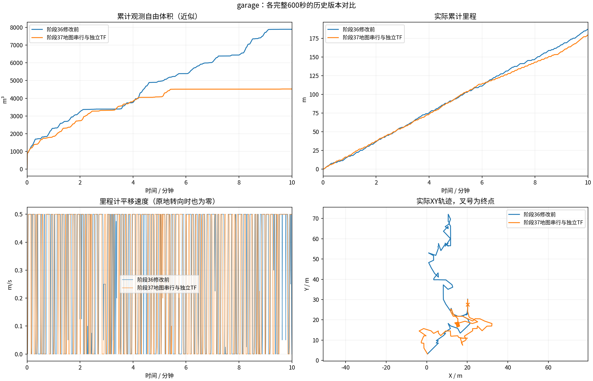
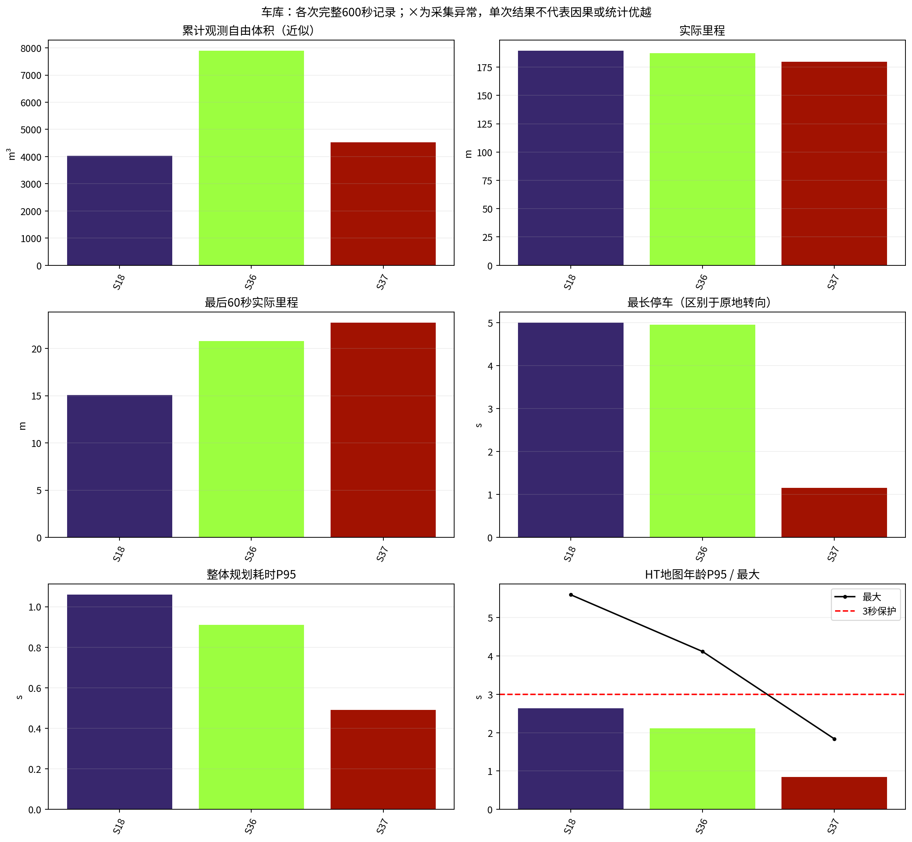
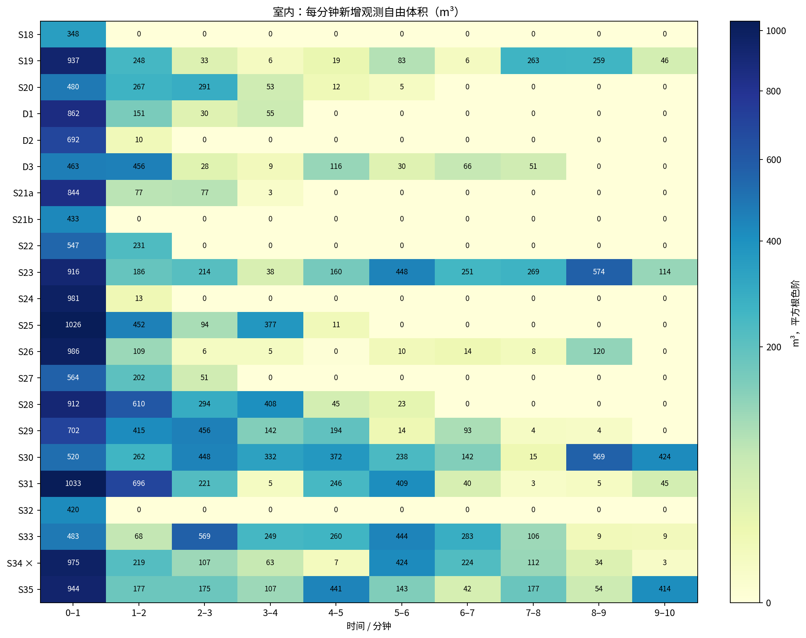
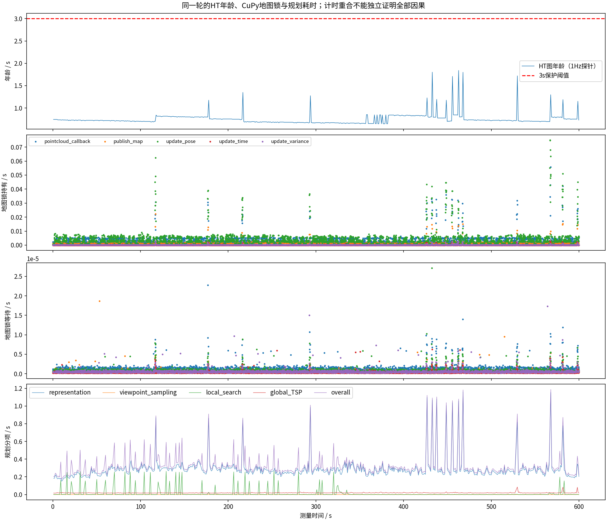
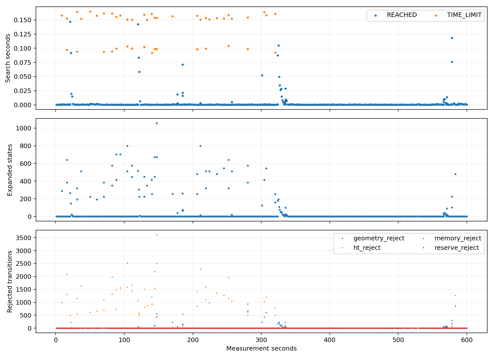
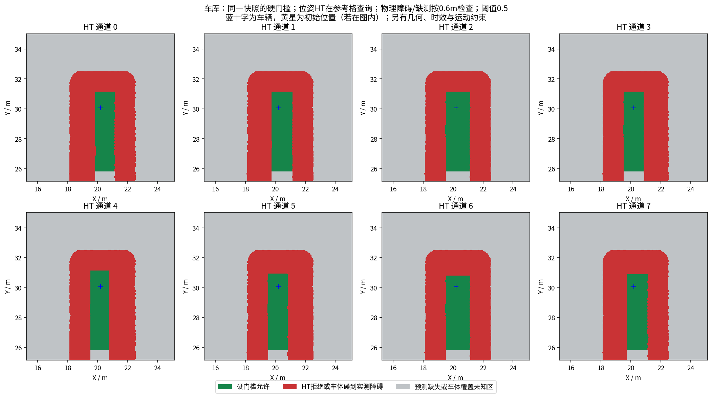
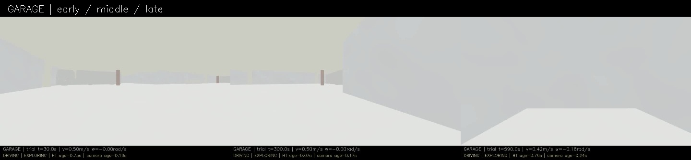
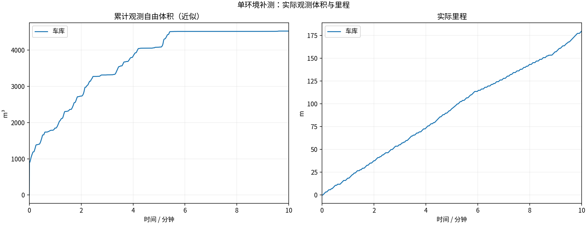
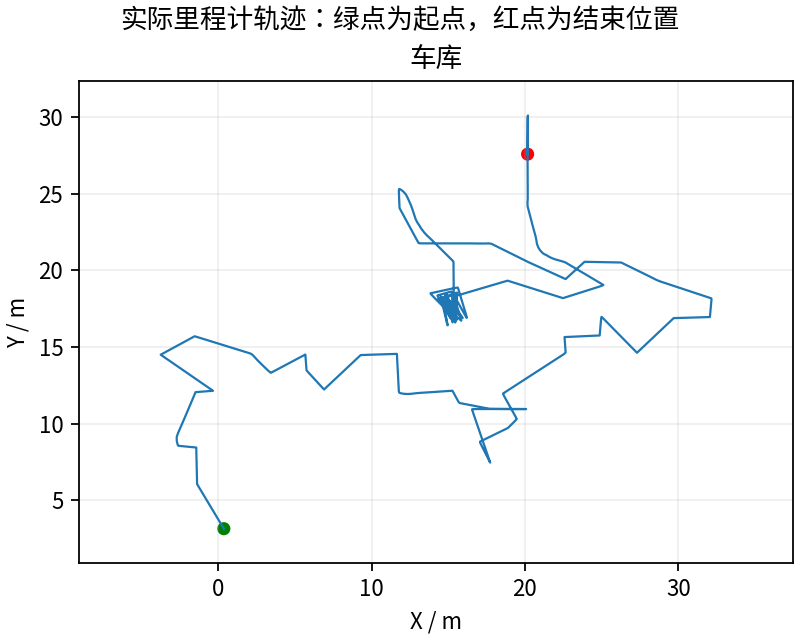
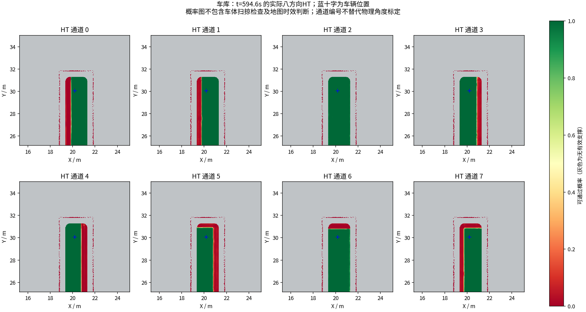

# 地图调度修复：车库完整600秒与历次多角度对比

**179.78米 / 4522.625立方米，末尾任务EXPLORING。** 最后一分钟22.735米，最长停车1.150秒。定时录满600秒不表示场景已经全探索完。

本轮确认改善的是建图调度与时效，**没有显示整体探索效率提升**：体积下降42.8%、里程下降约4.0%，原地转向21.7%→27.0%；末分钟虽然走了22.735m，只新增8.375m³（上轮174.625m³）。1m轨迹格重复进入占比约15.0%→29.2%，支持存在更多回访，但该网格指标受边界抖动影响，不能单独确定目标策略为何改变。

[24页合并PDF图册](history/all_comparisons.pdf) · [可切换场景的网页图册](history/index.html) · [历次逐版指标CSV](history/measurements.csv)

## 为什么改、改了什么

阶段36有地图时效长尾。先排除不成立的解释：串行固定输入的GPU运算本身毫秒级，改分配器未见提速；无真实TF的简单多线程负载也未复现秒级等待。加入原MCAP的实际TF输入后，四线程P95 1.106s/最大1.905s，28s用24.56s进程CPU；地图单线程、TF独立接收布局P95 .0021s，CPU2.68s，受控复现支持修复调度竞争。[原因、反例与回归](../../fixes/2026-10-19_serial_mapping_executor.md)。

实际修改独立CuPy工作区的地图节点源码及安装入口，二者同版；地图回调串行，TF由独立子节点/单线程接收。实际ROS回归证明：地图回调等待尚未发布的新TF时仍能接收并返回，关闭幂等、无线程残留。保持融合公式、模型、可靠队列深度30、源时间戳/观测年龄和全部定时频率。HT工作区与CuPy工作区仍独立。[完整补丁](cupy_patch/)。

实测提交`d6d8787`，导航仍391fa0f、HT桥接445b5c1；65项冻结条目只有CuPy节点与安装入口两项变化，其余63项一致。全部实际导航/跟踪参数一致。[逐项对照](configuration_comparison.json)。相同车库/起点/0.5m/s上限、HT硬门槛0.5与3秒时效保护；回调时序仍可能改变路线，不宣称逐帧等价或全部提升归于单一低层机制。

## 本轮与修改前

| 指标 | 阶段36修改前 | 阶段37修改后 |
|---|---:|---:|
| 近似自由体积m³ | 7900.375 | 4522.625 |
| 行驶距离m | 187.25 | 179.78 |
| 最后60秒行驶m | 20.805 | 22.735 |
| HT地图年龄P95s（1Hz采样） | 2.115 | 0.842 |
| HT地图年龄最大s（1Hz采样） | 4.117 | 1.840 |
| 最长停车s | 4.950 | 1.150 |
| 原地转向比例 | 21.7% | 27.0% |
| 倒车指令比例 | 0.9% | 0.0% |
| HT_MAP_STALE控制状态条数 | 20 | 0 |
| PATH_STALE控制状态条数 | 26 | 0 |

体积基于600个源秒激光的0.5m自由体素并集，跳过0；不是真值覆盖率。每版本一次闭环试验，同时看效率与停顿，不能据单项指标宣称普遍优越。停车按|v|<.01且|ω|<.05统计，原地转向另计。

## 每次更改，从多个角度看

[历次图册：逐版总览、累计曲线、每分钟新增观测、运动构成、延迟分布、统一尺度轨迹与任务状态](history/REPORT.md)。室内与车库分开作图，失败轮和阶段34的退出诊断异常不删。原来的相对测量秒口径从旧MCAP统一源秒重算，原历史报告不回写；无本协议600秒曲线的早期阶段只列证据，不补造曲线。[全部版本数据覆盖表](history/version_data_coverage.csv)。

## 录制和剩余问题

13/13项采集、冻结、退出核验通过；视频9000帧/600.000000s完整解码，允许一帧误差。61份最终上下文和历史图ZIP CRC通过，坏文件0、遗留partial0。59份窗口内上下文同源核对、三份冻结模型重算通过；仅验证周期保存的样本。

搜索终止{'REACHED': 885, 'TIME_LIMIT': 47}，仍须关注搜索预算、全局待办/回访、转向与真正物理不可达。晚拒绝后非零指令0、未配对拦截0；记录几何样本不是连续时刻物理安全证明。独立覆盖真值、完整轮胎/滑移动力学、其他当前版场景和实车未验收，不能说系统所有问题都已解决。

## 输入接收计数的补充核查

修复后建图更快，旧审计只拿每5秒的mapper统计快照与1Hz观察器找“相同最新源帧”，本轮恰好0个匹配点；其False表示没有对齐证据，不能解释成掉包。本轮补充用完整CuPy计时日志中每一条scan回调序号按源时间戳对齐观察器。

本轮3086个回调与最终接收3086/处理3086一致，600个测量窗口检查点均精确匹配，观察器与mapper累计计数差恒为134；阶段36相同新方法也匹配600点，差恒139。偏置由各自启动时序决定，不可跨轮比较大小。这支持窗口内未见新增净相对漏收，仍不能证明源端持续或排除两个订阅者同时漏收。没有缩小队列、静默丢弃旧帧或重打时间戳。[本轮逐帧匹配](garage/scan_delivery_trace.json) · [修改前同法匹配](garage/reference_stage36_scan_delivery_trace.json)。旧stats法原JSON保留，不改写成通过。

## 数据、视频与停止

[完整视频](garage/camera_h264.mp4) · [全部已录制数据与SHA256](https://github.com/CQULzz/HT_Explo/releases/tag/ht-stage-20261019-serial-mapper)。记录为发布HT/控制/位姿/状态、源秒激光和周期地图/上下文，不是所有原始传感器无损采集。GitHub完整保留，本机最近两轮，先验证远端再清理旧录包；报告/图表/视频和回归样本保留。

按用户本次要求：修复、完整验证和出图完成后停止本次自动迭代，不再继续启动其他环境或新候选。本轮仿真计时结束即由记录器正常关闭，上传与图表完成后不留后台实验。

---

# HT 车库10分钟补测

每组测量 600 秒，从首个具备里程计和激光输入的TARE运行周期开始计时；初始化不计入。
每个场景独立启动、独立高程历史，上一组完全退出且视频处理结束后再启动下一组。车速上限均为0.5m/s，HT硬约束与3秒时效保护相同。
采用对应场景TARE参数；车库沿用历史配对起点，其余使用各自仿真原生起点。因此这不是相同场景的算法优劣对照。
相机原生960×540、15fps，视频含状态条并裁去初始化；重复帧代表真实图像更新间隔，不做插帧。

| 环境 | 状态 | 实际里程(m) | 近似观测体积(m³) | 末尾任务状态 | 视频 |
|---|---|---:|---:|---|---|
| 车库 | RECORDED | 179.78 | 4522.62 | EXPLORING | [播放/下载](garage/camera_h264.mp4) |

[全部视频播放列表](videos.m3u) · [实时状态与校验](suite.json)

每个场景仅一次10分钟测试，不能据此证明更长时间、所有环境或实车稳定。定时记录完成不等于探索完成。观测体积是抽样激光射线的自由体素并集近似，不是真值覆盖率；跨场景体积不可直接作为算法优劣排名。

## 实际出现的问题

下表保留暂停和地图延迟，不把“节点未崩溃”当作“没有问题”。地图年龄为1Hz抽样，完整控制消息保留在本地MCAP中。全零指令表示既不平移也不转向；原地转向单独统计。

| 环境 | HT年龄P95/最大(s) | 年龄>3s样本 | 全零指令占比 | 最长全零指令(s) | 全局引导无进展释放 | 验证失败项 |
|---|---:|---:|---:|---:|---:|---|
| 车库 | 0.84 / 1.84 | 0 | 3.2% | 1.15 | 2 | 无 |

遇到旧HT地图时仍执行3秒时效保护；没有为让车持续前进而放宽硬约束。全局引导释放说明该段目标没有持续接近，不能解释为该目标已经到达或覆盖完成。

| 环境 | 实收激光/600s | 平均频率(Hz) | 最大接收间隔(s) | 同源对齐检查点 | 观察器与建图器计数差恒定 |
|---|---:|---:|---:|---:|---|
| 车库 | 2996 | 4.99 | 0.26 | 0 | False |

计数差恒定只支持这些对齐区间内没有新增相对漏收；不能证明源端始终连续发布，也不能排除两个订阅者同时漏收。各场景均保留完整扫描计数和原始时间戳检查点。

### 车库末段实际HT

[同期接收的相机画面](garage/late_camera.jpg) · [原始图层快照](garage/late_map_snapshot.npz) · [时间与坐标元数据](garage/late_map_snapshot.json)

全部视频按15fps、600秒裁剪，时长校验允许1帧误差，完整解码通过；实际帧数和时长见各组video_validation.json。各组共有源文件的65项哈希一致，各组自身冻结文件核验见suite_validation.json。

相机年龄是图像接收后的年龄；相机仿真时间戳与导航墙钟不同，不能把该数值解释为传感器端到端延迟。本导出目录只含精选数据与视频；原始MCAP、全高程历史和输入诊断见suite.json所列目录，GitHub完整备份状态以本轮Release及发布校验回执为准。
