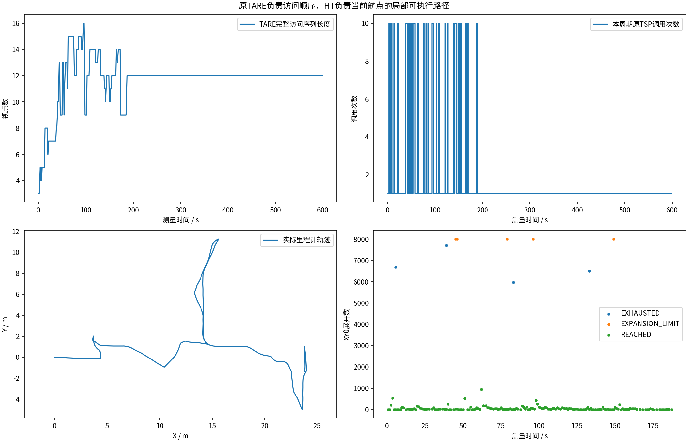
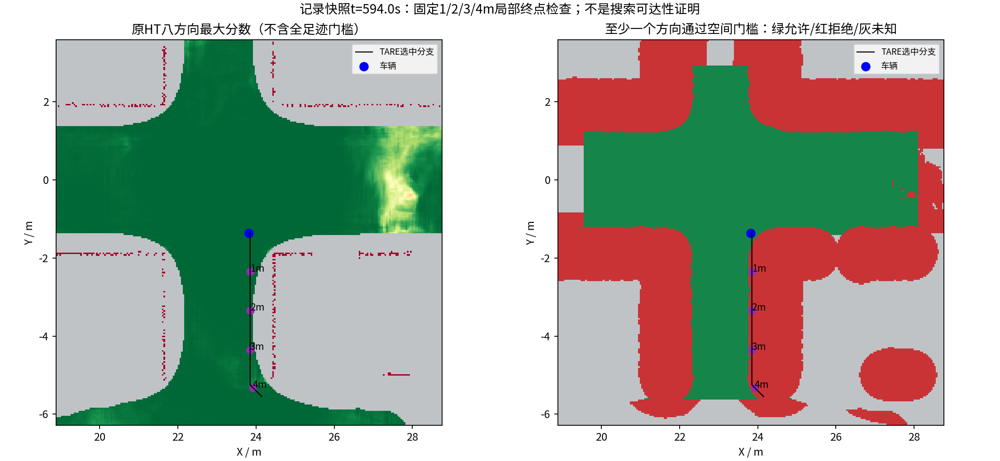
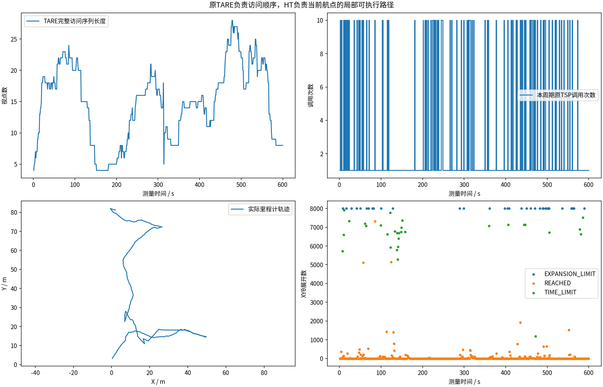
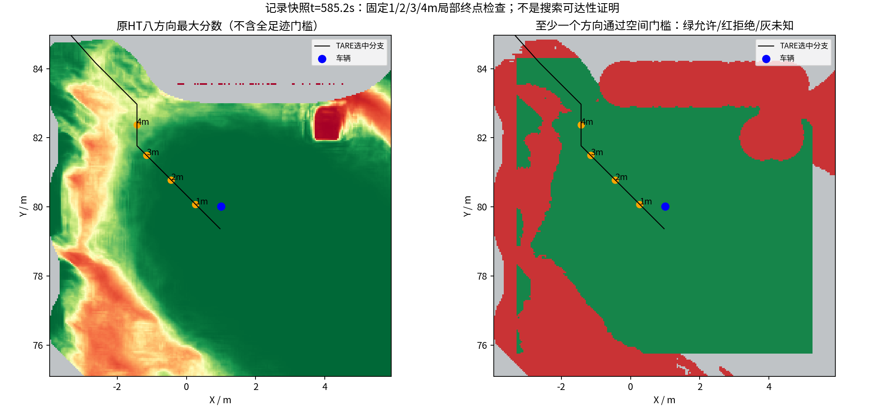
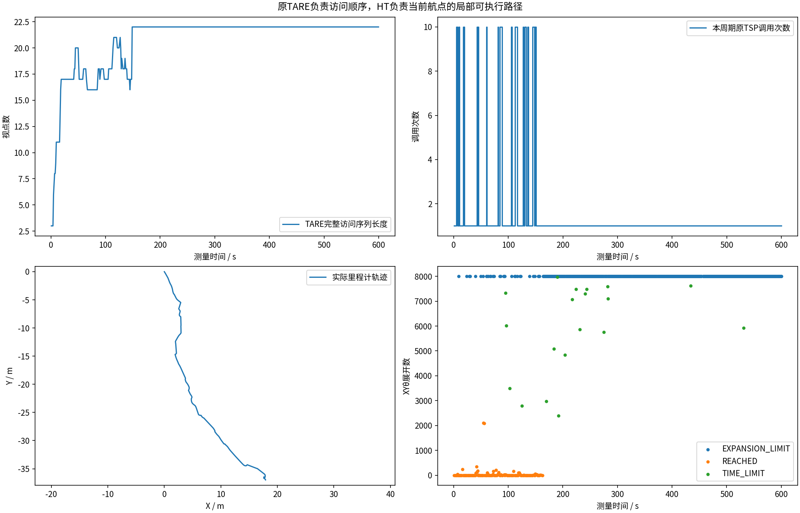
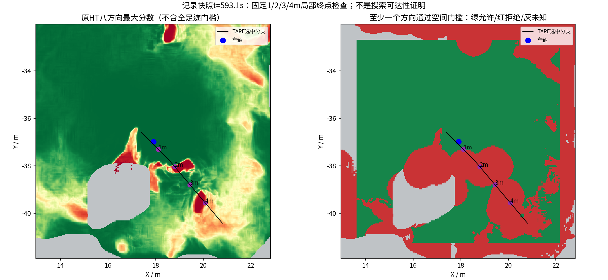
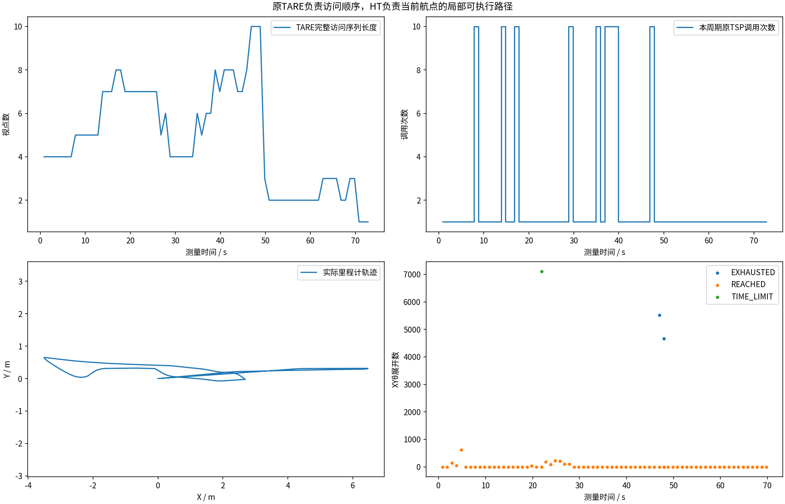
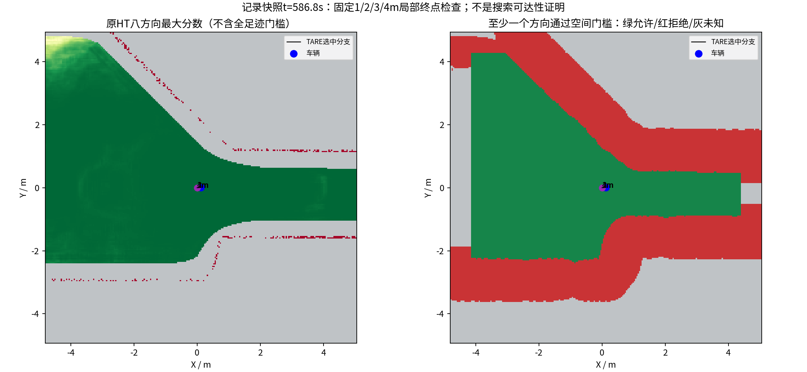

# 原TARE＋HT多场景：计划与实际采集结果

冻结运行提交：`454efa230fae337cfa8f87b2aa87ee9917040621`。每场景计划600秒；实际完成情况逐组列出。
原批次状态：`COMPLETED`；原批次终态记录存在：`True`；派生发布状态：`COMPLETED`。
原suite.json原样保存；中断和未启动场景不补拼、不冒充600秒。进度字段仅为最后一次状态抽样，不是最终实测时长。

| 场景 | 原状态 | 实测时长(s) | 最后进度(s) | 完整采集检查 | 视频 |
|---|---|---:|---:|---|---|
| indoor | RECORDED | 600.0 | 598.0 | True | [已验证视频](indoor/camera_h264.mp4) |
| garage | RECORDED | 600.0 | 600 | True | [已验证视频](garage/camera_h264.mp4) |
| forest | RECORDED | 600.0 | 599.5 | True | [已验证视频](forest/camera_h264.mp4) |
| tunnel | RECORDED | 600.0 | 599.6 | True | [已验证视频](tunnel/camera_h264.mp4) |

## 原TARE与HT分工核验

本批原TARE决定访问顺序，HT负责指定航点XYθ路线；附加审计的未执行或空样本不计作通过。

| 场景 | 原覆盖周期 | 最大访问视点数 | HT非空路线 | 航点/同分支违例 | 分工检查 | 附加审计 |
|---|---:|---:|---:|---:|---|---|
| indoor | 538 | 16 | 174 | 0 | True | 已执行，退出码见additional_audits.json |
| garage | 588 | 28 | 588 | 0 | True | 已执行，退出码见additional_audits.json |
| forest | 507 | 22 | 138 | 0 | True | 已执行，退出码见additional_audits.json |
| tunnel | 73 | 10 | 70 | 0 | True | 已执行，退出码见additional_audits.json |

[PDF图表](multiscene_diagnostics.pdf)。缺失值留空并标“未采到”，不填成零。

[同场景车库历史比较](garage_history/tare_architecture_comparison.png)；只包含实际具有完整指标的记录。

累计观测体积是0.5米体素的采样激光射线自由空间并集，不是真值覆盖率。不同场景/起点不可作算法排名；没有新增同限制原版TARE配对或实车验证。前缀终点允许不等于完整XYθ路径可达。
精选目录仅包含可用报告及已验证视频；失败视频、MCAP、快照等全部已录文件由完整原始Release分卷保存，远端发布是否完成以发布校验回执为准。采集完成不等于探索成功。
