# 阶段44：稀疏高程修正，四场景各600秒

实测冻结提交 `454efa230fae337cfa8f87b2aa87ee9917040621`；导航C++沿用 `d7e0741c1aeeb65f4c0ff404521a4c54f992a330`。修改和回归见[修正说明](../../fixes/2026-10-21_sparse_height.md)。保留原TARE六函数/TSP、HT权重/归一化/0.5硬门槛及运动上限。

## 实际结果

| 场景 | 采集 | 秒 | 里程m | 近似观测体积m³ | 末60s里程m | 最长完全停车s | 规划P95s | 地图年龄P95s | 末任务状态 |
|---|---|---:|---:|---:|---:|---:|---:|---:|---|
| indoor | RECORDED | 600.0 | 62.88 | 1849.250 | 0.00 | 412.529 | 1.536 | 1.269 | BLOCKED |
| garage | RECORDED | 600.0 | 224.11 | 9809.375 | 23.34 | 1.000 | 0.448 | 0.929 | EXPLORING |
| forest | RECORDED | 600.0 | 46.32 | 8377.875 | 0.00 | 436.049 | 1.080 | 1.287 | BLOCKED |
| tunnel | RECORDED | 600.0 | 25.62 | 448.875 | 0.00 | 529.376 | 0.102 | 0.713 | COMPLETED |

旧室内记录实际仅到569.501s，首个finished=1采样14.002s，里程8.563m；新候选在相同时刻里程62.883m。旧记录不补成600s；新旧单次轨迹并非单项因果隔离。

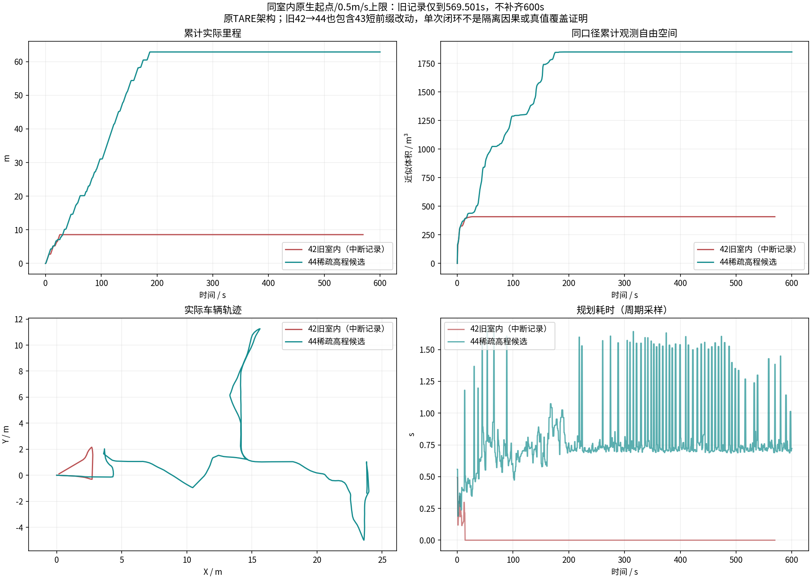

[同口径与中断边界](indoor_history/comparison_scope.json)。观测量是抽样激光自由空间体素并集，不是全局真实覆盖率。

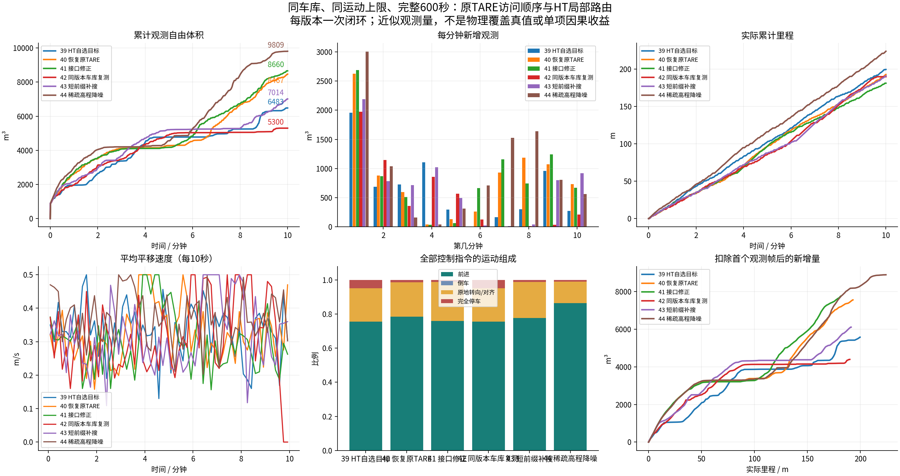

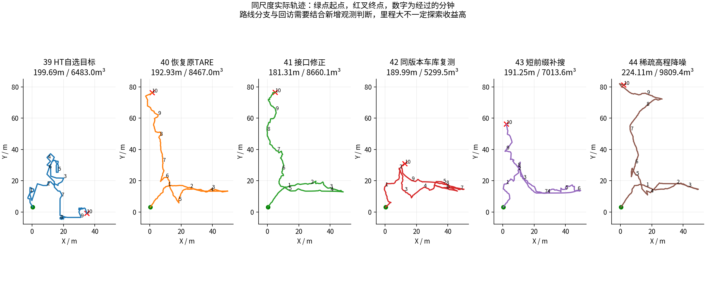

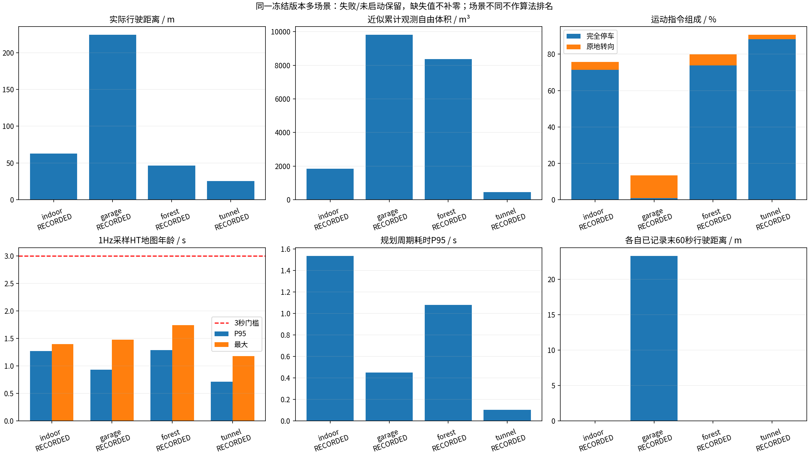

## 仍然存在的问题

- indoor末状态BLOCKED，不能称探索成功
- indoor记录中5次XYθ搜索达到展开上限，不能据此断言无路
- indoor最长完全停车412.53s，需结合任务/门禁解释
- forest末状态BLOCKED，不能称探索成功
- forest记录中754次XYθ搜索达到展开上限，不能据此断言无路
- forest最长完全停车436.05s，需结合任务/门禁解释
- tunnel最长完全停车529.38s，需结合任务/门禁解释
- tunnel在53.0s采样报告exploration_finished，是否真实全覆盖尚未验证；COMPLETED只表示任务返航条件满足

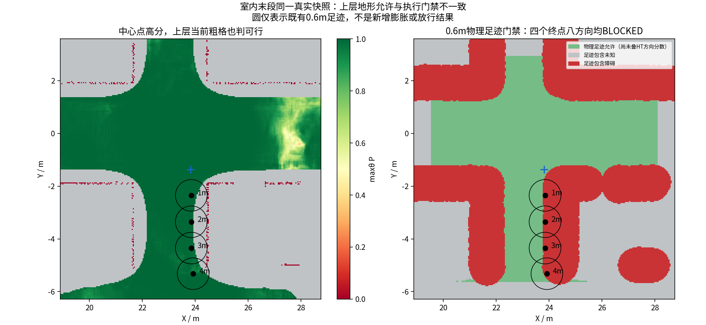

四个真实分支终点中心最大P约0.978～0.999，当前0.2m粗格均存在允许中心；完整车体门禁八方向均BLOCKED。见[frozen_coarse_footprint_counterexample.json](frozen_coarse_footprint_counterexample.json)。这是当前快照的接口反例，不冒称重建了全部历史缓存或证明有一条绕行路线。

在线日志表明室内末段同分支终点预筛拒绝、未进入XYθ搜索；森林则进入搜索并反复达到展开上限，两者不是同一种退出原因。准确门禁类别见prefix_admissibility_audit。室内代表测试位置的足迹碰到障碍格，见frozen_blocked_obstacle_samples.json；这些测试位置不是对全部179个真实端点的复现。不能用地图旧或CPU慢笼统解释。原TARE粗视点图与完整SE2可达性并不等价。新滤波不保证辨认所有低置信厘米孤立物；原训练噪声分布未知。

## 图、视频与逐项证据

### indoor

[完整10分钟视频](indoor/camera_h264.mp4) · [采集检查](indoor/suite_validation.json) · [路线分工](indoor/tare_waypoint_audit/summary.json)

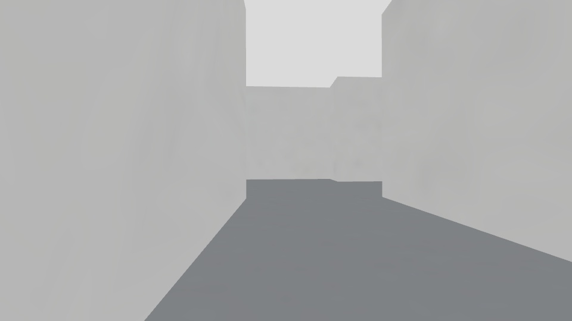

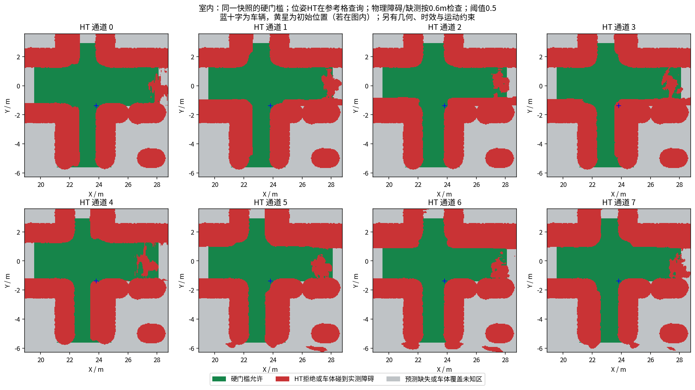

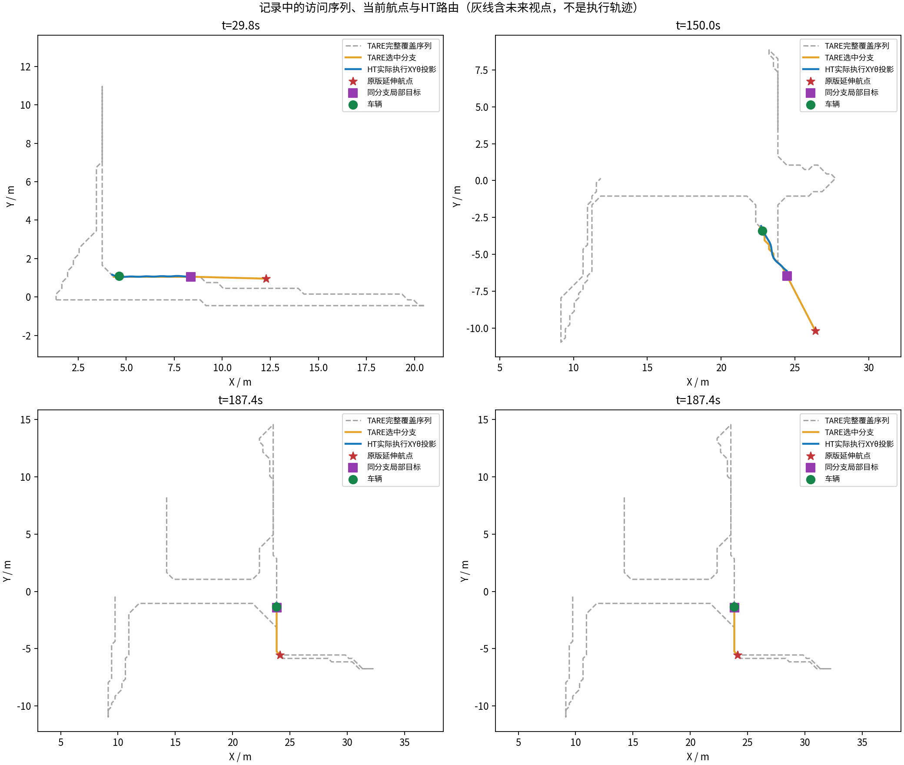

### garage

[完整10分钟视频](garage/camera_h264.mp4) · [采集检查](garage/suite_validation.json) · [路线分工](garage/tare_waypoint_audit/summary.json)

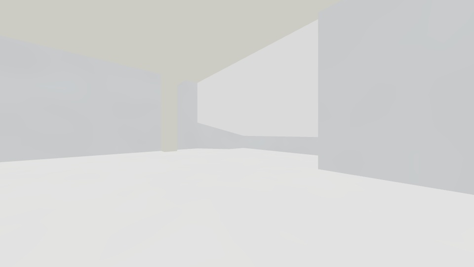

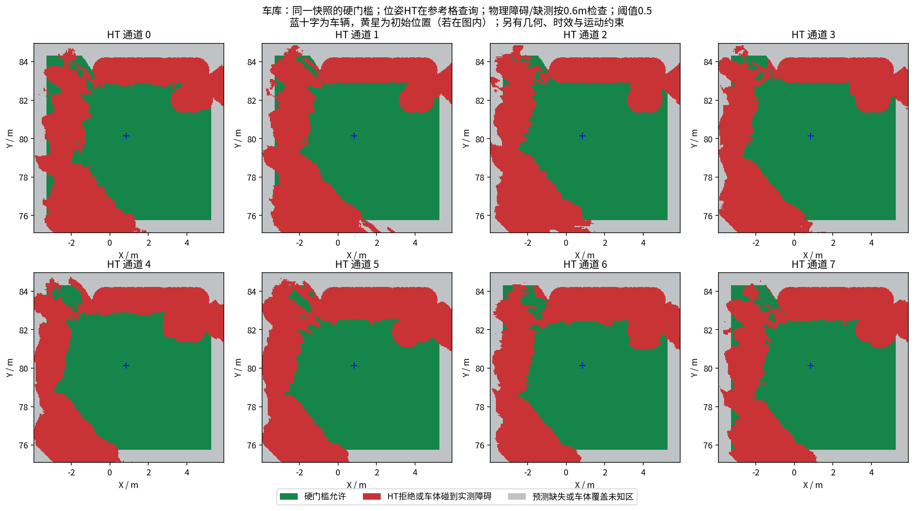

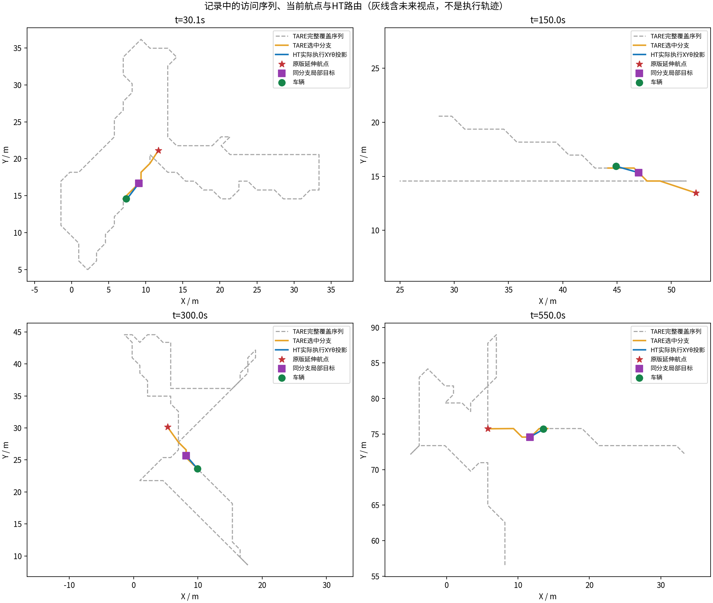

### forest

[完整10分钟视频](forest/camera_h264.mp4) · [采集检查](forest/suite_validation.json) · [路线分工](forest/tare_waypoint_audit/summary.json)

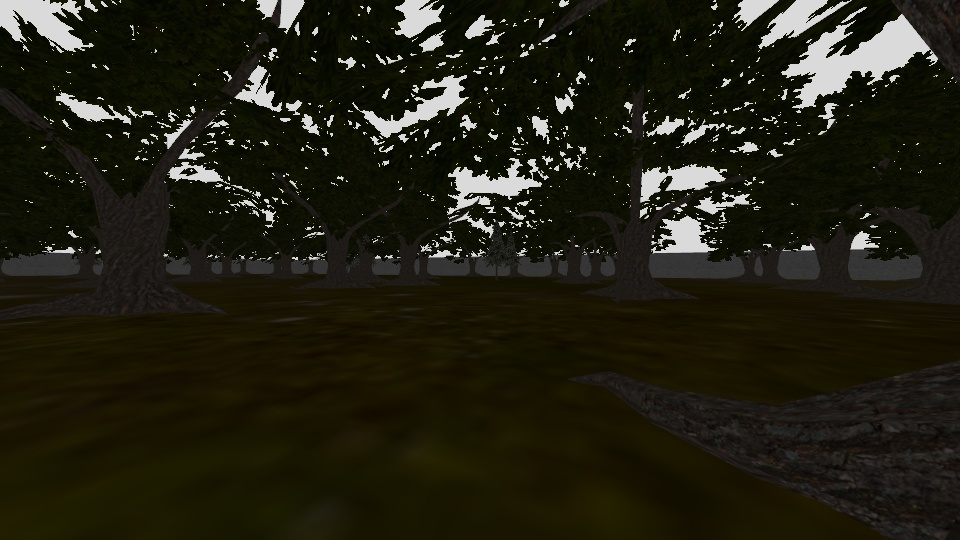

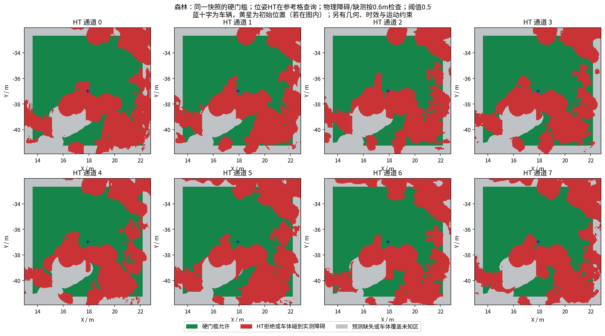

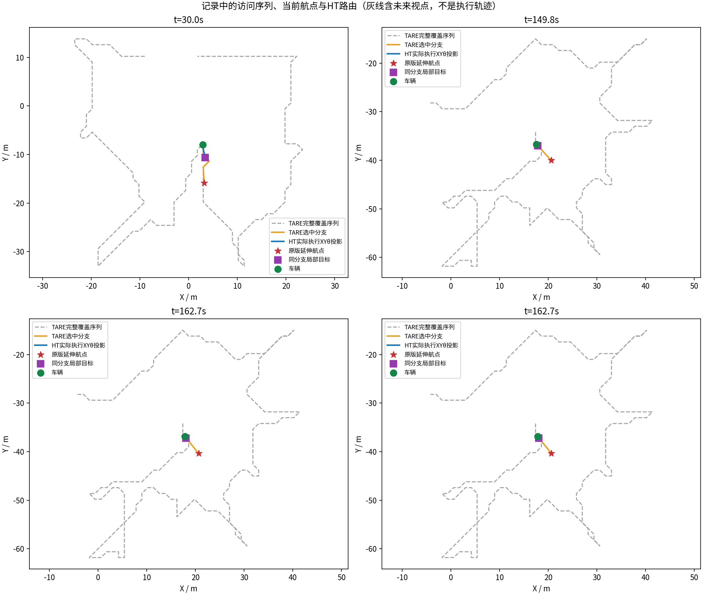

### tunnel

[完整10分钟视频](tunnel/camera_h264.mp4) · [采集检查](tunnel/suite_validation.json) · [路线分工](tunnel/tare_waypoint_audit/summary.json)

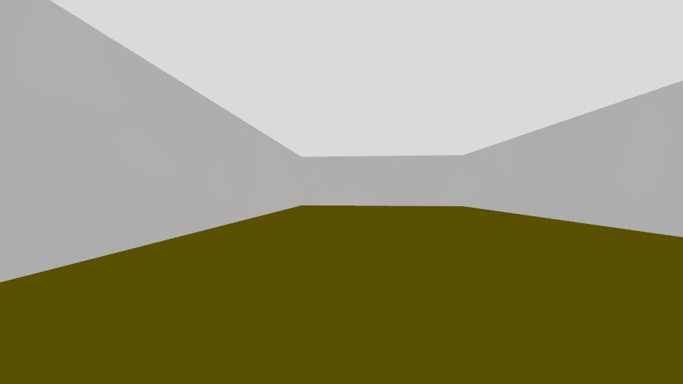

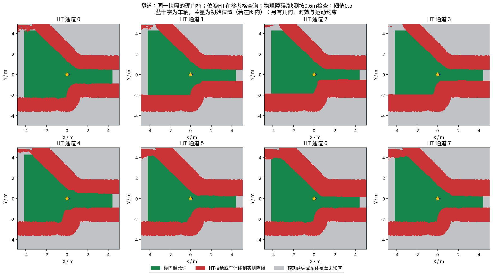

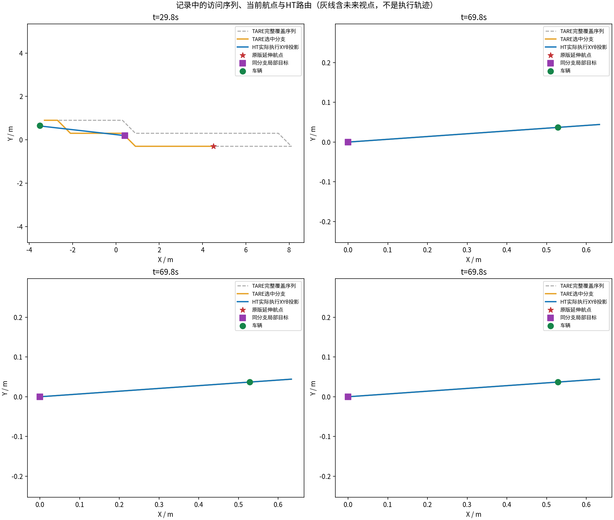

没有新原版TARE同限制配对和实车验证，不拿跨场景体积排名。完整数据/视频以stage44.json远端大小与SHA回执为准；报告存在不代表已上传。原始测量与失败记录保留。[通用采集/审计明细](COLLECTION_REPORT.md)。
