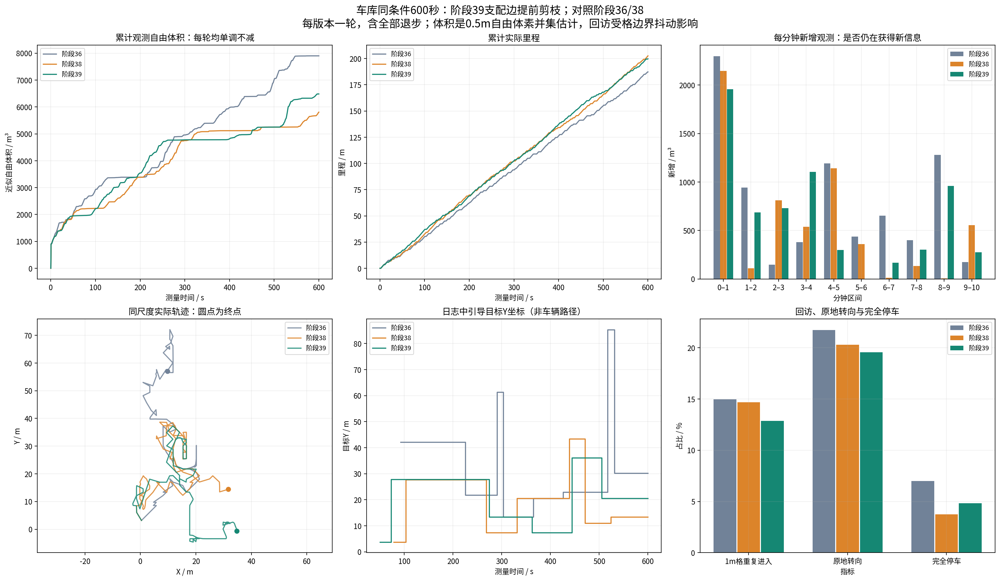
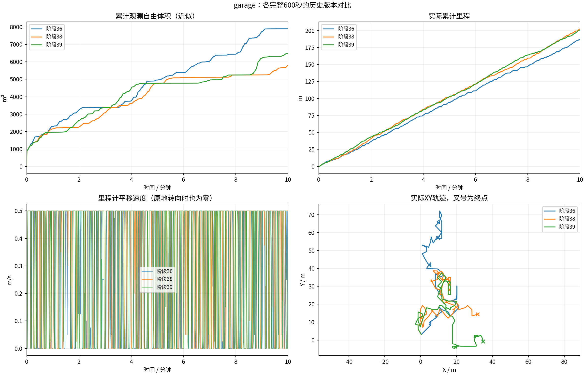
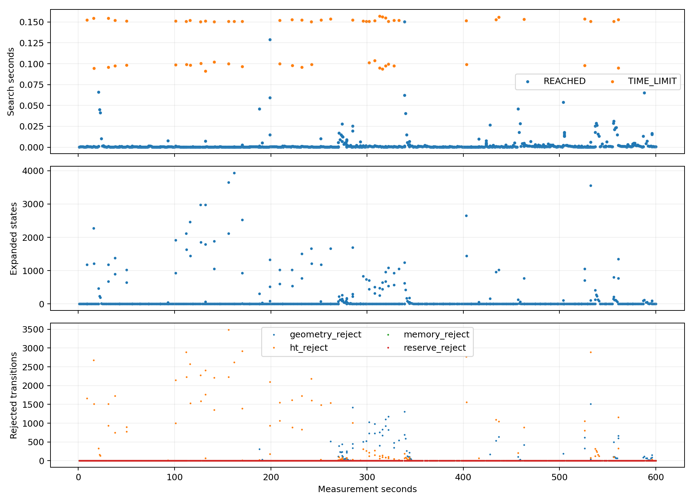
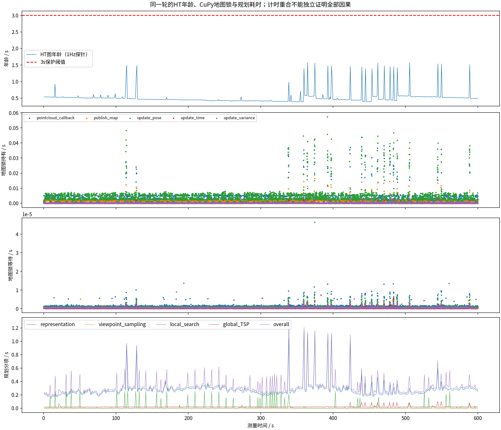
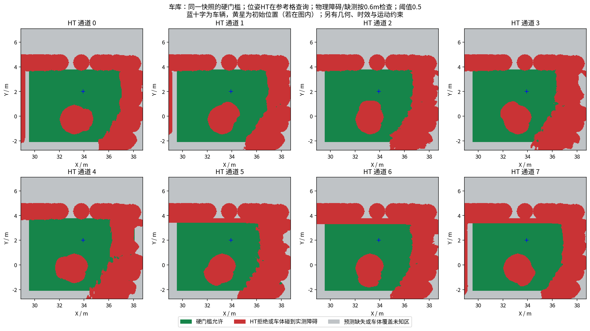
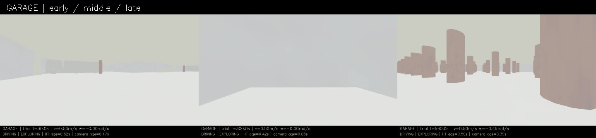
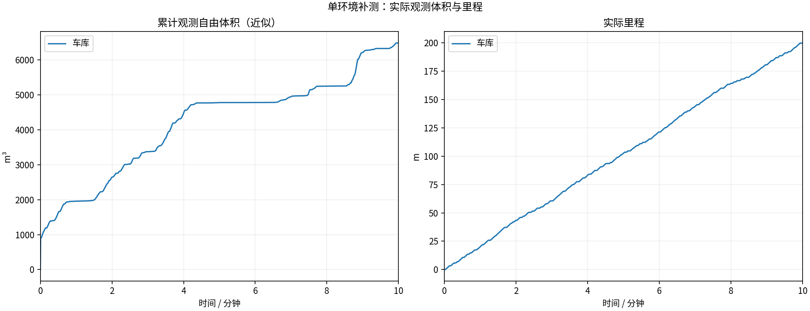
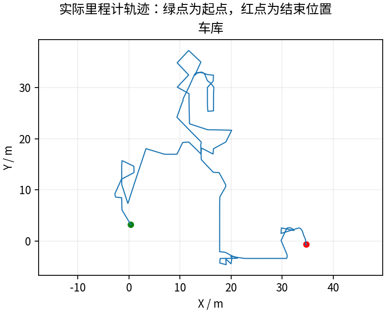
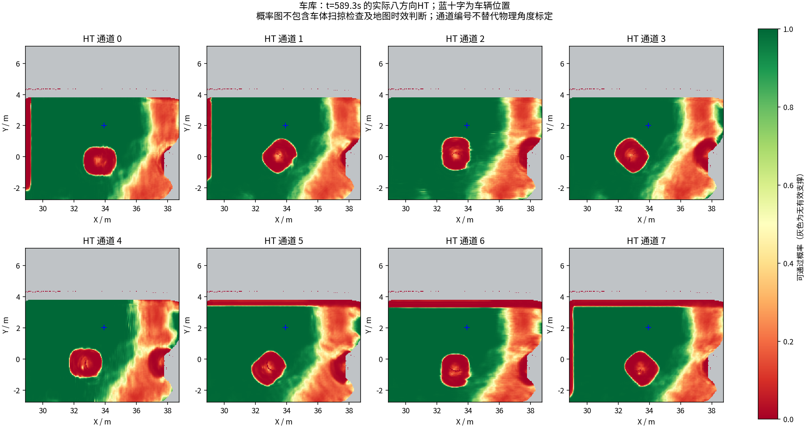

# 阶段39：搜索开销优化，以及为什么当前HT仍落后于TARE

**同车库完整600秒：199.69米、6483.000m³，体积较38为+11.6%。** 末尾任务EXPLORING，完整记录到点停止不代表探索完成。

## 先回答“为什么远不及TARE”

[详细代码与数据分析](TARE_GAP_ANALYSIS.md)：HT开启时绕过原局部TSP，只输出到单个目标的XYθ路线，以单点收益/到达时间做选择；多视点覆盖序列、视点间收益重叠和全局进出端衔接没有完整保留。全局引导多处用到终点的直线距离，而非沿拓扑绕行路线的剩余距离。必要绕行和长远覆盖收益容易吃亏。这是代码中已明确的结构差异，尚未消融量化贡献，不能把全部差距归为它或计算慢。

历史180秒原版/旧HT自由体积6242.625/3224.625m³（51.7%）不是当前版本准确比率。当时前进上限都0.5m/s，原版倒车/角速度/加速度却更宽松。当前还缺完全同运动约束的新原版600秒配对，不能冒充已经验证的公平比较。

本轮只优化搜索开销，**没有修改上述覆盖目标与全局引导结构**，不宣称一次剪枝就追平原版。阶段38的306/394条节流输出日志gain=0，结合平台期须核对中转是否真实推进；不能简单禁止必要零收益通行。

## 改了什么，什么证据支持

原搜索先做逐段HT/几何检查，最后才丢弃终点键已有更便宜/相等路线的边。本轮提前执行完全相同的终点键/代价比较；可能进入队列的边仍按原顺序逐段通过全部硬检查。没有跨地图缓存、量化碰撞位置、放宽未知或增加预算。

固定公开输入4个目标、各256次展开：查询约11700→3800（约减少67%），终止/展开相同；它们都是未到达结果，不把空路线相同作为成功路线证明。另18组合成障碍/方向patch/直连开关回归，真实成功路线代价与逐姿态完全相同。反例保留：4目标在.075/.15秒预算下新旧24次仍全TIME_LIMIT，计算更省不代表目标有路。[根因与回归范围](../../fixes/2026-10-20_successor_pruning.md)。

实测`6fc7549`，65项冻结条目只规划头文件、调用日志及规划二进制3项改变，其他62项相同；全部实际参数一致。[配置逐项对照](configuration_comparison.json) · [实际代码差异](tested_source.patch)。

## 同场景比较：改善与退步一起保留

| 指标 | 阶段38 | 阶段39 |
|---|---:|---:|
| 近似观测自由体积m³ | 5807.0 | 6483.0 |
| 实际里程m | 202.58 | 199.69 |
| 末60秒新增m³ | 553.75 | 274.515 |
| 末60秒里程m | 21.66 | 19.26 |
| 原地转向占比 | 20.3% | 19.6% |
| 最长完全停车s | 1.4 | 1.1 |
| 地图年龄P95s | 0.822 | 0.602 |
| 搜索次数 | 884 | 912 |
| TIME_LIMIT次数 | 81 | 65 |
| 直接连接成功 | 749 | 767 |
| 完全停车占比 | 3.73% | 4.84% |
| 最长无平移含转向s | 4.35 | 4.95 |
| 地图年龄最大s | 1.79 | 1.574 |
| 规划runtime P95s | 0.533 | 0.511 |

本轮累计提前剪去1048111条支配边；这不是放过未检查的可接受路线。不同轮次目标/轨迹不同，超时次数与查询总数并非同一工作量微基准，应结合冻结输入结果看。仍有搜索超时、回访、目标选择和独立物理覆盖真值问题。体积较38+11.6%，TIME_LIMIT 65次；单目标覆盖/直线引导结构未改，没有同控制约束的新原版TARE配对，不证明追平TARE。

两轮同车库、近似同起点、前进上限0.5m/s、相同HT/几何/运动限制；源秒激光600帧、跳过0，0.5m自由体素并集近似，不是物理真值覆盖率。每版本一轮闭环，输入调度/随机采样和路线分支均可能影响结果，不能据此宣称单项因果收益或统计稳定。

## 验证、视频和全部数据

13/13采集核验、4项CTest通过；视频9000帧/600.000000秒完整解码。61份最终上下文/历史图CRC通过，无损坏/partial；59份同源保存样本与三模型重算通过。记录几何采样及晚拦截见[审计](garage/blocked_commands.json)，采样不是连续物理安全证明。

[完整600秒视频](garage/camera_h264.mp4) · [本轮Release完整数据与SHA256](https://github.com/CQULzz/HT_Explo/releases/tag/ht-stage-20261020-successor-pruning) · [历次多角度图册](history/index.html) · [合并PDF](history/all_comparisons.pdf)。发布完成以仓库stage39.json远端SHA256/大小校验回执为准；源秒激光和周期地图不是所有原始传感器无损录制。GitHub保留全部，本机校验后只留最近两轮完整录包，图文视频和回归样本保留。

## 后续优先级

恢复多视点覆盖收益与全局拓扑接力，把XYθ可执行路线成本/可达性用于覆盖任务排序。先做有界候选/分段连接，避免全部视点两两完整Hybrid A*。在相同角速度、倒车、加速度条件下补原版对照，再分离多视点/单点、拓扑/欧氏引导、HT误拒与计算预算的贡献。暂时无路不能核销成已覆盖，不能为了好看体积直接放宽硬门槛。

---

# HT 车库10分钟补测

每组测量 600 秒，从首个具备里程计和激光输入的TARE运行周期开始计时；初始化不计入。
每个场景独立启动、独立高程历史，上一组完全退出且视频处理结束后再启动下一组。车速上限均为0.5m/s，HT硬约束与3秒时效保护相同。
采用对应场景TARE参数；车库沿用历史配对起点，其余使用各自仿真原生起点。因此这不是相同场景的算法优劣对照。
相机原生960×540、15fps，视频含状态条并裁去初始化；重复帧代表真实图像更新间隔，不做插帧。

| 环境 | 状态 | 实际里程(m) | 近似观测体积(m³) | 末尾任务状态 | 视频 |
|---|---|---:|---:|---|---|
| 车库 | RECORDED | 199.69 | 6483.00 | EXPLORING | [播放/下载](garage/camera_h264.mp4) |

[全部视频播放列表](videos.m3u) · [实时状态与校验](suite.json)

每个场景仅一次10分钟测试，不能据此证明更长时间、所有环境或实车稳定。定时记录完成不等于探索完成。观测体积是抽样激光射线的自由体素并集近似，不是真值覆盖率；跨场景体积不可直接作为算法优劣排名。

## 实际出现的问题

下表保留暂停和地图延迟，不把“节点未崩溃”当作“没有问题”。地图年龄为1Hz抽样，完整控制消息保留在本地MCAP中。全零指令表示既不平移也不转向；原地转向单独统计。

| 环境 | HT年龄P95/最大(s) | 年龄>3s样本 | 全零指令占比 | 最长全零指令(s) | 全局引导无进展释放 | 验证失败项 |
|---|---:|---:|---:|---:|---:|---|
| 车库 | 0.60 / 1.57 | 0 | 4.8% | 1.10 | 3 | 无 |

遇到旧HT地图时仍执行3秒时效保护；没有为让车持续前进而放宽硬约束。全局引导释放说明该段目标没有持续接近，不能解释为该目标已经到达或覆盖完成。

| 环境 | 实收激光/600s | 平均频率(Hz) | 最大接收间隔(s) | 同源对齐检查点 | 观察器与建图器计数差恒定 |
|---|---:|---:|---:|---:|---|
| 车库 | 2997 | 5.00 | 0.40 | 62 | True |

计数差恒定只支持这些对齐区间内没有新增相对漏收；不能证明源端始终连续发布，也不能排除两个订阅者同时漏收。各场景均保留完整扫描计数和原始时间戳检查点。

### 车库末段实际HT

[同期接收的相机画面](garage/late_camera.jpg) · [原始图层快照](garage/late_map_snapshot.npz) · [时间与坐标元数据](garage/late_map_snapshot.json)

全部视频按15fps、600秒裁剪，时长校验允许1帧误差，完整解码通过；实际帧数和时长见各组video_validation.json。各组共有源文件的65项哈希一致，各组自身冻结文件核验见suite_validation.json。

相机年龄是图像接收后的年龄；相机仿真时间戳与导航墙钟不同，不能把该数值解释为传感器端到端延迟。本导出目录只含精选数据与视频；原始MCAP、全高程历史和输入诊断见suite.json所列目录，GitHub完整备份状态以本轮Release及发布校验回执为准。
