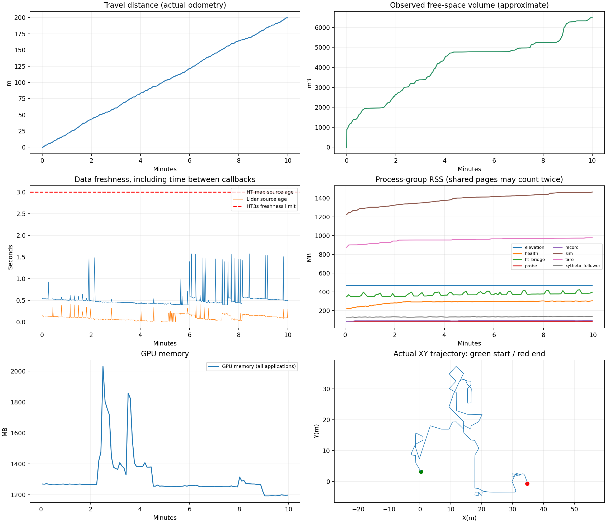
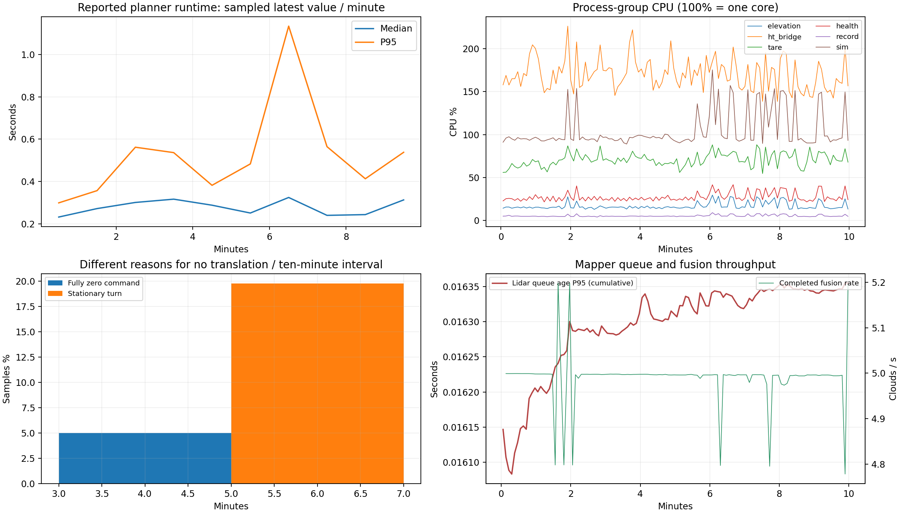

# 当前HT：garage连续测试

计划/实际记录 10 分钟；不重启规划、建图及跟踪节点。前进上限0.5m/s。

- 行驶距离：199.69米；到访1米轨迹格：204。
- 探索完成信号：False；定时结束不等于探索完成。
- 最后采样任务状态：EXPLORING；执行状态：HT_ASSISTED。探索完成信号只触发返航，不等于已安全回到起点。
- 运行期间父进程退出/资源保护事件：0个，详见endurance_audit.json。
- 1Hz采样HT地图年龄P95/最大：0.602/1.574秒；超过3秒0个采样点。
- 最长完全零速约1.0秒；最长实际不平移约5.0秒，后者包括原地旋转。

- 规划器日志确认收到并处理执行拒绝运动段2次；已进入6秒冷却重规划分支。

| 时段(分钟) | 里程(m) | 完全零速采样占比 | 原地转向采样占比 | 新增估计自由体积(m³) |
|---|---:|---:|---:|---:|
| 0–10 | 199.68 | 5.0% | 19.8% | 6483.00 |

## 数据与限制

资源和健康检查是外部观测；没有修改被测规划参数或用重启掩盖问题。
保留全部控制/状态/里程计消息；原始点云每秒抽样1帧，地图精确同时间戳快照约每10秒一组，相机视频15fps。此包不是完整传感器录包，不能用抽样帧数认定输入掉包。
全速输入需结合健康探针回调计数、CuPy接收/融合计数和源时间段核验；结束时可能有未完成的一帧。
以源时间戳对齐外部探针与建图接收计数，匹配62个检查点；计数差恒定：True。详见input_delivery_audit.json；这只检查匹配窗口内的相对接收差异，不能排除上游停发或双方共同漏收。
目标选择及全局引导切换日志保存在target_selection_audit.json。gain是视点覆盖估计；旧版对已承诺目标还使用过gain=0占位。实际新增观测需看自由体素并集，不能仅凭目标日志判断。
自由空间是0.5m体素光线累计近似值，不是官方覆盖率或真值。内存为进程组RSS相加，可能重复计算共享页；显存总量包含桌面。
单次测试不能证明实车或所有条件稳定。

[健康/停车/内存审计](endurance_audit.json) · [每10分钟统计](ten_minute_segments.csv) · [相机视频](camera_h264.mp4)
