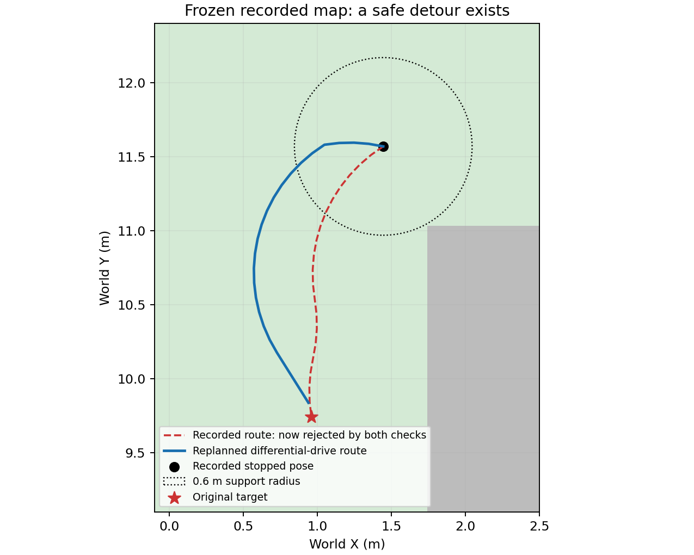
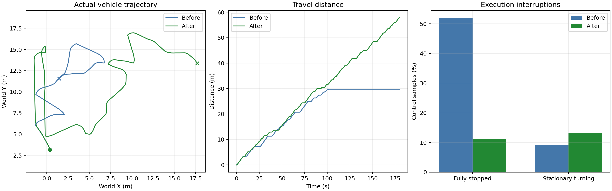
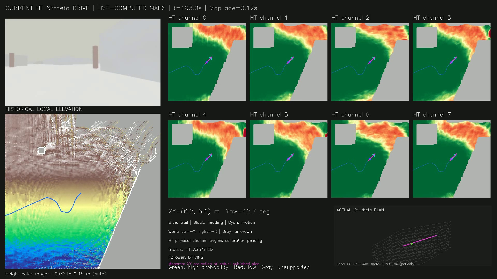

# HT 路径拒绝循环修复与 Garage 验证

修复代码：[`3912e37`](https://github.com/CQULzz/HT_Explo/commit/3912e37df7541799c354bf568ff8f3d5b0383aab)。本轮由当前 HT/XYθ 规划与跟踪器实际控制车辆，保持 0.5 m/s 速度上限、0.5 HT 概率阈值、0.6 m 车体支撑半径与严格未知策略。

## 改了什么

此前约102秒的持续停车，来自同段路径在规划、执行阶段采样落点不同，造成“规划通过、执行拒绝”。本次改为遍历线段经过的栅格，并共用 `motionSupport` 检查车体方向变化及行驶方向。发布前与执行器均检查前约1米路径。

执行器还会反馈被拒绝的运动段。规划器撤销对应目标承诺、清空旧路径，对相同位置和方向的失败运动设置6秒冷却，再寻找其他路线。过期路径的反馈不会清空新路径。指令弧线持续受阻0.5秒也会反馈，短暂受阻不立即切目标。

视频的HT及历史高程底图Y轴翻转已修正，车辆、路径与地图使用相同世界坐标。没有把未知区域涂成可通行，也没有降低HT门槛。

## 原始停车地图的回归

对原始录包中的同一份 GridMap 和同一条路径，直接调用构建后的 C++ `HtCostMap`：旧路线现在被规划器和执行器一致拒绝；从相同车辆姿态向原目标重新搜索，得到41个姿态的绕行路线，扩展32个状态，估计运动时间6.76秒。

这个冻结地图测试只验证HT硬约束与差速运动原语，不代替包含TARE几何检查及车辆跟踪的完整仿真。

[原始C++复核输出](recorded_stop_verification.txt)

## 完整仿真结果

每轮180秒。下表为实际轨迹与控制指令统计，不是探索体积。

| 指标 | 修复前卡住的一轮 | 修复后第1轮 |
| --- | ---: | ---: |
| 行驶距离 | 29.76 m | 57.87 m |
| 最后60秒行驶距离 | 0.00 m | 18.70 m |
| 最后观察到平移 | 102.00 s | 180.00 s |
| 完全停车指令占比 | 51.96% | 11.28% |
| 到访1米轨迹格 | 32 | 63 |
| 零速且对应 HT_PATH_BLOCKED 的控制样本 | 1562 | 0 |
| 探索是否完成 | 否 | 否 |

停车比例同时要求线速度和角速度接近零，不把正常原地转向计作完全停车。零速原因按话题接收顺序近似匹配，状态切换处存在一个控制周期左右的歧义；样本数不是停车事件次数。

第1轮记录982帧源时间范围内的点云，接收与完成融合也均为982帧；采样的最大HT图年龄约2.30秒。仍有到达短路径终点、转向对准等停顿，本轮没有复现原来的长时间HT路径拒绝循环。

## 视频与数据

[下载180秒实测视频](garage_ht_fixed_180s.mp4) · [视频校验信息](video_verification.json)

- [第1轮指标](run1_summary.json)、[停车审计](run1_pause_audit.json)、[时间序列](run1_timeseries.csv)、[运行清单](run1_manifest.json)。
- 本地完整录包、同步地图快照及日志：`presentations/scheduled_results/ht_swept_gate_2026-10-16/`。大体积原始MCAP未放入Git仓库。
- 测试：155项核心检查、15项HT地图ROS测试、5项执行器ROS测试通过。一次并发运行的地图测试在参数异常构造处等待，被人工中断；随后独立域重跑全部15项通过，两份日志均保留在本地实验目录。

这些实验是同场景、同速度上限下的实际运行，不是确定性轨迹回放。与修复前实验之间还发生过主机重启及GPU驱动版本变化，因此运行时间或行驶距离的差值不能全部归因于单一代码修改；原始地图的C++回归独立复现并验证了本次一致性修复。180秒按预设时长停止，不代表完成整个车库探索，也不能据此保证所有场景都不会停车。
