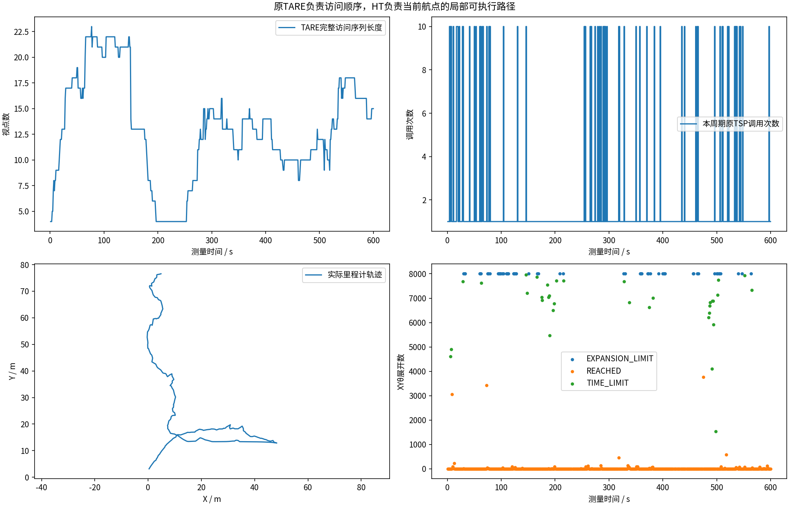
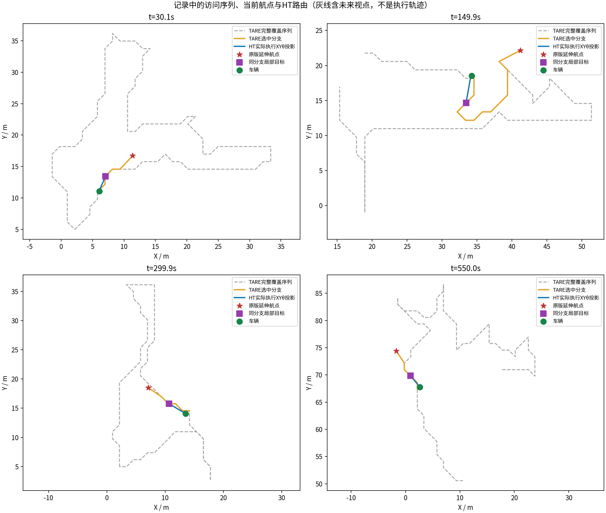
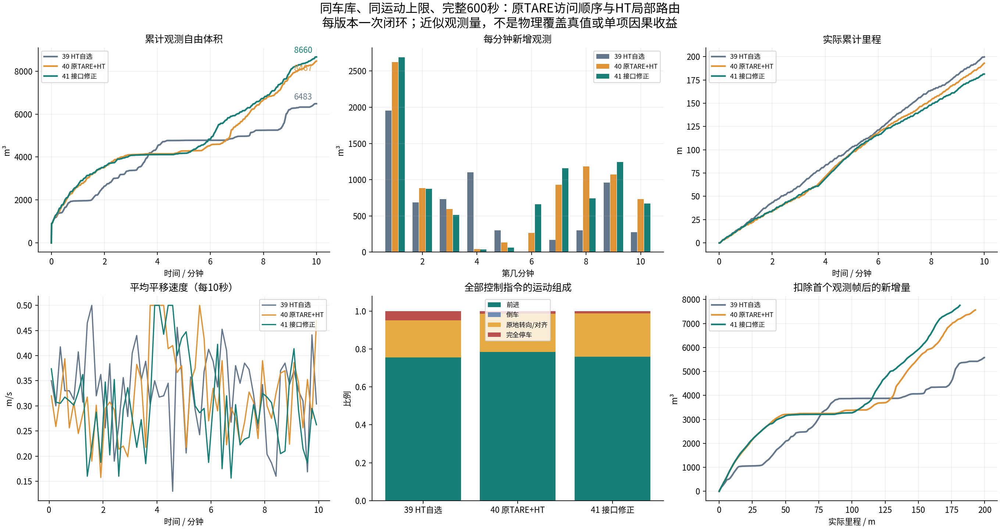
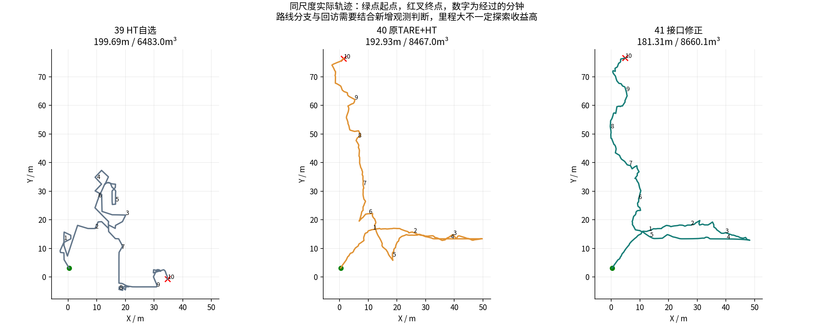
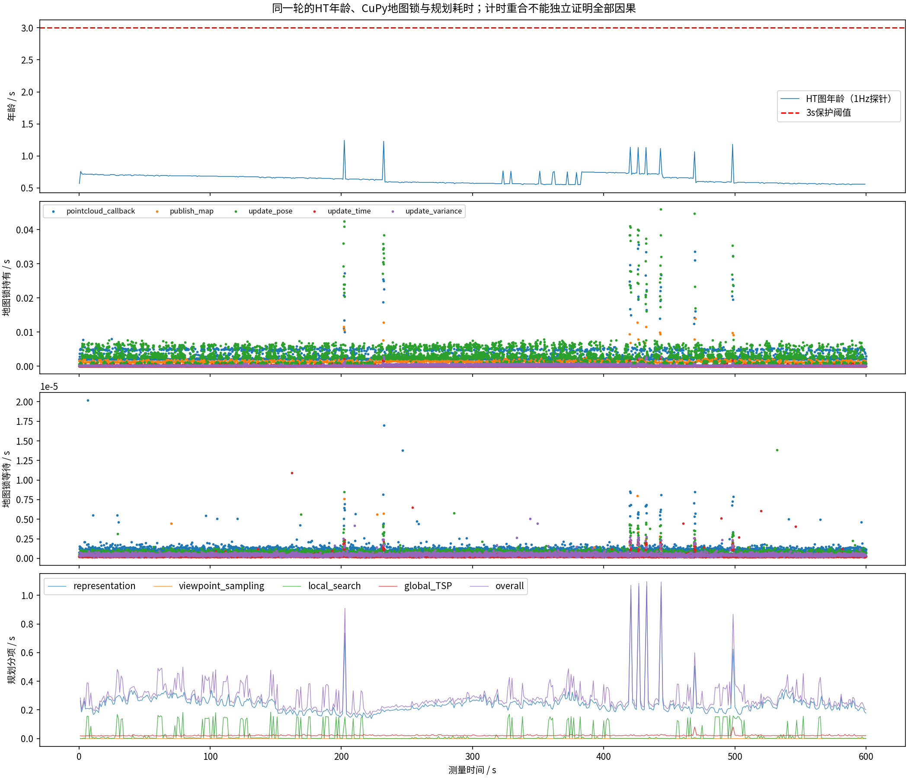
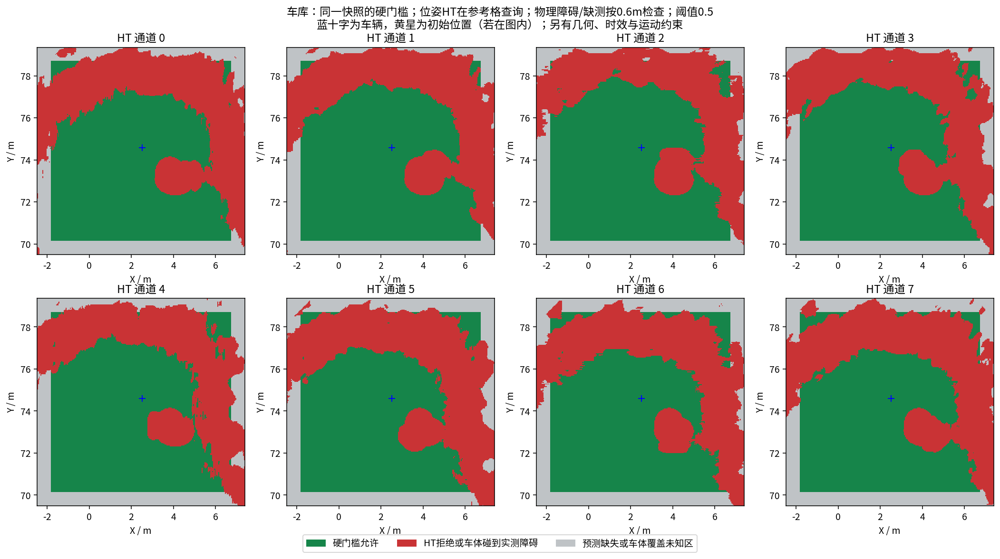

# 阶段41：保持原TARE决策，修正HT输入一致性与近家返航

**同车库完整600秒：181.31m，近似观测自由体积8660.125m³；较39为+33.6%，较40为+2.3%。** 搜索时间上限34次、展开上限57次，最长完全停车0.25s，末60秒新增671.645m³/移动16.56m；末尾EXPLORING。单次闭环不证明统计优越或单项因果提升。前进、倒车、角速度和加速度上限未增加。

## 最终分工与计划

原TARE完成覆盖估计、视点采样、全局/局部TSP及访问顺序、前视点与原航点延伸；HT只找当前odom到TARE当前航点的XYθ可执行路线。航点太远时，沿TARE路线分支取局部前缀；找不到路发零，不改选收益点。[原先行计划](../../plans/2026-10-20_tare_ht_waypoint_plan.md) · [边界修正先行计划](../../plans/2026-10-20_tare_ht_boundary_plan.md)。实测代码`68701319b333165dd9cd5acf8e226ba52c174434`。

六个核心函数体仍与原ROS2适配参考`b6760ad`逐字SHA一致。[检查](regression_and_counterexamples/regression/ht_tare41_upstream_contract.json)。并非声称整个包等同于官方ROS1源码；局部XYθ执行器和必要的传感器/控制保护保留。

## 先复现，再修正的两个边界

阶段40闭环后，用真实ViewPointManager构造禁行带，确实出现connected=1/candidate=1而实际最短路为空，测试失败；不能因为视频没卡死就忽略。HT删点先前发生在BFS之后，破坏原TARE图连通性前提。本轮一次读取地形顶点掩码，BFS和候选图共用；异步新地图不会在两步之间再次删点，下一周期再更新。执行仍用最新HT硬检查，因此粗图快照不是过期地图行驶许可。禁行带、异步更新、下一周期同步和解除禁行的真实ROS回归通过。[根因与证据](../../fixes/2026-10-20_tare_waypoint_boundaries.md)

近家返航源条件反例：原前视函数可能不输出目标，但原PublishWaypoint优先HOME；包装层原先先判断前视有效性会错误停车。本轮恢复HOME优先级，并选择原近家ROBOT→HOME分支交给HT。原前视返回标志仍原样供TSP使用；没有绕过HT/几何/传感器检查。此项有明确单元/分支回归，若本轮没有触发任务完成/返航，不能说已完成真实闭环返航验收。

CuPy/HT模型及历史融合不变。导航高程仍来自同源第12层ht_elevation；CMU地形只供模拟器贴地，TARE原地形话题无发布者。[现场隔离检查](garage/terrain_topic_isolation.json)

## 多视点序列与实际执行证据

592个原覆盖周期，原TSP实际调用分布{'1': 531, '10': 61}，最大访问序列23个，平均13.08个。600个允许移动的航点与原TARE输出相符；683个HT局部目标位于对应原路线分支，记录级违例0。683次HT尝试中592次到达，34次达时间上限、57次达展开上限；这些失败针对某个前缀，缩短同一分支后592个实际规划周期均发布了非空路线，不能把91次尝试失败当作91次停车。[原TARE→HT接口审计](tare_waypoint_audit/summary.json)

灰线为TARE未来访问路线，橙线为当前分支，蓝线为发布执行的XYθ路线的XY投影；不是把整条TSP序列都当成已经走过的轨迹。

## 同条件比较，保留改善与退步

| 指标 | 39：HT自选目标 | 40：原TARE+HT | 41：接口边界修正 |
|---|---:|---:|---:|
| 近似观测自由体积m³ | 6483.0 | 8467.0 | 8660.125 |
| 实际里程m | 199.69 | 192.93 | 181.31 |
| 末60秒移动m | 19.260023999999987 | 20.80419277108433 | 16.555495009980064 |
| 完全停车比例 | 4.84% | 1.36% | 1.22% |
| 原地转向比例 | 19.55% | 20.18% | 22.84% |
| 最长完全停车s | 1.1 | 0.75 | 0.25 |
| 规划P95s | 0.5109999775886536 | 0.45500001311302185 | 0.4309999942779541 |

39/40/41均车库600秒、近似相同起点及相同运动限制。本轮与40的实际参数逐项完全一致，[源码和配置对照](configuration_comparison.json)。40一次恢复了覆盖结构和地形接口，41只修正两处接口并保存构造失败，不能把闭环轨迹差异直接归因于某一项修复。原TARE历史控制限制更宽松，尚无完全同限制的新600秒原版配对，不宣称已追平原版。

## 验证范围与剩余问题

末60秒新增观测：阶段39为274.515m³、40为731.724m³、41为671.645m³。本轮累计量高于40，但末分钟收益和移动距离低于40，原地转向比例更高。地图年龄P95也由40的0.618s增至0.743s，最大值由1.592s降至1.246s；都是1Hz采样，不是所有时刻上界。

搜索时间上限34次、展开上限57次，最长完全停车0.25s，末60秒新增671.645m³/移动16.56m；末尾EXPLORING。 搜索预算失败不等于地形绝对不可通。粗TARE候选图的可达性不是完整SE2可达性保证；某个原TARE航点仍可能在局部HT图中无可执行路径。远端未知用于乐观引导，执行必须通过新鲜局部HT。HT地图噪声、必要绕行、长时间和其他环境仍需单独评估，没有独立物理覆盖真值或完整轮胎动力学/实车验收。

13项采集、4项CTest及原六函数SHA检查通过；视频8999帧/599.933333秒完整解码。61份上下文/历史图CRC通过：True；59份同源输入样本及模型重算通过：True。

HT拦截非零0、未配对0；几何拦截非零0、未配对{}。几何采样余量重叠0/592，旧指令外推碰余量0；采样和外推不等于连续物理接触真值。[几何采样](execution_geometry_audit/summary.json)

观测自由体积按源秒激光600帧计算，0.5m体素并集，跳过0；MCAP保留全部发布HT/控制/odom/状态，激光按源秒、地图和模型输入周期采样，不是全部原始传感器无损数据。

[完整视频](garage/camera_h264.mp4) · [历次多角度图册](history/index.html) · [PDF](history/all_comparisons.pdf) · [完整数据Release](https://github.com/CQULzz/HT_Explo/releases/tag/ht-stage-20261020-tare-boundaries)。完整上传以stage41.json远端大小/SHA256回执为准。GitHub全部保留，本机仅留最近两轮已核验完整原始数据。本轮发布后停止扩展新候选。

