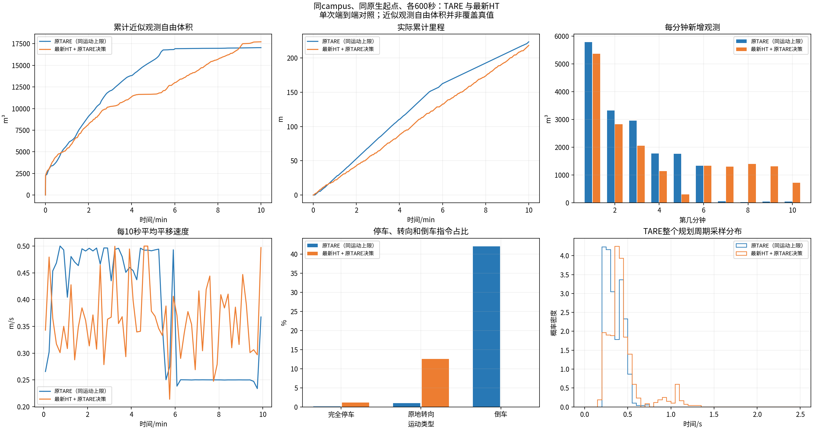
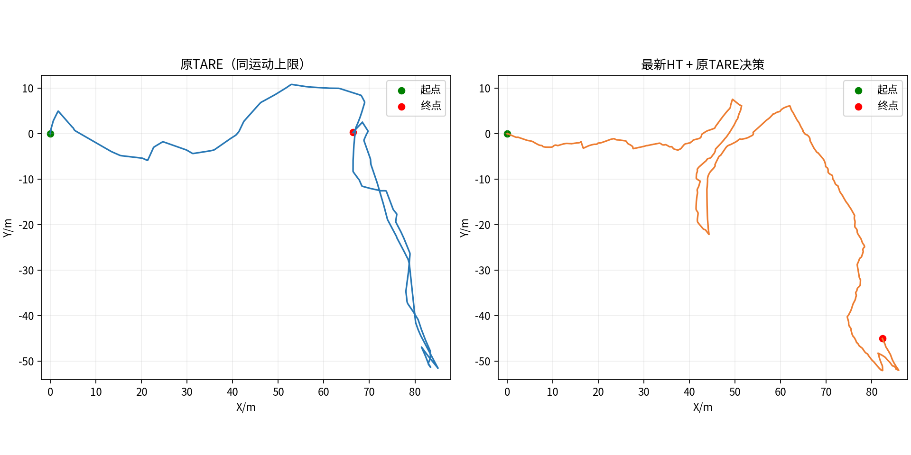
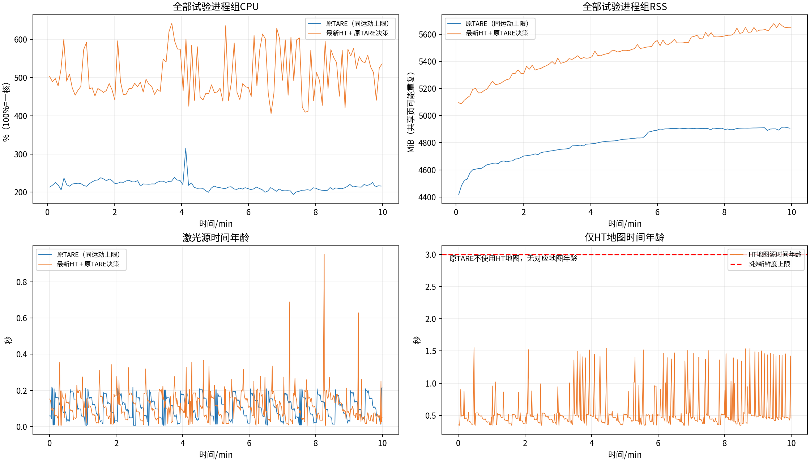
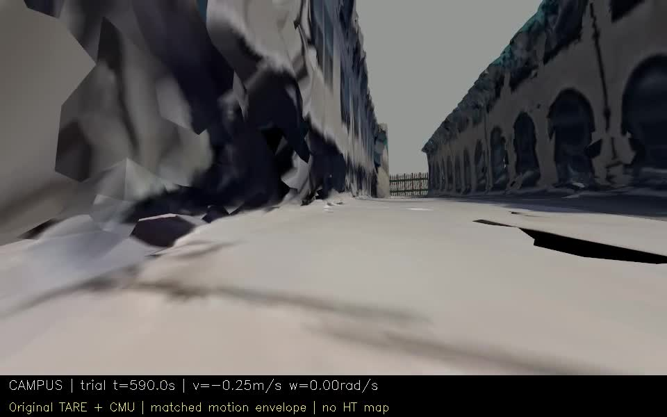
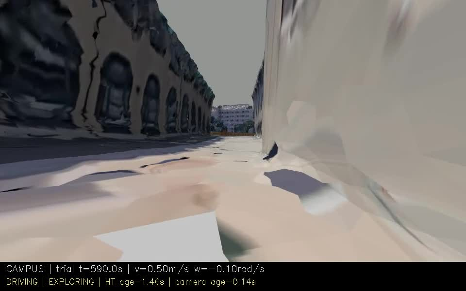
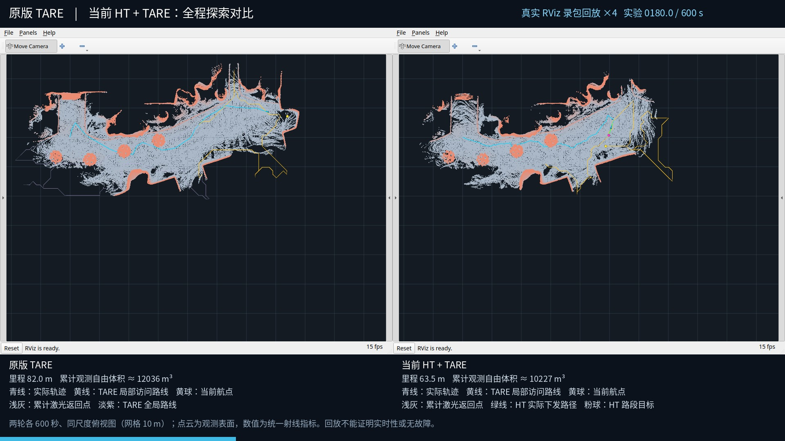
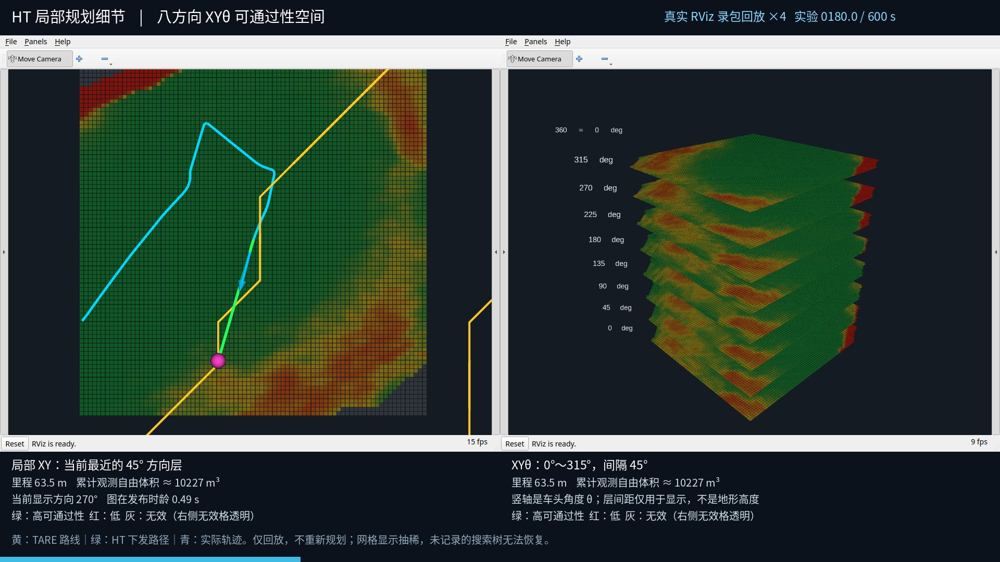

# 阶段48：原TARE与最新HT，同运动上限campus600秒对照

本次Campus结果：HT最终近似观测自由体积多3.95%（674m³），实际里程218.28m，原TARE为223.53m。前9分钟总体原TARE领先；在按1秒插值的曲线上，HT从约541秒起持续领先至600秒。最后一分钟新增量分别为HT 714.1m³、TARE 37.8m³。两组末状态均EXPLORING；本轮没有重现室内HT末段的长时间低收益，但不能由单次运行证明普遍优势。

试验设施冻结`f7fd77b66fc442752599ead359e8aa60e7773ae4`；HT导航保持`07c1abd334f83cb8d602e2234134b4286862c916`，原TARE ROS2适配基线`b6760adb4280b379567c76f4e684ce628e28ef71`。每组独立重启同一campus原生起点，顺序原TARE→HT，均实际600秒。

原TARE保留自身探索/TSP与CMU规划器；原CMU参数对齐角速度和线加速度，并用透明限幅组件对齐倒车速度/角加速度，限幅前后指令均已记录。前进0.5、倒车0.25m/s，角速度0.8rad/s，常规线/角加速度0.5m/s²、1.2rad/s²。显式全零/输入过期可立即停止。CMU原maxSpeed=2.0的内部归一化配置保留，但autonomySpeed=0.5，实际输出另有共同限幅，并非以2m/s开车。两套地形、几何安全规则与跟踪器仍不同，是端到端对照，不是HT单模块消融。

| 指标 | 原TARE（对齐运动上限） | 最新HT |
|---|---:|---:|
| 实际里程/m | 223.530 | 218.280 |
| 近似观测自由体积/m³ | 17048.250 | 17722.250 |
| 最后60秒新增体积/m³ | 37.766 | 714.125 |
| 最后60秒里程/m | 15.987 | 22.389 |
| 最长完全停车/s | 0.500 | 0.950 |
| 完全停车比例 | 0.13% | 1.12% |
| 原地转向比例 | 0.96% | 12.57% |
| 倒车指令比例 | 42.00% | 0.00% |
| 规划周期P95/s | 0.500 | 0.919 |
| 末任务 | EXPLORING | EXPLORING |
| 视点网格 | 40×40，间距1.2×1.2m，名义48×48m | 40×40，间距1.2×1.2m，名义48×48m |

本次HT/原TARE体积比=1.040，里程比=0.977。仅该次运行描述，不代表统计优越。

起点差0.000000m、航向差0.000000rad；配对/参数/实际指令/视频/采集检查分别保存在paired_validation.json、effective_parameter_comparison.json和逐组审计。总体状态：COMPLETED_WITH_ISSUES。

## 视频与数据

[左右分屏相机对比：左TARE，右HT](https://github.com/CQULzz/HT_Explo/releases/download/ht-stage-20261021-campus-matched/stage48-campus-camera-comparison.mp4)

[原TARE 10分钟视频](https://github.com/CQULzz/HT_Explo/releases/download/ht-stage-20261021-campus-matched/ht-stage-20261021-campus-matched-original.mp4) · [最新HT 10分钟视频](https://github.com/CQULzz/HT_Explo/releases/download/ht-stage-20261021-campus-matched/ht-stage-20261021-campus-matched-ht.mp4)

## 子进程退出检查

- original：已确认位于测量结束及停止信号之后；测量结束wall=1792581800.665867329，异常日志中最早信号wall=1792581800.9066；文件：local_planner.log。
- ht：未检出匹配的子进程退出异常；仍需结合逐项采集检查判断总体状态。

本轮最终状态COMPLETED_WITH_ISSUES。采集与退出异常分开记录，不删除失败、不把完整计时等同于所有稳定性检查通过。详见逐组lifecycle_exception_audit.json和原始日志。

## 实际RViz回放

[全局原TARE/HT对比](https://github.com/CQULzz/HT_Explo/releases/download/ht-stage-20261021-campus-matched/stage48-campus-rviz-comparison-4x.mp4) · [HT局部XY与八层XYθ](https://github.com/CQULzz/HT_Explo/releases/download/ht-stage-20261021-campus-matched/stage48-campus-rviz-xytheta-4x.mp4)

1080p、10fps、4倍速，各覆盖原实验0～600秒；真实RViz窗口录包回放，不是原运行实时屏幕录像，也不重新规划。全局同尺度显示累计观测点云、青色实际轨迹、黄色TARE访问路线/航点；HT绿色为已发布执行路径、粉色为路段目标。
局部左侧为当前最近45°方向的预测分数；右侧为八个原始方向层，竖轴是角度。红低绿高，左灰/右透明表示无效；模型分数不等于经过全部足迹/几何/时效检查的最终通行结果。上层可能遮挡下层路径，可对照左侧XY投影。
显示点云15m截断、0.18m体素抽稀，HT每3格显示一个原分数，不插值概率；显示抽稀不参与原指标或控制。完整轨迹在全局，局部XY只显示当前范围片段，XYθ不叠历史轨迹。未记录的搜索树不补造。
全局视野由两轮完整轨迹加15m范围共同确定，属于事后固定取景，不表示车辆提前知道未观测地图。HUD取不晚于当前时刻的最近CSV条目，采样与异步显示有刷新差；不能用回放测量在线延迟。

[原TARE访问顺序与HT同分支路由审计](architecture/summary.json)；图与记录见architecture目录。

## 仍存在的问题与核验

- HT原地转向指令占12.57%，原TARE为0.96%；HT整个TARE规划周期P95为0.919s，原TARE为0.500s。该周期含探索决策等步骤，不能当成单独XYθ搜索耗时。
- HT在第533.815秒有一次常规角加速度审计超限：相邻指令间隔0.045235s，角速度变化0.060rad/s，差分为1.326rad/s²，高于设定1.2；原地转向中发生，不是显式全零急停例外。代码xytheta_follower.cpp用固定dt=0.05计算每步限幅；本次指令时间间隔短于50ms，这是直接可核对的不一致。这属于指令差分，不能据此宣称实际车体角加速度或测量抖动来源已证实。本轮按用户要求未修改控制代码，检查保持失败。
- 原版localPlanner/pathFollower在完整测量结束后的SIGINT阶段抛出ROS context异常，关闭检查失败；HT未检出相同关闭异常。总体COMPLETED_WITH_ISSUES，完整计时不等于稳定性全项通过。
- 两边各处理600帧源秒激光，无指标帧被跳过；两边实际速度上限通过。72项HT运行输入/二进制在测后与冻结哈希一致；原TARE六个关键决策函数体与适配基线一致。[核验记录与额外诊断](verification/README.md)。

## 口径与限制

- 每秒按绝对源秒取一帧真实地图坐标激光，使用相同sensor里程计原点；0.5m自由体素并集、0.25m射线步长、15m截断、回波前0.25m排除。这是近似观测量，不是真值覆盖率。
- 原TARE完成信号只表示原生返航触发，不能拿它当HT的COMPLETED到家驻留状态，也不证明真实全覆盖。
- 两个系统各一次，固定运行顺序，探索随机性和初始化/感知/控制差异未统计消除；限幅后的原TARE不是原CMU默认高速控制链。
- 本场景实际视点网格见上表及effective_parameter_comparison.json；没有沿用室内配置的网格说明。即使采样密度相同，感知、几何与控制链仍不同，不能把差距单独归因于HT。
- 记录保留全部发布控制/odom/状态/路线；激光源秒采样、HT输入/地图按既有策略，不是全部原始传感器全频无损录包。
- 本轮没有修改HT导航；本次对照不同时验证森林、隧道或实车。

完整数据以docs/experiments/publications/stage48.json远端大小/SHA回执为准，报告存在不等于已发布。
