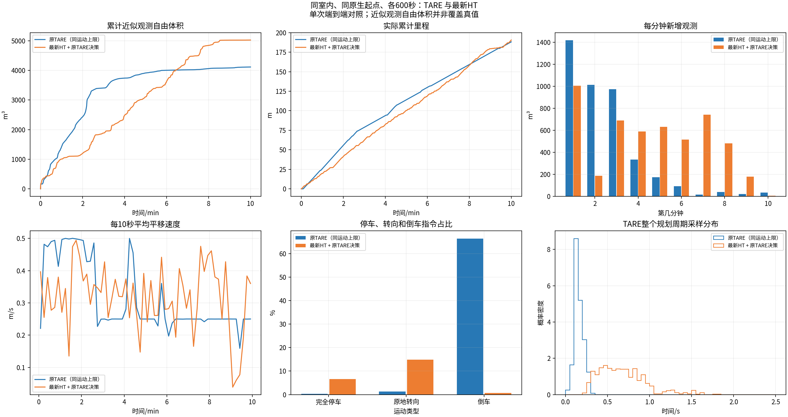
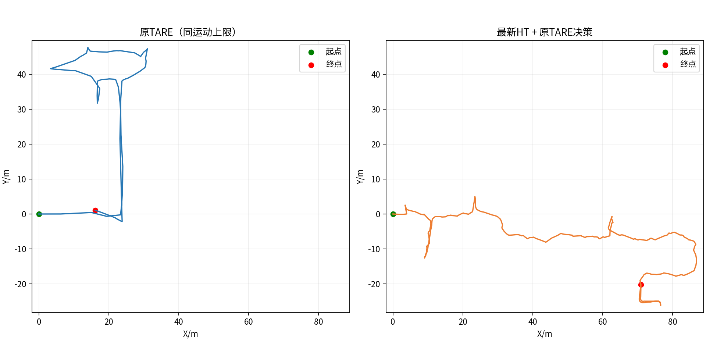
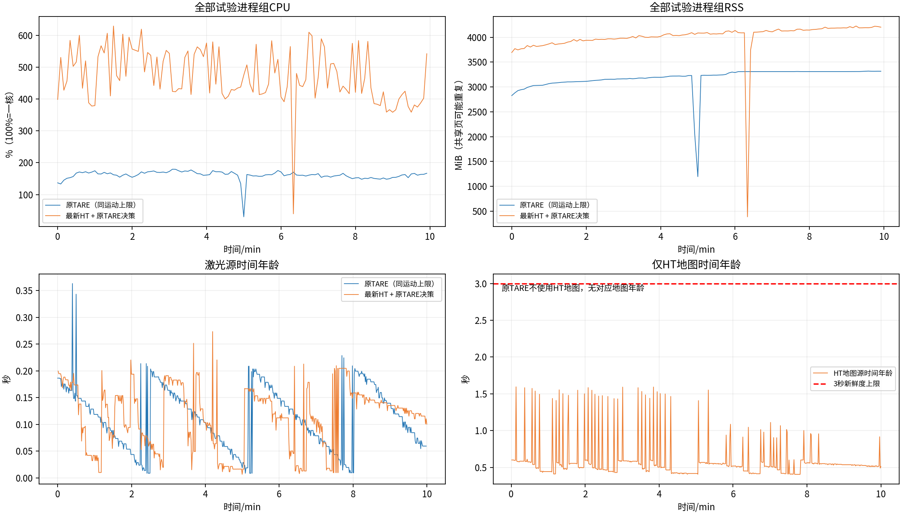
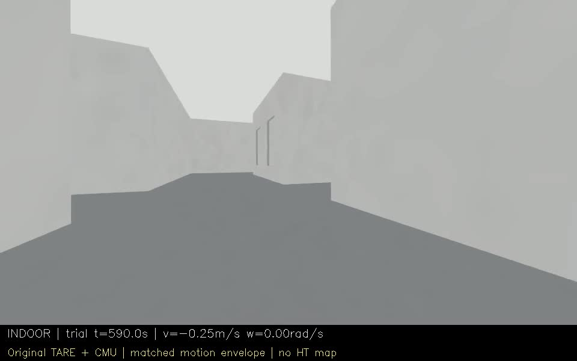
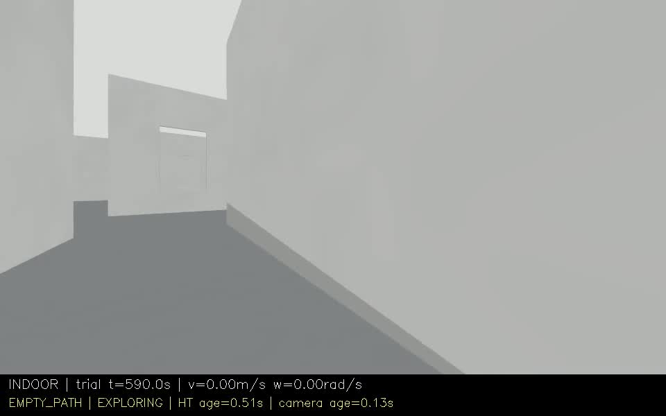

# 阶段47：原TARE与最新HT，同运动上限室内600秒对照

试验设施冻结`1ded85a7b66ad9506bb26b7abe4e1c1def946648`；HT导航保持`07c1abd334f83cb8d602e2234134b4286862c916`，原TARE ROS2适配基线`b6760adb4280b379567c76f4e684ce628e28ef71`。每组独立重启同一indoor原生起点，顺序原TARE→HT，均实际600秒。

原TARE保留自身探索/TSP与CMU规划器；原CMU参数对齐角速度和线加速度，并用透明限幅组件对齐倒车速度/角加速度，限幅前后指令均已记录。前进0.5、倒车0.25m/s，角速度0.8rad/s，常规线/角加速度0.5m/s²、1.2rad/s²。显式全零/输入过期可立即停止。CMU原maxSpeed=2.0的内部归一化配置保留，但autonomySpeed=0.5，实际输出另有共同限幅，并非以2m/s开车。两套地形、几何安全规则与跟踪器仍不同，是端到端对照，不是HT单模块消融。

| 指标 | 原TARE（对齐运动上限） | 最新HT |
|---|---:|---:|
| 实际里程/m | 188.190 | 190.530 |
| 近似观测自由体积/m³ | 4116.125 | 5027.125 |
| 最后60秒里程/m | 14.090 | 11.124 |
| 最长完全停车/s | 1.600 | 6.400 |
| 完全停车比例 | 0.33% | 6.62% |
| 原地转向比例 | 1.34% | 14.88% |
| 倒车指令比例 | 66.33% | 0.69% |
| 规划周期P95/s | 0.256 | 1.201 |
| 末任务 | EXPLORING | EXPLORING |
| 视点网格 | 50×50，间距0.6m | 100×100，间距0.3m |

本次HT/原TARE体积比=1.221，里程比=1.012。仅该次运行描述，不代表统计优越。

起点差0.000000m、航向差0.001500rad；配对/参数/实际指令/视频/采集检查分别保存在paired_validation.json、effective_parameter_comparison.json和逐组审计。总体状态：COMPLETED_WITH_ISSUES。

## 如何理解这次结果

- 最终HT比原TARE多911.000m³（+22.13%），里程仅多2.34m（+1.24%）。这次差别主要表现在实际路线带来的新增观测，而不是多行驶了很多；不能据此分离具体模块的因果贡献。
- 原TARE前半程更快看到新空间：第3分钟约3406m³，HT约1886m³；第6分钟原TARE约4006m³，HT约3622m³。HT在第7分钟反超，不能只看终值就说HT全程更快。
- 后段仍有低收益回访：最后60秒HT走11.124m，只新增3.625m³；原TARE走14.090m，新增约32.878m³。两组末状态均EXPLORING，观测增益平台不是探索完成或代码崩溃证明。
- HT完全停车6.62%、原地转向14.88%，高于原TARE的0.33%和1.34%；最长完全停车6.40s对1.60s。本轮未出现旧版数百秒停车，但短停和转向开销仍在。
- HT整个规划周期P95为1.201s，原TARE为0.256s，约4.69倍。HT视点网格数量也为原版4倍，且感知/局部路由不同；不能把4.69倍全部解释为XYθ搜索耗时。
- 原TARE倒车指令占66.33%，HT为0.69%。共同倒车上限是0.25m/s、前进0.5m/s；这个对照同时评价了两种跟踪器在同一不对称运动包络下选择前进/倒车的效果，不代表原CMU默认0.5m/s倒车控制链的表现。
- 实际轨迹显示原TARE主要向+y推进并沿原走廊返回，HT主要向+x和−y推进。视点采样密度、控制策略与实际分支不同，因此本轮只能说明这组现有配置的端到端结果，不是“HT地形替换单独提升22.1%”的证据。

## 视频与数据

[左右分屏对比视频：左TARE，右HT](comparison.mp4)

[原TARE 10分钟视频](original/camera_h264.mp4) · [最新HT 10分钟视频](ht/camera_h264.mp4)

## 原版退出异常（不隐去）

原TARE组的CMU localPlanner和pathFollower在采集完成、收到SIGINT之后，因ROS context已失效而抛异常并以-6结束。最早记录的信号处理时间为1792574297.610514，600秒测量窗口结束于1792574297.398429；异常均位于停止信号之后。定时探针已正常完成，录包/视频完整，未检出测量窗口内的该类异常。详细证据见original/lifecycle_exception_audit.json和原始local_planner.log。

因此保留600秒的探索指标，但原版的“无子节点退出异常”检查为false；整体状态COMPLETED_WITH_ISSUES，完整数据按带缺陷记录发布，不能声称所有稳定性检查通过。本轮没有修改原CMU节点源码来掩盖这个问题。

## 口径与限制

- 每秒按绝对源秒取一帧真实地图坐标激光，使用相同sensor里程计原点；0.5m自由体素并集、0.25m射线步长、15m截断、回波前0.25m排除。这是近似观测量，不是真值覆盖率。
- 原TARE完成信号只表示原生返航触发，不能拿它当HT的COMPLETED到家驻留状态，也不证明真实全覆盖。
- 两个系统各一次，固定运行顺序，探索随机性和初始化/感知/控制差异未统计消除；限幅后的原TARE不是原CMU默认高速控制链。
- 视点网格不同：原TARE 50×50、间距0.6m；HT 100×100、间距0.3m。名义范围均约30×30m，但HT有4倍网格数量，会影响候选和计算工作量；不能将差距全归于HT地形或XYθ。完整有效参数与逐项差异见effective_parameter_comparison.json。
- 记录保留全部发布控制/odom/状态/路线；激光源秒采样、HT输入/地图按既有策略，不是全部原始传感器全频无损录包。
- 本轮没有修改HT导航；本次对照不同时验证森林、隧道或实车。

完整数据以docs/experiments/publications/stage47.json远端大小/SHA回执为准，报告存在不等于已发布。
