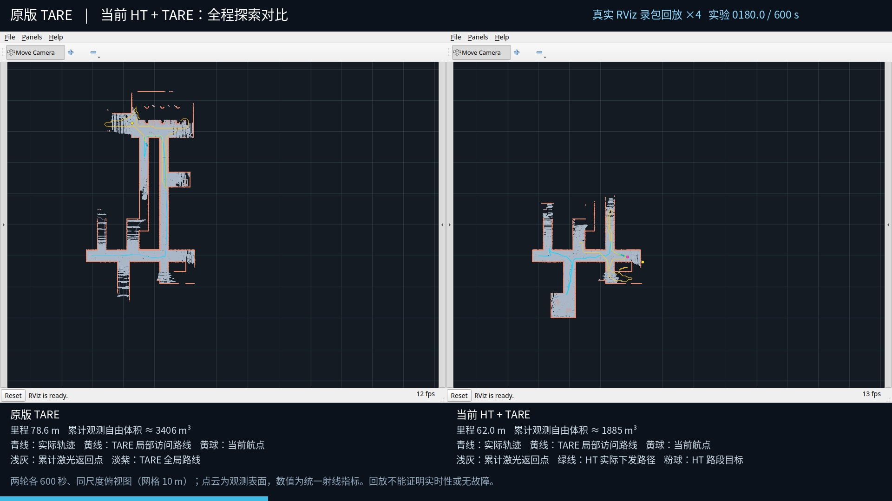
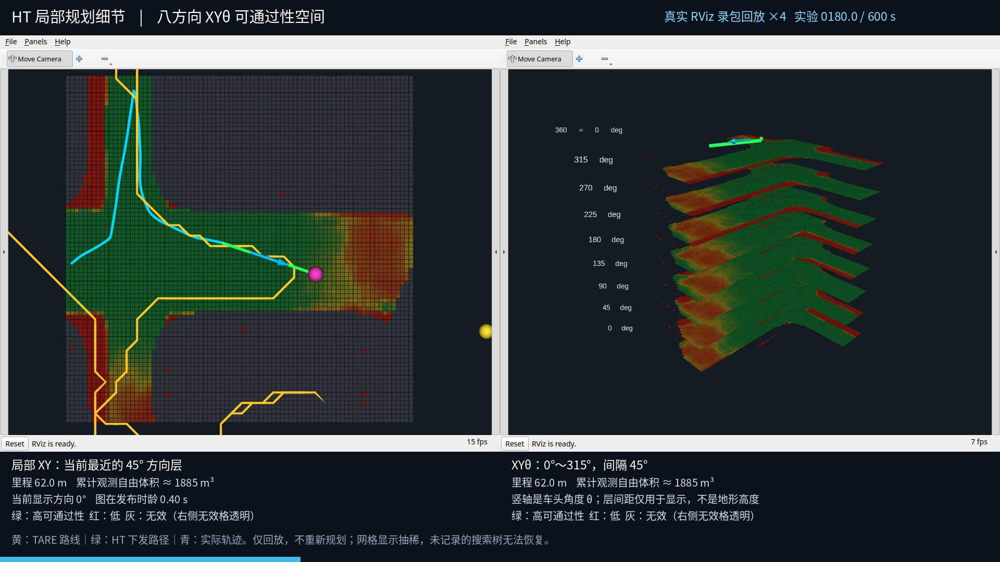

# 阶段47：RViz探索过程与XYθ局部规划回放

这两段是**实际RViz2窗口的录包回放视频**：读取之前两轮各600秒的实验数据，重新显示地图、轨迹与已发布路线，再录制RViz窗口。不是当时实时桌面录像，也不是新一轮导航实验。导航代码、原始MCAP和既有封存结果均不修改。

- [原版TARE与当前HT：全程同屏对比](https://github.com/CQULzz/HT_Explo/releases/download/ht-stage-20261021-tare-matched/stage47-rviz-comparison-4x.mp4)
- [HT局部XY地图与八方向XYθ空间](https://github.com/CQULzz/HT_Explo/releases/download/ht-stage-20261021-tare-matched/stage47-rviz-xytheta-4x.mp4)

均为1920×1080、10fps、H.264/yuv420p、4倍速；约2分30秒覆盖实验0～600秒。顶部数字是实验相对时间。可用播放器调至0.25倍，按实验时间观察；不会增加原本的可视化采样频率。

## 看哪些信息

全局对比：左侧原TARE，右侧当前HT。同一世界坐标俯视范围，网格边长10m；右为+X，上为+Y。图像逐步展开的是**累计观测激光返回点**，不是整个仿真世界的真值地图。前期原TARE向+Y走廊推进较快，HT随后沿+X和−Y分支推进；具体指标见[原比较报告](../ht_tare_matched_10min_2026-10-21_review/REPORT.md)。

| 颜色/标记 | 数据含义 |
|---|---|
| 浅灰点云 | 已接收的激光返回表面；高处偏暖色 |
| 青色曲线、箭头 | 记录位姿组成的实际轨迹、当前位姿和航向 |
| 黄色路线 | TARE局部覆盖/访问路线，不是承诺车辆将逐点行驶的轨迹 |
| 淡紫路线 | 原TARE全局覆盖路线，可能为空或很短 |
| 黄色球 | 当前`/way_point` |
| 绿色路线 | HT实际发布的`/ht_xytheta_path`，不是另算的shadow候选 |
| 粉色球 | HT当前`/ht_route_goal`路段目标 |

局部细节：左侧选取最接近当前车头方向的一个原始45°HT层，随车平移显示；右侧同时叠放八个方向层。XYθ的竖轴是θ，不是地形高度；层间距1.5个显示单位代表45°，360°与0°周期相接。经过0°边界的路线分段画出，避免跨整张图的虚假竖线。

局部XY图仅画当前HT范围内的实际轨迹片段；XYθ图只画当前车位姿与HT执行路径，不重复叠加历史轨迹，以免挡住地形。完整历史轨迹保留在全局对比视频中。

每层网格仍来自同一地形的相应方向预测：绿表示高预测可通过性，红表示低预测可通过性。左图灰格表示HT无效，右图无效格透明以免挡住下面各层。**这些是模型分数，不是加上车体足迹、几何碰撞、时效与运动约束后的最终允许状态。**绿线表示曾发布的路径，后续仍可能被安全检查暂时保持。





## 数据来源与显示处理

源试验：`ht_tare_matched_10min_2026-10-21_17-07-58`；冻结设施提交`1ded85a7b66ad9506bb26b7abe4e1c1def946648`，HT导航`07c1abd334f83cb8d602e2234134b4286862c916`，原TARE适配基线`b6760adb4280b379567c76f4e684ce628e28ef71`。

原始记录取自`/endurance/registered_scan`、`/state_estimation`、`/way_point`和已记录的各条路线；HT额外使用`/ht_traversability/global_local`、`/ht_route_goal`、`/ht_xytheta_path`。原版`/path`使用vehicle坐标，本次不靠猜测外参把它冒充世界系执行路径；原版黄色线显示实际记录的世界系`/local_path`覆盖路线。

- 两轮各使用测量区间内600份激光采样。仅显示距接收时当前传感器位姿15m内的返回点，0.18m体素保留一个实际点并累计；该显示处理不是重新建图或重新计算探索指标。
- 位姿显示最多10Hz，状态最多2Hz；视频帧推进0.4秒实验时间，发布该时刻前已接收的最新可视化状态。中间多次更新可能合并显示，不是全频逐消息录像。
- HT源图约0.040936m/格、241×241、约9.8655m见方。显示每隔3格抽取一个原分数，约0.122807m/显示格，未做概率插值。颜色保留原分数；显示抽稀不能用于复核每一个足迹硬约束。
- 按GridMap列主序和循环缓冲起始索引还原；索引0位于+X/+Y一侧。八层保持原来0°、45°、…、315°语义，不补造更细方向层。
- 下方里程与近似累计观测自由体积直接取封存CSV。体积是统一射线采样的外部近似指标，不是上方表面点数、官方覆盖率或真值已探索空间。
- HUD里程取不晚于当前回放时刻的最近一条0.5秒采样；例如HT最后一条在600.004秒，600秒画面仍显示599.504秒的190.278m。报告终值190.528m使用完整采样末行，两者存在约一个采样周期的差别，不是回放重新算出了不同里程。
- 回放按录包接收时间推进。RViz接收/渲染是异步的，画面与顶部目标时刻可能存在少量刷新延迟；不能用这段离线视频测量原系统实时规划延迟。局部HUD的“发布时龄”是该地图消息发布时的记录时间差，不是回放当前地图年龄。

## 复现

脚本：[rviz_recorded_comparison.py](../../../presentations/rviz_recorded_comparison.py)。依赖ROS2 Jazzy、rviz2、rosbag2_py/MCAP、grid_map_msgs、NumPy、PyYAML、Pillow/XCB、Noto CJK字体及libx264 FFmpeg。画面来自独立Xvfb显示，不抓取用户桌面。

```bash
source /opt/ros/jazzy/setup.bash
python presentations/rviz_recorded_comparison.py --prepare \
  --suite presentations/scheduled_results/ht_tare_matched_10min_2026-10-21_17-07-58 \
  --cache .git/rviz-replay-runtime/stage47.pkl
# 启动独立显示（本次使用本地解包的Xvfb）；不要在同一显示同时录两组窗口。
Xvfb :98 -screen 0 1920x1080x24 -nolisten tcp -ac +extension GLX +render -noreset
# 在另一终端执行，ENCODER指向支持libx264的FFmpeg二进制：
ROS_DOMAIN_ID=231 python presentations/rviz_recorded_comparison.py \
  --cache .git/rviz-replay-runtime/stage47.pkl --mode comparison \
  --output /tmp/stage47_rviz_comparison --encoder "$ENCODER" --display :98
# 局部细节将--mode改为detail，使用不同输出目录；配置由脚本生成。
```

只发布`/recorded_rviz/...`下的点云与MarkerArray；没有`cmd_vel`发布器，不启动仿真、规划器、推理或控制器。原始搜索展开节点没有录制，不能恢复搜索树；视频展示地形与已发布路径。

## 验证与已有局限

视频整段解码、尺寸/帧数/时长、源封存清单核对和上传校验分别见`validation.json`、`source_review.json`与独立发布补充回执。RViz配置、渲染日志、采集信息和关键帧与本报告一起保存。

原实验仍为`COMPLETED_WITH_ISSUES`：原TARE的两个CMU节点在600秒测量后SIGINT退出时异常。本次补录不改变该失败记录，也不能把离线可视化成功当成实车或多场景稳定性验收。两轮实际路线、视点网格密度、地形和跟踪器不同，单次对比不能证明HT单模块因果提升。

GitHub视频附件：[全局RViz对比](https://github.com/CQULzz/HT_Explo/releases/download/ht-stage-20261021-tare-matched/stage47-rviz-comparison-4x.mp4) · [HT局部与XYθ](https://github.com/CQULzz/HT_Explo/releases/download/ht-stage-20261021-tare-matched/stage47-rviz-xytheta-4x.mp4)。本页只补充可视化，不覆盖原有22个Release附件或原发布回执。
