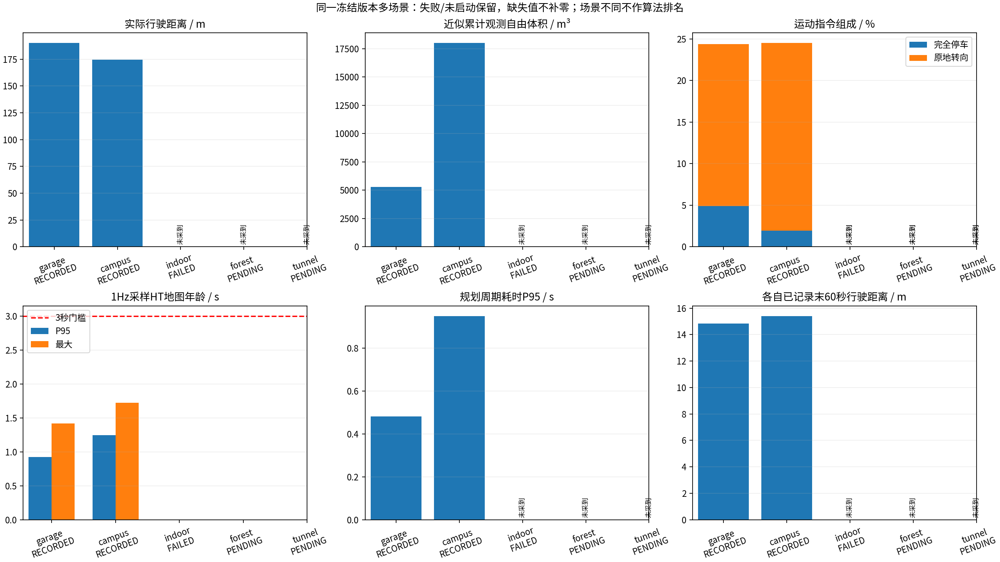
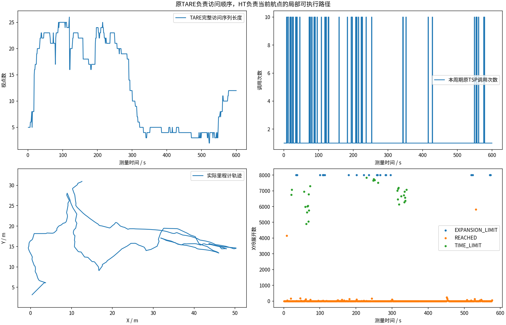
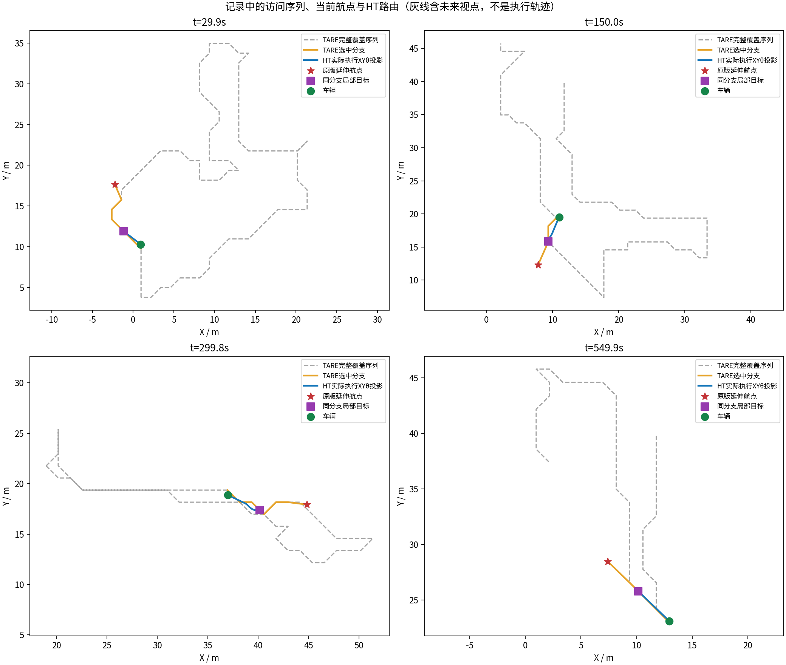
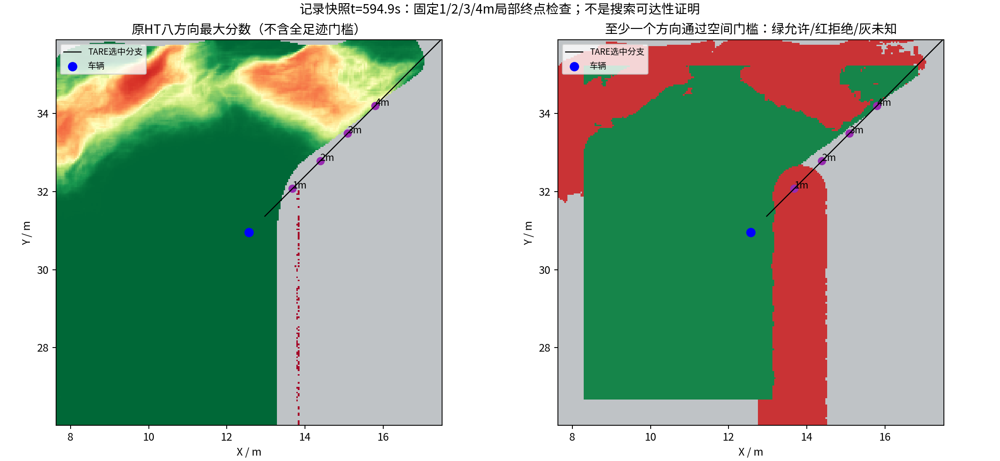
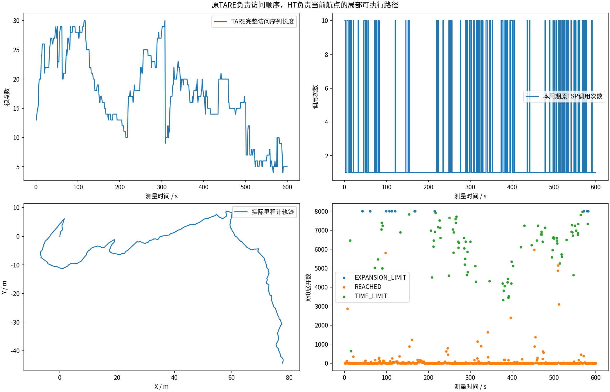
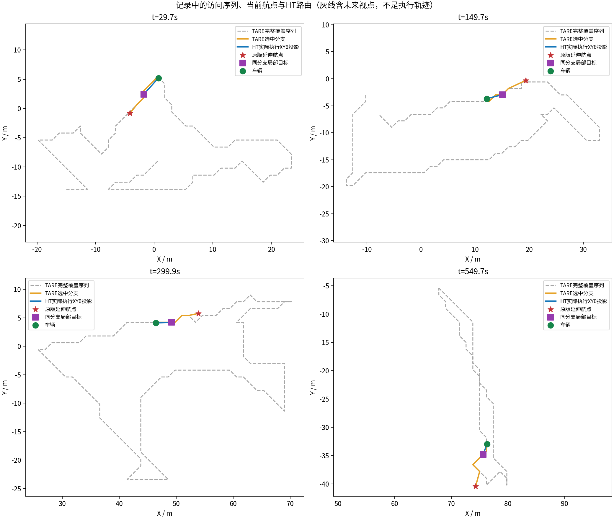
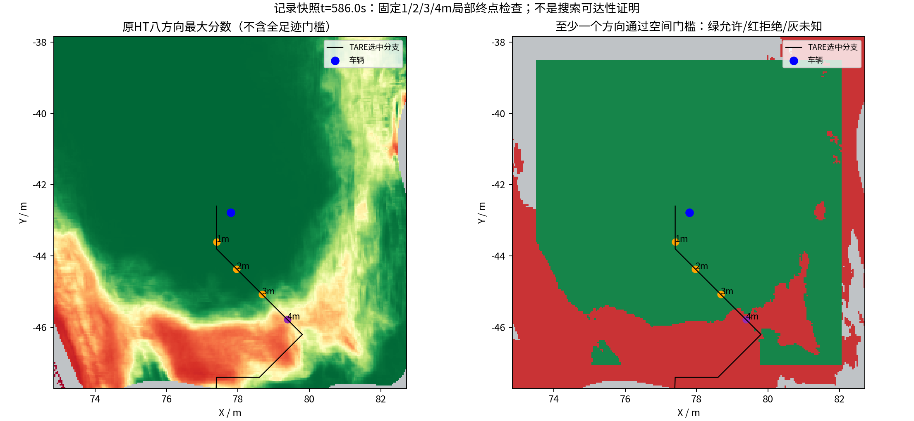

# 原TARE＋HT多场景：计划与实际采集结果

冻结运行提交：`dccfcc93232f0f27f9ae2d63b59ae93c4c1168c4`。每场景计划600秒；实际完成情况逐组列出。
原批次状态：`RUNNING`；原批次终态记录存在：`False`；派生发布状态：`INTERRUPTED_OR_UNFINALIZED`。
原suite.json原样保存；中断和未启动场景不补拼、不冒充600秒。进度字段仅为最后一次状态抽样，不是最终实测时长。

| 场景 | 原状态 | 实测时长(s) | 最后进度(s) | 完整采集检查 | 视频 |
|---|---|---:|---:|---|---|
| garage | RECORDED | 600.0 | 599.8 | True | [已验证视频](garage/camera_h264.mp4) |
| campus | RECORDED | 600.0 | 600 | True | [已验证视频](campus/camera_h264.mp4) |
| indoor | FAILED | 未知 | 569.5 | False | 未生成或未验证；原文件保留于完整录包 |
| forest | PENDING | 未知 | 未采到 | False | 未生成或未验证；原文件保留于完整录包 |
| tunnel | PENDING | 未知 | 未采到 | False | 未生成或未验证；原文件保留于完整录包 |

## 原TARE与HT分工核验

本批原TARE决定访问顺序，HT负责指定航点XYθ路线；附加审计的未执行或空样本不计作通过。

| 场景 | 原覆盖周期 | 最大访问视点数 | HT非空路线 | 航点/同分支违例 | 分工检查 | 附加审计 |
|---|---:|---:|---:|---:|---|---|
| garage | 585 | 26 | 563 | 0 | True | 已执行，退出码见additional_audits.json |
| campus | 547 | 30 | 547 | 0 | True | 已执行，退出码见additional_audits.json |
| indoor | 未知 | 未知 | 未知 | 未知 | 未审计 | 未执行：记录不完整 |
| forest | 未知 | 未知 | 未知 | 未知 | 未审计 | 未执行：记录不完整 |
| tunnel | 未知 | 未知 | 未知 | 未知 | 未审计 | 未执行：记录不完整 |

[PDF图表](multiscene_diagnostics.pdf)。缺失值留空并标“未采到”，不填成零。

[同场景车库历史比较](garage_history/tare_architecture_comparison.png)；只包含实际具有完整指标的记录。

累计观测体积是0.5米体素的采样激光射线自由空间并集，不是真值覆盖率。不同场景/起点不可作算法排名；没有新增同限制原版TARE配对或实车验证。前缀终点允许不等于完整XYθ路径可达。
精选目录仅包含可用报告及已验证视频；失败视频、MCAP、快照等全部已录文件由完整原始Release分卷保存，远端发布是否完成以发布校验回执为准。采集完成不等于探索成功。
