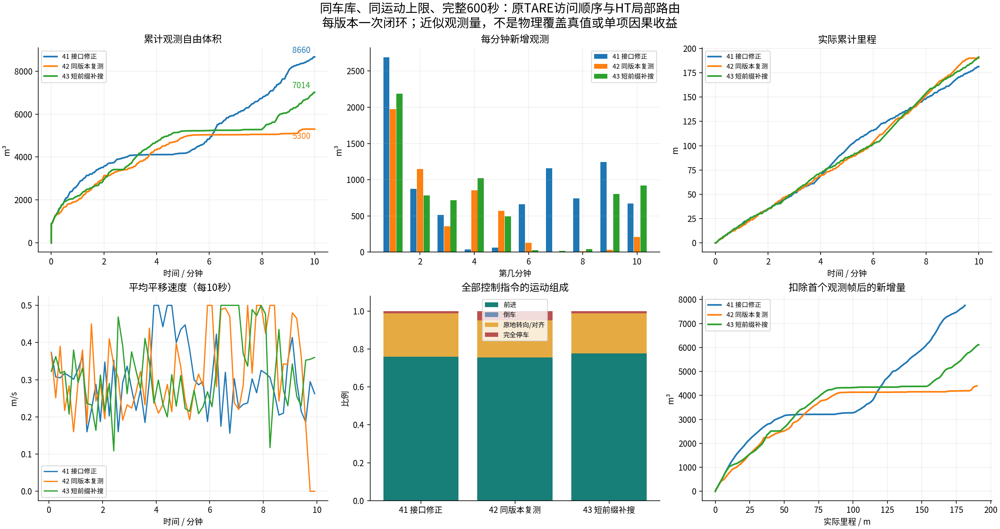
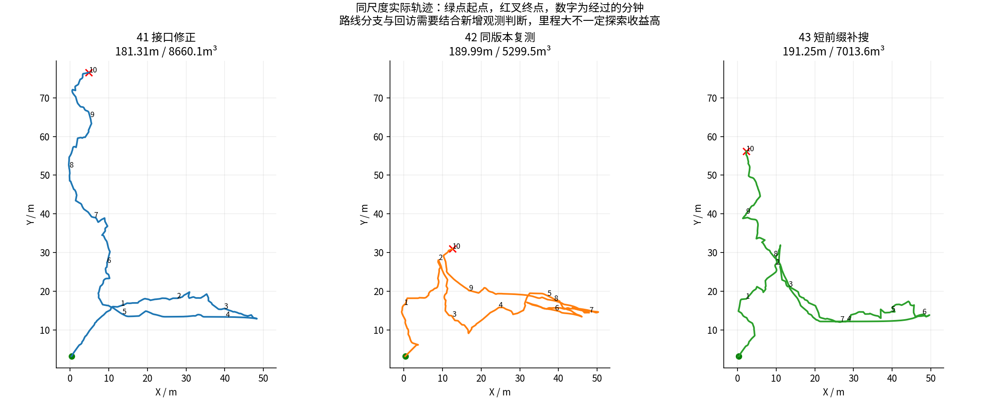
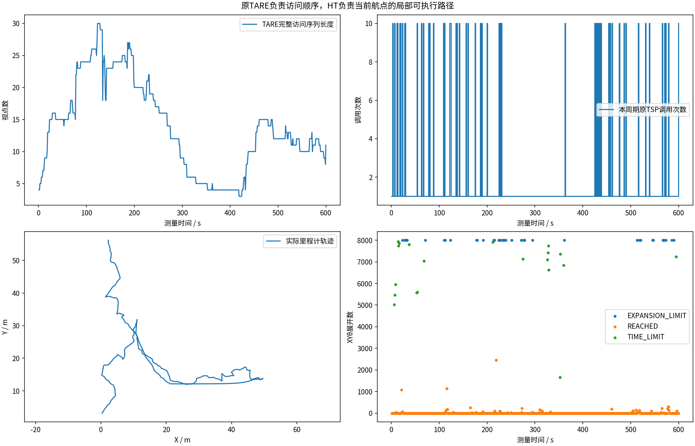
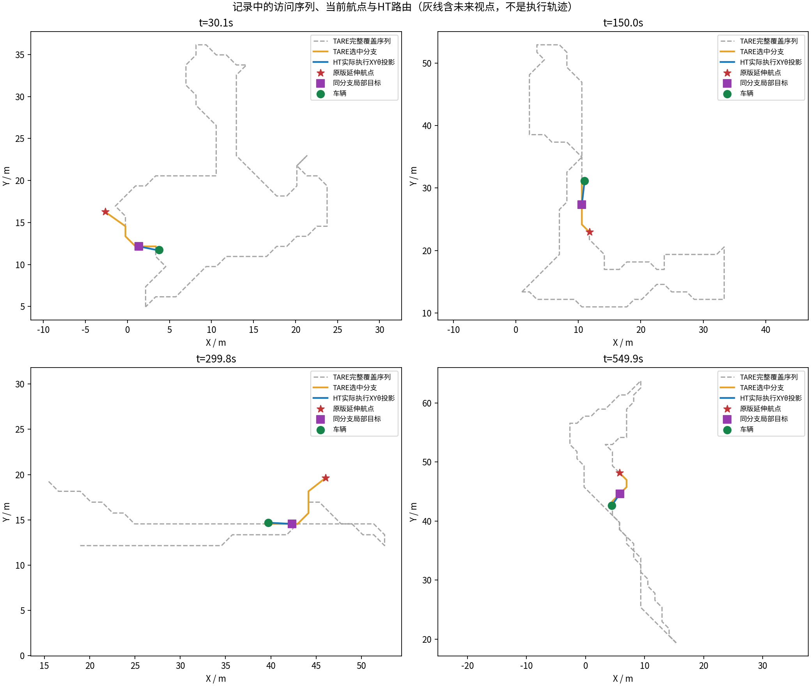
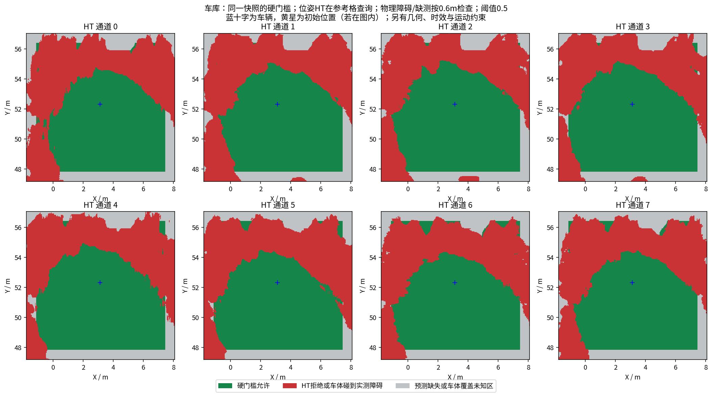
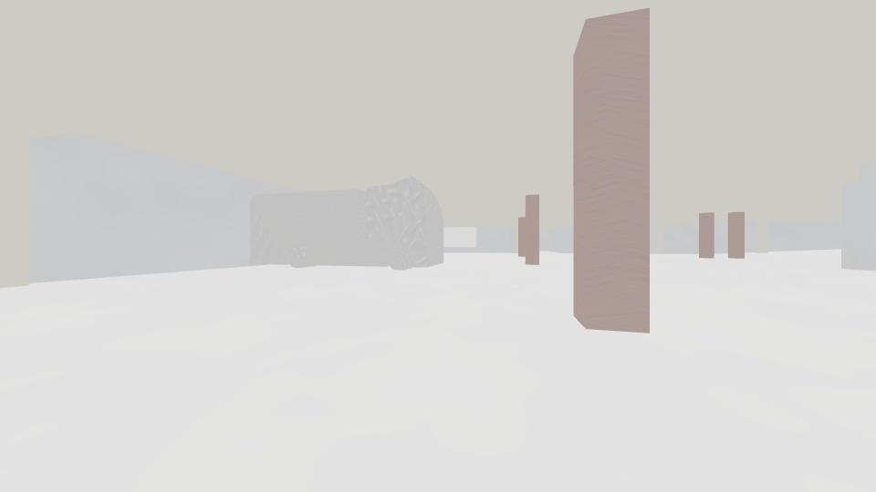

# 阶段43：原TARE路线短前缀补搜，车库600秒

实测代码 `d7e0741c1aeeb65f4c0ff404521a4c54f992a330`。保持原TARE六函数/TSP/waypoint、HT硬阈值和运动限制。新旧初始位姿接近但并不完全相同；每候选单次闭环，不能保证统计优越或单项因果。

## 原因和修改

旧车库末段22周期固定1/2/3/4米终点全部不允许，没有进入XYθ搜索；同一TARE分支短于1米处仍有支持。保留快速路径，失败后细采样同分支短前缀，避开后方锚点，仍用完整HT/几何/运动检查和原0.35秒周期搜索预算。没有换收益点、提高速度或放行未知。
[计划](../../plans/2026-10-21_tare_ht_short_prefix_plan.md) · [根因及回归](../../fixes/2026-10-21_tare_short_prefix.md) · [室内问题诊断](../../fixes/2026-10-21_indoor_ht_gate.md)。

## 同场景实际结果

| 版本 | 实测秒 | 里程m | 近似自由体积m³ | 末60秒里程m | 完全停车 | 原地转向 | 最长完全停车s | 规划P95s | 地图年龄P95s | 末状态 |
|---|---:|---:|---:|---:|---:|---:|---:|---:|---:|---|
| 41接口修正 | 600.0 | 181.31 | 8660.125 | 16.56 | 1.22% | 22.84% | 0.250 | 0.431 | 0.743 | EXPLORING |
| 42同导航复测 | 600.0 | 189.99 | 5299.500 | 14.83 | 4.90% | 19.48% | 22.133 | 0.481 | 0.924 | BLOCKED |
| 43短前缀补搜 | 600.0 | 191.25 | 7013.625 | 19.06 | 1.18% | 21.16% | 0.600 | 0.432 | 0.648 | EXPLORING |

相对42体积变化+1714.125m³。采样激光自由空间并集不是物理真值；不能把里程大等同于探索好。
本轮新增补搜没有触发，不能用本轮体积变化证明补搜收益；针对性回归验证了固定终点漏搜的修正。

## 实际补搜与剩余问题

新增补搜尝试0次，成功0次，其中短于1米成功0次；路由保持停车日志0周期。[逐次摘要](adaptive_usage.json)。原TARE→HT分工检查True，记录级违例0；记录审计不是连续物理安全或全局可达性证明。

四项CTest、六原函数SHA、10项记录流程回归通过。完整采集13项检查和视频验证见[本轮校验](garage/suite_validation.json)。[视频](garage/camera_h264.mp4) · [运行文件差异](runtime_changes.json)。
时间/展开预算失败、短步推进和地图噪声仍需看真实记录。室内12个低分点切断走廊的问题尚未在线修复；没有新增同限制原版TARE对照或实车试验。

完整已录文件上传Release后以stage43.json回执为准；本地报告与视频不代表原始数据已上传，未验证资料不删除。
