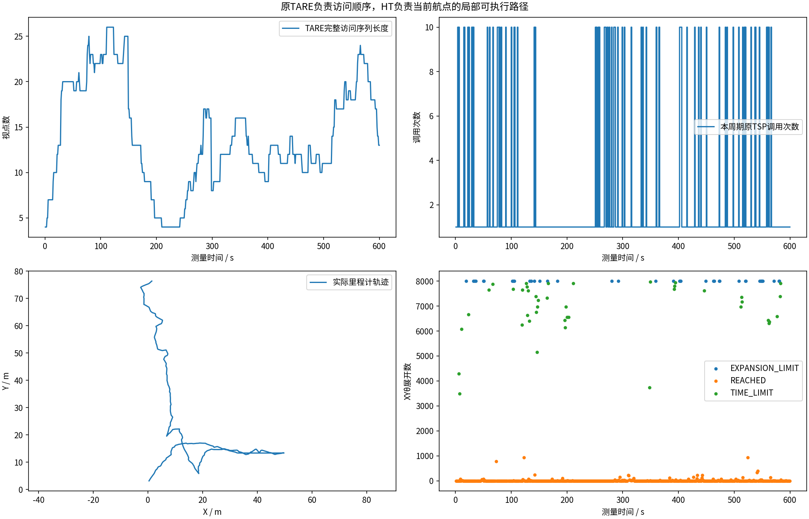
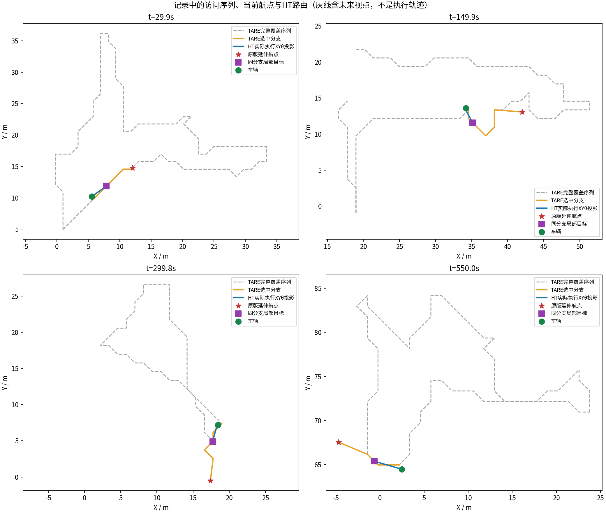
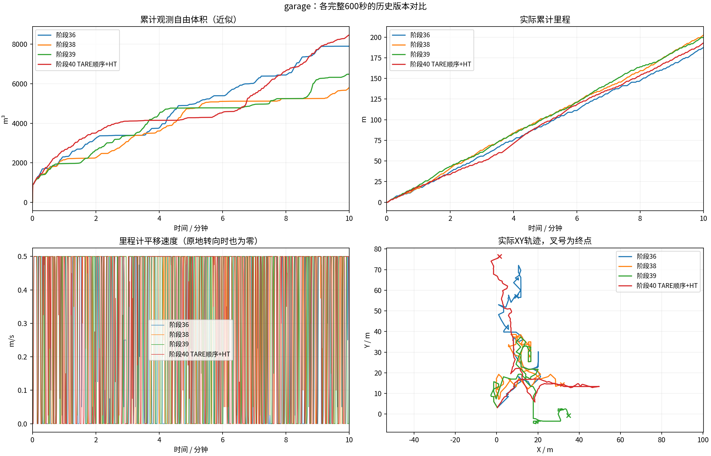
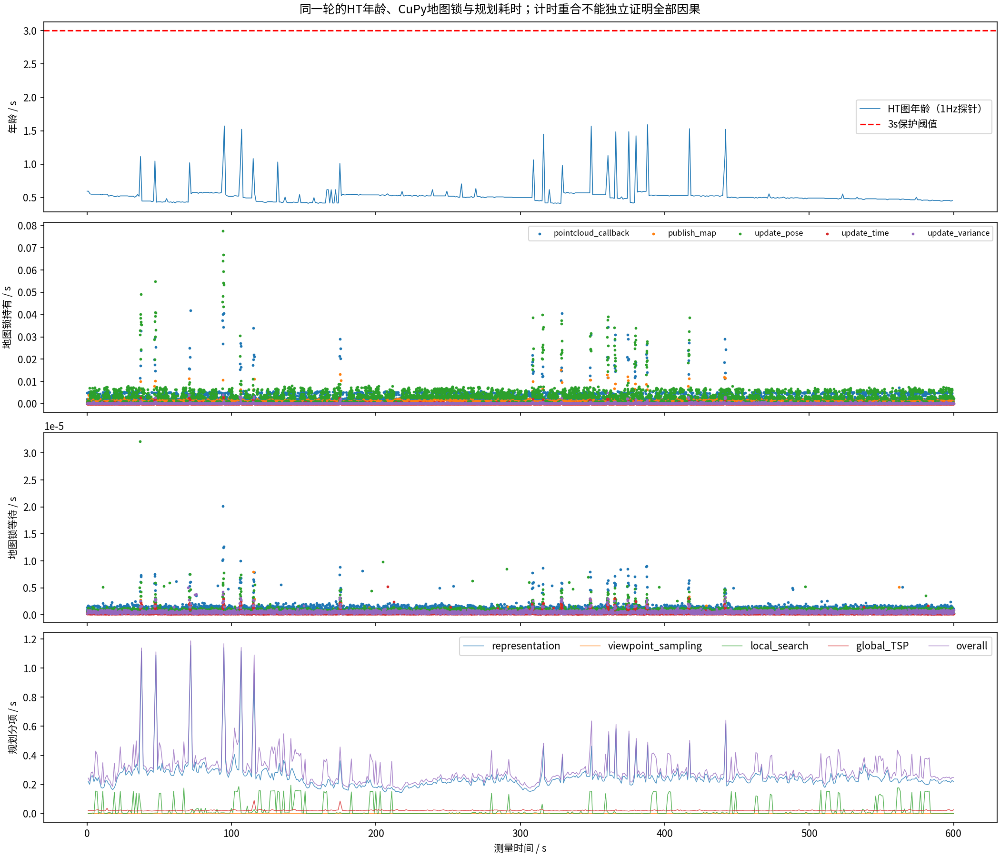
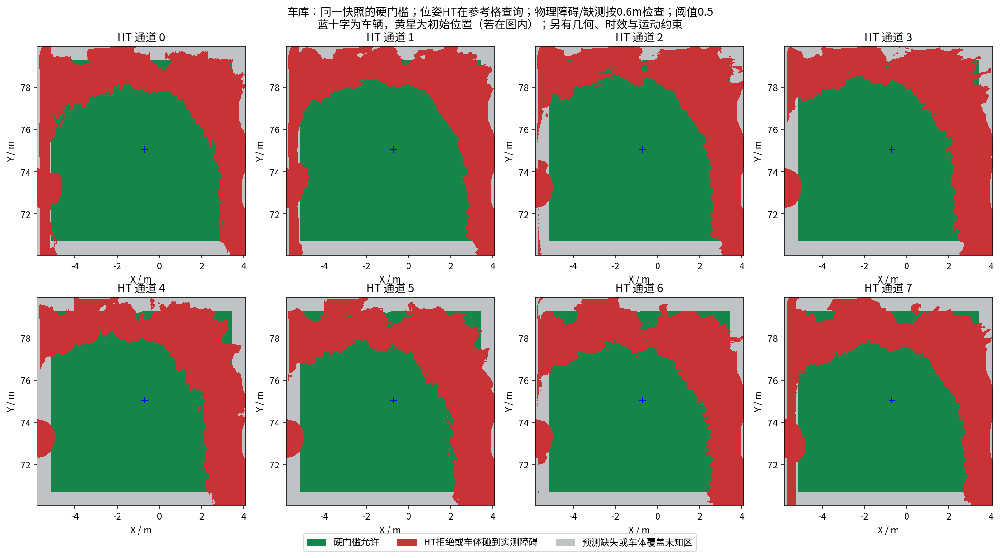

# 阶段40：原版TARE决定访问顺序，HT负责航点路由

**完整车库600秒：192.93米，近似累计观测自由体积8467.000m³，较阶段39为+30.6%。** XYθ搜索时间上限42次、展开上限38次；最长完全停车0.75s，末60秒新增731.724m³/移动20.80m；末尾EXPLORING。这是单次闭环结果，不是统计优越性或探索完成真值。

## 按用户要求改了什么

[先行计划](../../plans/2026-10-20_tare_ht_waypoint_plan.md)先于实现提交。代码`42966cb22b0f719df035391f3850b9a654f161e1`：默认`tare_waypoint`，恢复原版局部覆盖、局部TSP、全局任务更新、全局TSP、路径拼接和前视点选择。六个核心函数体与独立ROS2适配原版参考`b6760ad`逐字SHA一致，[核对结果](upstream_and_regression/regression/ht_tare40_upstream_contract.json)。不是说整个ROS2包与官方ROS1仓库逐字相同。

TARE使用自己的完整视点序列、采样/收益去重、路径长度目标和TSP求解器；HT不再通过单点收益/时间、指南冷却和目标承诺改写访问目标。原版航点延伸也保留。过远航点沿TARE路线分支取局部前缀，再用XYθ找从当前odom过去的可执行路径。HT找路失败发零，不改选其他收益点。所有执行轨迹仍经原运动学约束、HT硬门槛、点云几何和控制拦截，速度限制未提高。

地形高度来自CuPy/HT同源历史高程，第12层`ht_elevation`与八方向图坐标/时间一致；墙顶不作地面。粗视点只需存在可通方向，执行仍逐段检查实际方向。远端未观测位置只用于原TARE乐观引导，不授权开进未知地形。CMU地形仅在`/simulation/terrain_map`供车辆模拟器贴地，TARE原地形输入话题无发布者，[现场话题核对](garage/terrain_topic_isolation.json)。

## 接口是否真的按这个分工运行

592个覆盖周期记录原TSP，实际调用次数分布{'1': 520, '10': 72}。最大完整访问序列26个索引，平均13.89个；原版最多10次优化，但已有覆盖/空队列时走原版单次分支，不能说每周期必算10次。录包保留完整顺序、覆盖路线、原版航点、HT局部目标和实际执行路线。

600个允许移动的航点与最近原TARE航点相同，672个局部目标核对是否位于对应分支；审计违例0，总体接口检查True。消息级检查不等于连续安全或实际逐视点到访证明。[审计数据](tare_waypoint_audit/summary.json)

灰线是TARE未来访问路线，橙线是当前分支，蓝线是实际发布的HT路线XY投影，星号是原TARE延伸航点；它们不是已经走过的轨迹。

## 同车库对比，改善和退步一起保留

| 指标 | 阶段39：HT自选目标 | 阶段40：原TARE顺序+HT |
|---|---:|---:|
| 累计近似观测自由体积m³ | 6483.0 | 8467.0 |
| 实际里程m | 199.69 | 192.93 |
| 末60秒里程m | 19.260023999999987 | 20.80419277108433 |
| 完全停车比例 | 4.84% | 1.36% |
| 原地转向比例 | 19.55% | 20.18% |
| 最长完全停车s | 1.1 | 0.75 |
| 最长无平移s（含转向） | 4.95 | 5.549 |
| 地图年龄P95s | 0.602 | 0.618 |
| 地图年龄最大s | 1.574 | 1.592 |
| 整体规划P95s | 0.5109999775886536 | 0.45500001311302185 |

同场景近似同起点、前进0.5m/s和相同转向/倒车/加速度限制。具体参数和变动源码见[冻结配置对照](configuration_comparison.json)与[代码差异](tested_source.patch)。地形输入、目标组织、路线分支都改变，所以本轮不是单项算力消融。原始TARE历史角速度/倒车/加速度更宽松，尚未补齐完全同约束的新600秒原版配对，不能把本轮体积比当成已追平原版。

## 仍存在什么问题

闭环录制后另做构造回归，确认了两个接口边界，下一候选修正；本轮消息检查通过不代表所有配置均正确：

1. **HT删点后连通性未同步。** 用真实ViewPointManager加载一条全方向禁行带，另一侧仍connected=1/candidate=1，但最短路poses=0；期望不允许该候选的GTest确实失败。原因是HT候选筛选发生在原BFS之后，连通性尚未看到这次删除。[失败输出](boundary_counterexamples/ht_tare40_connectivity_counterexample.log) · [构造源码](boundary_counterexamples/ht_tare_connectivity_probe.cpp)。
2. **近家返航指令优先级。** 源条件构造中，离家1.2m、原版rush-home开启，前视函数可无有效输出，但原版PublishWaypoint优先发HOME；HT包装层若先要求前视输出，会错误停车。此600秒始终EXPLORING，**这不是本轮现场停车原因**。[参数与条件](boundary_counterexamples/rush_home_source_case.json)。

XYθ搜索时间上限42次、展开上限38次；最长完全停车0.75s，末60秒新增731.724m³/移动20.80m；末尾EXPLORING。 搜索预算失败不等于地形绝对不可通；硬约束也可能因地图误差拒绝真实平地。完整序列恢复不保证每个TARE航点在当前局部HT图中可达。没有全方向历史HT缓存或全局SE2可达性保证，局部有效窗口仍约9.87m见方；粗历史高度/可行性用于引导，执行用新鲜局部HT。尚未验证无限时长、其他环境、轮胎动力学和实车。

执行日志中的拦截非零配对0，未配对0；几何拦截非零0，几何未配对{'GEOMETRY_COMMAND_BLOCKED': 0}。几何采样余量重叠0/592，旧指令外推碰余量0条；采样和外推不是连续物理接触真值，单列证据不隐藏。[几何审计](execution_geometry_audit/summary.json)

## 验证、图册和完整数据

13项采集检查全部通过，4项CTest及新增桥接检查通过；视频9000帧/600.000000秒完整解码。61份最终上下文和历史图CRC通过：True；59份输入上下文核对与模型重算通过：True。

源秒激光600帧、跳过0，0.5m自由体素并集是近似观测量，不是物理覆盖真值。MCAP含全部发布HT/控制/状态/odom、按源秒保留激光、周期地图及精确HT输入输出，不是所有原始传感器无损录制。

[完整600秒视频](garage/camera_h264.mp4) · [历次多角度图册](history/index.html) · [PDF](history/all_comparisons.pdf) · [GitHub完整数据Release](https://github.com/CQULzz/HT_Explo/releases/tag/ht-stage-20261020-tare-waypoint)。完整发布以仓库`docs/experiments/publications/stage40.json`远端大小/SHA256回执为准。GitHub保留全部，本机仅保留最近两轮已核验完整原始数据。

