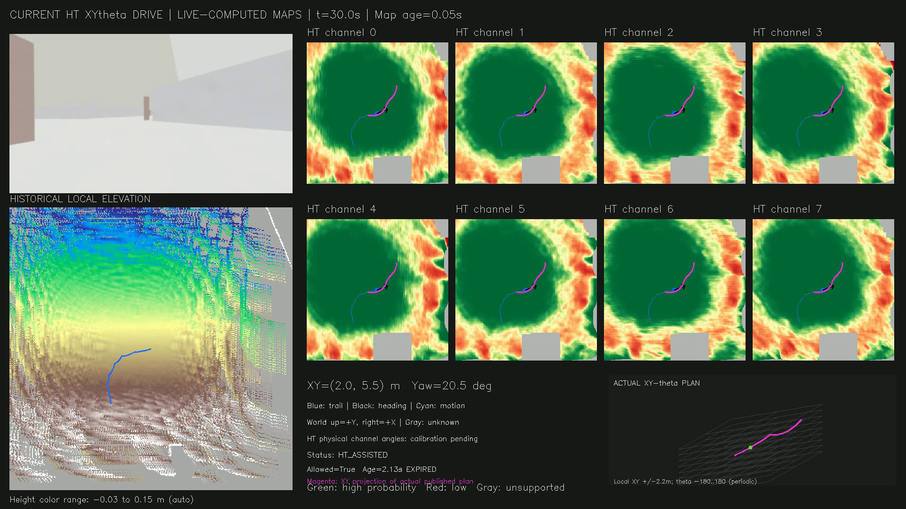
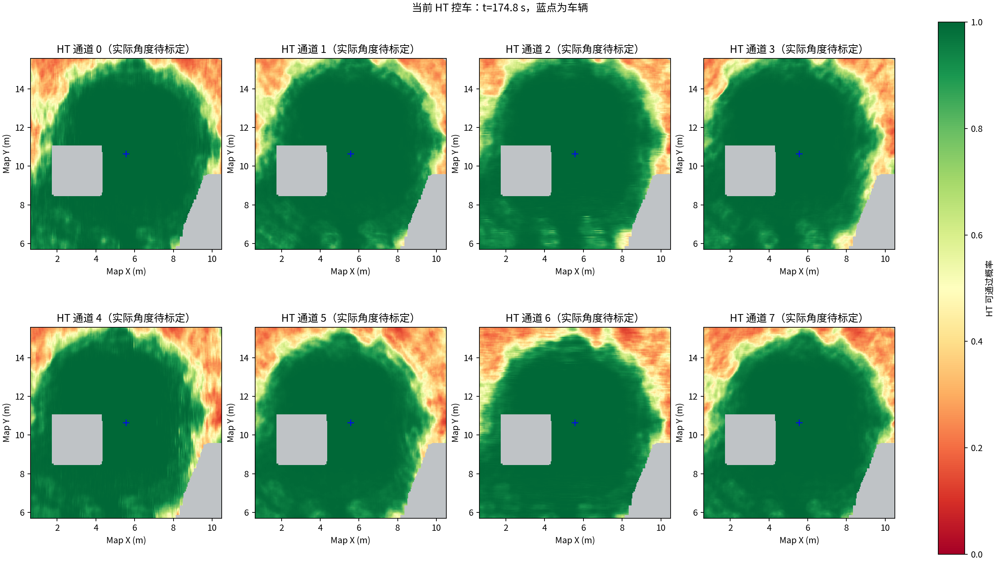
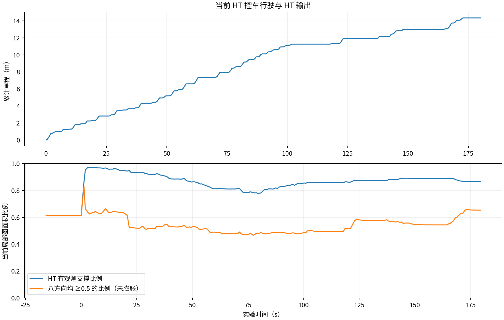

# 当前 HT 控车验证

记录 180 秒，行驶 14.35 米，到访 13 个1米轨迹格；探索完成：False。

运行按预设时长结束，不代表探索完成。1米轨迹格仅统计车走过的位置，不是探索面积或体积。

本次修改：修正 CuPy 到 ROS 的重复坐标翻转和历史格索引；按高度分层保留历史观测；保留真实观测时间；对小幅噪声做保边处理，遇到不兼容的高度保留未知状态；分离点云和周期回调，避免 TF 等待阻塞建图。

本轮由当前 HT/XYθ 规划与跟踪器实际控车，非原版轨迹离线计算。视频紫线来自实际发布的 /ht_xytheta_path，右下角显示实际姿态路径。

HT 状态：{'HT_ASSISTED': 216, 'HT_MAP_STALE': 1, 'NO_EXECUTABLE_ROUTE': 7}；最大 HT 图年龄 3.149 秒。

点云对应时间窗口：录包 984 帧，接收 984 帧；成功处理窗口录包 983 帧，完成融合 983 帧。

接收排队：中位数 0.047 秒，P95 0.800 秒，最大 1.584 秒。

完全零速指令 1484/3600，其中许可超过1.5秒未续期 1294 次、许可为假 114 次、路径超过3秒 0 次。原地转向指令另计 1035 次。

上述次数是20Hz控制指令样本数，不是停车事件次数；过期状态与零速同时出现，不能仅据此排除其他停车条件。summary.json 的 zero_cmd_fraction 按线速度统计，包含原地转向，不能当作完全停车比例。

TARE /runtime 指标中位数 0.301 秒、P95 0.697 秒；该指标不等于整条感知到控制链路的延迟。

地图坐标、分层历史和真实观测时间已修正；远处噪声、未知区及执行停顿仍应结合视频检查，不能宣称探索已全部解决。模型八通道物理角度仍待实车标定。

225组保存快照中的 CuPy、历史高程和HT图时间戳全部严格一致。最后一帧点云在主动结束时未完成融合（984帧接收、983帧融合）；日志末尾的中断和仿真节点退出异常发生在脚本主动停止阶段。

本次仿真使用修复提交 `322ec85`；Garage，速度上限0.5m/s，运行180秒。地图与控制数据实时计算，视频事后按录包时间合成。视频为1920×1080、10fps、180秒，不代表规划频率为10Hz。

验证：历史融合/边缘保留等42项测试通过；CuPy GPU/ROS 7项测试通过；HT核心140项及ROS集成13项检查通过。仿真只能说明本次场景表现，八通道物理方向尚待实车标定。



紫线是实际发布路径的XY投影，蓝线是已行驶轨迹，黑箭头是车头方向；右下角是同一实际路径的XYθ表示。绿色表示模型高可通过性，红色表示低可通过性，灰色表示无支持。图中标为EXPIRED的许可不会继续授权控制。





完整视频与原始bag保留在本机，未上传Git仓库：

```text
presentations/scheduled_results/ht_validation_final_2026-10-15/visuals/current_ht_exploration.mp4
presentations/scheduled_results/ht_validation_final_2026-10-15/original_bag/
```

再次运行并自动录包、生成视频与报告：

```bash
python3 presentations/run_ht_validation.py --duration 180
```

需已构建独立的CMU仿真工作区、CuPy工作区及本仓库。配置见[CuPy安装说明](../../../tools/elevation_mapping_fixes/README.md)。

[原始指标](summary.json) · [接收与停顿审计](delivery_and_pause_audit.json) · [建图统计](cupy_processing_stats.json)
