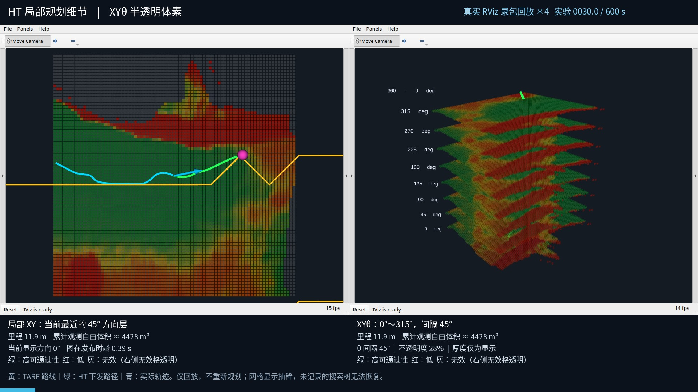
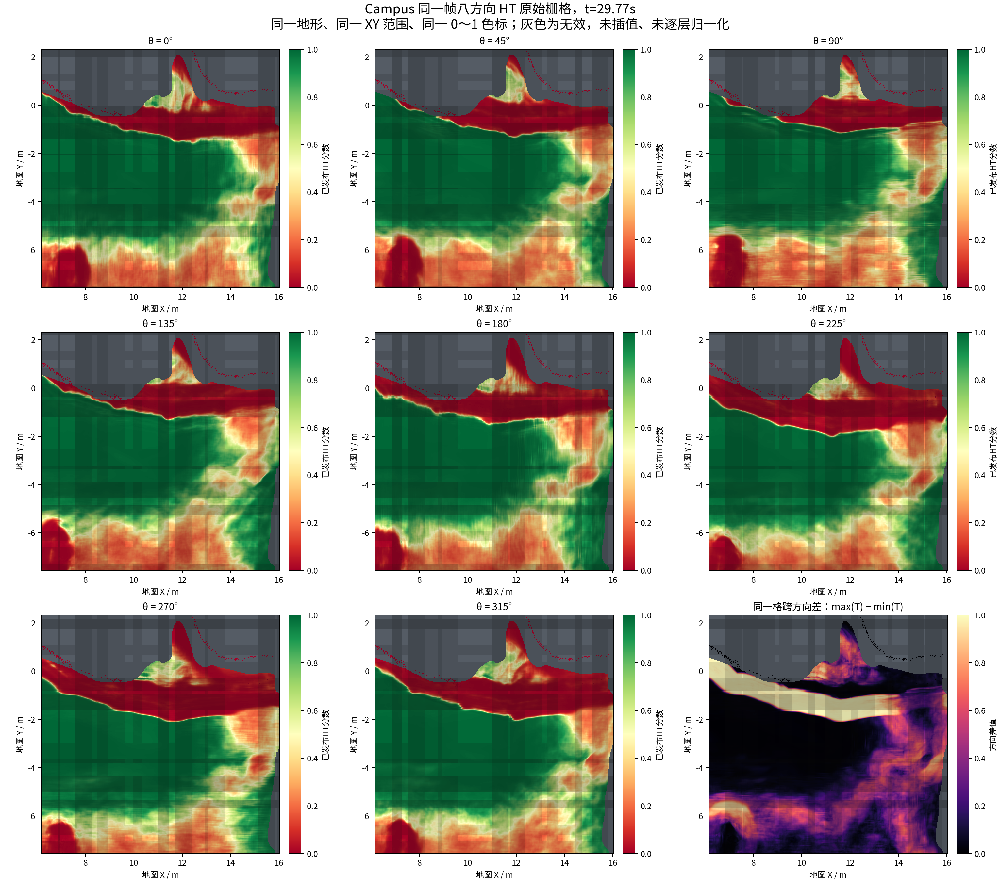

# HT八方向差异核对与半透明体素预览

八层表示同一块地形在八个方向的已发布HT分数，几何位置共用。直接读取Campus原MCAP的1175帧，**没有一帧八层完全相同**。这能排除“把同一张图复制八遍”，不能单独证明模型的物理准确性或方向标定正确。

- 按有效格子与帧联合统计，八方向最大最小差的均值为0.221；62.42%的格子—帧差值超过0.05。
- 0°与180°的平均绝对分数差为0.122。统计包含共用的几何障碍格。
- 原录包选取的同一帧，经显示用的每3格取样后，与RViz缓存的八个通道及有效掩膜逐项一致。

完整统计见[audit.json](audit/audit.json)、[逐帧CSV](audit/per_map.csv)、[独立原始栅格快照](audit/snapshot.npz)和[验证记录](validation.json)。

## 为什么轮廓相似

平地通常在多个方向都获得高分，障碍位置也不会随车头方向移动。冻结的[建图桥接代码](https://github.com/CQULzz/HT_Explo/blob/f7fd77b66fc442752599ead359e8aa60e7773ae4/tools/ht_cupy_bridge/cupy_to_ht.py)还会将识别出的部分几何障碍格在八方向共同设为0。方向差异主要体现在周边分数与边界范围；需要在同一XY位置比较数值。

旧图的不透明度0.88，格子厚度仅0.012显示单位，接近重叠薄片，容易遮挡下层。半透明能缓解遮挡，但叠色会影响读数，过低的不透明度也会让画面变糊。

## 新版显示

[半透明体素视频：原实验30～150秒，4倍速、30.1秒](https://github.com/CQULzz/HT_Explo/releases/download/ht-stage-20261021-campus-matched/stage48-xytheta-transparent-voxels-4x.mp4)

不透明度设为28%，体素XY填充为显示格间距的82%，厚度0.14显示单位；八方向间距保持45°。厚度仅是显示比例，没有给未采样角度补造分数。无效格不绘制；右侧是XYθ，左侧保留当前最近方向的XY投影和记录中的执行路径。



下面八幅图共用XY范围和0～1色标，保留241×241原始栅格，不平滑、不逐层归一化。分数包含原实验已经施加的几何掩膜。右下角为同一格八方向最大最小差，便于直接辨认方向影响。



## 数据、验证与限制

本次只做离线显示与审计，使用阶段48的既有Campus录包：实验设施f7fd77b，HT导航07c1abd。未重跑探索，未改变原记录的分数、路线或运动指令。原实验COMPLETED_WITH_ISSUES状态保持，原来的32个Release附件不覆盖。

五个生成的视频均完整解码；正式预览为1920×1080、10fps、301帧。发布话题全部在/recorded_rviz/下。原MCAP的文件大小与修改时间在审计前后一致。颜色混合后的屏幕RGB不用于计算方向差异，数值核对使用原始发布通道。

显示试调的12%/6%低不透明度版本、28%/42%版本均保留在previews中。首次预览误选DDS域236，FastDDS端口超出范围，改用230后成功；失败日志保留，不影响原实验。

Jazzy的[CUBE_LIST实现](https://github.com/ros2/rviz/blob/jazzy/rviz_default_plugins/src/rviz_default_plugins/displays/marker/markers/points_marker.cpp)支持逐点alpha；[透明混合实现](https://github.com/ros2/rviz/blob/jazzy/rviz_rendering/src/rviz_rendering/objects/point_cloud.cpp)解释了叠色现象。此处保留原红黄绿分数映射，只改变显示体积和alpha。

## 复现

精确使用的渲染脚本为renderer_snapshot.py，参数和哈希见render_settings.json；早期试调脚本为renderer_preview_snapshot.py。使用独立显示器，避免抓取用户桌面：

```bash
source /opt/ros/jazzy/setup.bash
export ROS_DOMAIN_ID=230 OPENBLAS_NUM_THREADS=1
# 先在独立终端启动Xvfb :98 -screen 0 1920x1080x24 -nolisten tcp -ac +extension GLX +render
python3 docs/results/ht_xytheta_transparent_voxels_2026-10-22/renderer_snapshot.py \
  --cache .git/campus-matched-runtime/rviz.pkl --output NEW_OUTPUT \
  --mode detail --display :98 --encoder FFMPEG_PATH \
  --start 30 --limit 150 --speed 4 --fps 10 --voxel-alpha .28 --voxel-height .14
```

缓存可由renderer_snapshot.py --prepare --suite 原阶段48录包根目录 --cache 新缓存路径重建。统计脚本为audit_script_snapshot.py；--plot-only仅从已保存snapshot.npz重新画图，不重算统计。本次对图标签作了这一修订，明确它是已发布HT分数。

工作区同时有另一任务对主绘图脚本与CuPy的变更。本次用独立渲染快照和发布分支保存可视化成果，保留那些工作区变更；本补充不把这些导航改动当作已经完成新的600秒测试。
