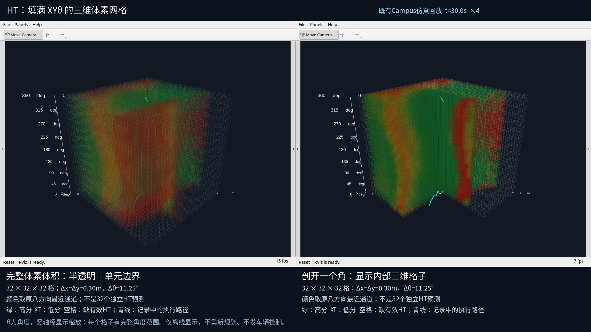

# HT 的 XYθ 三维体素网格（2026-10-22）

此前显示虽然用了 CUBE_LIST，但方块在 θ 方向很薄、间隔很大，仍呈现为八张悬空薄片。本次将显示改为填满角度轴的三维单元，并保留半透明与格子边界。



- [30.1 秒新视频，4 倍速](https://github.com/CQULzz/HT_Explo/releases/download/ht-stage-20261021-campus-matched/stage48-xytheta-voxel-grid-4x.mp4)
- [报告、快照、渲染配置和代码快照](https://github.com/CQULzz/HT_Explo/releases/download/ht-stage-20261021-campus-matched/stage48-xytheta-voxel-grid-supplement.tar.gz)
- 本机播放：`bash scripts/play_ht_voxel_grid.sh`；下载目录的“播放HT与TARE_RViz视频.sh”已改为同一入口。

## 实际表示

| 项目 | 本次值 |
|---|---|
| 显示网格 | 32 × 32 × 32，共 32768 格 |
| XY 范围 | 随记录中的车体位置移动，9.6 m × 9.6 m |
| 每格范围 | 0.30 m × 0.30 m × 11.25° |
| θ 轴 | 覆盖 [0°, 360°)，首尾周期相接 |
| 方块尺寸 | 显示尺寸 0.294³，单元间仅留 2% 边界缝 |
| 透明度 | 左侧 alpha=0.045；右侧 alpha=0.14 |
| 右侧剖视 | 去掉正 X、正 Y 象限，使内部单元可见 |
| 来源地图分辨率 | 约 0.04093567 m/格；本次 0.30 m 是可视化采样间距 |

竖轴是车头角度 θ，不是地形高度。为方便看格子，将每个 11.25° 区间的显示高度设成与 XY 格宽相同。每个体素有完整的角度厚度，不再将八个方向画成分离的薄片。

原始 HT 仍只有八个方向通道。每个显示格子的中心查询最近的原始 XY 格，以及最近的 45° 方向通道；没有对分数作插值，32 个显示方向也不是 32 次独立 HT 预测。接近的角度沿用同一通道，颜色相同是这条查询规则的结果。

绿色表示高分，红色表示低分；无效、未知或地图以外的单元不填颜色。青线是原录包中记录的执行路径，白箭头表示记录中的当前车头方向。0.30 m 单元中心的颜色只用于显示，不能当作整格或车辆扫掠区域均可通过的证明；导航地图没有被降采样。

## 数据与验证

这是既有 Campus 仿真录包第 30–150 秒的离线 RViz 展示，4 倍速、10 fps、1920×1080，共 301 帧，含终点帧，时长 30.1 秒。没有启动新仿真、HT 推理、规划器、跟踪器或实车，也没有发布运动指令。

- 原实验：stage48，候选 `f7fd77b66fc442752599ead359e8aa60e7773ae4`，导航代码 `07c1abd334f83cb8d602e2234134b4286862c916`。
- 原实验状态仍为 `COMPLETED_WITH_ISSUES`，本次显示更新不改变其导航结论。
- 原录包：`presentations/scheduled_results/ht_tare_campus_matched_10min_2026-10-21_19-12-25/ht/evidence_bag`，位于原工作树 `HT_Explo-fixposition`。
- 全分辨率解码准备了 239 张原始 HT 地图；按时间仅选择当前帧之前的地图和位姿。
- 首帧 25664 个有效显示体素；逐个核对与原始地图最近单元、最近方向查询完全相等，无效格保持 NaN。
- 5 项表示测试通过，涵盖周期方向、角度轴连续填充、未知数据、旧降采样缓存拒绝及剖视几何。
- FFmpeg 完整解码通过，确认 301 帧、1920×1080、10 fps；视频 SHA256 为 `0dc1f4c80b3997536b032fe7582f70959871fbdedd25d82fec3f38d524de5baf`。
- 原录包 `metadata.yaml` SHA256 与准备缓存时相同：`23cf60888514ff8b831fa29dc939cf3b6581951469a14d77eb362e0bba28bd2a`。
- 仅发布 `/recorded_voxel_grid/full` 和 `/recorded_voxel_grid/cutaway` 两个 MarkerArray 显示话题；正常完成后本次两个 RViz 与 Xvfb 均已退出。
- 第一次预览因 Marker 的 Vector3 尺寸传入 Python 整数，触发 rclpy 消息转换断言，已将尺寸统一转换成 float。失败日志保留于 `preview_failed_int_scale/`；只清理了此次产生的 RViz/Xvfb 进程。之后预览和正式视频均完成。这是离线显示问题，不是导航实验失败。

证据见 [validation.json](validation.json)、[tests.txt](tests.txt)、[逐帧信息](video/capture.json) 和 [原始查询快照](video/voxel_snapshot.npz)。原历史薄片视频继续保留，新视频使用不同附件名。

## 代码与复现

工作树为 `/home/lzz/my test/HT_Explo-sim-check`，分支 `sim/validation-20261022`。新增 `presentations/rviz_xytheta_voxel_grid.py`、对应表示测试及 `scripts/play_ht_voxel_grid.sh`；未改导航、控制、建图或 HT 推理文件。

依赖 ROS 2 Jazzy、RViz、grid_map_msgs（仅原录包解码）、NumPy、PyYAML、Pillow、FFmpeg、Xvfb 和 Noto CJK 字体。Xvfb、FFmpeg 的本机默认位置可通过 `--xvfb`、`--encoder` 覆盖。

```bash
cd '/home/lzz/my test/HT_Explo-sim-check'
python3 -m pytest -q presentations/test_xytheta_voxel_grid.py
source /opt/ros/jazzy/setup.bash
source install_standalone/setup.bash
OPENBLAS_NUM_THREADS=1 python3 presentations/rviz_xytheta_voxel_grid.py \
  --prepare \
  --base-cache '/home/lzz/my test/HT_Explo-fixposition/.git/campus-matched-runtime/rviz.pkl' \
  --cache .codex_visual_runtime/xytheta_voxel_grid/native.pkl --start 30 --end 150
```

派生 pickle 只读取可信的本机历史缓存。HT 颜色重新从 MCAP 按原分辨率读取；缓存仅复用原来的位姿、执行路径及源文件定位信息，不使用旧的稀疏显示 HT。

渲染输出目录必须不存在；复现另取新目录，避免覆盖本轮证据。以下命令仅启动离线显示进程：

```bash
ulimit -c 0
ROS_DOMAIN_ID=230 ROS_LOCALHOST_ONLY=1 OPENBLAS_NUM_THREADS=1 \
python3 presentations/rviz_xytheta_voxel_grid.py \
  --cache .codex_visual_runtime/xytheta_voxel_grid/native.pkl \
  --output .codex_visual_runtime/xytheta_voxel_grid/reproduction \
  --start 30 --end 150 --speed 4 --fps 10
bash scripts/play_ht_voxel_grid.sh
```

该脚本在独立的 Xvfb `:97` 中用两个真实 RViz 窗口捕获画面；这是离线生成的视频，不是 RViz 实时更新速度的测量。软件解码播放参数沿用此前已确认可工作的 VLC 设置。
