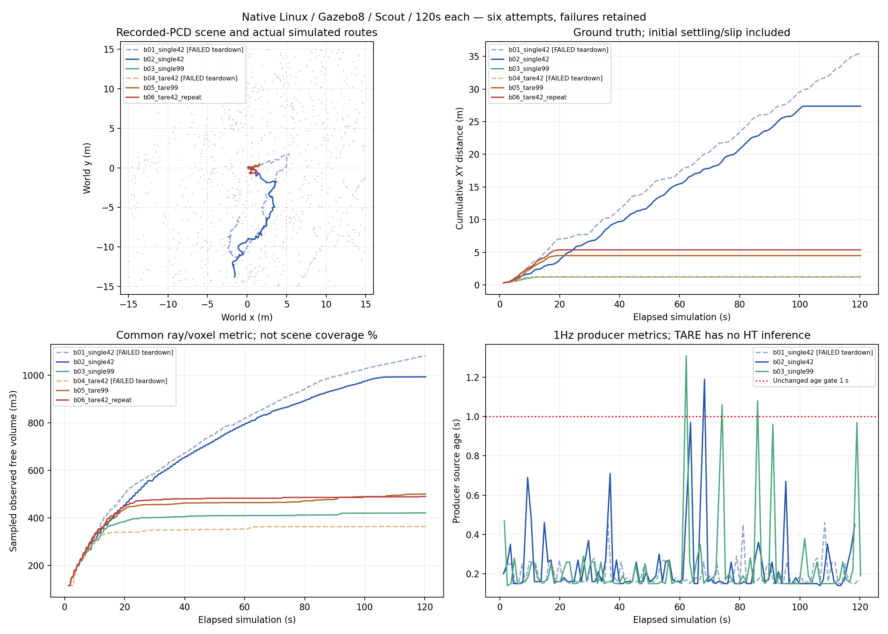

# 循环7结束：6/6，退出修复通过，完整探索未验收

接续分支`fix/scout-wsl120-20261105`，交接源ea9bdcb。用户已授权本批最多6次（失败计数）及同环境TARE对比；本批已停止，没有第7次、Release或实车部署。独立根目录`/home/lzz/HT_linux_cycle7_20261106`，账本[BUDGET.json](BUDGET.json)。

## 结果

|轮次|仿真秒|实际XY里程/m|近似观测自由体积/m³|HT源龄P95/s|最终任务状态|流程结果|
|---|---:|---:|---:|---:|---|---|
|b01_single42|120.3|35.527|1082.960|0.2780|RETURNING_HOME|FAILED|
|b02_single42|120.3|27.370|993.848|0.4800|BLOCKED|RECORDED|
|b03_single99|120.3|1.230|420.624|0.4565|COMPLETED|RECORDED|
|b04_tare42|120.3|1.207|363.976|N/A|COMPLETED|FAILED|
|b05_tare99|120.3|4.494|501.040|N/A|COMPLETED|RECORDED|
|b06_tare42_repeat|120.3|5.366|490.088|N/A|COMPLETED|RECORDED|

成功退出的配对：种子42，HT993.848m³/27.370m，TARE490.088m³/5.366m（HT体积+102.79%）；种子99，HT420.624m³/1.230m，TARE501.040m³/4.494m（HT体积−16.05%）。每种子仅一对有效退出运行，不能宣称普遍优越。两次失败仍显示，不删掉较差或较好结果。距离含起步前沉降/侧滑；体积是相同源秒采样的激光射线0.2m体素并集，不是场景覆盖率，停车后的微小姿态/射线采样变化也可增加它。

## 确认并修复的代码问题

- 采集器DONE写入早于资源清理，runner可打断文件收尾：现在关闭视频/CSV、保存数组、销毁ROS后才写DONE，并等待observer自然退出。
- runner向整个导航进程组SIGINT，ROS launch又转发SIGINT，子进程被重复中断：只给launch父进程首个SIGINT，超时仍按真实结果升级；最终再检查launch子节点退出码，父进程0不能掩盖失败。纯ROS旧/新对照分别出现−2/正常退出。
- mapper默认KeyboardInterrupt会截断活跃回调；ScoutInputs异步context关闭及guard销毁早于工作回调结束：信号只请求退出，先停止提交/排空工作、保留真实异常，再销毁节点和context。真实POSIX信号回归旧版失败、新版通过。b02之后mapper0；b05/b06输入桥清理无原异常。
- 四个CMU节点收到默认信号后context失效，100Hz循环仍可能spin_some并创建guard condition，导致−6：在独立CMU副本中延后context shutdown，循环数学不改。四节点纯ROS旧版均−6，新版均0；b04失败保留，b05/b06实测均0。精确补丁见[manifest](../../../tools/pcd_sim/cmu_shutdown_manifest.json)，原工作区未覆盖。

59项相关Python/ROS回归通过，含实际DDS命令桥和真实信号/多线程回调；同步导航已有9/9 CTest通过。上述退出修复不等于解决探索能力；原mapper−9的每个底层等待点并未全部定位，不把合理修复当成全部原因的证明。

## 对四项导航现象的判断

1. **当前朝向低分**：当前三轮HT没有采到当前航向低分运行时样本；不能否定WSL循环6的旧反例，因为其原始MCAP/上下文未在本机挂载。六个保存输入张量离线GPU复算的最大概率误差≤1.85e−6，0.5门限翻转0，未发现本批张量与模型输出不一致。这不证明模型对真实地形的语义正确。
2. **缺支撑/无路径**：b02在约101.4秒起持续无可执行路线，车位约(−1.59,−13.83)，当前概率约0.97、当前物理足迹无未知/障碍，邻接部分上下文无效；原生TARE后来目标约(2.71,−20.57)，超出重建场景y=−15边界。生产HtCostMap的稀疏录包姿态查询未拒绝当前姿态。边界外支撑未知不能改成可走地面；这轮不是当前朝向低分停车。离线查询时钟=原始源时刻+1ms只隔离地形门控，不替代真实时效、几何或整路径安全验证。
3. **短距离COMPLETED**：HT99约13.92秒完成，TARE三轮也在10.92–20.15秒完成。HT99触发前TARE报告global_return=1/local_complete=1，残余surface12/frontier3低于40/15。没有当前可达未完成任务的证书，因此既不把COMPLETED称为场景全覆盖，也不凭原始残余点武断修改TARE目标/TSP/完成规则。
4. **同种子波动**：HT42体积1082.960/993.848m³，TARE42为363.976/490.088m³；两套都有波动，前一轮各有退出缺陷，不能把差值归因于退出修复。HT42首次上下文源时刻1.8/1.2秒，第一次surface随机抽样范围1/3，候选集合在第一次抽样已不同。固定随机数流不固定DDS发现、ROS/GPU调度、输入时间、候选集合与调用次数。未证明单一来源，也未证明任意加启动延时可以解决。

三轮HT各12个测量窗口内上下文与同源发布地图11层精确配对；CPU重建支撑/障碍掩码一致。b02另有窗口后的121.2秒上下文，保留并明确列为窗口外。源龄仍用生产者1Hz source_age_at_publish_s；三轮P95均<1s，但b02/b03仍有个别>1s瞬态，不能宣称从不陈旧。未知严格、概率0.5、图龄1秒、固定1.5m/60秒先验、权重及外参均未降低或改变。

## 仿真环境与对照边界

实际主机是原生Ubuntu24.04、ROS2 Jazzy、Gazebo Sim8.15、RTX5060Ti/NVIDIA EGL，非WSL。沿用`/media/lzz/lzz/rosbag/20261103_190624`中的地图：当时挂载目录未找到独立PCD，已从同包map_local导出56849点`recorded_local_map.pcd`，用于原点附近±15m重建；另有9827点全局PCD。来源及哈希见MAP_SOURCE/LOCAL_MAP_SOURCE。地面最长三角连接边0.8m，障碍体素0.16m，缺测区域不补无限平面。车辆依据用户确认的Scout URDF。激光为32线均匀角间隔近似、[-55°,15°]、5Hz；真值定位，不含实车多径/穿透/定位误差，是受控点云场景。环境网格逐轮冻结；车辆视觉网格与此前清单及批后SHA一致，不冒称逐轮独立监视。

HT使用worker推理、single mapper+独立TF。TARE是**当前仓库保留的几何分支+CMU地形分析/局部规划/跟踪器**，不是未经修改的历史上游TARE；不运行HT推理、不消费HT地图，CuPy作为共同后台建图进程保留，HT源龄N/A。两套使用同场景/模型/源激光/外参/起点/种子/120秒，TARE采样网格40×40、1.2m一致；前进0.4、倒车0.25m/s，角速度0.8rad/s，常规线/角加速度0.5m/s²、1.2rad/s²，显式零/失效可立即停。CMU未知当障碍、旋转碰撞开启，额外桥保留0.84142m/±0.5m几何包络及新鲜输入检查。六轮实际/sim/cmd_vel逐消息限幅核验通过。

两种地形和控制器不同、基线没有HT推理负载，属于端到端对照，不是只移除神经网络的单模块消融。CMU原提交8314318d，四文件退出补丁在独立副本；原CMU、原Linux定制CuPy8文件、旧Linux工作树均保持。Linux没有强套WSL定制核心补丁；CPU/GPU和原始CuPy实现差异使本批不能与WSL成绩直接作因果归因。

## 数据保留与交付

逐轮manifest记录实际提交、参数入口、源码/二进制及场景哈希；MCAP全部逐消息核对计数/可用CRC及SHA，六段视频全部241帧解码通过，无冻结文件变化。精简报告、图和代码推送到接续分支；未发布Release、未部署实车。大MCAP/MP4/CSV/NPZ仍保留本机，无完整远端备份，不清理。失败b01/b04完整保留。

- 原始六轮：`/home/lzz/HT_linux_cycle7_20261106/runs/`
- 种子42左右对比：`runs/comparisons/HT_TARE_seed42.mp4`
- 种子99左右对比：`runs/comparisons/HT_TARE_seed99.mp4`
- 视频是地图上的实际仿真轨迹/遥测，非Gazebo相机或实车录像。
- [完整指标](FINAL_COMPARISON.json)、[账本](BUDGET.json)、[逐轮历史](ROUND_RECORDS.md)、[模型复算](MODEL_REPLAY.json)、[原代码保留核验](PRESERVATION_VERIFIED.json)。

最终状态：退出和采集链路修复有测试及实测证据；完整探索/稳定完成未验收，低分旧反例与所有源龄尖峰仍未完整解释。本批按6次上限停止。
