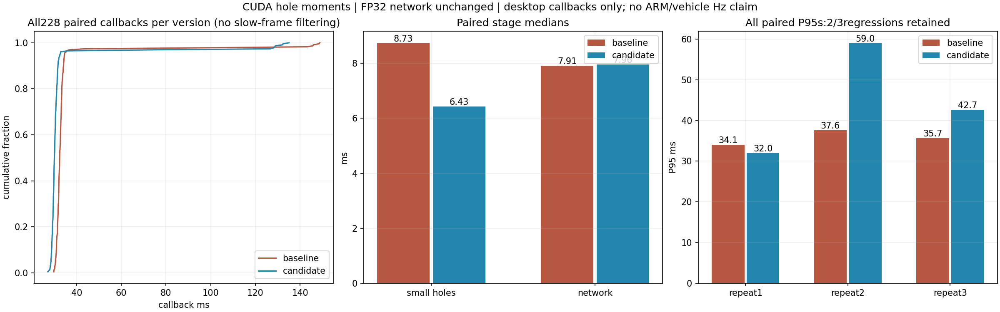
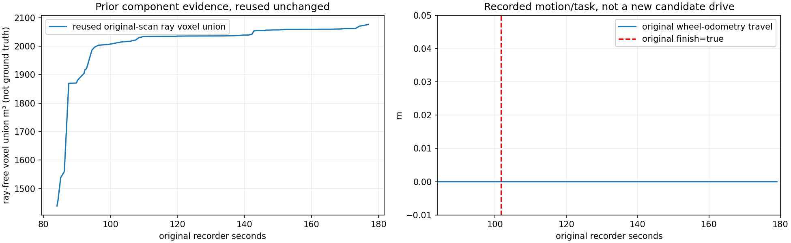

# 小孔填补CUDA统计加速，2026-11-01

用户要求修改并上传GitHub。本轮把小孔平面拟合的9组窗口统计量搬到CUDA，保留CPU上的候选筛选、拟合求解和所有门槛。**198帧×strict/moderate两档共396次高度/掩码/统计对照完全一致，81帧完整HT模型输入和输出字节一致。** 桌面交替帧回调中位32.43→30.08ms，减少7.24%；小孔阶段8.73→6.43ms。ARM及实车频率尚未验收，部分轮次P95仍退步。

固定tag：`real-scout-cuda-hole-fit-20261101`，分支`real/scout-helios32`。提交和完整附件SHA以发布回执为准。本轮没有启动设备、仿真、控制器或车辆，没有修改独立CuPy建图工作区、TARE、TF、模型权重或0.5门限，也没有操作周报。

## 实现与数值边界

原实现的9组统计量是x、y、h、xx、yy、xy、hx、hy、hh的窗口均值，用于原有局部平面。新增CUDA实现按[已安装SciPy v1.11.4的参考递推](https://github.com/scipy/scipy/blob/v1.11.4/scipy/ndimage/src/ni_filters.c)保持先列后行的加减和除法顺序，使用显式FP64 round-to-nearest运算并关闭FMA。官方源文件、blob/SHA和许可证保存在科学归档reference_source中。

GPU首先计算列统计，再仅为已通过原候选筛选的行/列输出9组均值；没有复制完整9层结果回CPU。CPU继续计算已知样本数量、四象限、距离、保护/新旧表面条件、坡度/RMS/范围、跳变否决和连通分量。网络继续使用原FP32输入与权重；这里的FP64保持原CPU统计精度，不是改变网络精度。

`ht_small_hole_fit_backend`：

| 值 | 行为 |
|---|---|
| auto（默认） | CUDA设备上完成4组精确启动自检后启用；初始化/自检失败回退CPU并记录警告与原因。CPU设备使用原统计。 |
| numpy | 强制原CPU窗口统计，原Numba候选距离和历史优化仍可保留。 |
| cuda | 修补开启时要求CUDA设备与自检成功，失败提前报错，不静默回退。 |

启动自检含边界、大窗口、非整十进制分辨率和完整291×291，逐字节比较9组统计量。`auto`依据可用性和数值自检，不是按速度自动择优；车上GPU与建图/网络共享资源，净收益仍需实测。运行中GPU错误不属于初始化回退保证。

实际后端、4组自检、统计精度记录在`/ht_real/ht_runtime`的`actual.small_hole_fit_backend`、`actual.small_hole_fit_details`，新模块SHA也进入运行身份；性能消息和每帧诊断另记录后端。新launch参数已安装并核对，可用numpy单独退回原统计路径。

## 输入、冻结与验证

基线为上轮历史优化代码`1c5e621a`，proper分支父提交为其回执`8a43789d`。测试前冻结源码，期间未修改候选。复用：

- 旧moderate审计中117帧完整填补参数快照，含原strict/moderate输出；逐文件SHA保留。
- 最近Oct31录包81个原GridMap及匹配的原Odometry CDR，保留源时间、观测年龄和网格；离线时钟只设原源时间+50ms驱动直接回调，不模拟实车传输。基线验证另外捕获81帧填补参数。

198帧分别比较两档，共396组：高度、filled掩码和连通分量/计数完全一致；每组CPU/GPU组件计时3次，交替谁先执行。完整81帧模型输入、14层输出与几何元数据逐字节一致；另外972帧次跨运行输出哈希核对，通过F-order序列化或逻辑矩阵的相同布局后比较，0.5门限零翻转。

342项Python检查通过，其中新增13项检查覆盖两档/多分辨率/噪声、保护、过期、只读转置、空查询及自动回退/显式失败。新独立安装的CUDA模块、HT入口、权重和launch逐字节一致，实际安装模块启动并完成一次填补对照。C++源码/已安装ELF未变，沿用已验证8组测试，没有重做未变C++检查。原build_real/install_real未覆盖。

## 实测结果与反例

桌面RTX5060Ti、Jazzy、现有GPU环境。无并行回归/其他本任务性能测试；没有更改功耗、CPU频率、绑定、GC、内核或网络。每轮完整81帧，正式整帧统计排除前5帧，其余慢帧全部保留。文件读取、压缩、输入捕获不计入正式回调时间。

| 分组，ms | 版本 | 中位 | 平均 | P95 | 最大 | >100ms |
|---|---|---:|---:|---:|---:|---:|
| 独立进程3轮 | 旧 | 32.54 | 35.06 | 34.56 | 150.12 | 4 |
| 独立进程3轮 | 新 | 30.23 | 30.32 | 31.85 | 32.76 | 0 |
| 逐帧交替3轮 | 旧 | 32.43 | 35.26 | 34.59 | 148.83 | 5 |
| 逐帧交替3轮 | 新 | 30.08 | 33.39 | 32.64 | 135.06 | 7 |

交替分组汇总中位减少7.24%、平均减少5.30%。小孔阶段中位8.73→6.43ms，网络7.91/7.96ms基本相当，收益集中于改动目标。

**交替第2、3轮P95分别37.63→58.97、35.66→42.66ms退步，且>100ms样本5→7。** 汇总P95改善不能覆盖这些反例，尾延迟稳定性没有通过验收。没有过滤慢帧或改变系统设置来取得结果。

独立填补函数在两个数据集分别排除前5个输入后，每档/版本564次统计：strict中位7.71→5.40ms，moderate8.12→5.80ms（约减28.6%）。COMPONENT_AUDIT保留初始总体汇总及所有原计时，最终按数据集暖机口径见SUMMARY。不能把组件降幅当作整帧或车上频率降幅。

## 原记录上下文与视频

本轮输出完全一致，没有新的车辆轨迹或探索成绩。图中复用同原始扫描的前序射线自由体素并集、轮里程与任务事件：它们是旧记录/既有组件证据，体素不是真值自由空间或HT许可；轮里程仍为0，原先过早finish=true仍是待查问题。

视频显示81个实际新旧HT结果与测得回调曲线，1600×900、6fps、13.5秒，逐帧标原始不均匀时间，完整解码通过，不是实车或实时播放。

## 剩余项与发布范围

CUDA统计路径已实现，未把全部小孔步骤移到GPU。ARM上FP64吞吐和与CuPy/网络共享GPU后的收益未验收，不能承诺已达到5Hz/10Hz。输入连续缺口、近车缺测和过早完成也没有因此自动解决。需要下一次车上按实际运行身份记录唯一源更新时间率、阶段耗时、地图年龄与拒绝原因。

科学归档保存冻结源码、两个数据集参数/原CDR、396组组件输出、完整HT输入/输出、所有计时/反例/日志/脚本。首次参考源解析换行、首次哈希布局检查的口径错误在CHECK_NOTES保留，更正检查后未修改实验数据或算法。原始大录包及已发布证据复用已核验Release附件，不重复解压或上传。本轮发布核验后停止，不自动开启下一候选。
