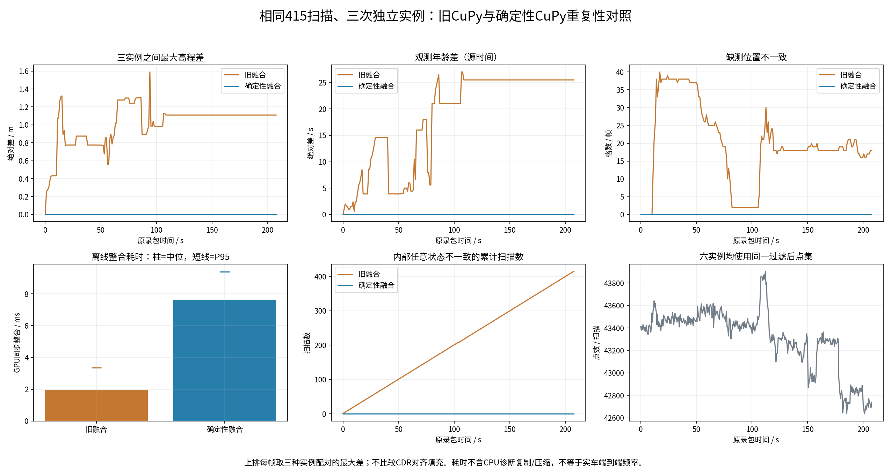
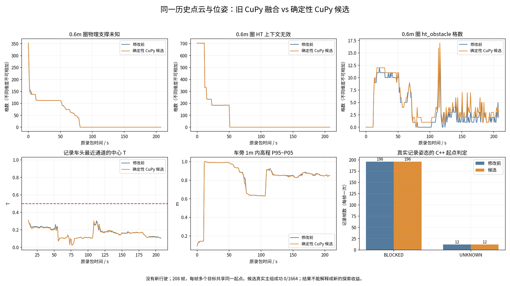
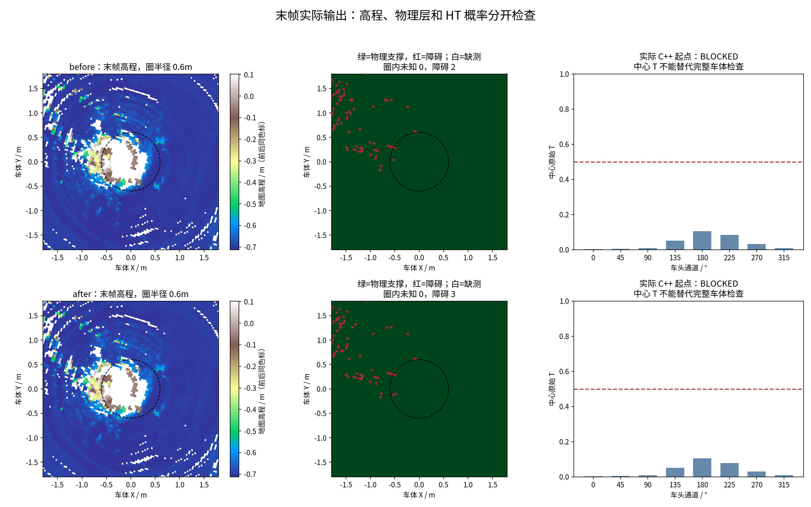

# CuPy 稳定融合修复与完整历史数据复测

2026-10-28，实车分支。**已修复并实测消除了这组数据的建图重复差异；实际起点仍全部被 HT 拒绝，不能称车辆停车已解决。**

## 本次真正修好了什么

旧 GPU 内核把点融合、离群方差修改和射线清理放在同一批并行线程里。一个点可能读到另一个点刚修改的方差，进而改变接受判定；upper bound 还有最后写者决定结果的问题。仅加 Python 锁或设随机种子不能解决它。

本次在**独立 CuPy 工作区**实现：

1. 本帧点统一读取不可变的旧图，固定本帧接受集合。
2. 按格子和原始点序号排序，每格固定顺序归约高斯更新；漂移残差也固定归约。
3. 点融合完成后，射线清理读取另一份固定快照；清理量与 upper bound 分开归约，再统一提交。保留清理功能，直接新观测优先于同帧清理。
4. 修正旧辅助函数的隐式半精度几何，使用 FP32 坐标和 FP64 有序求和，地图仍存 FP32。纯几何 GPU 探针验证了旧半精度可改变 0.04m 格索引。

这是明确定义原先竞争行为并修正精度，**不是与任意旧线程调度逐位等价**。未修改 HT 权重、T≥0.5 门槛、未知策略、车体外参或 TARE 的覆盖/TSP/访问顺序。

## 三次旧版、三次新版完整复测

相同 415 帧原始扫描、207.587 秒、同一套十四盒和四轮柱过滤、同点顺序、同源时间和 R/t。每个后端构造三个全新实例；每个实例生成 208 张原生 291×291、0.04m 地图，并逐扫描保存内部状态。

| 指标 | 旧融合，3次 | 新融合，3次 |
|---|---:|---:|
| 重复之间原生高程最大差 | 1.589686m | **0** |
| 记录的5组状态数组逐位一致 | 否，415帧均有差异 | **是，415帧全部一致** |
| 原生高程/方差/观测年龄逐位一致 | 否 | **是，208图全部一致** |
| 整合中位耗时 | 1.964ms | 7.618ms |
| 整合P95耗时 | 3.350ms | 9.404ms |

五组数组为 elevation_map、observation_stamps、normal_map、new_map、center，不声称穷尽 Python 对象所有状态。原生图比较浮点数据本身，包括 NaN 位，不比较可能含随机填充字节的 CDR 序列化哈希。

耗时包含 GPU 同步，排除 CPU 诊断复制/压缩和每实例首帧；新方案为稳定性付出开销。这是 **RTX 5060 Ti 本机离线整合**耗时，不能换算成 ARM 或实车整条链路频率。

## 起步有没有恢复

旧、新各选择预先约定的第0次重建结果，重算全部208张HT；每帧保留精确网络输入，不再靠保存高度近似复原。之后使用**同一个生产 C++ XYθ 二进制**，各执行1664个真实记录姿态目标查询，另加3个人工控制。

| 指标 | 旧融合 | 新融合 |
|---|---:|---:|
| 真实目标可达 | 0/1664 | **0/1664** |
| 起点BLOCKED（按帧计） | 196 | 196 |
| 起点UNKNOWN（按帧计） | 12 | 12 |
| 人工控制可达 | 2/3 | 2/3 |
| 末帧中心八方向最大T | 0.104904 | 0.105097 |
| 末帧车旁1m高程P95−P05 | 0.850862m | 0.850781m |

成功人工路线逐段复核通过；低概率负控制正确拒绝。1664个目标查询共享208个起点，不能当成1664次独立实车试验。起步先验关闭，0.6m有效性半径与严格未知保持不变，源时间保留，离线时钟固定到对应地图，不测试在线新鲜度或控制器。

**因此：建图一致性修好了，但它不是这批起点持续低分的唯一原因。**末帧圈内不缺物理支撑，中心八方向分数仍低于门槛。不能把重复性提升写成探索能力或行驶里程提升。

## 为什么仍低分：已有证据和不能确定的部分

- 原权重对理想平地输出约0.9998，对厘米级高频噪声敏感；输入单位、梯度尺度未发现可据以修改的错误，不能盲改分辨率或补回旧参考点偏移。
- 过滤后的**原始扫描**已有近车高点，主要高簇在车后约X=-0.5m、Z=0.2～0.7m；它们的真实身份未标注，不能全当作车体噪声删除。
- HT历史窗口还保留了旧高结构，当前缺测不能证明这些结构已经消失。历史保留与动态清理需要直接观测/自由射线证据，不能靠清空车旁制造通行。
- 精确网络输入复现误差≤4.77×10⁻⁷。仅改未知填值或近地噪声未恢复通过；这些诊断反事实均未部署。详见 [输入审计](EXACT_CONTEXT_REPORT.md)、[原始数据审计](LOW_T_AUDIT.md) 和附件 `low_t_audit/`。

## 旧实车停车不能与本轮混为一谈

进一步读取原录包的配置和控制状态，确认 Oct11 运行的是旧 `best_probability` / `best_policy` 加 `geometric_fallback`，并非本轮严格 XYθ 查询。4049条 `/cmd_vel` 中仅163条非零，最后非零在80.702s；80.802s控制器报告 `NO_SAFE_LOCAL_ROUTE`，当时上层仍曾允许导航。后续还记录了地图/许可/定位过期等待，末上层为 `FALLBACK_BUDGET_EXHAUSTED`、allowed=false。

持续车后高簇出现在108.089s以后，晚于首次停驶；不能用它单独解释80.7s停车，也不能把当前0/1664查询当成旧整车停驶的完整因果证据。旧配置、原状态、时间序列及边界见 [旧控制记录审计](ORIGINAL_CONTROL_REPORT.md)。未解码的Scout原生消息不冒充轮速证据。

## 交付与验证

实测运行冻结本地提交 `8d9cbe3`，对应保留原GitHub历史的代码提交 `48f61fbfe703ef100220d4e36b0c0bf2927c0f8e`。后续安装器提交 `70f1a51f64239e724031f49c3a091d8092172d1a` 增加部署工具，不改这轮实际使用的映射内核。各阶段映射见 `CODE_PUBLICATION.json`。

- 独立CuPy：`deterministic_fusion.py`、`elevation_mapping.py`、`parameter.py`及10项新GPU回归，随 `tools/elevation_mapping_fixes/deterministic_fusion.patch` 发布，保留旧后端用于对照。
- HT：实车 mapper 配置明确开启 `enable_deterministic_fusion`；两阶段安装器先在临时目录预检，拒绝覆盖未知修改，重复安装不改文件。实际工作区安装通过；首次安装器子目录路径解析失败已修复，失败日志保留。
- 10项新GPU测试通过；8项原有观测年龄测试在新旧后端各通过一次。桥接83项加安装器10项，共 **93项CPU/ROS回归通过**。HT桥接包和独立CuPy的两个包分别构建通过；还从独立安装目录加载新内核，核对文件哈希并完成两实例GPU检查，不借用HT安装覆盖层。
- 独立工作区不放进HT/src，不改仿真main/develop。没有执行ARM二进制，没有启动仿真、设备、底盘或车辆；ARM性能、在线TF/定位和实车闭环未验收。
- 半透明体素视频33秒，22张离线快照，0.16m×45°显示格、alpha=0.03，原图仍0.04m；H264完整解码通过。蓝点是记录姿态，主组未生成可行路线，没有新版车辆行驶录像。

代码、所有实际使用的原始扫描、六次中间地图/内部状态、416份精确HT输入、实际C++结果、失败日志、图和视频：[Release real-scout-cupy-stable-20261028](https://github.com/CQULzz/HT_Explo/releases/tag/real-scout-cupy-stable-20261028)。远端大小和SHA256核对以 PUBLICATION_RECEIPT.json 为准。

复现入口是 `tools/ht_cupy_bridge/rebuild_mapping_stability.py`、本目录 `analyze.py/render.py`、Release中的冻结参数与 `ht_context_run.py`。实际数据来源、源码/权重/二进制哈希和依赖全部随附件保留；原始外盘备份不改写。
