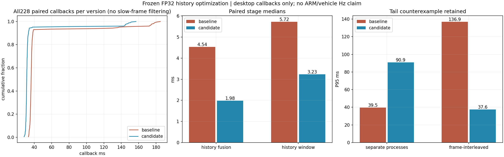
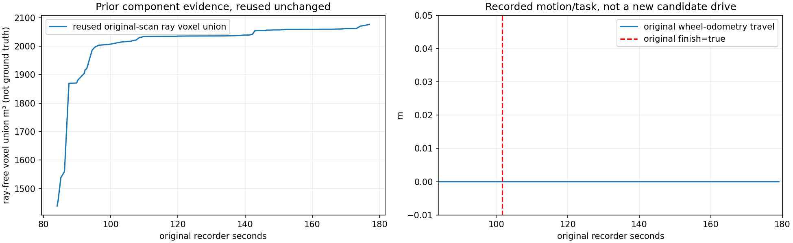

# HT历史处理提速，2026-11-01

用户要求提高偏低的有效HT频率。本轮直接优化HT回调中的历史处理，保留原公式与输出。**同81帧模型输入、14层输出逐值/哈希一致，0.5门限零翻转；交替帧对照中回调中位36.32→31.23ms，降低14.00%。** 这是桌面离线服务耗时，不是车上频率。部分分组的P95变差，慢帧仍存在，不能称为已稳定解决车上2.2Hz。

固定tag：`real-scout-history-fusion-speed-20261101`，实车分支`real/scout-helios32`；确切提交、完整附件与SHA见本目录发布回执。本轮没有启动设备、仿真、控制器或车辆，没有修改独立CuPy工作区、TARE、TF或周报。

## 为什么还低，以及这轮改哪里

复用10月31日17:01:05录包的46条重启后性能记录：原始雷达约10Hz，注册点云约0.86Hz，HT约0.83Hz；HT单回调中位254.0ms，网络77.8ms，历史融合30.1ms、历史窗口24.0ms、小孔填补42.1ms。已使用CUDA，输入断流与计算耗时都限制有效更新率。上一轮可靠订阅修复仍没有在车上验收，不能把桌面160/160接收直接写成实车HT10Hz。

254ms对应串行计算容量约3.94帧/秒，尚未计排队/发布等额外间隔。这不是当前实车测得的新频率。5Hz要求整帧预算约200ms，10Hz约100ms；单是网络已有78ms，因此不能只调发布定时器或只优化网络。

本轮聚焦约54ms的历史处理：

- 把按tile反复创建临时数组的FP32融合更新编译执行。保留最近观测/拒绝时间屏障、1ms新观测判定、多表面关联、首索引平局、最旧模式替换、原增益与方差下限。显式FP32中间舍入，不用fastmath。输入非FP32时继续走原NumPy更新。
- 固定世界裁剪与每块tile的交集是连续倒序矩形，用等价基本切片读取，避免复制整块多层高度、方差和时间数组。原NumPy选择路径也保持数值规则。
- 在订阅建立前预热新增融合内核；运行身份记录实际`history_fusion_backend`及新模块SHA。`ht_history_backend=numpy`保留NumPy历史路径，auto可回退；原权重、FP32、TF32关闭、0.5门限、质量/小孔/碰撞/启动假设均不变。

CUDA Graph、CUDA channels_last及动态ROI已有小收益或失败记录，这轮不重复采用。独立CuPy建图实现未改。

## 冻结输入与检查

基线来自上一轮部署代码`885f334d`。候选只改两个既有HT模块，新增融合内核与4项状态/边界测试。冻结快照及SHA见CANDIDATE_FREEZE，实验期间未修改源码。

直接从已验证MCAP提取重启后81条`/ht_real/elevation_raw`原CDR，匹配最近的原始`base_link`定位，偏差不超过现有50ms表面高度提示门槛。保留原源时间、原网格、原观测年龄；不重解压、不改原包、不广播录包。离线时钟设为各原源时间+50ms，只驱动直接回调与既有定位有效性检查，不模拟实车传输和实时调度。

GPU、模型、所有参数、源数据和输出口径相同。每次完整处理81帧，统计统一排除前5帧；不剔除其余慢帧。单独验证运行捕获模型输入与输出，正式计时不含文件读写、压缩与模型输入捕获。验证输出字节哈希1053帧次一致；另有3轮交替运行的全部输出相同。随机60帧多层状态/拒绝屏障和float32关联边界测试比较所有保存高度、方差及观测时间。

329项Python检查通过。C++未改，不重复运行原8组检查；沿用已验证相同二进制。新独立安装目录中的HT入口、历史模块、新内核及权重与源文件逐字节一致，没有覆盖原build_real/install_real。

## 所有耗时结果与反例

单位ms，各组每版本228个统计样本，保留所有超过100ms的帧。

| 分组 | 版本 | 中位 | 平均 | P95 | 最大 | >100ms |
|---|---|---:|---:|---:|---:|---:|
| 初筛 | 旧 | 36.39 | 38.66 | 38.35 | 178.63 | 4 |
| 初筛 | 新 | 30.77 | 38.26 | 139.82 | 151.22 | 15 |
| 独立进程，回归结束后 | 旧 | 36.04 | 41.57 | 39.49 | 180.70 | 9 |
| 独立进程，回归结束后 | 新 | 31.16 | 37.06 | 90.88 | 151.85 | 12 |
| 同进程逐帧交替 | 旧 | 36.32 | 44.54 | 136.91 | 184.90 | 15 |
| 同进程逐帧交替 | 新 | 31.23 | 36.60 | 37.58 | 156.89 | 10 |

初筛前段与一次回归并行，保留为筛查，不将其当独占测速。随后没有并行回归，独立进程按新旧/旧新/新旧顺序测试。它仍出现**候选P95明显变差**，此反例保留，不能用更有利分组替代或宣称尾延迟已通过验收。

为缩小时间顺序/系统状态差异，补做同进程两个冻结生产节点实例，逐原始帧轮换谁先处理，共3轮。基线在原历史模块加载后构造，候选在新模块加载后构造；其他共享模块字节相同，各自模型/历史状态独立，运行身份与实际源文件保留。三轮平均和中位均下降，P95分别78.20→43.97、172.77→64.46、38.98→34.88。汇总平均下降17.83%。两个版本仍有慢帧，不能把组间P95的大变化当作普遍收益。

交替分组的融合中位4.54→1.98ms（约减56%），窗口5.72→3.23ms（约减44%）；网络约7.63/7.69ms基本相当，收益集中在改动目标。车上这两段原共约54ms，桌面结果不能按比例直接替换车上耗时。

慢帧中多数CPU阶段同时增加，部分回调结束后CPU读数约800MHz。只读证据与低频相关，不能证明唯一成因或排除代码/调度差异。本轮没有改CPU绑定、功耗、频率、GC、内核或网络设置。

## 观测、里程、任务和视频

算法输出/模型输入不变；本轮没有新的车辆行驶或规划轨迹。下图复用同一原录包已验证的射线自由体素并集和轮式里程：射线体素不是真值自由空间或HT通行许可，轮式里程为0，旧任务仍在开始15.529秒后finish=true。这些是原记录/既有组件证据，不能标成候选产生的新探索成绩。

视频展示81帧实际新旧HT输出及实测回调曲线，1600×900、6fps、13.5秒，原始不均匀时间逐帧标出，完整解码通过；不是实时或模拟行驶。

## 提频路线与验收边界

本轮完成历史热路径优化，下一处明确目标是车上约42ms的小孔计算，随后是约78ms的网络及约25ms的两次质量处理。新的GPU实现必须先与现有FP32参考比较插值、观测/障碍支撑、模型输入及临界0.5判定，不能通过关填补、缩图、降低门限或涂绿未知换频率。

5Hz的目标预算是整回调约200ms以内，稳定有效源更新还要求输入、建图和HT链路都及时。当前不能承诺已达到5Hz，更不能承诺10Hz。下一次车上验收需使用本轮实际运行身份并记录输入接收/发布计数、唯一源时间率、HT回调P50/P95/最大、地图年龄和拒绝原因，区分接收丢失、陈旧拒绝与计算饱和。

尾延迟稳定性、ARM实际收益、三节点/建图完整吞吐、近车缺测及提前完成仍未验收。发布为离线候选，完整成功/反例/失败尝试随Release保留。本轮归档发布后停止，不自动开启下一算法候选。
