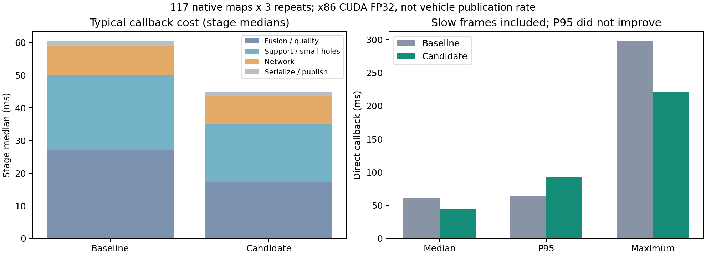

# HT频率优化：2026-10-30本地离线候选

本轮减少了HT单帧的典型处理耗时，但没有证明车上的2.2Hz问题已经消失。尚未部署Jetson或采集当前实车链路；旧包中的节点为`ht_traversability_node`，当前仓库入口是`cupy_to_ht_bridge`，实际运行版本仍需确认。

## 修改

- 历史多表面选择增加Numba编译路径，逐格执行原有高度关联、时间、拒绝、障碍和首索引平局规则，避免逐瓦片反复分配临时数组。禁用fast math，订阅前预热密集及实际瓦片布局。`ht_history_backend=auto`可在Numba不可用时明确告警并回退NumPy；`numpy`保留原路径，`numba`要求编译成功。
- 小孔修复保留原有全图窗口统计、候选条件和算术顺序，仅对获准候选像素求解平面，减少无用临时数组。没有扩大插补范围。
- CUDA也使用既有eval Conv/BN融合函数；保持FP32、关闭TF32、保留原CUDA连续布局。`ht_fuse_bn=false`可以关闭融合，旧CPU开关仍有效。
- 新增每秒至多一次的`/ht_real/ht_performance`诊断，分别给出源时间间隔、实际发布间隔、消息年龄、单帧分阶段耗时、被替换输入数、设备和后端。只对真实新源时间戳发布HT，未以重复旧图抬高频率。
- 新增可复用的`benchmark_ht_stream.py`，直接消费已重建原生输入，独立输出目录，保留版本哈希、逐帧结果和参考差异。

权重、0.5门槛、291输入/241输出、方向顺序、未知/物理观测/硬障碍规则、外参、过滤配置和TARE/TSP均未改变。未修改独立CuPy工作区、仿真分支或周报。

## 输入与证据

直接复用已校验的`HT_stationary_retest_2026-10-29_22-43-02/inputs/stationary_required_topics.db3`，未重复解压原11.4GB数据库。旧22话题子集的CDR校验记录保留。

本轮唯一一次原始扫描重建：643扫描，641积分，2帧无精确时刻TF跳过，117张原生图。沿用既有离线条件：0.04m/11.64m、稳定融合、drift/overlap关闭、配准候选关闭、小孔修复开启、空历史初始化。不是完整实车默认链路复刻。

重建脚本每0.5秒左右采样一次只决定保存哪些输入，**不是测速得到的约2Hz**。后续基线/候选均直接读同一`native_stream.pkl`，没有重复建图。

完整结果：`/media/lzz/KINGSTON/HT_frequency_2026-10-30_01-01-19`。包含初始源码快照、冻结参数、原生输入流、117帧基线图、原版及候选各三次结果、所有网络候选和失败日志、117帧完整模型输入前后副本、构建及检查日志。

## 同输入测速

x86_64、RTX5060Ti、PyTorch2.11.0+cu128、CUDA FP32，PyTorch4线程/BLAS1线程。基线HEAD为`dfd8c7c`，候选未提交。每组117帧，原版/候选交替各3次，每次去除前5帧预热；文件读取、保存及比较不计入回调。直接回调没有真实DDS订阅、序列化传输、在线排队和规划负载；不能外推ARM或实车发布频率。

| 合并三次结果 | 原版 | 候选 |
|---|---:|---:|
| 单帧回调中位数 | 60.80ms | 45.11ms |
| P95 | 64.74ms | 93.21ms |
| 最大值 | 297.41ms | 220.32ms |
| 超过100ms的帧 / 336测量帧 | 12 | 16 |
| 历史融合/质量阶段中位数 | 27.07ms | 17.38ms |
| 支持掩码/小孔/可选历史图阶段中位数 | 22.79ms | 17.62ms |
| 网络中位数 | 9.15ms | 8.43ms |

典型回调耗时下降25.8%，中位数倒数对应的单帧处理能力提高约34.8%；这个倒数不是实车帧率。**合并P95未改善，不能声称尾延迟解决。** 原版和候选均出现成段慢帧，未删除或归为预热；原因未唯一定位。安装后另一次带线程CPU计时与完整输入捕获的117帧验证未出现超过90ms的测量帧，但不能用它否定前述慢帧。

网络筛选也保留了失败候选：CUDA `channels_last`约94ms，原连续布局约8.75ms，故未启用该布局；连续布局BN融合约8.24ms。筛选包含传输及softmax，同输入各3次，不是整链路速度。

## 数值与安装检查

- 89项相关回归通过，包含多表面、过期/拒绝、未知区、窄孔、CPU/CUDA融合、输入契约、并发接收、性能诊断及三种启动模式。首次运行因未source实车安装环境导致3项包查找失败；补齐环境后全通过，失败日志保留。
- 编译历史路径与NumPy路径在随机多层、滚动、拒绝、过期、参考/优选等12组对照逐位相同。
- 原版三次输出与基线逐位一致；候选每次117帧的0.5门槛判定差异为0，未知/障碍/物理支持/插补等非概率层与地图几何差异为0。最大受支持概率差`3.725290298461914e-06`，来自FP32 BN折叠舍入，不保证任意未来临界概率永远不翻转。
- 安装后117帧完整291×291模型输入高度和源时间戳与基线逐位一致；输出再次通过同一对照。
- `build_real/install_real`内`ht_scout_bridge`、`tare_planner`独立构建成功。安装中的HT入口、历史选择、新模块、小孔函数、模型、权重与实车launch逐字节核对。

## 实车2.2Hz仍需验收的部分

旧静止包接收时间统计：点云10.14Hz、原始高程1.80Hz、global_local1.62Hz、现场HT1.63Hz；11条旧推理日志为123.5～260.5ms。它们描述10月28日旧现场，不能解释10月29日两份空包所对应的2.2Hz。

上游高程供图本来就慢，因此只加速HT不能保证整链路频率。需要核对当前车上启动命令、实际节点/版本、测频话题、设备及CUDA状态，再使用新诊断分开记录输入供图间隔、处理耗时、发布间隔、消息年龄和替换数。当前没有ARM性能验收，没有新的600秒仿真、实车运动、Git提交、上传或周报操作。
