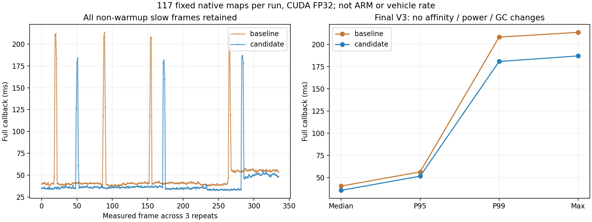
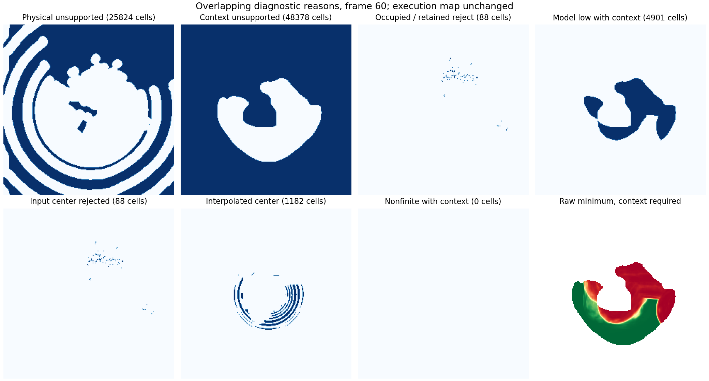

# HT候选计算减负与延迟/红区诊断（2026-10-31）

**最终版本在本机旧数据三次对照中，完整HT回调中位40.68→35.86ms（减少11.8%），P95为56.57→51.74ms（减少8.5%）。** 修改版351帧的完整模型输入、地图几何、全部14层结果及0.5判定一致，概率最大差0。仍有9/336个超过100ms的慢帧；未宣称长尾完全消失、车上不再2.2Hz或已通过ARM验收。

本轮按用户“给我改，改完以后上传github”的指令实施。代码仅进入实车分支`real/scout-helios32`，固定tag为`real-scout-ht-latency-20261031`。独立CuPy、外部配准/TF、仿真分支、车辆和周报未操作。

## 修改内容及依据

### 1．小孔修复只检查原有候选

原实现为每帧291×291图构造四张完整象限查询，并执行全图欧氏距离变换，最后仅少量候选能进入平面检查。新Numba路径保留原积分计数，对原有候选坐标查询四象限；12cm邻近检查使用与原欧氏阈值相同的整数位移集合，只查询合格候选。复用原始同一张box均值，坐标网格缓存有8项上限。

12cm、四象限、原始测量、观测年龄、方差、坡度、残差、边缘与高程范围等全部条件不变。没有扩大插补、改变权重/0.5阈值或把插补变为新观测。NumPy参考路径保留，auto与numba共享同一预热内核；安装后117帧只出现一个内核签名，避免把新编译推迟到某一帧。

### 2．区分排队、处理与平台证据

新增最新输入槽的接收/接受/取出/替换/乱序/退出丢弃计数与单调时钟排队时间；直接回调时排队时间为null。HT内部细分解码、源质量、历史融合、参考面、历史窗口、最终质量、小孔、上下文、网络与发布阶段。

只读运行剖析记录CPU编号、线程/进程CPU时间、GC、页错误、上下文切换和RSS峰值，慢帧附带回调结束后的OS频率与节流计数。没有改变GC、线程数、CPU亲和性、系统调频或功耗。源消息年龄在主地图发布后立即采样，发布后的诊断开销单列；实验的完整回调计时仍包含这些开销。

### 3．红区原因可重叠并可追溯输入

独立`/ht_real/ht_reasons`提供原因位、原始网络低分方向位及原始八方向最低分。有上下文的模型低分、物理支持不足、占据、输入拒绝和插补可同时存在；不强行归为单一原因。无上下文的原始分数保持NaN，不作为许可。既有主HT地图仍是原来的14层，逐帧结果一致。

新增`inspect_ht_reason.py`，核对同一源时间戳与几何后，按与规划器相同的floor索引导出单格原因及原始51×51模型窗口。演示帧的地图中心同时为物理支持不足与上下文不足，分数为null；未将它涂绿。工具不代替真实地形真值，也尚未自动串联规划器的首拒绝日志。

### 4．历史资源与退出处理

报告历史瓦片/上限与实际科学数组字节数；容量错误会给出`HISTORY_CAPACITY_EXCEEDED`，不自动抹掉旧证据。历史换出/恢复策略仍未实施，资源统计不等于整个进程内存已治理。

本机Jazzy退出时，原执行器先销毁唤醒对象再等待线程，排队处理器可能访问已销毁对象，测试曾出现未取出的异步异常。现先关闭本节点新图入口、取消本节点定时器、等待已进入的回调和写盘，再关闭执行器和节点。测试还检查退出后不处理待定/新到地图、在写盘中SIGINT仍完成当前记录，且强制GC后无遗漏异步异常。没有停止其他进程。

完整参数、字段与原因位说明见[使用文档](../../real_vehicle/HT_LATENCY_DIAGNOSTICS.md)。

## 排查反例：没有采用无依据的调参

先冻结上一版源码，测量GC事件、CPU编号和慢函数，并分别试验PyTorch1线程及GC冻结。两者仍出现约200ms慢帧，慢帧内GC耗时接近零；没有采用它们，也没有通过绑核或调频取得最终成绩。

慢函数剖析显示多个未改CPU函数一起变慢，网络相对稳定。最终候选的部分慢帧结束时系统报告约800MHz。额外逐帧读取OS频率的观察中，107个快帧（<60ms）报告频率中位约5.08GHz，5个慢帧（>100ms）中位约800MHz。该读数发生在回调之后，没有完整频率轨迹；只能作为平台侧相关线索，不能唯一证明根因，也不能外推ARM。没有修改主机或车上的功耗配置。

## 最终实验设计

- 复用此前已验证117帧原生高程流，以及原22话题子集中的TF/位姿，不重复解压11.4GB数据库，不重复建图。
- 固定源码V3、同一权重、CUDA FP32/TF32关闭、PyTorch4/BLAS1、291输入、241×241×8输出、同一质量和历史后端；原版与修改版交替各3次，均空历史起步，CPU调度不约束。
- 每次前5帧用于预热但完整保存，其余112帧均计入统计，不删任何慢帧。文件读取、比较、保存不计入回调；模型输入捕获对两版相同，诊断开销计入完整回调。
- 延续既有离线0.04m/11.64m原生图、严格源时刻TF与位姿约定；里程计接口使用录包`scout_chassis_link`对应的车辆参考，离线接口名为base_link，不改实车TF。
- 离线ROS时钟仍按源时间+30ms推进，因此source_age字段不是实车传输延迟；服务时间来自真实单调墙钟。没有bag play、DDS压测、规划控制或车辆闭环。
- 门槛在正式对照前冻结：完整回调中位减少至少5%，P95不得退步超过5%；模型输入、几何、非概率层与0.5判定一致，概率误差≤2e-5。全部通过。

## 最终结果

| 完整HT回调，合并三次 | 修改前 | 修改后 |
|---|---:|---:|
| 中位 | 40.68ms | 35.86ms |
| P95 | 56.57ms | 51.74ms |
| P99 | 208.09ms | 180.67ms |
| 最大 | 213.41ms | 186.90ms |
| >100ms / 336测量帧 | 13 | 9 |

修改后小孔阶段中位约6.96ms。三次修改版351帧相对第一次基线，完整291×291模型输入、几何、14层结果一致，概率差0、阈值翻转0；原版另两次也一致。100组随机孔洞/平面样本还与冻结的旧实现逐元素对照，高程、掩码与统计一致；独立距离参考覆盖分辨率边界、图像边缘、稀疏与密集观测。

初步V2（退出修订前）中位39.67→35.53ms、P95 54.58→38.39ms。发现退出竞态后修订、重新冻结并完整重测，采用上表V3作为最终结论。两组源码、全部数据和慢帧均保留，没有挑选较好一轮冒充最终成绩。

另有117帧逐帧原因图/输入捕获，以及安装后117帧检查，均与基线主地图一致。原因图是额外显示，不改变许可；物理支持层沿用原25cm邻近支持定义，不等于中心存在直接激光回波。

## 验证、失败和剩余工作

最终142项Python/ROS/CUDA检查通过，包含新后端、旧过滤/历史、实际ROS队列与原因图、实际SIGINT清理、安装来源及方向数值检查。本轮未修改C++规划与执行代码，不把上轮8组C++结果冒充本轮重跑。独立`build_real/install_real`重新安装，关键模块与权重逐文件相等。

初次广泛检查发现测试用冻结历史提供器没有新增资源统计接口，诊断改为明确“不支持”，不会为可选统计破坏地图处理。预热工厂随后合并auto/numba实例。退出顺序的首次单独调整又暴露排队计时器可在退出期间继续运行，最终加入入口关闭与定时器取消；合成单次输入夹具也明确取消重复定时器。初版、失败日志及中间修订说明保留，最后142项检查无该退出告警。

仍未完成：ARM/实车完整链路验收；剩余极慢帧的唯一根因；孤立偏高回波的物理身份与真实方向地形标定；规划首拒绝日志自动关联；历史换出/恢复及长期RSS治理。没有通过删除近车环境、降低0.5、给轨迹补绿、放宽过期或重复旧图提高频率。

## 数据与发布

完整本地目录：`/home/lzz/HT_latency_20261031_020242`。保存冻结基线、候选各版本、根因筛选与慢函数剖析、初步及最终六轮输出和完整输入、逐帧原因图、安装检查、查询演示、失败日志、参数、图表和可解码视频。原输入引用已验证的历史Release附件，不重复上传原始包。

只向`real/scout-helios32`以远端父提交叠加代码和报告，不推本地导入历史、不force、不移动旧tag、不改main/develop。Release以离线候选标记，完整数据、图表、视频及逐文件大小/SHA256一并归档；远端代码和附件核验后保存回执。本轮发布后停止，不自动开始下一种模型或融合候选。
