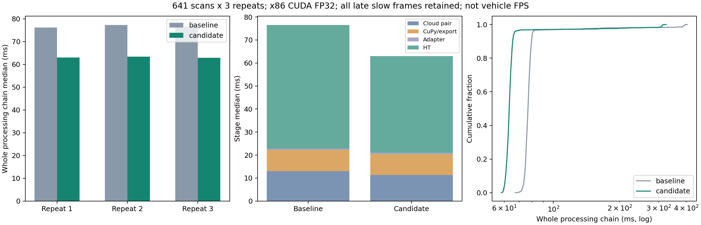

# HT离线整链路性能对照与发布验收（2026-10-30）

**满足实验前固定的发布门槛。** 复用10月28日16:53:17静止录包，新旧版本各重复3次，每次643帧原始扫描、641帧精确TF积分与HT输出。整条离线处理链中位耗时76.72→63.10ms（减少17.8%），P95为80.51→66.53ms（减少17.4%）。原生高程、完整模型输入、几何/未知/障碍/插补掩码及0.5门槛判定一致，最大概率差4.47e-6。

这是x86_64/RTX5060Ti上的离线处理实验，不是Jetson/ARM验收、真实DDS排队测速或车上不再2.2Hz的证明。没有启动仿真、设备、控制器或车辆，也没有操作周报。

## 版本与修改范围

基线：此前已发布实车代码对应的冻结HT模块和输入桥接。修改版包含：历史表面选择编译、小孔候选计算减负、CUDA eval Conv/BN融合、分阶段诊断；输入桥接的单次点云解析/过滤、减少拷贝、接收/重计算分组、发布前失效复核和BLAS限线程；独立CuPy的无订阅发布跳过。

模型权重、地图尺寸、0.5门槛、方向顺序、车体/轮胎过滤、观测年龄、融合和地形规则、TARE覆盖/TSP/视点访问顺序未改。未采用失败的ROI裁剪或channels_last CUDA布局，未引入FP16/TF32/TensorRT。代码保持在实车分支，CuPy源码和build/install仍独立。

此前组件级检查：[HT单帧优化](../real_ht_frequency_2026-10-30/REPORT.md)、[输入桥接优化](../real_input_pipeline_2026-10-30/REPORT.md)。这些旧报告的失败/P95退步记录保留，没有用本次新结果覆盖。

## 实验设计与输入

- 输入是已验证的22话题SQLite子集`stationary_required_topics.db3`，原始CDR消息不变；没有再次解压11.4GB原数据库。原始ZIP已在`real-scout-newbags-20261028`的Release保存，SHA和本次输入关系见`RAW_SOURCE_ASSETS.json`。
- 此前每0.5秒保存一图的117帧数据不能证明处理频率上限。本次对每个有效扫描都生成HT，六次共3846张，完整保留所有地图、模型输入、逐帧耗时及缺TF原因。
- 链路为：点云双坐标输出→稳定CuPy积分/原生三层发布→高程适配→HT历史/预处理/八方向推理。直接调用，不启动ROS executor、bag play、规划器或控制器；磁盘读取、CDR解码、TF查找、比较和压缩保存不计入服务时间。输入接收并发另有实际ROS回归覆盖，本实验不代替在线队列验收。
- 服务时长使用真实monotonic墙钟；离线ROS时钟按源时间推进以检查输入约定，逐帧诊断中的source_age不是实车传输/排队延迟，不能用它声称端到端消息年龄改善。
- 参数沿用已验证离线条件：0.04m、11.64m、确定性融合，drift/overlap关闭，配准候选关闭，小孔修复开启，FP32 CUDA且TF32关闭。两条件均空历史初始化。它们不是完整实车默认建图入口的复刻。
- 两版本都固定BLAS1线程，以隔离算法变化；原输入进程默认28线程的额外负担已在前轮独立计时，本次不将其混入对照。因此下述收益不含28→1线程的额外收益。
- TF全部按扫描源时间查询。沿用此前录包重建约定：车辆参考使用记录中的`scout_chassis_link`，仅离线Odometry接口将该参考命名为`base_link`；未改写录包TF，不把本实验当作当前车辆整套TF验收。
- 变体交替各3次，每次排除最初10个积分扫描作统计预热，但保留其数据；其余慢帧没有删除。前置门槛和源码冻结在首轮前写入`EXPERIMENT_PLAN.json`。

## 结果

| 离线处理整链路 | 原版 | 修改版 |
|---|---:|---:|
| 中位耗时 | 76.72ms | 63.10ms |
| P95 | 80.51ms | 66.53ms |
| 最大耗时 | 404.09ms | 324.01ms |
| 单线程串行处理能力估计（总帧数/服务时间之和） | 12.03图/s | 14.51图/s |

最后一行是该离线处理链的服务能力估计，不是源录包频率、实际回放墙钟频率、DDS接收频率或车上频率。真实任务还受上游供图、队列、带宽、其他负载和ARM硬件约束。

| 重复 | 原版中位/P95 | 修改版中位/P95 |
|---|---:|---:|
| 1 | 76.14 / 80.42ms | 63.03 / 66.59ms |
| 2 | 77.32 / 80.34ms | 63.42 / 66.45ms |
| 3 | 76.57 / 80.93ms | 62.88 / 66.52ms |

零订阅跳过并未纳入上述收益：实验始终捕获必需raw输出，不生成无用显示图；其行为由独立发布测试检查。BLAS的作用也单独保留，避免将各进程/阶段的微测结果简单相加。

## 结果一致性与发布门槛

三次修改版的1923帧与第一次原版逐帧比较，三层原生高程、完整291×291模型输入、地图几何、所有非概率HT层一致；支持区概率最大差`4.470348358154297e-06`，0.5判定差异0。原版另两次1282帧也与首次原版一致。FP32 BN折叠存在微小舍入差，不据此保证任意未来临界概率永不翻转。

实验前固定门槛：整链路中位耗时下降至少15%，每次配对至少10%，P95不能退步超过5%；六轮均641输出、2帧缺TF；原生地图、模型输入、几何/掩码和0.5判定无差异，概率误差≤2e-5。全部通过，见`PUBLICATION_GATE.json`。参数和运行源码均已冻结，测试期间未改生产代码。

已有235项回归、46项安装后检查通过。HT使用本树`build_real/install_real`，CuPy使用独立`build_stable/install_stable`；安装来源与SHA已核对。发布前再次确认独立mapper核心、权重、标定及配置未变。

## 数据、视频和复现

完整数据位于本轮Release的`HT_performance_data.tar.zst.partNNN`分卷，含六轮完整帧、逐阶段耗时、模型输入、修改前后源码、原样22话题输入副本、前两轮组件结果、失败试验与校验记录。依次合并全部分卷后解压；原始完整录包由既有Release引用，无需重复上传。详见`REPRODUCE.md`。

`offline_comparison.mp4`只展示实测地图与处理耗时，灰色区分未测/上下文不足，未将未知涂绿，也不是新规划路径或车辆执行录像。发布附件保存视频完整解码检查。

首次生成视频时系统PATH缺ffmpeg，已保留失败日志，随后复用现有已安装的imageio_ffmpeg二进制，没有重跑或修改实验。之前CDR填充误报、未归一化测试四元数、慢帧及失败网络布局等记录全部保留。

## 发布及限制

固定tag：`real-scout-ht-performance-20261030`；仅追加到`real/scout-helios32`，以当前远端父提交叠加文件创建提交，不推本地导入历史，不force，不移动旧tag，不改main/develop。发布后校验远端附件大小/SHA256与分支、tag指向；回执随Release和后续实车分支元数据保存。

本轮满足“旧数据实验有明显进步才上传”的条件。静止近车未知/低分、方向真实标签、当前车上2.2Hz原因和ARM闭环仍未验收；上游旧现场高程约1.8Hz的事实不因本机性能提高而消失。未部署Jetson、未启动设备/车辆，未清理原始数据，未操作待审周报。
