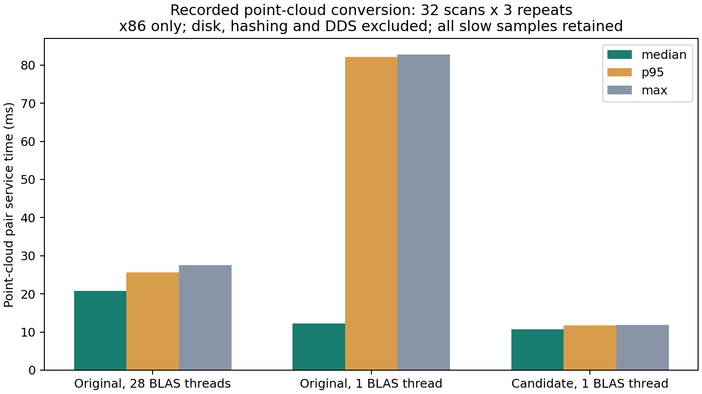

# 实车输入桥接与地图发布减负：2026-10-30本地候选

本轮优化输入处理的重复拷贝、线程争用和无用发布。不是新的建图/HT规则，也没有部署车辆或声称车上不再2.2Hz。

## 修改及安全边界

1. **点云只解析、过滤一次。** 从同一批保留点生成独立的rslidar原点云与map注册点云。保留旧双次变换中间的float32舍入，保留全部字段、端序和时间戳；消息只复制元数据，不再深拷贝随后会被替换的整块原始data。高程转换只复制需要的三层和元数据。
2. **点云处理独立调度。** 订阅回调只将点云放入有界队列；独立互斥回调组的worker处理点云，三线程executor允许接收、快速转换和TF继续调度。状态锁保护队列、时钟、故障及发布；计算在锁外。每路只允许一个处理者，活跃输入去重，保留单调源时间与精确时刻TF，不使用最新TF替代。云队列最多10个等待项加1个在处理项，其他队列原上限保留。
3. **在发布前再次复核。** 两种点云转换先完成，之后在同一状态保护区检查故障、关闭、源年龄和时钟；处理期间发生故障/回退/过期就同时丢弃两个输出，不把已过期结果作为新感知发布。关闭时先禁止新输出，再排空本节点正在执行的回调。发布本身仍可能受真实DDS压力影响，并未声称消除全部等待。
4. **输入桥接BLAS限为1线程。** 本机原NumPy OpenBLAS池默认28线程，Nx3变换不需要这样规模的线程组。启动参数`input_blas_threads`允许1～8，默认1；`python3-threadpoolctl`依赖显式写入package.xml。它只作用于输入桥接所在进程，没有改独立CuPy/HT节点线程配置。
5. **独立CuPy跳过无人订阅的发布。** 在地图锁、插件取图和GPU拷贝之前检查订阅数；有消费者时保留原有快照和发布路径。离线预加载、显式`publish_without_subscribers: true`以及既有直接捕获代理保留无条件发布。增加跳过计数。没有按相同源时间戳去重，因为方差老化/滚动中心等仍可能变化；没有压缩必需图层或改新鲜度。

融合、配准、观测年龄、外参、车体/轮胎过滤规则、模型、0.5门槛、HT地图尺寸、未知/障碍规则和TARE/TSP均未改变。没有采用前一轮失败的ROI裁剪，也没有引入TensorRT或降低精度。实车与CuPy仍在各自source/build/install工作区。

## 录包结果一致性

复用`HT_stationary_retest_2026-10-29_22-43-02/inputs/stationary_required_topics.db3`和上一轮保存的117帧原生高程流，不解压原ZIP、不重建已存在的高程结果。

- 643帧点云中，641帧有精确源时刻TF，2帧缺TF跳过并记录原因。新旧两种点云输出的**全部消息字段及data载荷字节一致，差异0**，包括28线程旧实现与1线程新实现。保留逐帧源CDR哈希、两个输出规范化哈希及代表性完整输出CDR。
- 117帧原生高程经新旧桥接转换，全部字段和浮点数组原始字节一致，差异0，输入消息未被修改。因此后续HT收到的这组输入与上一轮相同；这不代替当前实车TF/调度验收。
- 规范化检查覆盖全部字段；浮点数组按原始字节比较，包括NaN载荷和带符号零。CDR封装对齐填充字节可能未定义，不能用于判断两个ROS消息是否相同。本轮复核中227帧的完整CDR封装不同，但有效字段及载荷均相同。

## 本机耗时

x86_64、ROS Jazzy，实际静止包中每20帧选择一帧，共32帧，三个条件各重复3次。每组先预热3个样本；表格包含全部96个测量值，未删除慢帧。只测变换/打包函数，不含磁盘、反序列化、校验、真实DDS或接收排队。

| 点云双输出服务耗时 | 中位数 | P95 | 最大 |
|---|---:|---:|---:|
| 原版，28 BLAS线程 | 20.83ms | 25.62ms | 27.58ms |
| 原版，1 BLAS线程 | 12.25ms | 82.10ms | 82.82ms |
| 新版，1 BLAS线程 | 10.72ms | 11.72ms | 11.89ms |

相对原进程默认28线程条件，中位数减少48.5%。同为1线程时，中位数还减少约12.5%。旧版1线程组存在明显慢帧，已全部保留，原因未唯一定位，不能把限线程单独写成保证消除慢帧的手段。

高程转换117帧各3次，中位数0.494→0.419ms，P95为0.555→0.496ms；这项收益较小。点云桥接和HT推理位于不同阶段/进程，不能把本轮数字与上一轮60.8→45.1ms简单相加后宣称整链路帧率。

## 回归与独立安装

- 235项回归通过：整个ht_scout_bridge测试、上一轮HT频率优化相关回归、发布需求检查、安装器事务测试，以及真实CUDA观测年龄和稳定融合测试。20条警告均来自既有np.bool8弃用。
- 实际ROS并发测试：人为阻塞点云计算期间仍能接收并输出高程/里程计；重复及旧源时间戳不重处理；外参故障、时钟回退、处理过期或关闭后两个点云输出均丢弃。
- 点云端序、组织化行padding、非XYZ字段、未知值、输入不可变和双输出独立性检查通过。
- 零订阅发布检查验证不进入地图锁、不读取图层；后续订阅者能获得完整一致地图；同源时间戳下的方差更新不会被误去重。
- CuPy发布补丁只管理已知哈希的ROS wrapper。`--publication-performance`可幂等安装，拒绝未知编辑，独立于融合/配准阶段；不生成或覆盖trial配置。本机安装前后核心、配准及配置SHA全部相同。
- HT使用本工作树`build_real/install_real`，CuPy使用独立`build_stable/install_stable`，分别构建并核对安装源码。没有借用相邻工作树二进制。
- 去掉source路径覆盖后，确认实际导入两个install目录，安装后的46项输入转换、并发、失效屏障和发布检查全部通过；所有相关安装文件与源文件逐字节相同。见`FINAL_CHECK.json`。

## 尝试与证据

完整输出：`/media/lzz/KINGSTON/HT_input_pipeline_2026-10-30_01-36-43`。保留修改前源码、已知输入位置、补丁清单、各阶段日志、完整逐帧哈希、代表性CDR及校验清单。

失败记录保留：新增端序用例最初使用未归一化的测试四元数，4项用例失败，修正测试输入后通过；首次录包校验直接比较CDR封装填充字节，产生误报，失败脚本/样本/日志保留，改为全字段与载荷精确比较后641帧通过。没有删除失败输出或覆盖旧实验。

仍未完成Jetson/ARM实时性、真实DDS和当前实车链路验收；旧包约1.8Hz高程供图仍不能直接解释当前反馈的2.2Hz。本机微测不证明ARM帧率，也不能证明2.2Hz问题消失。本轮未仿真、运行设备/控制器、清理原包、操作周报、提交或上传；车上尚未应用本轮修改。
