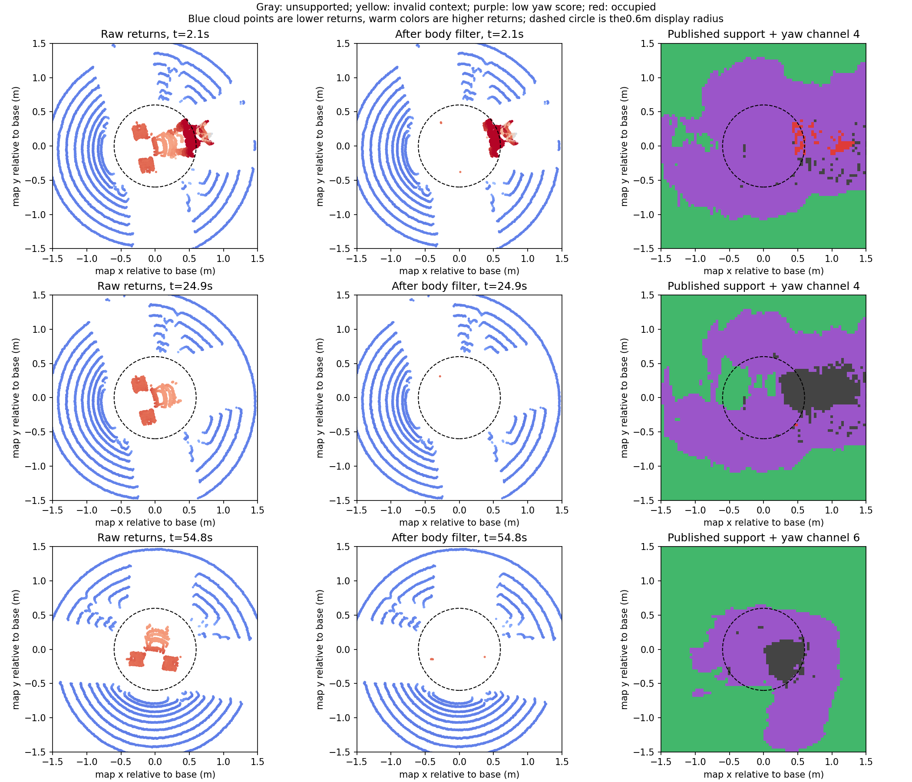
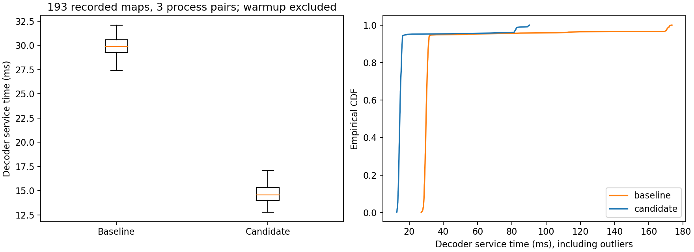
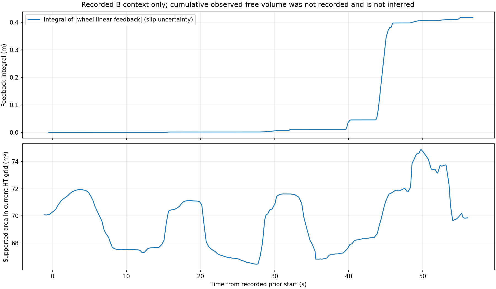

# 近车空洞与短程停车复核；HT地图接收加速及消费端诊断

## 结论与证据范围

近车缺测、扫描线间隙与HT未绘制区域需要分别解释。用户截图显示`NO_EXECUTABLE_ROUTE`、`Prior=False`，只能确认截图时没有可执行路线且起点许可已失效，不能据此确定首次制动的原因。

本轮独立复核的是完整的`ht_explore_20261102_193140.zip`（B轮）：两段MCAP共32,250条消息、57.295秒。A/C原始文件及外部报告的分析脚本不在本机；它们的具体统计和因果时序仍是外部报告证据，不冒充本轮独立复现。

**B包起点许可实际为60秒，不是仓库默认30秒；包结束时距许可截止还剩3.213秒。** 因而B包不能证明实际60秒后的停车状态。此前仅凭用户“约30秒”的描述推断许可到期，是待验证假说，现应按录包证据修正。

B轮定位净位移0.35193米，最大底盘线速度反馈约0.255m/s；绝对线速反馈的时间积分约0.41702米。积分含滑移和采样误差，不称为真实地面里程。全程有17条规划器`HT_MAP_STALE`和50条`NO_EXECUTABLE_ROUTE`状态消息；消息条数不等于独立故障次数。

## 黑色空洞与雷达视场的关系

若“rov”指FOV，视场和车体遮挡确实是近车缺测的来源之一。360度水平覆盖不保证能看到车底地面；有限的向下角度形成几何盲区，离散垂直扫描线在地面形成间隙，距离越远间隙通常越大。

RoboSense官方说明Helios系列存在多种垂直视场配置；5515手册给出−55至+15度。不能仅凭Helios32名称认定实车具体型号。[官方Helios说明](https://www.robosense.ai/IncrementalComponents/Helios)、[5515手册](https://cdn.robosense.cn/20220923164517_61201.pdf)。

B包第一帧原始点云的回波俯仰角1/50/99分位约为−51.21/−9.79/+14.91度，支持宽垂直视场解释，但点云没有ring字段，这不是逐通道标定表，也不能替代DIFOP或铭牌。按已有外参与地面偏移估计传感器离地约0.785米，若最大下探55度，理想平地最近落点约为`0.785/tan(55°)=0.55米`；这是几何估算，未含车身遮挡和姿态变化。

黑色还可能来自显示逻辑：`best_probability`只绘制HT上下文有效且具有有限输出高度的格子。原始回波缺失、质量/历史筛选后失去支撑、上下文无效，都可能表现为未绘制；黑色不能统一解释为模型低分或真实坑洞。

## 同源点云与地面证据回溯

选择约2.1、24.9、54.8秒的HT源时间戳，均找到完全相同时间戳的原始、车体过滤和注册点云。同序过滤云到注册云的刚体拟合RMSE约`4.2～4.8×10⁻⁷米`，可用于本帧几何回溯；它不单独证明整套外参或所有历史帧正确。

约54.8秒时，落在HT执行足迹缺测格内的原始回波有2,315个，高度相对base_link中位约+0.368米；过滤后仅余1个，约+0.335米。它们不是预计位于base_link下方约0.235米的地面证据，关闭车体过滤不能据此恢复可信地面。

末帧实际离散HT支撑足迹约853格，其中183格缺物理支撑、硬障碍0格。该足迹包含0.6米半径及网格离散余量，不能与界面0.6米诊断圈的格数混用。

沿508份实际HT输入CDR回查末帧这183格：183格曾有有限高度，但只有5格曾同时满足本次检查的2秒新鲜度、方差≤0.25m²及`base_z−0.23479±0.15米`高度带；允许600秒保留时有12格。这只是工程条件下的候选证据，不是真实地面标签。对5格的后续去向还需要实车新增证据/历史选择源码，不能直接判定为错误清理；其余格子也不能由有限高度推断为可靠地面。

## 车端版本差异

运行身份确认车端为ARM/Orin，CUDA、Numba及小孔CUDA后端已启用。与GitHub父版本相比，车端`cupy_to_ht.py`、`cuda_ht_context.py`、`historical_elevation.py`、`ht_support.py`哈希不同，另有本机不存在的`height_evidence.py`；参数包括`ht_qualify_evidence=true`、5秒表面策略和0.15米裕量。

因此本轮不声称重放了实车同一套HT推理/历史算法。使用的是车端已经发布的193张HT图，直接比较接收后的C++内部数据和查询结果。车端合入时需要保留并核对这5处已有源码差异，不能用本机旧HT入口覆盖它们。

## 时效与本轮修改

B轮50条HT性能诊断中，开始处理时源龄中位约0.389秒，处理耗时中位0.298秒，发布时源龄中位0.690秒；神经网络中位约71毫秒，源质量约45毫秒，融合约31毫秒，历史窗口约24毫秒，末次质量约41毫秒。源龄、CPU前后处理和消费者处理都占用1秒门限预算，不能把它统一归为GPU不足。

本轮只改已可独立验证的接收热点和诊断：

1. 缓存每帧八个概率层及有效性层的矩阵引用，消除逐格重复构造名称和查找层。
2. configuration语义下八个方向共用同一物理占据掩码，只做一次相同的膨胀；point语义仍分别计算八方向。
3. 增加`/ht_real/ht_map_diagnostics`，各消费者分别报告接收/接受/拒绝数、回调开始源龄、解码耗时、最新图和当前周期快照的源时间与年龄、拒绝原因。独立1Hz只读诊断，不续期地图。
4. `runtime_status.ht_map_consumers`汇总消费者诊断。年龄是消费者发布诊断时的采样值，汇总最多保留3秒；用源时间戳与当前ROS时间核对，不把诊断到达当作地图新鲜。

TARE目标/覆盖/TSP、HT推理、未知拒绝、真实障碍、0.5阈值、1秒时效、固定起点许可、车身过滤和独立几何碰撞均未改变。`terrainWindow`至文件尾全部控制查询函数保持逐字节一致。

## 验证与效果边界

- 独立Release构建和安装完成；117项Python检查通过，8组C++检查通过（含106个gtest用例及核心断言程序）。新增测试覆盖“新图已接收而周期仍持旧图”、拒绝计数、诊断汇总及异常输入边界。
- 193张原始HT CDR，新旧各3遍：概率、有效/物理支撑/未知足迹/八方向阻挡数组、几何字段、完整地形历史的SHA256及支撑分类均一致。
- 桌面每版本564个计时样本（每遍前5帧作预热剔除）：中位29.880→14.555毫秒，均值35.800→17.737毫秒，P95 51.133→18.780毫秒。仍有候选慢帧，最大90.201毫秒；全部原始计时及前一套受控夹具结果保留。
- 无先验离线查询：164图BLOCKED、29图UNKNOWN，全部无法直接用当前位姿起步；固定锚点、受控有效时段的对照193图均返回STARTUP_PRIOR。这是组件对照，不是对每帧实际任务时序或行驶效果的宣称。
- 未测ARM净收益、完整TARE规划延迟改善或实车持续探索。接收端加速不会制造缺失地面，不能称为已经修好黑洞或持续行驶。

包内未记录累计观测自由体积，因此不编造此指标；图中的支撑面积不是累计自由体积。视频也只展示B包已记录的地图和位姿，不是新控制实验。

## 后续仍需解决

取得车端新增证据/历史模块及实际C++安装身份，追踪那5格候选地面是否曾被正确接受、保留或被后续真实观测推翻。若近车地面从未被可靠观测，需要补足近车向下观测、核对遮挡或重新评估安装并标定。延长先验、扩大插补、缩足迹或刷新旧图时间戳均未作为本轮修法。

新增消费者诊断能区分“话题已来新图”与“规划器/跟踪器实际持有旧快照”；下一次实车记录应包括该话题及已有运行状态。A轮车尾几何点、C轮最后制动与60秒后无法重启，仍须各自原始数据复核，不能用B包替代。
