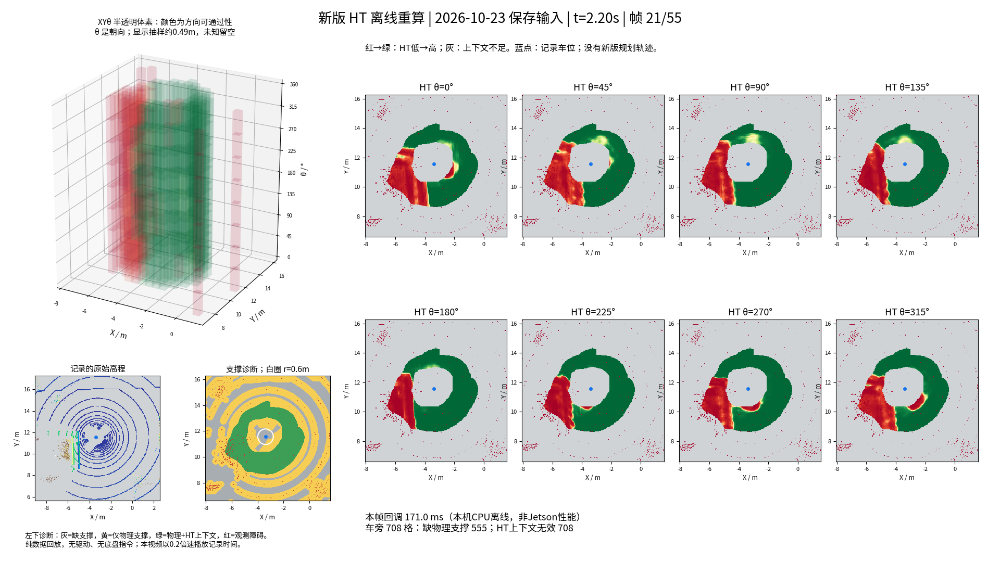
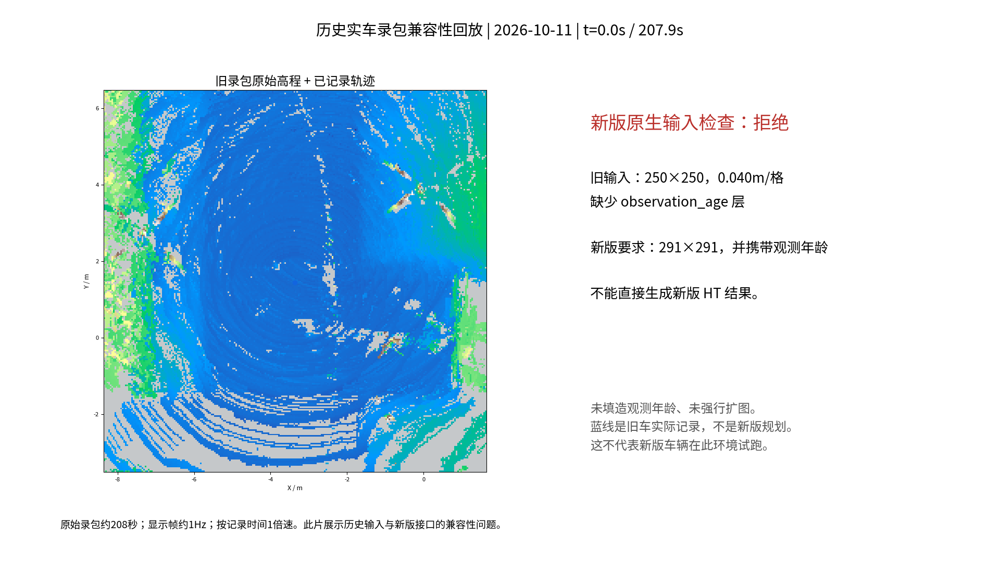
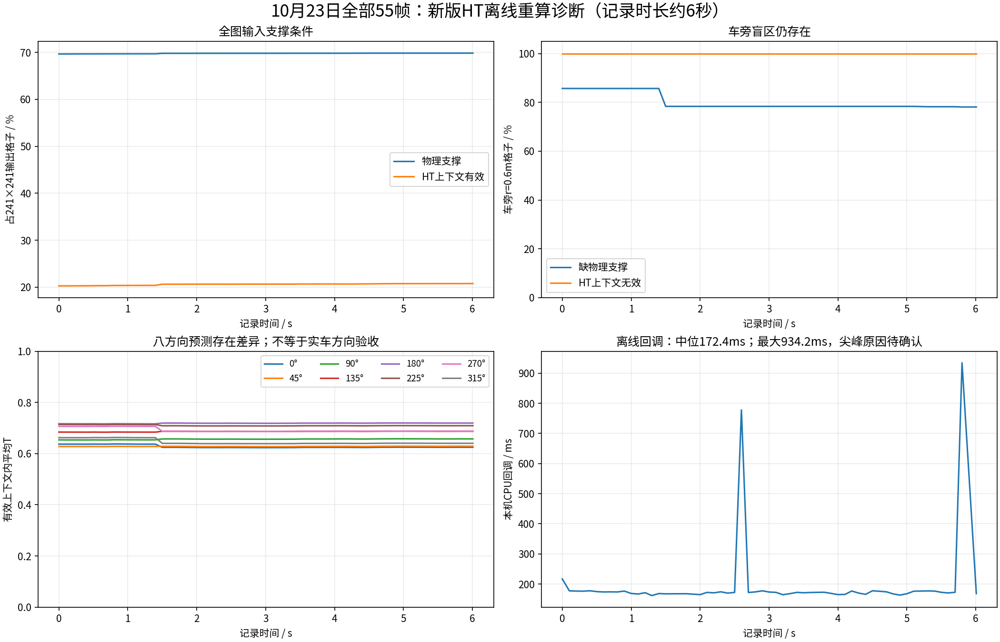
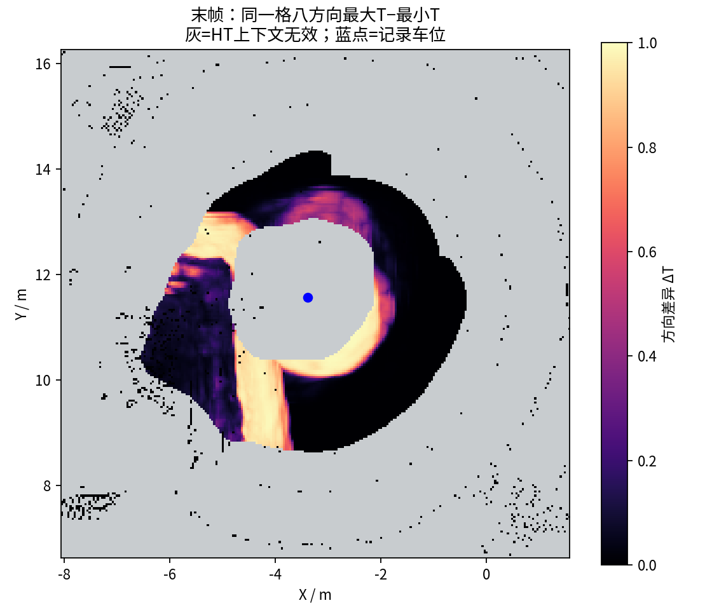

# 实车代码离线回放实验（2026-10-28）

**结论：新版HT对10月23日的55帧全部正常输出；车旁上下文盲区仍在。10月11日的旧行驶录包不能直接输入当前HT接口。此次没有新的车辆运动，也没有验证新版自主探索闭环。**

## 代码版本

- GitHub对应分支：`real/scout-helios32`。
- 原远端：`e0e09ce0fa28272c5a0358f04fe95216bcfcc044`（2026-10-22北京时间）。
- 补齐10月23—27日工作树源码：`85eab38e136af6a3d2de55e83f0a53628d689ee1`。
- 本次运行时修复及回放工具：`254ec3d11866d570f4f175ce0a3d2510c087defd`。
- 本地离线工具冻结提交：`acb4de6adada3cace9ed55af54f0380b61697a06`。
- 本地与GitHub的46个变更运行源码文件逐个Git blob一致；GitHub历史继续保留。原远端符号链接、COLCON_IGNORE及文件权限不被导出包缺失/权限变化误覆盖。
- 本轮未改TSP、XYθ搜索、HT权重或通行阈值。三项修复是库安装、点云QoS兼容、看门狗时钟；不应将地图输出的变化归功于这些基础设施修复。

`main`与`develop`仍分别为`649dad0`、`8b10207`，没有将实车更新合入仿真分支。
详细集成与远端源码核对见随附`github_integration.json`。

## 两组数据与结果

| 数据 | 实验内容 | 结果 |
|---|---|---|
| 10月23日保存输入 | 全部55帧GridMap、61条定位；记录时间跨度6.008秒；新版CPU/NumPy逐帧重算 | 55/55输出，无定位跳变/时间倒退故障 |
| 10月11日实车行驶录包 | 全部15个SQLite分片中1906条原始高程通过当前生产输入校验器检查；另保存2077条定位供复核 | 1906条全部因250×250几何被拒绝，且全部缺少observation_age层 |

当前HT要求291×291、约0.041m/格、规定布局及观测年龄。旧录包原图为250×250、0.040m/格。
实验未补造观测年龄、未强行填成291×291；旧图的模型结果不能冒充新版输出。
55帧文件是可信本地pickle序列，非完整新行驶录包；旧录包也不能替代当前标定及入口的实车运动验收。

## 观看视频

附件与数据对应预发布版本：[real-scout-offline-replay-20261028](https://github.com/CQULzz/HT_Explo/releases/tag/real-scout-offline-replay-20261028)。远端上传与哈希核对状态以发布回执为准。

- `HT_current_55frames_20261028.mp4`：31.10秒，原记录约6秒以0.2倍速播放。左上半透明XYθ体素，右侧八方向图，左下原高程和支撑诊断。体素仅显示抽样约0.49m，推理仍在原分辨率上运行。灰色表示上下文不足；蓝点表示记录的车位，没有新版规划路径。
- `legacy_208s_input_compatibility_20261028.mp4`：208.10秒，约1Hz显示历史原高程，按记录时间1倍速播放。蓝线是旧录包中已经发生的轨迹；右侧展示新版原生接口拒绝原因，不是新版车辆在行驶。
- 两段均为1920×1080、20fps、H.264/yuv420p；完整解码检查通过，并保存了文件SHA256。





当前视频左下原始高程里的蓝色细环是高程配色下的稀疏雷达采样，不是规划路线。图像采用最近邻栅格绘制，没有进行平滑插值。

## 已观察到的地图限制

全部55帧末帧，记录车位0.6m范围共709格，其中554格缺物理支撑，709格HT上下文无效。
这表示车旁缺测，不能将它解释为709格被模型认定成真实障碍，也不能据此宣称已修复自主起步/探索。
与前次8帧诊断中的606格不能直接比较：此次输入帧数、历史融合过程和最后帧均不同。



末帧有效上下文内，八方向预测的平均极差约0.219，约48.0%的格子方向极差大于0.05。
因此各通道并非直接复制；这只证明数值输出有差异，不证明实车方向响应已标定通过。



## 性能口径与未验证项

本机x86_64 / ROS Jazzy / PyTorch CPU，55帧回调平均197.3ms、中位172.4ms、95分位189.6ms，最大934.2ms，有两次明显尖峰；本轮未单独确认尖峰来源。
这是顺序离线回调计时，使用源时间戳+30ms的受控时钟，没有按原9Hz左右的速率进行实时调度压力测试。
因此不能由此认定Jetson/CUDA实时性达标，不能把受控时钟下的地图年龄当成真实端到端延迟。

没有启动雷达、定位、底盘驱动、仿真、rosbag网络播放或规划闭环。定位仅用于记录车位与高程参考；本实验没有重新生成CuPy高程，没有新探索体积或新行驶距离。
本轮的ROS节点限制在本机隔离域225；推理输出由进程内捕获器保存，不向底盘发布指令。

## 数据保留与复现

Release数据包保留55帧全部输入、逐帧输出NPZ、参数、诊断和视频；另导出旧录包全部1906条原始高程及2077条定位CDR，重新读回核对数量与整段高程CDR摘要。
旧录包导出仅是这次HT接口审查的完整输入，不包含未使用的点云、TF、底盘指令等全部车辆话题；完整15分片仍留在原移动硬盘，未清理。
原始55帧输入解压SHA256为`88ebd1592f06b4599cc1e742ea478ebcff2864d4918f59d3b3e1652f75ddf1ff`。

在配好ROS与HT依赖的独立工作区运行，输出目录必须不存在：

```bash
source scripts/source_real_scout.sh
unset CYCLONEDDS_URI
export ROS_DOMAIN_ID=225 ROS_LOCALHOST_ONLY=1 RMW_IMPLEMENTATION=rmw_fastrtps_cpp
export OPENBLAS_NUM_THREADS=1 OMP_NUM_THREADS=4
python3 tools/ht_cupy_bridge/replay_real_archive.py \
  --archive '/media/lzz/My Passport/HT_Explo_full_code_and_experiments_2026-10-27/HT_Explo' \
  --output '/实际路径/新的回放输出目录' --ffmpeg /实际路径/ffmpeg
```

回放工具与归档导出工具分别为`tools/ht_cupy_bridge/replay_real_archive.py`、`export_legacy_replay_inputs.py`。
只读取可信本地pickle。视频编码额外要求带libx264的FFmpeg；本机使用独立安装的imageio-ffmpeg 0.6.0所附FFmpeg 7.0.2。
代码原有回归结果见`validation/real_review_2026-10-28/REPORT.md`；本轮没有在修改算法后跳过回归，而是保持已验证运行源码不变进行数据回放。
