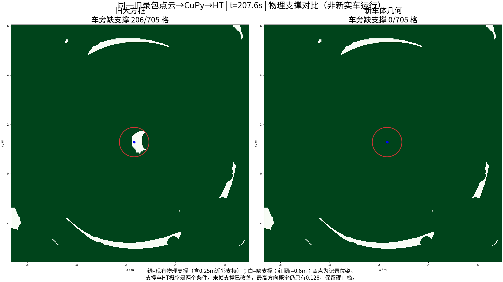
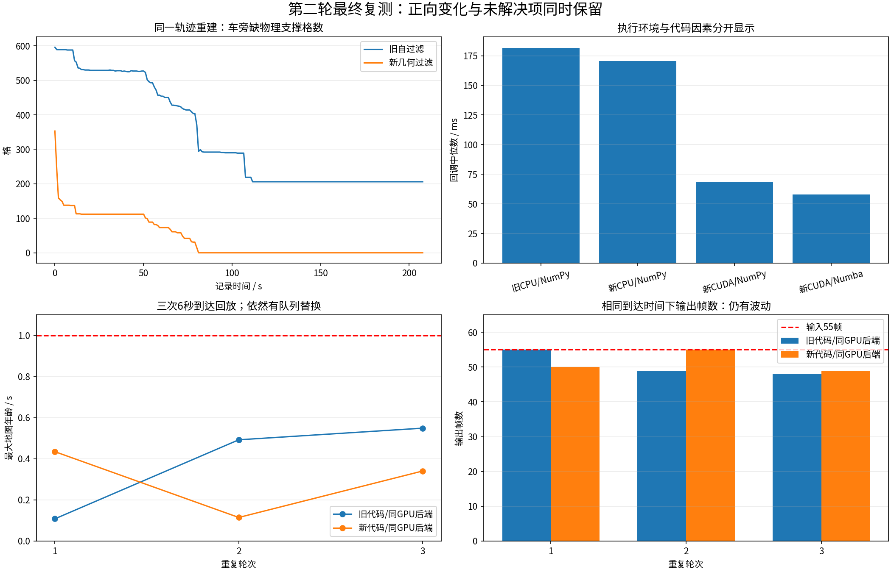
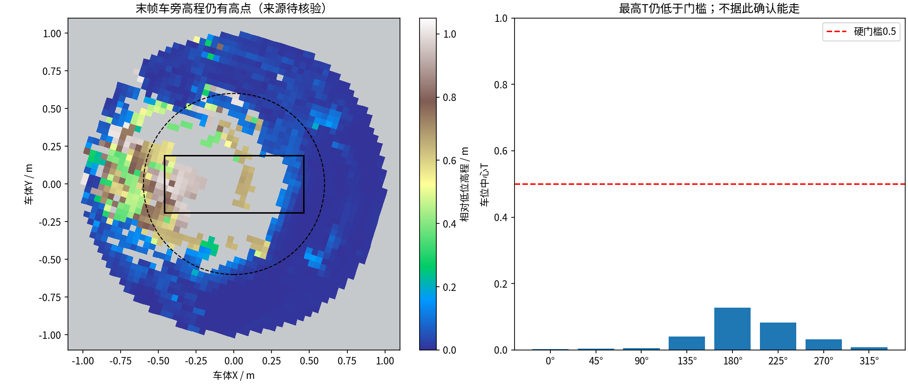

# 实车历史数据第二轮复测：过滤、观测年龄与计算环境

2026-10-28。**已修复可以证实的输入/环境问题，仍未完成实车导航验收。**本轮只处理历史数据，没有启动仿真、设备驱动、底盘或运动控制。简版见[BRIEF.md](BRIEF.md)。

## 1. 发现什么，为什么修改

| 问题 | 可验证证据 | 处理及边界 |
|---|---|---|
| 自过滤误删地面 | 旧rslidar框为`[-1,0.2]×[-0.7,0.7]×[-0.9,0.2]m`；已核验标定下平地约Z=-0.785m，位于框内。42个原始扫描样本的近地面候选点257773个，旧框保留247191个，新几何保留257773个 | 改为base_link下9个模型包围盒和4个轮子圆柱，保留原外参；2cm裕量是工程假设。模型车头也有超出旧框的部分，但本组没有观察到实际漏删前车体点，不能把这个可能性当成已证实噪声源 |
| 年龄层语义不一致 | 原默认使用`time`；CuPy上游代码该层由固定定时器步长累计，而当前HT要求实际观测源时间 | 统一`observation_age`，配置原生291×291、0.04m地图和可靠QoS；外部CuPy需应用仓库既有补丁。缺层就拒绝，不伪造新鲜时间 |
| CPU回放与GPU硬件不匹配 | 本机RTX5060Ti 16GB，原PyTorch却是2.11.0+cpu；55次网络输入均不同 | 创建独立CUDA环境，检查实际CUDA运算及Numba导入；CPU另折叠21层推理期BN。没有使用“相同地图缓存” |
| 旧保存地图不能直接喂新接口 | 10月11日保存图250×250且缺观测年龄 | 从原始LiDAR和记录位姿重新建原生地图，没有给250图补边、缩放或补造年龄 |

新增发布`/ht_real/lidar_filtered`是保留源时间戳和字段的雷达坐标点云；外部mapper用它保留传感器原点，再发布高程图。`/ht_real/registered_scan`来自同一过滤结果，经按时间的位姿转换。外部mapper不要再次执行旧大框过滤。

## 2. 冻结版本及改动文件

- 基线发布提交：`f1c50cce41fc6601520990b52c0e5f679c4ef526`；本轮运行代码发布提交：`a00c83eeaf5466a1eac53d29d0b54e35398acfab`，对应本地冻结`cdcc4fb4bc9a376f2afa5a113c40f3e95f0968a8`。完整映射保存在附件`GITHUB_SOURCE_MAPPING.json`和`FINAL_SUMMARY.json`。
- 分支：`real/scout-helios32`；本轮Release/tag：`real-scout-round2-20261028`。报告及视频生成脚本提交晚于运行冻结提交，不冒充实测版本；发布校验回执记录最终提交。
- 过滤：`src/ht_scout_bridge/ht_scout_bridge/{geometry,node}.py`、`config/scout_extrinsics.yaml`及对应测试；几何来源固定`CQULzz/eletranskit_scout@cf0b73d7d01b4b6a2718c7ff3124f4b7a3368c36`。
- 地图入口：`config/mapper_for_ht.yaml`、`launch/scout_real.launch.py`、`tools/ht_cupy_bridge/cupy_to_ht.py`及配置测试。
- CPU优化：`tools/ht_cupy_bridge/model.py`及`test_model_fusion.py`；设备检查：`tools/check_ht_compute.py`。
- 实验脚本：本目录`experiment.py`、`prepare_raw_rebuild.py`、`rebuild_cupy_maps.py`、`render_results.py`、`final_results.py`；通用离线视频渲染器`tools/ht_cupy_bridge/replay_real_archive.py`。
- **未修改**TARE的TSP、视点收益/访问顺序、C++路由、控制器、网络权重、外参矩阵、0.5硬门槛及现有0.25m近邻支撑规则。main/develop未合入实车修改。

## 3. 新一轮实验及结果

### 同轨迹从原始点云重建

来源是外盘备份的`validation/arm_vehicle/results/demo_20261011_225010/rosbag`，原记录约208秒。每0.5秒选一帧；416个候选中，1帧因位姿时间差超过50ms拒绝，415帧接受。采用全部2077个记录位姿作关联；已检查记录的固定变换与当前标定一致。

独立CuPy进程用新/旧过滤各融合415帧，每两次输出一张地图，**各208张、覆盖207.587秒**；HT独立进程读取两组序列化结果，各208/208张成功输出，无输入位姿故障。原生输入291×291、0.04m，HT中心输出241×241。地图包含真实点云源时间生成的观测年龄；关闭漂移补偿和overlap_clearance，两组参数相同并归档。

| 末帧指标（车位半径0.6m，共705格） | 旧过滤重建 | 新过滤重建 |
|---|---:|---:|
| 缺物理支撑格 | 206 | **0** |
| HT上下文无效格 | 0 | 0 |

“有物理支撑”包含原有0.25m内近邻测量支持，不表示每一格都直接被激光测到。重建保持原记录轨迹，没有重新规划或驱动车辆，不能比较探索体积/行驶里程提升。



### 同一55张保存输入的性能对照

此组源数据仅6.008秒；来源`validation/jetson_scout_2026-10-23/quality_optimization/live_input.pkl`，SHA256=`88ebd1592f06b4599cc1e742ea478ebcff2864d4918f59d3b3e1652f75ddf1ff`。它已被旧流程处理，单改HT推理不能恢复缺失点；它的末帧554/709格缺支撑与上述重建705格统计属于不同数据。

| 执行条件 | 回调中位ms | P95 ms | 最大ms |
|---|---:|---:|---:|
| 旧CPU/NumPy | 181.82 | 208.82 | 907.77 |
| 新CPU/NumPy | 170.77 | 202.60 | 594.17 |
| 新CUDA/NumPy | 68.24 | 76.27 | 368.94 |
| 旧CUDA/Numba | 59.47 | 72.94 | 315.08 |
| 新CUDA/Numba | 57.98 | 75.43 | 318.45 |

**大部分提速来自执行环境，并非过滤或HT算法突然提速三倍。**同GPU后端新旧速度接近，P95和最大耗时没有全面改善。CPU折叠BN的概率最大差2.921×10⁻⁶，0.5门槛翻转0；相同CUDA/Numba后端本次55张输出概率完全一致，有效性/障碍掩码一致。

按记录约9Hz到达时间再做各三次6秒队列测试：旧输出55/49/48帧，新输出50/55/49帧；新队列替换5/0/6帧，最大地图年龄0.435/0.114/0.341秒。**替换的是未处理完的旧待处理帧，不是网络丢包证据**；没有DDS网络、实车负载和长期稳定性结论。

模型几何过滤比旧大框开销大：旧框中位2.59ms，首版几何18.98ms；加入整体包围盒预筛后5.74ms，前后几何掩码逐点一致。CPU总处理仍不适合声称稳定跟上原9Hz。



## 4. 仍然存在的问题

**新重建末帧车位中心最高T仅0.127534，八方向都低于0.5。支撑恢复并没有自动解决通行判定。**车位周围1m内高程P95-P05约0.850m，存在明显高点。它们可能是真实障碍，也可能是现有模型未包含的电脑/电源箱等附件；缺少现场和附件尺寸，来源待确认。未通过降低门槛、删掉未知高点或改变近邻支撑距离来把地图涂绿。



接下来应先对照录包现场/车载附件尺寸核验高点位置，再决定是否补充有尺寸依据的车体过滤几何；真实障碍应保留。物理地图改进、低T来源、Jetson实际输入/TF/外部mapper接线和整车闭环验收是不同层面的事项。

本次记录位姿由雷达参考点与已验证固定外参推算到base_link，**仅用于离线地图/HT参考**；未测量的twist明确NaN，不能当作控制里程计。没有验证新Fixposition在线发布、时间同步、逐点去畸变、底盘命令链。现有整帧刚性配准不能据此声称已做逐点去畸变。

## 5. 验证、依赖和复现

- 215项Python回归通过；独立CuPy真实观测年龄GPU测试8项通过、4条NumPy弃用警告；`scripts/build_real_scout.sh`两包编译通过；原TARE六个函数合同检查通过。日志随附件保留；本轮未重跑历史C++88项测试。
- 本机Ubuntu/ROS2 Jazzy、i7-14700F、RTX5060Ti 16GB；独立Python环境使用torch2.11.0+cu128、CuPy13.6.0、Numba0.65.1、NumPy1.26.4，详见[GPU_ENV.md](GPU_ENV.md)和实际运算preflight JSON。这不是Jetson/ARM部署镜像。
- 独立CuPy工作区基线`88f4c0c2eb3542faeb7bd8fa9df2f18bd25eed91`已应用本仓库既有`tools/elevation_mapping_fixes/cupy_ht_mapping.patch`；本轮直接使用源码做GPU测试和离线建图，未声称完成colcon部署。
- 保留失败：域235超出FastDDS端口范围导致启动失败，改181后成功；系统coverage7.4.4与Numba不兼容，在虚拟环境升级7.17.0后成功。没有覆盖失败日志。

在本仓库根目录准备实际变量`ARCHIVE`、`RESULT`、`CUPY_PACKAGE`、`GPU_PYTHON`后执行（输出目录必须全新，禁止覆盖记录）：

```bash
source scripts/source_real_scout.sh
export ROS_DOMAIN_ID=181 ROS_LOCALHOST_ONLY=1 RMW_IMPLEMENTATION=rmw_fastrtps_cpp
export OPENBLAS_NUM_THREADS=1 OMP_NUM_THREADS=4
# 按GPU_ENV.md设置GPU环境的动态库；CUPY_PACKAGE指独立CuPy包目录。
"$GPU_PYTHON" tools/check_ht_compute.py --require-cuda --cupy --require-numba
python3 scripts/check_tare_waypoint_contract.py
bash scripts/build_real_scout.sh
python3 docs/results/real_round2_2026-10-28/prepare_raw_rebuild.py \
  --bag "$ARCHIVE/validation/arm_vehicle/results/demo_20261011_225010/rosbag" \
  --output "$RESULT/raw_rebuild_inputs"
PYTHONPATH="$CUPY_PACKAGE/script:${PYTHONPATH:-}" "$GPU_PYTHON" \
  docs/results/real_round2_2026-10-28/rebuild_cupy_maps.py \
  --input "$RESULT/raw_rebuild_inputs/selected_raw_inputs.pkl.gz" \
  --package-dir "$CUPY_PACKAGE" --output "$RESULT/cupy_rebuild"
"$GPU_PYTHON" docs/results/real_round2_2026-10-28/experiment.py \
  --stage ht --archive "$ARCHIVE" --input "$RESULT/cupy_rebuild/after_native_maps.pkl" \
  --device cuda --quality-backend numba --commit "$(git rev-parse HEAD)" \
  --output "$RESULT/rebuilt_ht_after"
# before同理读取before_native_maps.pkl，输出到独立rebuilt_ht_before。
```

保存55帧的CPU/GPU对照与定时队列测试由`experiment.py --stage ht/timed`执行；旧代码来自基线提交，不能把当前源码配上旧提交文字冒充基线。完整新旧脚本快照、输入、实际参数、日志、NPZ及数值结果见Release数据附件。只对可信本地pickle输入运行这些离线脚本。

## 6. 视频和归档

Release：[real-scout-round2-20261028](https://github.com/CQULzz/HT_Explo/releases/tag/real-scout-round2-20261028)。

- `HT_round2_raw_cupy_xytheta_208s.mp4`：半透明XYθ体素与8方向HT图，处理208帧，视频约每5秒展示一张地图；蓝点是记录位姿，没有新规划路线。
- `HT_round2_support_comparison_208s.mp4`：新旧车旁支撑随记录时间的变化。
- 两段H.264/yuv420p视频均完整解码检查通过。它们是离线结果展示，不是实时帧率证明或新实车行驶录像。
- 数据附件含本轮所有计算阶段和失败日志、抽样原始CDR、原生地图、HT数值快照、脚本/版本映射和逐文件SHA256；视频渲染中间PNG不重复打包，保留关键帧与重渲染脚本。原始外盘整包不改动。
- 发布是否完成以`PUBLICATION_RECEIPT.json`远端资产大小和SHA256核验为准；本报告文件本身不作为上传成功证据。
