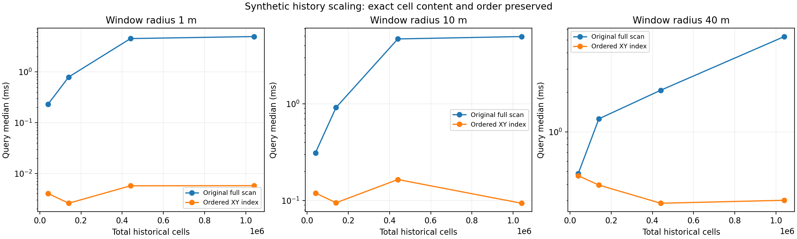
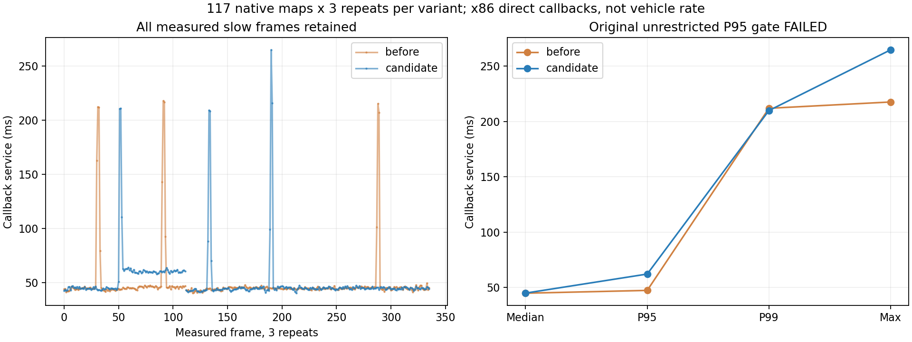

# 系统优化首轮：运行身份、诊断有界化与地形历史索引

日期：2026-10-30。**首批代码候选已完成，语义和功能检查通过；原不约束调度的HT回调P95门槛未通过。首轮因此暂停自动发布，用户随后明确要求上传，现按候选版本归档到实车分支，验收失败结论不变。** 复核结论见[方案复核](../../plans/2026-10-30_system_optimization_review.md)。不是已解决实车2.2Hz或近车全红的声明。

## 修改与合理性

1. HT增加运行身份清单，记录实际入口、导入模块和权重哈希、参数、设备/后端、线程池与话题。标准实车命名空间为`/ht_real/ht_runtime`，保留最近一次身份，便于晚加入的诊断订阅。性能与逐帧诊断引用同一runtime_id。该清单仅覆盖HT进程，整链路关联尚未完成。
2. 原逐帧无限列表改为默认600条有界记录。显式启用实验归档后，用独立JSONL日志和有界写盘队列保留全量；退出时流式生成兼容JSON数组。队列溢出或磁盘错误明确失败，不以截断记录冒充完整实验。安装后检查以2条在线容量产生6条真实HT输出，6条均完整归档并关联运行身份。
3. C++地形历史由平铺有序map改为X/Y两级有序索引，局部窗口不再扫描全部远处历史。原0.2m键、单元、更新规则、坐标筛选、未知指导策略及返回字典序保持不变。没有淘汰历史，不等于全部地图内存已经有界。

这些项目都有直接代码依据，适合作为方案的首批修改。历史淘汰、TF策略、融合、方向模型、规划缓存、低精度推理和整体重构暂缓，避免在没有相应数据时扩大语义变化。

## 验证范围

- 实车独立`build_real/install_real`构建成功；未引入相邻HT二进制。安装入口、新模块及原模型/历史模块已逐文件核对。
- CTest 8个目标全通过，其中7个gtest目标共99个用例，另有ht_core自定义目标。覆盖随机/边界索引、HT地图、起步同步、TARE几何、规划输入和执行跟随。
- 50项Python检查通过；包括数据契约、真实晚加入订阅、运行身份、记录淘汰与全量归档、队列溢出、模拟磁盘错误、实际主循环退出、源时间与发布统计、实车launch模式。另有安装后真实节点归档检查。
- 最终ROS回归使用专用domain与localhost discovery。初始检查未启动驱动、控制器或车辆；本轮没有仿真或闭环任务。
- 独立CuPy工作区未改；其wrapper与方案审阅快照SHA一致。模型、预处理、历史融合、小孔规则、过滤、0.5门槛、物理支持/未知规则、TARE顺序与控制限值均未改。

## 旧数据语义对照

直接复用前轮117帧已验证原生高程流及原22话题子集中的TF/位姿；不重新解压、不重建原始点云。HT修改前后各3次，CUDA FP32、相同线程和后端，参数与源码冻结。每次前5帧作预热，其他慢帧全部保留。

修改版每次刻意将在线诊断容量设为2，测试频繁淘汰是否影响输出。三次共351帧完整291×291模型输入、地图几何、所有14层结果与基线一致；概率最大差**0**，0.5翻转**0**。原版其他两次也与首次基线一致。各轮完整地图与模型输入都保留在本地实验目录。

这是直接回调实验，不含真实DDS队列、在线TF等待、规划/控制负载或ARM。它不证明当前实车总launch已复现。原录包供图频率与本机服务耗时仍是不同口径。

## 地形历史规模实验

固定40401个近处单元，追加0/10万/40万/100万个远处单元。半径1/10/40m窗口及全历史负控制，每种12次交替计时，预先固定2次预热。所有查询的单元字段与顺序均与原扫描一致。以下为40m窗口：

| 历史单元总数 | 原全扫描中位 | 新索引中位 | 加速比 |
|---:|---:|---:|---:|
| 40,401 | 0.482ms | 0.463ms | 1.04× |
| 140,401 | 1.255ms | 0.393ms | 3.19× |
| 440,401 | 2.070ms | 0.286ms | 7.23× |
| 1,040,401 | 5.302ms | 0.301ms | 17.59× |

百万历史中，索引只检查40401个近处候选，满足事先规定的≥2倍门槛。该合成结果证明局部查询扩展性改善，**不是HT推理或整车17倍加速**。它也不测量整套规划器任务成功率。

退步未隐去：请求所有单元时，140401单元中位2.210→2.315ms（约4.7%慢），1040401单元18.036→18.279ms（约1.3%慢）；40401单元的首次构建约10%慢，而较大合成集合首次构建更快。这些构建各一次，不能冒充在线更新的稳定统计。两级容器有列级开销，尚未测得独立的长期RSS上界。

## HT尾延迟：原验收失败，补充诊断不替代失败结果

| 原始不约束CPU调度，合并3次 | 修改前 | 修改后 |
|---|---:|---:|
| 中位 | 44.90ms | 44.99ms |
| P95 | 47.44ms | 62.21ms |
| P99 | 211.94ms | 209.90ms |
| 最大 | 217.64ms | 264.73ms |

P95退步约31.1%，超过事先规定5%。修改版第1次后半段CPU处理阶段变慢，第2次局部出现慢帧，第3次未出现；原版也存在超过200ms的慢帧。不能删除这些数据，也不能以中位基本不变宣告尾延迟合格。

针对这一未解问题，额外冻结补充诊断计划：记录回调前后所在CPU，对新旧进程都使用相同4个性能核（0/2/4/6）进行各3次对照，不改变系统功耗/频率配置、不操作其他进程。补充合并结果：

| 同样4核约束，合并3次 | 修改前 | 修改后 |
|---|---:|---:|
| 中位 | 44.06ms | 44.29ms |
| P95 | 46.60ms | 46.71ms |
| 最大 | 221.27ms | 221.30ms |

该条件下P95差约0.24%，未见明显固定开销；加上1对记录核心的不约束调度补录，共936帧输出与首次基线地图一致。原慢段没有记录CPU位置，补录的不约束调度两版均落在性能核，因此**尚不能唯一归因于混合核迁移**。本机确有不同性能等级CPU，这是排查方向，不是已证实根因。

补充结果不替换原门槛，原验收仍为失败。本版因用户明确要求而上传为候选，不标为已验收性能版本；后续仍需完善逐阶段CPU/调度或分配诊断。不为过门槛反复挑选最好一轮。

## 已发现并修复的边界反例

索引初版在`x=radius=1e300`的合成反例中，与原扫描结果不一致。原因是`abs(cell.x-x)<=radius`与直接构造区间边界在巨大数值下受浮点舍入影响，不再等价。正常坐标下索引预留边界单元并继续执行原谓词；当查询精度不足或非有限时回退全扫描。完整边界测试通过。

初版源码与冻结计划保留为`candidate_rejected_v1`和`REJECTED_FREEZE_V1.json`，失败日志为`cpp_regression.log`。修正后重新冻结V2再进行性能实验，未放宽语义条件。第一次构建已有头文件的旧有编译警告，编译日志保留。

## 资产与复现

完整本地资产：`/home/lzz/HT_system_foundation_20261030_132818`，包括修改前/后冻结源码、失败初版、计划、8组正式与补充测试日志、6轮完整旧数据输出/模型输入、8轮补充诊断、逐次规模CSV、源码/安装检查、图表和视频。`run_offline_checks.py`及`run_cpu_diagnostic.py`记录完整调用；目录独占创建，不复用旧输出。

`offline_parity.mp4`展示原旧数据的两版最小八方向分数，灰色区分无物理/上下文支持；没有生成车辆轨迹或规划路径。逐帧解码检查见`VIDEO_CHECK.json`。原22话题输入及旧Release继续复用，未复制/覆盖或清理原始录包。

用户追加指令：“把改好的给我传到github对应分支”。据此仅向`real/scout-helios32`追加候选代码、报告与版本索引，使用远端父提交叠加，不推本地导入历史；新tag为`real-scout-system-foundation-20261030`，Release标记prerelease，不改main/develop或旧tag。完整本轮数据、失败记录、图表与视频作为Release附件；原输入引用已验证的上一轮完整数据，不重复解压或重建。发布大小/SHA256和代码校验完成后另附回执，原`FINAL_CHECK.json`保留首轮尚未发布时的真实状态。

待审周报、现有表单与外部进程未操作，实车/仿真及独立工作区仍分离。本次上传不启动新实验或设备。尾延迟仍待诊断，不能把后续模型/融合/TF候选混入本轮结果。
