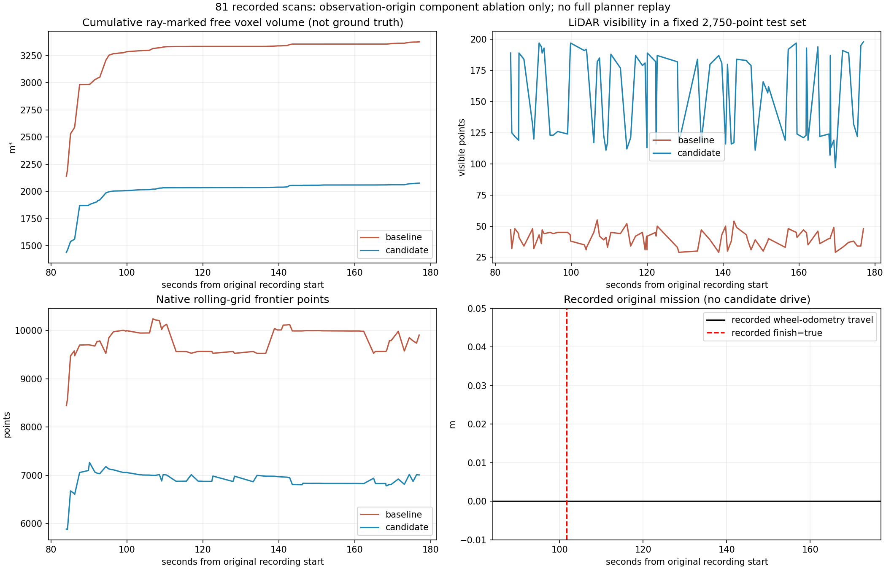
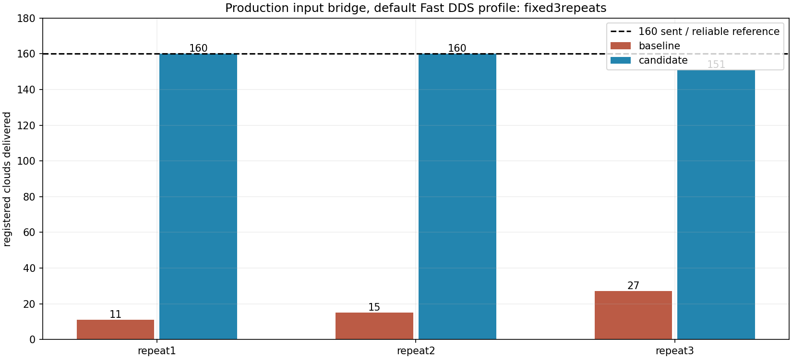

# 实车点云接收与TARE观测原点修正，2026-11-01

**URDF→静态TF和base_link定位转换一致；TARE接入层混用了车体原点与雷达观测原点，已修正。** 本机复现的大点云接收问题明显改善，仍有一次连续9帧缺口。没有完成车上ARM或完整TARE闭环验收，不能宣称提前结束、无法起步或降频已经全部解决。

部署包装补丁见[PACKAGING_FIX.md](PACKAGING_FIX.md)：r1仅补齐可选XML安装，原实验tag和冻结数据保持。

固定版本`real-scout-tare-input-fix-20261101`，目标分支`real/scout-helios32`。确切提交、附件和远端SHA以本目录发布回执为准。独立CuPy工作区未修改、未加载；使用本轮独立build/install，没有覆盖原build_real/install_real，没有启动设备、仿真或车辆，没有操作待审周报。

## 输入与已有事实

直接复用已验证解压数据，未重复解压。原始`ht_exploration_20261031_170105.zip`为1,875,816,434字节，SHA256：`3206329dc863e76e63b3b3240aa5a02d4f1389ebb8b31faa87d1d74dcebb75f0`。3个MCAP共83,254消息、82个非空话题，179.043秒。完整原ZIP和完整科学归档随Release保存，MCAP已在原ZIP中，不在科学归档重复存储。

此前全包审计发现：重启后原始点云950帧约10Hz，注册点云81帧约0.86Hz，HT77帧约0.83Hz。新任务15.529秒后`exploration_finish=true`，当时30秒起点假设仍生效；`mission_completed`始终false。所有速度命令和Scout速度为零，轮式里程计XY未变。定位毫米抖动不能累计成实际里程；本包没有车辆移动几厘米的证据。

## TF核对与观测原点修正

读取用户固定的[eletranskit_scout@cf0b73d7](https://github.com/CQULzz/eletranskit_scout/tree/cf0b73d7d01b4b6a2718c7ff3124f4b7a3368c36)原Xacro和launch，保存源blob/SHA。保留用户确认的FP_POI同位和0.1162m支架高度；解析固定关节，与配置、录包静态TF逐项比较。

| 变换 | 平移，m |
|---|---|
| FP_POI→base_footprint | (-0.2005158179,0,-0.65899) |
| FP_POI→base_link | (-0.2005158179,0,-0.4242) |
| FP_POI→rslidar | (-0.0280158179,0,0.126) |
| base_link→rslidar | (0.1725,0,0.5502) |

1696对FP原定位经外参转换后，与记录中的base_link定位最大矩阵误差8.88e-16。没有发现变换方向取反或高度叠加，未改标定或新增TF广播器。

接口错误在TARE观测调用层：原占据栅格射线和机器人观测覆盖使用base_link位置。现由同一标定计算杆臂，按**扫描源时刻**匹配位姿，用完整四元数旋转：

`p_world_lidar = p_world_base + R_world_base * [0.1725,0,0.5502]`

射线和LiDAR覆盖使用雷达原点。车辆位置、栅格滚动中心、访问历史、路由、回家和起点锚点仍用车体。通用入口偏移默认为零。测试包含扫描时刻插值、roll/pitch/yaw、零偏移和非法输入。

## 参考原TARE后的边界

参考[原TARE@b6760ad](https://github.com/caochao39/tare_planner/tree/b6760adb4280b379567c76f4e684ce628e28ef71)，修改前16项函数体词法比较均一致；实车算法参数与原garage一致。访问半径、gain门限和原生完成条件不能仅凭这次停车就判成移植错误。

本轮三个`tare_original.cpp`逐字节保持；覆盖、全局/局部TSP和访问顺序不改。共享`EnqueueViewpointCandidates`追加只读`TARE_SELECTION`日志，因此修改后16项比较15项相同、1项仅追加诊断；其中6个原生覆盖/TSP/路径函数仍一致。日志区分visited、非探索单元、已预选、剩余候选、原始gain/frontier、虚拟覆盖、最终队列和门限，以便解释“有未覆盖点但没有可选目标”。

## 点云传输修正

参照原TARE可靠订阅，适配器原始点云、TARE注册点云、跟踪器注册点云改为RELIABLE，深度分别保持2、5、5。小队列及原源时间拒绝门槛保留。原录包metadata中相关writer均声明reliability=1（RELIABLE）；这支持兼容性判断，但不能证明车上DDS共享内存配置。

适配器参数`cloud_reliability`默认`reliable`，可显式选`best_effort`，不静默回退。新增1Hz有界`/ht_real/input_performance`，包含源码/标定SHA、RMW、端点QoS兼容性、接收/入队/重复/TF等待/溢出/过期/拒绝/转换/发布计数、最近200次阶段耗时及输入静默。TF等待计尝试次数，可重复，不是独立丢帧数。

新增可选UDPv4+16MiB共享内存XML，通过`dds_profile`按本launch进程启用，默认不强制加载。独立writer和建图进程需分别加载才构成同条件配置。未改全局DDS、内核、网卡、CPU绑定或功耗。

### 冻结版本各3次正式传输对比

12帧真实原始点云CDR载荷循环160次、10Hz，伴随10Hz高程/定位，独立3进程、localhost ROS域和诊断命名空间。FakeTf恒定就绪、内存中改为当前时间戳以隔离调度/传输；原始录包未变，**不是原TF实时重放**。测试机器为x86/Jazzy/FastDDS2.14.7，不能外推Orin/Humble。

| 正式重复 | 旧版收到/发布 | 新版收到/发布 | 可靠参考接收 |
|---|---:|---:|---:|
| 1 | 11/11 | 160/160 | 160 |
| 2 | 15/15 | 160/160 | 160 |
| 3 | 27/27 | 151/151 | 160 |

每次发送160帧，合计53/480→471/480。新版第三次缺少源索引18～26的连续9帧；源最大间隔0.100159秒，可靠参考收到160，不能解释成源停发。已转换帧最大转换51.7ms。缺少充分接收栈/调度证据，**未唯一定位此缺口，不宣称完全消除丢帧**。

补充计时中，默认配置两次160/160，可选16MiB配置两次160/160；默认诊断回调最大1.40/1.20ms，16MiB补充中最大2.98ms。补测不替代正式第三次异常。新隔离参与者与只改变容量的512KiB控制配置比较，确认本机共享映射随XML显著增大。最初把请求容量等同mmap字节数的错误检查已保留并更正。车上实际版本/配置仍待记录。

两路C++改动已编译并通过相关离线测试；上述探针测适配器，不能称为三节点全链路吞吐验收。

## 原点分量实验：81帧真实注册点云

复用81帧、1696个位姿、相同源时刻插值、同一网格原点和固定2750查询点。使用生产`RollingOccupancyGrid`和`LiDARModel`；仅改变杆臂为0或标定值。0.2m下采样、0.3m占据格和原TARE视场/遮挡门槛一致。81帧源时间、下采样点数、占据点坐标全部完全一致。没有运行完整规划器、跟踪器、车辆或仿真。

| 指标 | 旧车体观测原点 | 新雷达观测原点 |
|---|---:|---:|
| 固定点集可见点数，中位 | 41 | 177 |
| 当前栅格自由体积，中位m³ | 2779.029 | 1748.979 |
| 前沿点数，中位 | 9794 | 6880 |
| 跨帧射线自由体素并集，最终m³ | 3377.025 | 2076.408 |

可见点数81/81帧增加，自由体素/前沿81/81帧减少。没有物理真值，不能把数量增减直接标为覆盖效果提升。这证明参考点会影响计算。自由体素不是真实可通行地形或探索完成度；图中里程/任务状态来自旧记录，轮里程0，不是候选的新行驶结果。

## 回归、失败和剩余项

冻结源码和实际二进制后复测：**Python325项、C++8组通过**；另有10项launch/QoS/诊断专项及独立CPU启动用例通过。两项依赖独立CuPy包的测试未加载，详见完整测试选择清单。HT权重、FP32、0.5门限、外参、过滤、原TARE算法/参数、固定1.5m/30s假设及独立碰撞/急停/定位/时效门槛保持。

伴随修复：`ClockType`改从`rclpy.clock`导入以兼容Humble模块布局；CPU运行身份所需`cuda_ht_context`显式导入轻量模块，避免仅CUDA路径导入时CPU启动KeyError，没有初始化GPU或改推理数学。原CPU失败、过时QoS测试失败、回归收集失败、不存在测试路径、分析/录像工具路径错误及共享映射断言失败全部保留，成功结果未覆盖失败日志。

视频81帧、1600×900、13.5秒，OpenCV/ffmpeg完整解码通过；每帧标真实不均匀源时间，6帧/秒用于观看，不是实时或模拟行驶。

**提前完成尚未验证修复。** 原包还有HT近车观测不足、旧地图、HT约束候选集合、无可执行XYθ路线等独立因素。下一包应联查输入计数、TARE_SELECTION、原生完成条件、候选/前沿/虚拟覆盖和实际运行身份。不能通过降低gain或扩大起点假设掩盖原因。

完整TARE闭环、ARM稳定吞吐和外部总launch未验收。本阶段禁止设备/仿真，因此没有执行600秒仿真；本轮完成后停止，不自动开下一候选。发布完成以全部远端大小及SHA核对回执为准。
