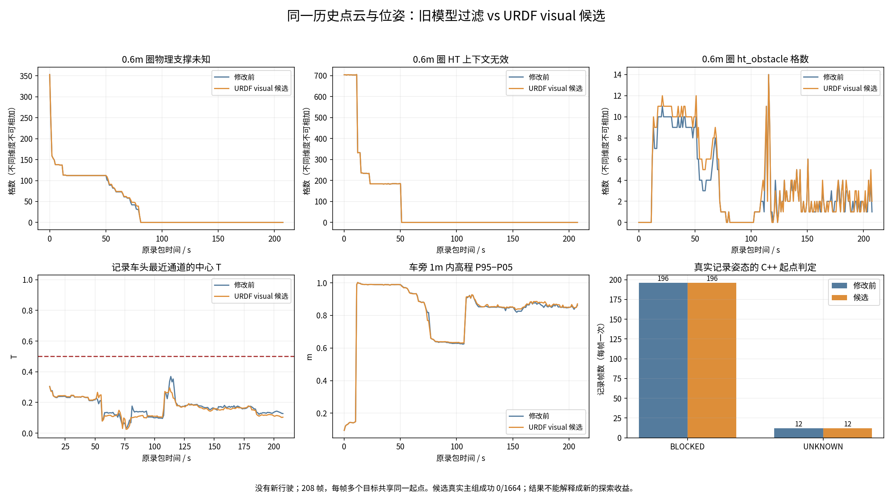
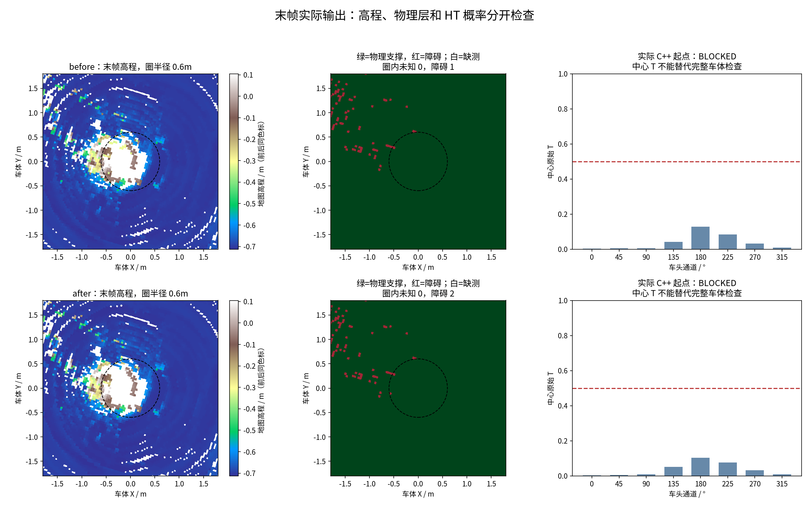

# URDF 车壳过滤补齐与离线 XYθ 复测（2026-10-28）

**完成了模型覆盖修正、原始点云重建、实际 C++ 规划检查及视频；没有解决这批记录姿态无法起步的问题。** 同输入重复对照又发现 CuPy 建图结果存在局部明显波动，不能把地图变化全部归因于新增过滤。

## 修改与依据

用户要求按 URDF 检查车身附件。使用 `CQULzz/eletranskit_scout@cf0b73d7d01b4b6a2718c7ff3124f4b7a3368c36` 的实际模型：支架、传感器已有过滤；仓库没有独立的电脑/电源箱 link，不能凭空添加附件尺寸。底盘 `base_link.dae` 的视觉外壳超出了原 collision 盒。

- `src/ht_scout_bridge/config/scout_extrinsics.yaml`：增加五个 DAE 部件的 AABB，边界由原始米制顶点计算，2cm 工程裕量只计一次。原九盒、四轮柱、TF 和定位外参不变。
- 新增自包含视觉几何回归样本和六项测试。87,098 个模型顶点原漏 6,522 个，现全部覆盖；90,601 个平地样本前后均保留 89,581 个；48 个模型外障碍样本均保留。
- 原有轮柱已屏蔽上述平地中的 1,020 个轮下样本，本轮没有增加平地删除。一个旧测试点实际处于新增车壳的 2cm 裕量内，预期改为过滤，并增加外移 4cm 的保留点。首次失败日志保留，没有删除失败记录。

模型包围盒也覆盖空角。落入模型盒的点只是“候选车体点”，没有真值标注；这些有限回归样本不能证明所有实车障碍都不会误删。

## 实验如何进行

冻结本地代码 `ad573bb8e480c7aab9f15406e6682e6c9ec77ec9`，对应 GitHub 实车代码提交 `0664a75b221f17709895a03563a8dfa303eb6d20`。后续只增加报告、发布资料和显示参数。未修改 TARE 的收益、覆盖、TSP 或访问顺序。

1. 使用同一份 Oct11 记录中抽取的 415 帧原始扫描，跨度 **207.587s**。重算并逐点核对旧过滤与缓存完全相同；仅五盒不同，新过滤额外删除 1,032 点，分布在 260 帧。原始 CDR、扫描时间、R/t 和全部里程计字节保持一致。
2. 两套独立 CuPy 实例重建原生 291×291、0.04m 高程图，每两帧扫描保存一次，共 208 张/版本；同一套 HT 权重和 CUDA+Numba 后端生成两组 HT。
3. 两组地图都送入**同一个已经修正车头方向语义的生产 C++ `HtCostMap/planXYTheta` 二进制**。208 个记录姿态，每个测试八个距离 1.5m 的固定目标，合计 1,664 查询/版本；另有三个人工控制。二进制 SHA256 为 `cfb9cd91310a09dad2014831e5812d69ad1c3fb35f5fc01c3c2fa6aaca36781d`。
4. 保持 T≥0.5 硬门槛、0.6m 有效性半径、严格未知、configuration 分数及关闭起步先验。XYθ 使用 32 朝向、0.3m 搜索格、0.4m 行驶步、11.25°/22.5°转角；完整参数在 `SUMMARY.json`。源时间保留，离线时钟固定到地图时间，并不验证实时新鲜度。

本机 x86_64 / ROS Jazzy，RTX 5060 Ti / PyTorch 2.11.0+cu128 / CuPy 13.6.0。是本机源码构建和 GPU 重算，**没有执行 ARM 二进制，没有启动仿真、设备、控制器或车辆**。记录里程计为地图重建用途的姿态数据，其中未测量 twist 为 NaN，不能用作控制里程计。

## 实际结果

| 指标 | 原九盒过滤 | 补齐视觉外壳 |
|---|---:|---:|
| 输出 HT 帧 | 208 | 208 |
| 起点 BLOCKED（每帧计一次） | 196 | 196 |
| 起点 UNKNOWN（每帧计一次） | 12 | 12 |
| 实际记录姿态固定目标可达 | 0 / 1664 | 0 / 1664 |
| 人工控制可达 | 2 / 3 | 2 / 3 |
| 末帧 0.6m 圈内缺物理支撑 | 0 / 705 | 0 / 705 |
| 末帧中心八方向最大 T | 0.127840 | 0.103976 |
| 末帧车旁 1m 高程 P95−P05 | 0.862m | 0.871m |

三个人工控制是方向相关倒车、方向带加实体墙绕行、低概率负控制。前两项得到路线且逐段复核通过，低概率例正确拒绝；人工结果不能算作真实地形成功。1,664 个查询共享 208 个起点，也不是 1,664 次独立实车试验。

**直接停车原因仍是起点被硬约束判为无效。** 末帧已经不是“车旁缺测”，中心八个方向均低于 0.5，完整车体检查也不通过。补齐车体模型没有证明这是所有低概率的根因，也没有把停车修好。

## 额外负控制：相同输入也会变化

为了避免把建图波动当作过滤提升，又执行同配置对照：415 帧两侧 mask **逐位相同**，都等于旧九盒过滤，原始点/时间/位姿/参数一致，两套新建 CuPy 实例仍各自产生 208 帧地图。

| 全序列逐格比较 | 相同过滤负控制 | 九盒与十四盒处理对比 |
|---|---:|---:|
| 原生高程最大绝对差 | 1.562m | 1.109m |
| HT 概率最大绝对差 | 0.614 | 0.595 |
| HT 概率平均绝对差 | 0.000514 | 0.000571 |
| T=0.5 翻转的格×方向×帧计数 | 16,766 | 11,106 |
| 车位中心八方向门槛翻转 | 0 | 0 |

这些是累计格-帧统计，不是唯一世界格数。总体平均差较小，但局部差异足以影响硬门槛，不能只称普通浮点尾差。本组没有新增 C++ 控制查询，原生地图/HT 的负控制和主组实际 C++ 查询分别保存。

**事实：** 差异在 HT 前的原生 CuPy 高程、方差和观测年龄中已经出现。源码同时存在共享方差参与接收分支、点融合与射线清理交错、upper_bound 非原子写入等竞争机制。

**尚待确认：** 各竞争机制对具体异常单元的贡献、其余数值因素，以及地形/定位/模型输入对持续低 T 的贡献。没有逐线程或逐内核隔离证据，不能把每个 1m 级差异都唯一归因到某一行。详见 [CuPy 审计](CUPY_REPEAT_AUDIT.md) 和 [同过滤对照](SAME_FILTER_CONTROL.md)。本轮未混入 CuPy 算法修改。

## 验证、视频与版本

`ht_scout_bridge` 构建通过；本轮包内测试 **83 passed**，包含六项新几何回归。C++ 算法源码和二进制未变，沿用前轮已通过的 96 个 GTest 及核心测试，本轮另实际执行 3,334 个 C++ 查询。失败日志、负控制、源输入、完整参数、哈希和中间地图均保留。

视频为 **33 秒离线地图/规划结果对比**，22 张历史地图快照，H264 完整解码通过。半透明 XYθ 体素显示格为 0.16m×45°、alpha=0.03；实际输入地图仍是 0.04m，显示抽样不改变规划。蓝点是原记录姿态；只有实际算出路径才画蓝线。本批主组没有可行路径，不能提供“新版已经开起来”的录像。

- 分支：[real/scout-helios32](https://github.com/CQULzz/HT_Explo/tree/real/scout-helios32)，仿真 main/develop 不变。
- 本轮代码、四组中间图/负控制、视频及校验：[real-scout-urdf-visual-20261028](https://github.com/CQULzz/HT_Explo/releases/tag/real-scout-urdf-visual-20261028)。上传完成以 Release 的 `PUBLICATION_RECEIPT.json` 为准。
- 补齐过滤之前的完整 208 帧实验已独立发布：[real-scout-xytheta-full208-20261028](https://github.com/CQULzz/HT_Explo/releases/tag/real-scout-xytheta-full208-20261028)。不把旧结果冒充新过滤结果。
- 复现入口：[REPRODUCE.sh](REPRODUCE.sh)、`FREEZE.json`、`prepare_raw_candidate.py`、`run_pairs.py`。原始外盘备份未更改。

下一步应先隔离并修正 CuPy 同输入重复性问题，再评价车体过滤和 HT 质量；独立候选应先固定旧图读取、分离点融合与射线更新、定义稳定归约，再用同输入对照验收。不能通过降低 HT 门槛、填绿未知或更换起点掩盖失败。本轮按要求归档后停止，没有宣称实车闭环验收通过。
