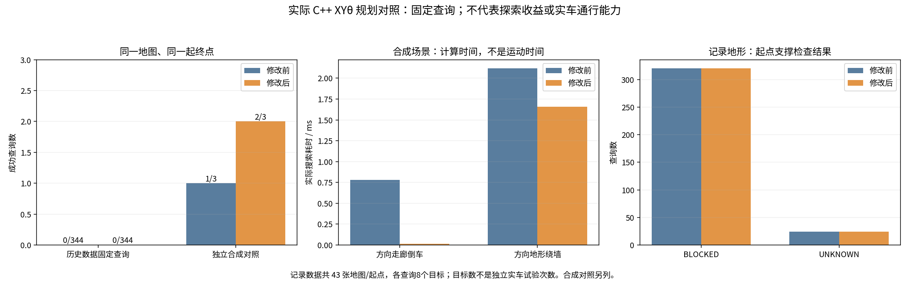
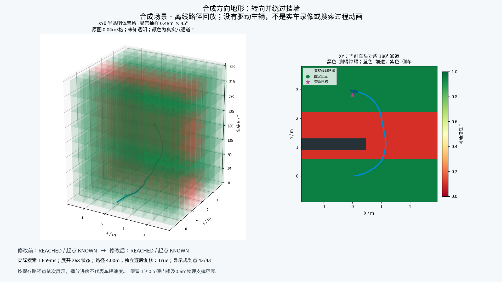

# 实车XYθ配置空间规划：方向语义修正与实际C++复测

2026-10-28。已修复配置朝向与位移方向混用；未解决历史数据中起点地形判定失败，未进行新实车行驶。简版见[BRIEF.md](BRIEF.md)。

## 修改前究竟是什么

当前实车分支已经有可执行的路线链：原版TARE视点/覆盖/TSP → 原访问分支与局部目标 → `RouteTareWaypoint()` → `PlanHTReturn()` → C++ `planXYTheta()` → `/ht_real/ht_xytheta_path` → `xytheta_follower` → 显式drive模式的底盘命令桥。inspect默认无运动输出。上一轮只验证地图重算，没有验证实际规划器，本轮补上这一层。

`BEST_EFFORT`是部分雷达/定位订阅的ROS2通信策略。HT地图订阅、HT地图发布和规划路径发布已为RELIABLE；强行将原始传感器订阅改成RELIABLE，会无法匹配只提供BEST_EFFORT的传感器。没有用修改QoS冒充算法实现。RViz的最佳方向概率图只是显示；TARE上层可用各方向可行性的投影引导，但实际执行仍逐姿态检查，未把最大概率作为运动许可。

## 真正的缺陷与修正

实车配置`ht_score_semantics: configuration`表示T(x,y,车头θ)。旧`HtCostMap::motionSupport()`检查扫掠车头朝向后，又无条件按`atan2(Δy,Δx)`检查位移方向。倒车时θ与位移方向相差π，因而额外检查了一个不属于实际车体配置的通道。路径跟踪中的微小横向对齐误差也可能错误触发旁向通道。

现在：configuration语义只沿实际车头θ检查扫掠；旋转跨越的所有HT方向仍检查；倒车不会凭空改为θ+π。旧point/行驶方向语义保留原来的额外位移及返程方向条件。配置语义中的`ht_require_reversible_motion`不会制造一个反向速度预测；同一静态配置路径反向遍历仍查原车头。模型无速度/轮地力学维度，不能据此证明真实坡面牵引、打滑或制动可逆。

修改文件：

- `src/tare_planner/src/ht_cost/ht_cost_map.cpp`与对应头文件：配置空间运动判定。核心行为变更只是一处有语义依据的条件。
- `src/tare_planner/tests/ht_ros_test.cpp`：新增实际倒车路径、微侧移判定、未知/实测障碍拒绝和返程参数语义4个回归。
- `src/tare_planner/tools/ht_xytheta_offline.cpp`、CMake注册：直接调用生产HtCostMap与Hybrid A*的离线工具。
- `tools/ht_cupy_bridge/prepare_xytheta_replay.py`：从上一轮真实HT快照生成保留时间戳和方向的GridMap CDR，并生成明确标注的合成对照。

原TARE六个核心函数的合同检查仍通过。没有改收益、TSP、访问顺序、模型权重、高程生成、0.5概率门槛、0.6m支撑范围、严格未知规则、起步先验或实车运行模式。

## XYθ空间怎样找路

搜索键为(x,y,θ)，采用0.3m位置键和32个航向键；真实状态与运动轨迹保持连续。HT仍只有8个45°方向预测，32个搜索朝向按既有最近方向桶映射，不能宣称增加了32个独立地形预测。地图0.04m，与0.3m搜索键和可视化抽样尺寸是不同概念。

扩展使用差速/滑移转向的前进、倒车、圆弧和原地转向，转角11.25°/22.5°，平移原语0.4m；每段沿实际车头查T与支撑/障碍，转向中途也检查。可行时先尝试经过同样硬检查的转向加直行/倒车连接，失败再做Hybrid A*。单目标0.15s、8000扩展上限、目标半径0.35m、局部搜索半径7m保持原值；实际范围还受有效HT地图边界限制。

这是运动学规划。当前头文件的规划名义前进/倒退速度0.5/0.25m/s、角速度上限0.8rad/s，本轮保持；实车另有限速0.4m/s，规划时间代价不能当实际执行时间。跟踪器另做加速度/命令弧检查，不等于搜索状态已包含速度、加速度或完整车辆动力学。

## 同一输入，两套真实C++判定

基线本地`e205f4e4439ebaaf5c09573b527dee18018a4dc3`对应GitHub`37c7cd37a44b9b1b35e7df9ac3a4f7454d290cc6`；运行候选本地`a33f78a`对应GitHub`59179d2f3f173355379d7d4badbd8c6db9055b9e`。运行冻结后没有改算法，后续提交只添加报告、复现和图表。

比较工具用新旧相同runner对象和依赖，仅将基线提交的原始ht_cost_map.cpp编译为独立旧静态库替换链接；没有在Python里模拟旧判定。原始源码、编译/链接argv、库与二进制SHA256、源图/参数SHA256保存在BINARY_MANIFEST.json。两个版本严格使用相同CDR、位姿、目标、参数和原图时间；工具ROS时钟固定在原图时间，没有把历史图时间改成现在。此冻结查询不能验证实时新鲜度或实际网络QoS。

只使用隔离域183及localhost；内部GridMap话题和起步先验话题均隔离。关闭起步先验，不发布导航许可、路径或速度，不启动设备、TARE目标选择、跟踪器或底盘。独立collision_cloud和ViewPointManager几何约束未在工具中重建，不能把其成功称为整车可执行验收。记录的机器人位姿仅作离线参考。

| 场景 | 修改前 | 修改后 | 可得结论 |
|---|---|---|---|
| 人工方向走廊：只允许θ=0，目标在身后1.2m | EXHAUSTED | REACHED，车头保持0，25姿态、1.2m | 修复合法倒车被反向通道误拒绝；由可行连接求解，非A*扩展 |
| 人工方向相关带状地形+实体墙绕行 | REACHED | REACHED，268扩展、约3.999m、累计转角2.945rad | 真正Hybrid A*绕行，保留中途方向与墙体约束；该例没有成功率提升 |
| 人工全部T=0.1 | INVALID_START | INVALID_START | 不放宽低概率门槛 |
| 真实43帧，每帧8个固定方位1.5m目标，共344查询 | 全INVALID_START | 全INVALID_START | 本组起点本身不获许可；不能宣称真实导航改善 |

真实图来自上一轮415扫描CuPy重建后的208张HT图，每5张抽一张并保留末张，覆盖约208秒；不是重新跑车。目标是固定方向诊断查询，未冒充TARE收益视点。真实43个位姿中40个BLOCKED、3个UNKNOWN，对8个不同目标重复查询不等于344个独立停车事件。40个BLOCKED位姿的实际车头通道T均低于0.5；其中35个在0.6m诊断圈还包含实测障碍标记，两项可重叠。详见START_DIAGNOSIS.json；诊断圆不代替生产膨胀足迹的全部栅格检查。

保留这组负结果：修复XYθ方向语义不会自动修复车旁高点、地图支撑或低T预测。起点被硬约束拒绝时，不通过将车位默认标绿、软化T或绕过未知门槛制造路线。真实数据高点来源、模型地形响应与车体附件仍待核验；生产有固定起点1.2m/30s的未知区先验，工具关闭了该先验，不能从这些独立静态查询推断完整任务每个时刻的行为。





左图保留整条路线的车头θ变化，右图为最后显示帧车头对应的单通道；早先路径投影穿过该单通道红区并不表示当时以同一θ驶过。实际每段按该段自己的θ检查。

## 验证与复现

两包构建通过；7个CTest目标全部通过，包含96项GTest及独立ht_core_test。新4个回归全部通过，point语义、转向中途低T、未知、观测障碍、跟踪器和输入状态测试保留。原TARE六函数合同检查通过。Python新增准备/对比脚本通过语法检查，生成347条数据的时间、源输入及C++SHA256已交叉核对；所有成功路径均在搜索结束后逐段重新检查，并独立检查到达目标半径。本轮没有重复无改动的215项Python推理或CuPy GPU回归。

```bash
source scripts/real_scout_environment.sh
export CMAKE_BUILD_PARALLEL_LEVEL=2 MAKEFLAGS=-j2
colcon --log-base log_real build --executor sequential \
  --base-paths src/tare_planner src/ht_scout_bridge --build-base build_real \
  --install-base install_real --packages-select tare_planner ht_scout_bridge \
  --cmake-args -DCMAKE_BUILD_TYPE=Release -DCMAKE_EXPORT_COMPILE_COMMANDS=ON
source scripts/source_real_scout.sh
export ROS_DOMAIN_ID=181 ROS_LOCALHOST_ONLY=1 RMW_IMPLEMENTATION=rmw_fastrtps_cpp
ctest --test-dir build_real/tare_planner --output-on-failure -j1
python3 scripts/check_tare_waypoint_contract.py
# MAPS、RESULT指实际输入和全新结果目录。
python3 tools/ht_cupy_bridge/prepare_xytheta_replay.py --maps "$MAPS" --output "$RESULT/input"
export ROS_DOMAIN_ID=183
build_real/tare_planner/ht_xytheta_offline --batch "$RESULT/input/queries.tsv" --output "$RESULT/after.json"
```

双版本完整复现：按BASELINE.json从已发布基线提取ht_cost_map.cpp为RESULT/ht_cost_map_before.cpp，再运行本目录`compare.py --data RESULT`。脚本需要实际基线源文件、编译数据库和原生依赖，输出目录必须全新，不能将当前源码配上旧提交文字冒充基线。只读取可信本地pickle/CDR。

本机为x86-64/ROS Jazzy，C++是本机原生编译，未直接运行ARM二进制，也未证明Jetson/ARM64性能或CAN闭环。ARM部署仍需匹配ARM64的ROS/OR-Tools并在板端构建；目前未获得真实地形响应验证。

## 资料与版本

对比图和视频仅展示真实计算结果；视频成功路线明确标注为人工地形、离线路径回放，不是假冒RViz或实车录像。半透明体素的第三轴是车头θ，显示抽样尺寸会标注，非物理高度。真实末帧失败同时展示。

代码实车分支`real/scout-helios32`；Release/tag：[real-scout-xytheta-20261028](https://github.com/CQULzz/HT_Explo/releases/tag/real-scout-xytheta-20261028)。数据附件含全部347×2查询结果、46张CDR、元数据、参数、版本映射、原始基线源、二进制/编译证据、测试日志和图表/视频。上一轮全量CuPy输入与208张HT仍保留在对应旧Release，本轮保留实际使用的查询输入及源图SHA，未更改外盘原始备份。发布成功及远端逐资产校验以PUBLICATION_RECEIPT.json为准。
