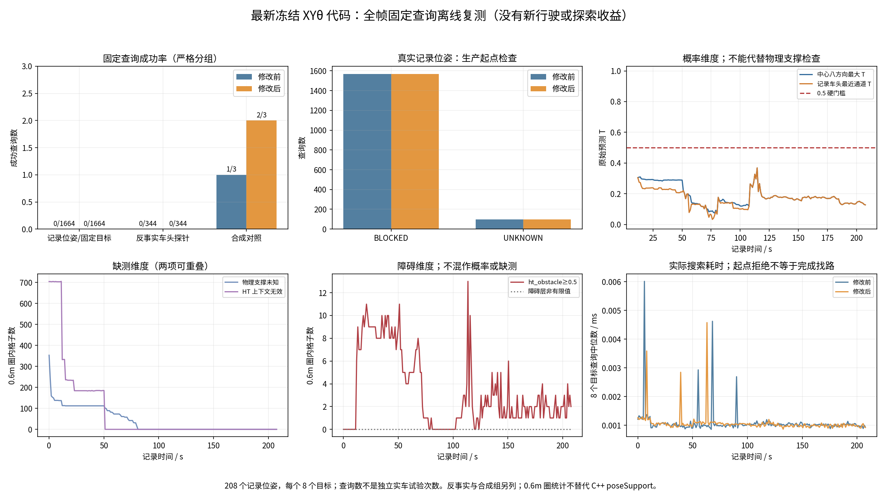
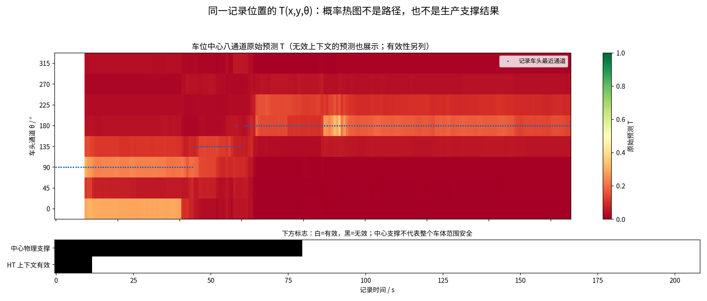
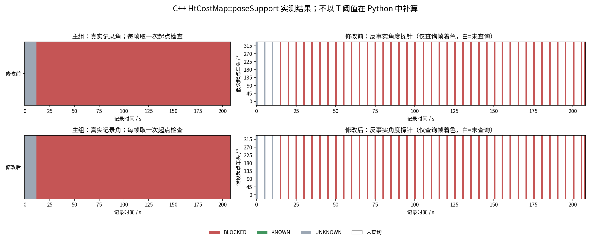

# 全208帧独立离线复测

2026-10-28。本轮在上一轮之后独立生成输入、重新运行两套真实C++程序；不是复用旧结果，也不是新实车行驶。简版见[BRIEF.md](BRIEF.md)。

## 版本与协议

导航运行源本地a33f78a，GitHub `59179d2f3f173355379d7d4badbd8c6db9055b9e`；两套C++二进制SHA256均与上一轮一致。新验证工具GitHub `863009304c4174523b7364477901aaa65227dc85`。报告/工具checkout提交与导航运行提交分开记录，不能将报告HEAD当成新的算法版本。FREEZE.json、RUN_MANIFEST.json记录每个生产源文件和二进制校验。

保留原208帧HT场、原时间戳、原位姿和真实车头角度；每帧8个1.5m世界方位目标，共1664次主查询。每5帧及末帧另查8个假设车头，共344次counterfactual_heading；只改变起始朝向，不证明实际能从原方向旋转过去。3个人工输入仍沿用上一轮的手工方向概率/障碍场，不是模型预测或实测地形。全批每版本2011查询，修改前后顺序独立执行。

配置仍为configuration语义、T≥0.5、物理支撑半径0.6m、strict未知、32搜索航向、8预测方向、0.15s搜索预算、8000扩展上限；离线关闭起步先验。ROS时钟冻结于原图时间，无导航许可/速度输出。没有TARE收益/TSP选择、额外碰撞云、实时新鲜度/通信/控制器或轮地动力学验收。C++为桌面x86原生程序，未运行ARM二进制。

## 结果

| 组别 | 查询数量 | 修改前到达 | 修改后到达 |
|---|---:|---:|---:|
| 208个真实记录起点×8目标 | 1664 | 0 | 0 |
| 43帧×8假设车头 | 344 | 0 | 0 |
| 人工对照（含必须拒绝的负例） | 3 | 1 | 2 |

真实起点按帧去重：196个BLOCKED、12个UNKNOWN；所有1664主查询均INVALID_START。假设角度诊断同样未得到可用起点。不能把8个目标的重复拒绝算成8个独立停车事件，也不能用早拒绝的微秒耗时冒充找路速度。整批墙钟约75.4/78.5秒包含读图、ROS节点和消息接收，非车辆运动时间。

人工倒车走廊旧版EXHAUSTED、新版REACHED；方向相关绕墙前后均REACHED；全T=0.1前后均INVALID_START。所有成功路线重新逐段检查通过。与上一轮重叠的347个查询，输入相同且到达状态/终止原因全部一致。完整before/after.json、SUMMARY.json和逐帧诊断附在Release。







T热图保留无效上下文中的原始预测，不能单看其颜色许可运动；支撑热图取C++实际poseSupport，未查询的假设方向格留白，没有在Python里用阈值补造。0.6m诊断圈是辅助计数，不代替生产栅格足迹膨胀。

## 失败与输入一致性审计

首次预检因37个重叠CDR文件字节不一致停止，尚未开始规划，日志preflight_attempt1.log保留。逐字段、每层float32原始位模式和XCDR1布局解析证明：地图数据完全一致，所有差异只落在对齐padding内。保留37份首次生成文件和原metadata后，复用上一轮已存CDR字节，才冻结本轮输入。没有更改概率、未知/障碍标记、坐标或时间。PADDING_AUDIT.json及serialization_audit目录保留逐字节证据；新的非重叠地图在两个版本间使用同一个文件。

导航算法未变，因此本轮不把此前96项GTest和ht_core_test重新冒称为新运行测试；用源/二进制哈希核对复用其验证，新增工具通过语法检查及全批字段/哈希/路径复核。原始208帧NPZ和原生CuPy文件仍在上一轮完整Release；本轮保存全部211张实际查询CDR及记录来源SHA256，足够重跑规划。绘图需按原Release恢复对应208帧NPZ。

## URDF核验与下一候选

用户补充“去看URDF”后，核对了指定源仓库默认main与固定cf0b73d，二者相同。16个link、15个fixed joint；现有传感器架和传感器visual均已覆盖，没有独立电脑/电源箱link可据此臆造尺寸。另发现base_link.dae视觉外壳侧凸超出现有collision过滤，415个原始扫描中1032个保留点位于这些视觉部件包围盒内，末帧6个。详见[URDF_CHECK.md](URDF_CHECK.md)。这只是模型覆盖缺口证据，不能断言全部是车体或是停车根因。

本轮生产滤波配置没有改变。视觉几何补齐必须作为下一冻结候选，再从相同原始扫描重建高程/HT和规划，不使用本轮数据替代修改后验收。不会凭猜测扩大整片车周围删除范围。

## 复现与发布

```bash
source scripts/source_real_scout.sh
export ROS_DOMAIN_ID=183 ROS_LOCALHOST_ONLY=1 RMW_IMPLEMENTATION=rmw_fastrtps_cpp
python3 tools/ht_cupy_bridge/prepare_xytheta_replay.py --maps "$MAPS" --output "$RESULT/input" --frame-stride 1 --heading-probe-stride 5
python3 docs/results/real_xytheta_full208_2026-10-28/reuse_frozen_inputs.py --data "$RESULT" --previous "$PREVIOUS"
# RESULT/FREEZE.json先记录实际已校验的源码与二进制；不要伪造提交标签。
python3 docs/results/real_xytheta_full208_2026-10-28/run.py --data "$RESULT" --previous "$PREVIOUS"
python3 docs/results/real_xytheta_full208_2026-10-28/visualize.py --data "$RESULT" --maps "$MAPS" --output "$RESULT/plots"
python3 docs/results/real_xytheta_full208_2026-10-28/make_video.py --data "$RESULT" --ffmpeg "$FFMPEG"
```

输出目录须新建，pickle输入只用可信本地实验资料。视频为20秒离线路径演示，成功场景为手工对照，真实末帧失败同时展示，不是RViz或实车行驶录像。

实车分支real/scout-helios32；本轮独立标签/Release [real-scout-xytheta-full208-20261028](https://github.com/CQULzz/HT_Explo/releases/tag/real-scout-xytheta-full208-20261028)。代码、全部查询输入/结果、首次失败、审计、图、视频均保存；大数据放Release，不写入Git历史。远端大小/SHA256以PUBLICATION_RECEIPT.json为准。原外盘归档未修改，main/develop未合入实车配置。
