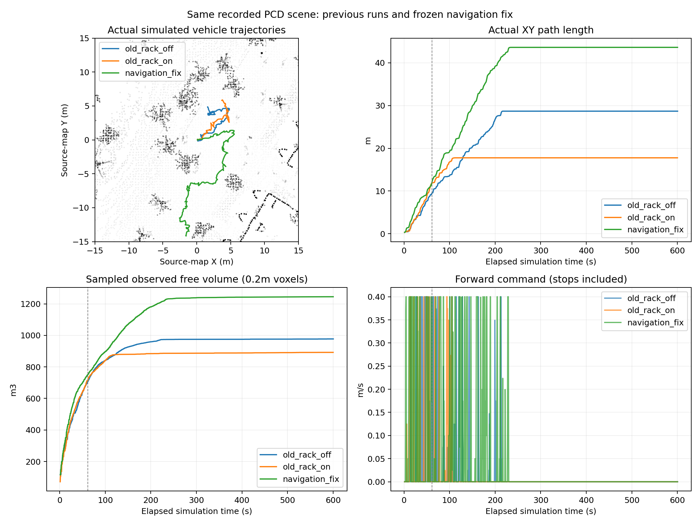

# Scout 点云场景导航修复与600秒复测

Publication complete: [Verified publication receipt](PUBLICATION_RECEIPT.json) · [Delivery details](DELIVERY.md)

测试代码固定为 `53fcb471ee9b36bf238355d530a9f00d02a6ab14`，开发分支为 `fix/scout-navigation-pcd-20261105`。本轮完成代码修复、回归和600.3秒采集；**任务未完成，不能宣布任意场景或实车持续探索已验收**。发布记录及完整原始数据见 [GitHub实验Release](https://github.com/CQULzz/HT_Explo/releases/tag/ht-scout-pcd-fix-20261105-v1)，是否完成远端核验以发布回执为准。

## 修改与证据

### 1. 不可靠参考面误剔除旧地面

在此前点云基线源260.0s，车底矩形范围133个已观测高度被标为 `stale_off_surface`，其中132格与仿真实际地面误差在-1.84mm～+4.55mm内。用相同源高度/方差/年龄复算，混合高度拟合的RMS约3.82cm、参考面中心约-0.687m，而标定几何给出的地面参考约-0.808m；该低可信拟合仍参与了旧地面剔除。

[local_surface.py](https://github.com/CQULzz/HT_Explo/blob/53fcb471ee9b36bf238355d530a9f00d02a6ab14/tools/ht_cupy_bridge/local_surface.py) 现在要求拟合满足原代码用于偏移学习的2.5cm误差条件，且与已有高度锚点兼容；不满足时退回高度锚点参考，没有可靠锚点则保留未知。用户提供的固定传感器/车体高度不再在运行中向杂波表面漂移。没有调整5s陈旧判据、0.15m高度边界、0.5概率阈值、1s图龄、严格未知或启动许可。

回归夹具 `test_fixtures/pcd_surface_260s.npz` 保存原源观测及标记，不含用来替换建图的真值地面。原133格保持已有观测，真实缺测仍未知，时间戳不刷新；旧高回波、过期异层和新鲜台阶/障碍的既有检查仍通过。夹具是诊断裁剪，不冒充原估计器所有历史状态的完全回放。

[cupy_to_ht.py](https://github.com/CQULzz/HT_Explo/blob/53fcb471ee9b36bf238355d530a9f00d02a6ab14/tools/ht_cupy_bridge/cupy_to_ht.py) 的性能记录增加参考面拟合/回退元数据，后续可直接检查采用了哪个参考值。本轮468条参考面记录中320次拒绝不可信拟合，标定高度偏移始终为0.23479m。

### 2. 校正 TARE 与实际车辆参考点，并统一跟随器碰撞包络

[原硬件采样配置](https://github.com/CQULzz/HT_Explo/blob/53fcb471ee9b36bf238355d530a9f00d02a6ab14/src/ht_scout_bridge/config/tare_scout.yaml) 沿用了距地面0.75m的候选视点参考高度，但实际里程计和运动规划使用 `base_link`，对应确认URDF的接地参考高度0.23479m。现已统一为0.23479m；轮胎半径0.16459m、轮心相对base_link高度-0.0702m也给出同一名义高度。

[scout_real.launch.py](https://github.com/CQULzz/HT_Explo/blob/53fcb471ee9b36bf238355d530a9f00d02a6ab14/src/ht_scout_bridge/launch/scout_real.launch.py) 原先没有把TARE的碰撞配置传给跟随器，导致规划器采用0.7m半径参数、跟随器退回0.5m默认值。现在二者共享硬件配置，保持原规划器的保守碰撞边界，没有为让车前进而缩小包络。实际传感器外参及URDF尺寸未变。

### 3. 消除额外跟踪余量区的起步陷阱

独立最小反例：起点不碰撞，但处于额外0.12m跟踪缓冲区中，旧搜索只剩原地转向，32次展开后EXHAUSTED。新规则在相同目标和物理边界下找到28姿态路径。

[tracking_margin.h](https://github.com/CQULzz/HT_Explo/blob/53fcb471ee9b36bf238355d530a9f00d02a6ab14/src/tare_planner/include/ht_cost/tracking_margin.h) 和 [ViewPointManager](https://github.com/CQULzz/HT_Explo/blob/53fcb471ee9b36bf238355d530a9f00d02a6ab14/src/tare_planner/src/viewpoint_manager/viewpoint_manager.cpp) 仅允许这种缓冲区内的动作**增加到测量障碍的最小间距**；一旦离开缓冲区，恢复完整余量。真实碰撞、边界、HT足迹、未知、航向和失败边检查仍然生效，不能朝障碍靠近或从真实碰撞起点获得豁免。

[跟随器](https://github.com/CQULzz/HT_Explo/blob/53fcb471ee9b36bf238355d530a9f00d02a6ab14/src/tare_planner/src/ht_cost/xytheta_follower.cpp) 独立检查实际指令弧的同一条件，缓冲区脱离目标速度限制为0.1m/s，保留原加减速与刹车弧校验。真正碰撞的起点在 [tare_waypoint_router.cpp](https://github.com/CQULzz/HT_Explo/blob/53fcb471ee9b36bf238355d530a9f00d02a6ab14/src/tare_planner/src/sensor_coverage_planner/tare_waypoint_router.cpp) 中直接保持停车，避免反复搜索相同无效起点。仍由原TARE决定目标/顺序，没有用HT另选探索目标。

## 回归

- Python：237项通过，涵盖桥接、标定/配置一致性、记录地面反例、历史融合与质量链路。
- C++：8组最终检查通过；109个GTest通过、4个可选外部录包夹具未提供而跳过；HT核心15,241条检查通过。
- 余量区反例同时验证向外脱离成功、朝障碍移动拒绝、真实碰撞起点拒绝；跟随器实际输出用例验证脱离目标限速和遇障归零。
- 首次C++运行误用了超出FastDDS端口范围的域233，随后在合法域229复跑。新几何用例的参数声明/ROS YAML节点名设置也经过修正；失败日志保留。最终配置夹具使用仓库的 `mixed_turn_stop.txt` 补跑通过，没有依赖已清理的旧包。
- 编译使用本机x86_64/ROS2 Jazzy，源码在两个提交 `85d7167`、`53fcb47` 冻结；不是ARM/Humble或实车部署验收。

## 同场景闭环实验

沿用此前录包点云构建的±15m裁剪场景、相同起点、雷达设置、真值定位及mapper配置。源文件夹为 `/media/lzz/lzz/rosbag/20261103_190624`，密集局部图56,849点用于地面/障碍重建，车辆几何依据确认的Scout URDF。地面最长连接边0.8m，障碍体素0.16m，缺测区域不补无限地面。雷达32线角间隔为近似、5Hz，未注入多径/穿透异常回波；外部mapper全局存储关闭。这是受控点云场景测试，不是原车传感/定位误差和动力学的完全复刻。

| 版本 | 仿真采集 | 累计XY里程 | 采样观测自由体积 | 任务 |
|---|---:|---:|---:|---|
| 前轮：支架过滤关闭 | 600.4s | 28.69m | 977.38m³ | 未完成 |
| 前轮：支架过滤开启 | 600.1s | 17.77m | 892.08m³ | 未完成 |
| 本轮：导航修复、支架过滤开启 | 600.3s | **43.62m** | **1245.06m³** | 未完成 |

本轮净位移14.31m，先验到期后累计行驶31.40m。里程包含往返/绕行，体积是原时戳1Hz扫描每32个回波取1条射线的0.2m体素覆盖估计，均不是任务完成判据。原TARE随机排序和调度未锁定，两轮宏观轨迹不同；这些是实际观测值，不能据单轮声称普遍提升或给各单项修改分配因果收益。

### 本轮搜索结果与最后停车

- 实际进入的151次局部路径搜索全部REACHED，没有EXPANSION_LIMIT/TIME_LIMIT/EXHAUSTED；其中5次成功搜索从额外跟踪余量区开始。这不意味着每个TARE目标都可执行。
- 源时间/真车体位置航向的生产C++地形检查，在先验开始65秒后的53个新鲜图样本全部有当前姿态支撑。在线足迹未知格的中位和P95均为0，仍有短暂缺测触发停车，未忽略这些拦截。
- 约233.25s后无明显平移（1s位移窗>0.01m/s定义），车停在约(-1.58,-14.14)m。246条同目标保持日志全部指向裁剪范围外的原生目标，约(3.33,-20.46)m；均因前缀缺少支撑，没有进入搜索。场景只重建到y=-15m，不能把该边界放行为地面，也不能宣称完成探索。
- HT发布源龄中位0.51s、P95约1.42s，仍有超过1s门限的间歇停车；图龄/计算延迟优化仍未验收。此候选解决已复现的错误参考面与跟踪缓冲陷阱，不保证所有几何不连通或预算受限的目标都能恢复。

## 数据完整性与保留

本轮ROS域228、独立Gazebo分区、localhost，底盘输出只接 `/sim/cmd_vel`；无实车驱动。采集期间运行安装文件/参数/环境网格哈希未变。原始MCAP共175,986条消息，逐条计数与rosbag元数据一致，可用CRC检查通过；真值源时间跨度604.6s，覆盖所需600秒。完整轨迹视频1201帧、10倍速对照121帧均逐帧可解码。视频是点云底图上的实际轨迹/遥测，不是Gazebo相机录像。

采集完成后mapper没有在SIGINT/SIGTERM宽限期内退出，仅对其自有进程组执行SIGKILL；状态标为 `RECORDED_WITH_CLEANUP_ISSUE`，未包装成全流程零报错。记录器和采集器均正常退出，600秒前没有因此中断。原版失败轮、此前短暂启动中止轮、本轮150秒诊断预检均保留，并明确不计为600秒通过。

当前轮增加记录碰撞云与失败边；没有录制全频原始LiDAR或所有内部搜索状态。原时戳1Hz扫描、完整已发布HT/原因/证据图、控制/位姿/状态、约10s图快照、日志和资源记录保留。旧轮的原始消息与故障状态不改写。

Release分卷归档包括前轮完整采集、本轮完整采集/诊断预检、运行脚本、模型资产和测试安装。只排除可从MCAP再生的 `query_cdr`、重复源码Git库/未使用的旧安装副本及缓存；不排除任何已录制MCAP。分卷在上传前逐文件校验，上传后核对GitHub大小和SHA256，核验回执单独保存。单独的车辆visual模型清单在结束后补充归档，不冒充原运行清单已逐项监控过它们。

## 复现与交付

1. 获取上述测试提交及Release归档；按照 `EVIDENCE_MANIFEST.json` 顺序拼接同一归档的 `.tar.partNNN`，先校验各卷SHA256，再解包。
2. 旧场景来源/构造参数见 `previous-evidence/README.md`；本轮运行脚本为 `navigation-fix/runtime/run_sim.py`。它们保留本机实际路径/依赖，可用 `relocate_scene.py` 和 `MODEL_ASSETS.json` 重新定位世界网格URI；几何和动力学数值不改变。
3. 需要ROS2 Jazzy、Gazebo8、原CuPy mapper和GPU虚拟环境等依赖；测试安装归档为桌面x86构建。所有运行必须保持独立ROS域和仿真命令接口。
4. 精简指标见 `ANALYSIS.json`、`FIX_ANALYSIS.json`、`COLLECTION_VALIDATION.json` 和 `VALIDATION.json`；完整实验数据与视频见 [Release](https://github.com/CQULzz/HT_Explo/releases/tag/ht-scout-pcd-fix-20261105-v1)。远端校验以 `PUBLICATION_RECEIPT.json` 为准。

本轮结束后停止；没有合并main、移动车辆、部署到车端或自动开始其他场景。
