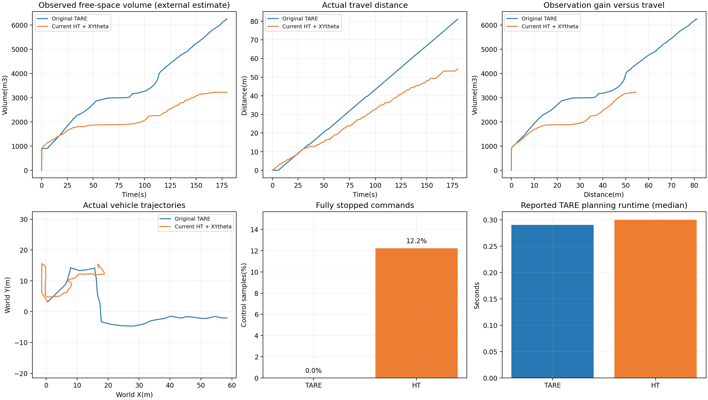
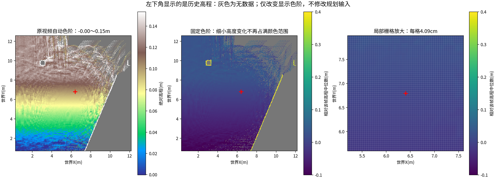

# 原版TARE与当前HT：Garage配对实验

每组180秒，分别重启同一Garage环境、预定位姿和0.5m/s前进上限。
原版使用自身路径规划及CMU局部规划/跟踪；当前版使用CuPy历史高程、HT硬约束、XYtheta规划和独立跟踪器。这是端到端系统比较。

| 指标 | 原版TARE | 当前HT |
| --- | ---: | ---: |
| 行驶距离(m) | 81.080 | 54.520 |
| 估计累计观测自由空间(m³) | 6242.625 | 3224.625 |
| 到访1米轨迹格 | 96.000 | 63.000 |
| 完全停车比例 | 0.00% | 12.22% |
| 原地转向比例 | 2.65% | 15.06% |
| 倒车指令比例 | 87.23% | 0.00% |
| 最长连续线/角速度均近零指令(s) | 0.000 | 1.450 |
| 最长连续不平移指令(含转向，s) | 2.786 | 10.500 |
| 最后60秒行驶距离(m) | 28.244 | 15.504 |
| 实际最大线速度指令(m/s) | 0.475 | 0.500 |
| 实际最大角速度指令(rad/s) | 1.571 | 0.800 |
| TARE运行时间中位数(s) | 0.290 | 0.300 |
| TARE运行时间P95(s) | 0.467 | 1.103 |



本轮当前HT的估计观测自由空间为原版的51.7%，行驶距离为67.2%。原版继续向远处推进，当前HT有更多原地转向、完全停车和已知区域回访，后段观测增益趋平。因此本轮原版整体探索效率更高；不能只凭HT不再长时间卡住就认为已追平原版。

“完全停车”同时检查线速度和角速度；“不平移”还包括原地转向，后者会使里程曲线暂时变平。两者不能混用。

## 观测体积口径

两组使用相同外部算法：每秒取一帧原始地图坐标点云，配对激光位置，沿有效回波光线采样0.5米体素的自由空间并取历史并集，距离截断15米，排除回波终点附近0.25米。ray采样间隔0.25米，因此该体积为近似估计。
该数值不是TARE官方覆盖率、真值探索体积或车辆已走过面积。相同区域重复行驶不会重复增加并集体积；两条路径即使路程接近，也可能观测到不同新空间。

## 控制器参数差异

相同的是0.5m/s自主行驶目标/前进速度上限，并非全部运动约束相同。原版CMU控制器允许约0.5m/s倒车、最大转速90°/s(1.571rad/s)、最大加速度2.5m/s²；当前HT跟踪器倒车上限0.25m/s、转速0.8rad/s、加速度0.5m/s²。原版launch中的maxSpeed仍为2.0m/s，但autonomySpeed设置为0.5m/s，实际命令峰值见上表。
原版保留自己的双向跟踪策略，可能长距离倒着开；当前版使用自己的运动时间代价与跟踪器。这里比较原版控制链路与当前完整系统，不是控制器参数完全对齐的单模块消融实验。

## 限制与原始数据

每个版本仅一次独立运行，探索具有随机性。两个系统控制器、感知堆栈与初始化过程不同，不能将差异全归于HT单模块。两组规划/runtime指标不包含所有感知与控制耗时。
探索完成信号：原版False，当前False；180秒按预设时间停止，不代表探索结束。

原始数据：`original/`、`current/`下的`timeseries.csv`、`observation_volume.csv`、`summary.json`及`external_metrics.json`；录包在`original_bag/`、`current_bag/`。
配置与提交记录见`manifest.json`，预定位姿见各组`stage.json`。

## 左下角为什么显得模糊

视频左下角是历史局部高程图。291×291格覆盖约11.91×11.91米，每格4.09厘米，显示到600像素时每格约2.06像素。示例帧用几乎整个色谱表示约0～15厘米高程，微小起伏被放大；约30%格子无数据，形成灰色空洞与碎斑。图像使用最近邻绘制。
下面只改变色阶并放大栅格，没有补出未知地形，也没有改变规划输入。



## 对比分屏视频

[下载180秒对比分屏视频](comparison.mp4)。左右都是实际录制的相机画面，按各自测量起点的相同实验秒数并排；下方显示各自轨迹。原版原地朝向与移动方向可以不同，因为其允许双向行驶。

本地用VLC可运行：

```bash
vlc --no-one-instance --avcodec-hw=none --vout=xcb_x11 "/home/lzz/my test/HT_Explo-fixposition/presentations/scheduled_results/tare_ht_pair_2026-10-16/comparison.mp4"
```

完整原始MCAP与HT快照保存在本地实验目录：`/home/lzz/my test/HT_Explo-fixposition/presentations/scheduled_results/tare_ht_pair_2026-10-16`，大体积录包未放入Git仓库。

工具：`presentations/run_tare_ht_pair.py`、`summarize_tare_ht_pair.py`、`render_tare_ht_pair.py`。验证结果见[validation_checks.json](validation_checks.json)。
