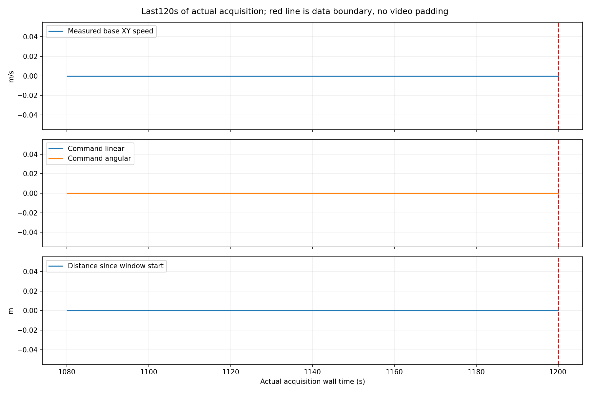
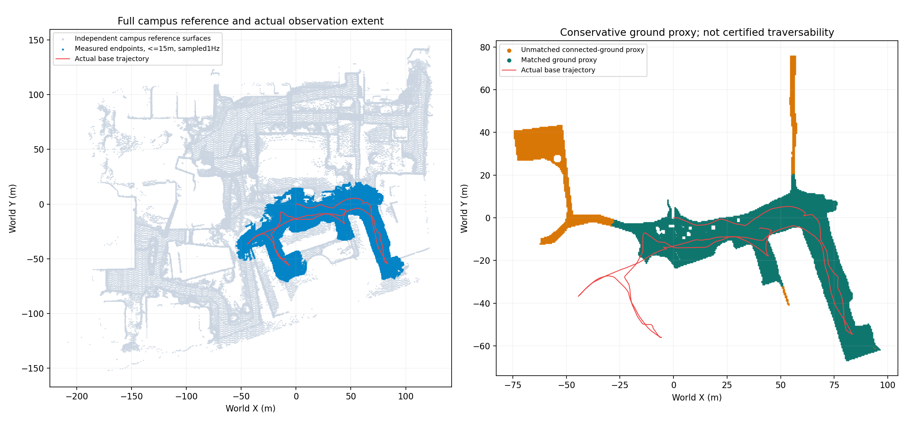
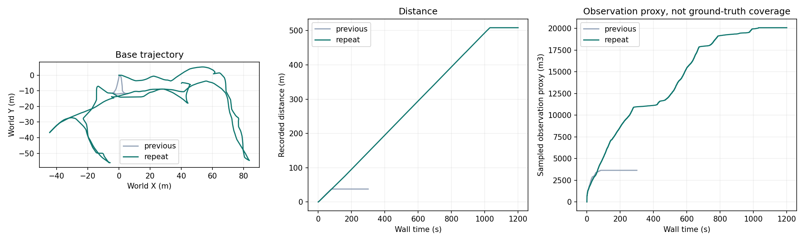

# campus 20分钟探索实验（2026-11-18）

用户要求一次20min长时间探索，核验当前配置能否完整探索campus。本轮完整采集20分钟，但未通过完整探索及返航验收：仍有未观测参考地形区域，且车辆在返航途中被HT上下文门禁持续拒绝，最终停在距起点40.46米处。软件发出完成信号不能代替场景覆盖和返航验收。

## 实际设置

实际导航代码11dd46d5561a0b426ebc800e192d9f42d0d8b00d；资料基线369d2dd。保持TARE双分辨率、HT八方向门禁、URDF包络、Helios标称32×1800/仿真10Hz、crop_box及0.65m explicit_labels_v1先验，启动前原305个冻结文件SHA一致。域221、Gazebo11549、Xvfb:105。输入就绪后采集1200秒墙钟，仿真推进另计。

首轮雷达实体spawn排队后超时，输入尚未就绪即中止，失败完整保留。仅将实体创建延迟60/62/64秒改为120/122/124秒、载体90秒改为150秒后使用唯一基础设施重试。第二轮在约784秒出现goal_x/goal_y=-nan诊断，observer解析非法JSON后中断，未完成20分钟，原文保留。仅追加一次观察器容错重试：原文记录解析错误后继续，3项检查通过，不改变导航策略、模型、速度或门禁。代理原自定2次上限因只读采集器故障扩为3次，原attempts不重置，第三轮为最终一次。运行时另一组独立AEDE基准仿真并行，未中断或改动；其CPU/GPU负载是比较混杂因素。未建立同一显式随机种子。

## 结果

- 实际采集1200.000515秒墙钟，完整采集=True，里程508.504686米，末30秒0.000000米。
- finish=True，首次完成信号秒=1017.734356880188，最后非零速度采样秒=1030.5910179140005。
- 仿真推进375.000秒，实时因子0.312592；不与1200秒墙钟混算。独立读取3751条/clock消息并按接收时间排序核对，覆盖1199.646秒接收窗口；不能按MCAP文件名字典序把bag_9误当最后一段。
- 扫描/HT观察器接收频率3.0625/3.1250Hz；抽样图龄P95 0.660346秒，>1秒比例0.000%。重打时间戳不是物理端到端延迟。
- 独立原图命令审计passed=True，计数{"maps": 3759, "command_audits": 59999, "allowed": 51547, "allowed_moving": 51487, "rejected_HT_MAP_STALE": 3, "direction_rejection_examples": 193, "direction_distinct_rejections": 193, "direction_examples_map_matched": 193, "rejected_HT_CONTEXT_INVALID": 8449, "unresolved_commands": 0}。缺图不能用邻帧替代。
- 全部MCAP可用CRC/metadata核对通过，645424条消息、27段；305个归档条目与冻结一致，测试前后冻结一致=True。
- SIGINT子进程干净退出=False，本轮相关残留=0；既有清理缺陷原文保留。

## 实际停车证据

- 1017.734秒（16分57.734秒）发出软件完成信号；1030.591秒为最后一个非零速度采样。
- 原始base位姿在1031.096—1200.000秒保持静止，共168.905秒；最后120秒里程增量为0，线速度和角速度命令均为0。
- 1031.032秒起连续8449条审计为HT_CONTEXT_INVALID；末30秒1500条全部为同一拒绝原因。抽样图龄P95约0.660秒，没有>1秒样本，不以地图长期停更解释本次停车。
- 最终base为(40.135,-5.107)m，距初始约40.458m；最新目标为(32.012,-5.414)m，数值有限。本轮未出现非法JSON诊断，不能把第二轮的NaN目标当成本轮停车原因。
- HT_CONTEXT_INVALID表示查询位置的HT有效上下文检查不通过。直接停车原因已经明确；为什么该处上下文失效、以及全局任务为何遗漏远处区域，需要分别定位，当前没有修改或放宽门禁。

本段证据来自原始CSV/审计/位姿，不使用视频尾帧判断。本轮是真实记录到近169秒停车，与前一段视频约3.5秒的回放定格不同。见STOP_DIAGNOSIS.json、END_MOTION_CHECK.json及下图。



| 时段 | 实际里程增量m | 采样观测体积代理增量m³ |
|---|---:|---:|
| 0—5分钟 | 145.118 | 10975.500 |
| 5—10分钟 | 149.593 | 4488.375 |
| 10—15分钟 | 149.214 | 3902.375 |
| 15—20分钟 | 64.579 | 721.500 |

实际base位置低速持续至少10秒的区间（含原地转向分类）：

```json
[
  {
    "begin_s": 1031.0955421590002,
    "end_s": 1200.0004394800003,
    "duration_s": 168.90489732100013,
    "heading_total_change_rad": 0.0,
    "classification": "stationary",
    "finish_at_end": "True"
  }
]
```

## 独立场景对照与完整性判据

官方campus参考点云3117380点，空间约336×311m。将本次实际配准扫描按1Hz、距精确配对雷达位姿15m内取端点，0.5m体素、0.75m最近观测体素中心容差，与参考比较；没有补造未知区域。参考表面匹配比例11.510%。另以参考点云最低地表、0.2—1.0m障碍带、3×3足迹邻域和每0.5m邻格≤0.2m高度差生成保守连通地形估计，匹配比例78.911%；其中未匹配且距实际路线20m以上的格数2526。

以上两项都是诊断代理，不是真值可达地面覆盖率：完整模型含屋顶/建筑等不可通行结构，保守点云地形估计又会漏掉窄道，不能将未匹配点一律视为可达未探索，也不能把代理比例高直接视为全campus通过。必须结合剩余区域位置、实际路线和任务状态判读。上次完成后的零计数包含停止更新后的零初始化，不能当作实测全图覆盖完成。新增里程不等同新增探索。

图中左侧灰色为整个校园参考表面、蓝色为实测端点、红色为实际轨迹；右侧绿色/橙色分别为估计连通地形中匹配/未匹配部分。这不是将整张模型的建筑屋顶都要求车辆访问，也不把11.51%的表面匹配比例宣称为校园地面覆盖率。独立对照保留的未观测地形区域与未完成返航共同说明，本次不能宣称campus完整探索已实现。





## 保存与停止

本轮实际数据：`/home/lzz/ht_campus_1200s_20261118/runs/explicit_labels_campus_1200s_03`；失败首轮在同root的runs/explicit_labels_campus_1200s_01；中断的第二轮为runs/explicit_labels_campus_1200s_02。Windows精简结果：D:/HT-Campus-1200s-20261118/results。完整MCAP和冻结留本地，不新增Release或上传原始包/视频，未完整远端备份前不得清理。新账本3/3次已用并关闭，不自动追加实验或候选，不部署实车。
