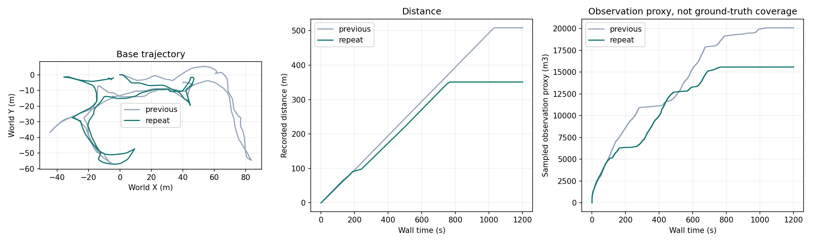
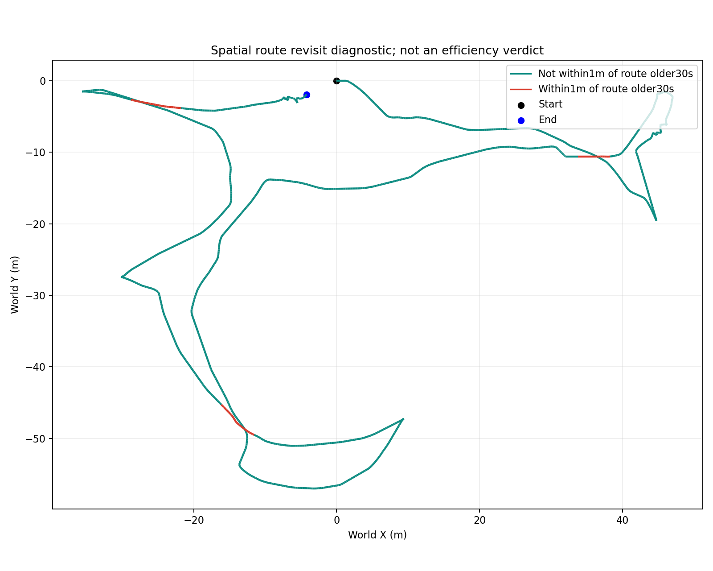
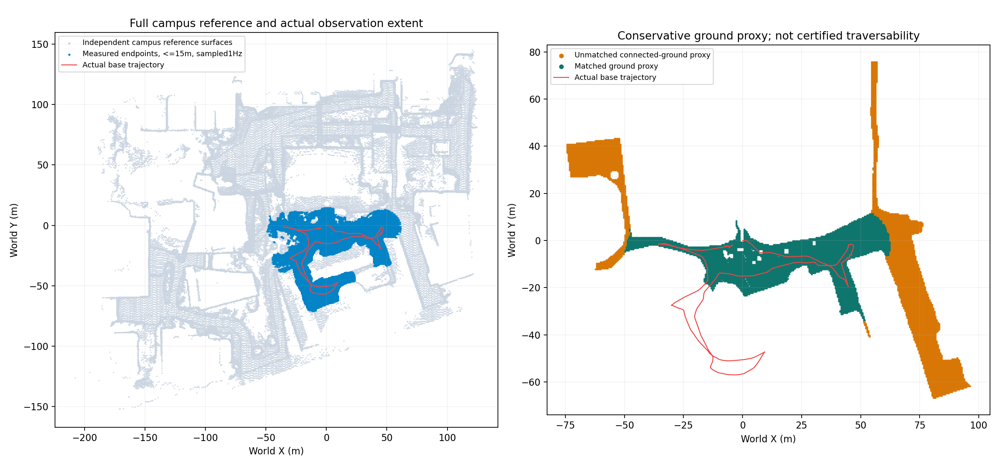

# campus 20分钟复跑与回头路诊断（2026-11-18）

**本轮完整采满1200.002秒墙钟，但未通过全campus探索及返航验收。** 行驶351.039m，在距起始位置4.624m处实际停车，末433.972秒完全不动。软件finish=true不能代表已返回起点或覆盖全场景。

用户要求重新试一次并关注回头路。本轮只启动一次，导航仍为11dd46d5561a0b426ebc800e192d9f42d0d8b00d，资料基线e46bf8a。305个冻结文件启动前及运行后SHA一致；五节点实际参数与上轮逐字节一致。沿用Helios32 crop_box、URDF包络、0.65m固定起点先验explicit_labels_v1。没有导航策略、HT阈值或安全门禁修改。

## 结果对比

| 项目 | 上轮20分钟 | 本轮20分钟 |
|---|---:|---:|
| 完整采集墙钟秒 | 1200.000515 | 1200.002423 |
| 累计里程m | 508.505 | 351.039 |
| 首次finish信号秒 | 1017.734 | 686.964 |
| 最后非零命令采样秒 | 1030.591 | 765.530 |
| 最终base距起始位置m | 40.458 | 4.624 |
| 末30秒里程m | 0 | 0 |
| 采样HT图龄P95秒 | 0.660 | 0.596 |

本轮11分26.964秒发出finish，12分46.030秒起保持停车至20分钟结束。PHASES.json的低平移区间为766.030440—1200.002350秒，航向累计变化为0；末120秒位姿与命令见END_MOTION_CHECK.json/end_motion.png。判断来自真实采集数据。本轮没有制作新视频。

域219、Gazebo11559、Xvfb:106。20分钟为墙钟，仿真推进407.4秒（约6分47秒），RTF=0.339575。预检无其他Gazebo；上轮存在独立AEDE并行负载。没有共同显式随机种子，因此路线和结果变化不能归因于代码修复或效率提升。

## 本轮为什么卡住

终点全局仍要求回起点，最后有效目标为(0.1725, 0.0000)，是有限坐标。局部规划每次检查690组候选，允许0组：582组HT_CONTEXT_INVALID，108组HT_DIRECTION_LOW。path_found=false，输出路径只有当前位置1个点。最后30秒107次局部更新全部无路径；62274次上下文拒绝和11556次方向拒绝是重复候选尝试次数，不是独立位置数量。原始诊断见PLANNING_CHAIN_DIAGNOSIS.json和data/diagnostic_samples.jsonl。

末段pathFollower及command_audit显示HT_ALLOWED，是对线速度/角速度均为0的命令放行，不能据此认为存在可行返航路线。门禁没有报连续上下文拒绝，是因为路径在上游localPlanner已经被全部筛掉。最近恢复自报8次计划/8次完成，发生于约239.79秒；终点没有正在执行的恢复路径。因此当前失效链是：全局返航目标仍在→局部全部候选不通过HT→单点路径→零速度→长期停车。尚未定位到导致所有候选失败的最初高程/方差样本，不能把失效链识别说成根因已修复。

本轮最终原始HT图中，当前base点上下文有效、八方向分数均大于0.5；朝目标前方0.5/0.75/1.0m采样点虽有直接地面观测且非障碍，但ht_valid=0、方向分数均非有限。这与上轮“当前点即无效”有所区别，支持前方存在上下文缺口的诊断；这几个直线采样点仍不能代替对全部690组扫掠路径的重建。

本轮扫描/HT观察频率约3.336/3.393Hz；采样HT图龄P95=0.596s、最大2.349s，1个样本超过1秒；14条过期拒绝保留。终点地图持续更新，末段无路径不能解释为地图停更。

另有174条包含-nan目标的非法local_selection JSON和33条非有限航点记录。稳健采集器记录原文后继续，未修改上游规划值；这些仍是导航缺陷。末段目标有限，不能把早期NaN直接当作本轮终点停车原因。

## 回头路有多少

以扣除雷达0.1725m偏移后的base XY轨迹按段长度加权，段中点距至少30秒以前轨迹采样点不超过指定半径，记作空间重复。必要返航、转场及从旧位置观察新区域也会被计入；该指标不能直接等同无效绕行。1米口径可能漏掉同一路面上有横向偏移的往返，因此同时报告3米/5米敏感性。

| 重复判定半径 | 上轮 | 本轮 |
|---|---:|---:|
| 1m | 11.20% | 5.15% |
| 3m | 26.57% | 19.20% |
| 5m | 37.02% | 30.19% |

本轮1米口径重复17.885m/347.030m；发出finish前3.46%，之后20.36%。负线速度对应的行驶距离约104.207m，它是倒车指令期间的base位移，不等于104m原路折返。347.030m为base XY计算值，表中351.039m为沿用的雷达采样轨迹里程；二者因雷达偏移和转向不同，不能混作分母。逐段可复查BACKTRACKING.json/backtracking_segments.csv。

| 时段 | 里程增量m（雷达采样轨迹） | 采样观测体积代理增量m³ |
|---|---:|---:|
| 0—5分钟 | 125.903 | 7096.500 |
| 5—10分钟 | 145.138 | 6202.875 |
| 10—15分钟 | 79.998 | 2290.125 |
| 15—20分钟 | 0.000 | 0.000 |

路线重复存在，但本轮更早停止、总观测量更少；不能据重复比例较低称整体探索更好。没有逐次目标选择的反事实对照，尚未证明每个回头路段是否可避免。

## 上轮HT上下文问题的原图证据

上轮最终base点ht_measured_valid=1、ht_observation_valid=1、ht_obstacle=0，但ht_valid=0、8方向值均非有限；朝当时目标0.5m处上下文有效。当前点首先不通过门禁，附近存在有效格并不足以证明能安全起步。源代码的上下文约束为51×51窗口（约2.09m）至少90%邻近已知支撑，且没有未决不确定项。单点有地面观测不等于整个神经窗口有效。见PREVIOUS_STOP_MAP_CHECK.json；本轮最终原图另见FINAL_STOP_MAP_CHECK.json和首末HT快照。未放宽上下文阈值。

## 全campus参考对照

沿用相同官方campus参考：每秒至多取1帧真实注册扫描、距精确配对雷达位置≤15m的端点、0.5m体素、0.75m匹配容差。本轮参考表面匹配9.121%；保守地形连通估计匹配50.236%（上轮78.911%），5461个未匹配估计格距轨迹超过20m。图中可见大片尚未观测区域。

这些都是诊断代理，不是可达地面真值覆盖率。完整模型含楼顶等不可访问表面，地形连通估计可能遗漏窄道或误判障碍；不能声称所有橙色格都实际可达，也不能把软件uncovered/frontier清零当作全场景探索完成。finish后的零计数存在重置/跳过更新语义。

## 校验、遗留问题和后续

653134条消息、28段MCAP的可用CRC/metadata计数检查通过；305条冻结归档核对通过。独立原图审计38033条非零放行候选：0越限、0未匹配。方向拒绝示例1799条中1778条匹配原图，21条未匹配，保留这个局限；command_audit的24条方向低分拒绝与示例数量是不同口径。门禁审计不能证明神经模型真值正确或任务完成。

采集及顶层launcher正常完成；SIGINT时若干ROS子节点仍有RCLError/abort，载体段错误，不能称干净退出。相关进程最终无残留，见CLEANUP.json。这些退出错误发生于采集结束清理阶段，与12分46秒开始的停车分开记录。

下一步应重建终点失败候选的完整窗口及首个拒绝位置，确认上下文空洞如何产生、为何恢复没有接管；同时把全局任务耗尽与执行阻塞、未完成返航分开，避免finish掩盖无路径。另需修复非有限航点源。上述均尚未实施，本轮只复跑和诊断。

原始录包/冻结/完整事件：`/home/lzz/ht_campus_repeat_1200s_20261118/runs/explicit_labels_campus_repeat_1200s_01`。Windows精简：D:/HT-Campus-Repeat-1200s-20261118/results。新账本1/2次、status=closed，不自动追加试跑；旧3/3账本未重置。仅推送精简资料到fix/ht-execution-20261113；无新Release，未上传原始MCAP或视频，原始数据继续保留。
