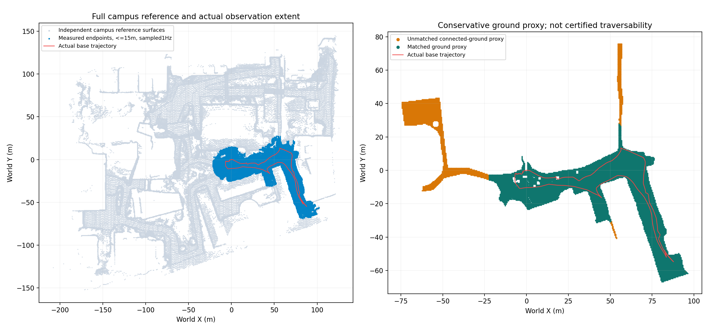
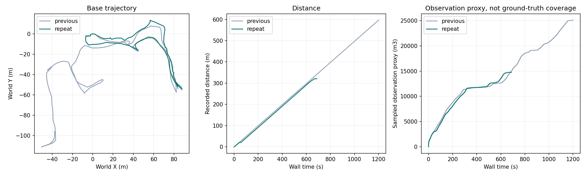

# campus运行至软件任务结束并返航（2026-11-18）

**本轮按任务状态自然结束：688.203秒墙钟（11分28.203秒）、320.721m，finish=true，车体中心距初始位置0.026466m，连续稳定停车20.145秒。不是固定20分钟截断。** 这个结果证明本轮软件完成并返航停车；独立场景对照仍有明显未观测区域，不能称全campus探索完成。

## 任务结束证据

| 事件 | 正式采集后墙钟秒 |
|---|---:|
| 首次finish_transition=true | 633.805111 |
| 最后非零命令采样 | 667.553688 |
| 连续实际停车开始 | 668.058259 |
| 返航稳定停车条件满足、采集结束 | 688.203104 |

终点base XY=(-0.025784919,-0.005965215)；最后20秒CSV样本全部finish=true、零命令，位置完全不变，HT/里程计/扫描图龄均新鲜。独立复核RETURN_VERIFICATION.json通过。采集器另要求命令到达龄≤0.25秒，终点实时条件成立；规则内0.5m起点邻域只是收尾容差，本轮实际误差约2.6cm。

START后的结束规则没有运行时长上限：finish=true、车体回到初始0.5m以内，输入新鲜、零命令且位置保持0.05m内连续20秒，才记录RETURNED_AND_STOPPED。持续300秒无位移/无观测增长会记录PERSISTENT_BLOCKED失败，不能伪称完成；本轮没有触发失败分支。7项结束规则回归通过。RESULT.json的mission_complete仅指软件任务和返航收尾判定，不是全场景覆盖验收。

上一轮仿真已经退出，没有完整规划器检查点，因此本轮是从同一起点重新开始，未冒充从旧20分钟处续跑。导航仍5ba8bb5、资料基线87133ad5819a9d021d69a7b84bd1ff40197bd77a；新域207、Gazebo11579、Xvfb:108。只改只读采集结束条件及隔离地址，五节点实际参数与上一轮字节相同，实际/proc/exe和SHA确认两个导航进程加载修复版。

## 恢复实际发生在哪里

本轮2次恢复计划、1次完成、1次安全中止，**均发生在finish信号之前的探索阶段**。初次进度更新时提到的恢复计数是累计值，不能把它放到后面的返航阶段。

| 恢复事件 | 秒 | 结果 |
|---|---:|---|
| 计划1开始 | 44.020 | PARTIAL_PROGRESS，搜索净目标进展0.747984m |
| 计划1完成 | 54.440 | 耗时10.420秒，净位移1.098837m，兼容目标更新保留 |
| 计划2开始 | 54.973 | FULL_PROGRESS，搜索净目标进展0.768471m |
| 计划2中止 | 57.734 | COMMAND_REJECTED:HT_OCCUPIED，invalidated累加1 |

第一条恢复在线执行了经过完整门禁/控制器校验的部分进展前缀；搜索进展是相对规划时目标的距离缩短，净位移不是同一指标。第二条在更新地图出现占用否决后停车/释放恢复，未绕过保护；原生规划随后继续运动。累计search_failures=0。

finish后车辆使用原生可行路径返航，末段Recovery报告RETURN_GOAL_REACHED，未触发新的恢复执行，finish后恢复完成数=0。因此本轮在线验证了部分前缀执行和新占用中止，以及实际返航停车；**尚不能据此宣称“收到finish后阻塞时的恢复接管”已在线验收。** 该分支仍只有此前原始终点冻结图的验证。

完整恢复事件见data/diagnostic_samples.jsonl/RECOVERY_ANALYSIS.json。最终诊断里的search_outcome、first_search_rejections、progress_m保留的是上次搜索/起点信息，不能把其中x约18m的旧拒绝位置当作返航终点的新失败。

## 全campus仍未验收

本轮独立官方参考表面匹配8.485%；保守连通地形估计匹配78.639%，2572个未匹配估计格距实际轨迹超过20m，明显仍有区域没有观测。软件finish时日志uncovered=84、frontier=0、global_return=1、local_complete=1；返航后日志零计数存在重置/跳过更新语义，不能替代全场景验收。

参考采用真实注册扫描、每秒至多一帧、精确配对雷达位姿≤15m端点、0.5m体素和0.75m匹配容差。模型含屋顶/立面，地形连通估计可能遗漏窄道或误判障碍；不能将78.639%当作真实可达地面覆盖率，也不能直接认定所有未匹配格都实际可达。但现有证据不支持“整个campus已经探索完”。需继续核对TARE任务耗尽、剩余区域连通/可达性及完成判据之间的关系，而不是只延长一个已完成并停车的任务。

## 与上一轮和重复路线对照

上一轮同修复版1200.001秒/596.607m仍finish=false，本轮688.203秒/320.721m已软件完成返航。没有共同显式随机种子，路线早期已不同，不把更早收尾解释为探索效率提升或完整覆盖更好。/clock推进239.900秒，RTF=0.348748；上述11分28秒为墙钟，不能称11分钟仿真时钟。

| 时间区间（秒） | 雷达轨迹里程增量m | 采样观测体积代理增量m³ |
|---|---:|---:|
| 0.0—300.0 | 141.359 | 10832.500 |
| 300.0—600.0 | 149.618 | 2680.250 |
| 600.0—688.2 | 29.744 | 1238.875 |

base XY里程317.238m，与雷达轨迹320.721m因0.1725m偏移和转向不同。按段长度加权，距至少30秒以前路线不超过指定半径算空间重复，包含必要转场和返航，不全等于无效行驶。

| 重复半径 | 本轮比例 |
|---|---:|
| 1m | 4.18% |
| 3m | 17.11% |
| 5m | 26.91% |

3m口径重复54.286m；倒车指令期间base行程141.472m，不等于全部原路折返。采样射线体积是观测代理，不是可通过地面真值。

## 校验和保存

- 352220消息、18段MCAP的可用CRC/metadata计数及318条冻结归档SHA核对通过；运行前后冻结一致，原导航/模型/传感器/历史600秒期限、HT门限/未知/障碍/TTL、0.65m先验均未改。
- 33277条非零放行命令原图独立审计0越限/0未匹配；方向拒绝示例154条中153条匹配，1条未匹配保留。审计通过不证明网络地形真值正确。
- 采样HT图龄P95=0.616s、最大0.802s，无>1秒样本；正式窗口原因统计HT_ALLOWED=34350、HT_DIRECTION_LOW=202、HT_OCCUPIED=29。未记录NaN航点/非法JSON不表示其源已修复。
- 清理阶段ROS子节点退出错误仍保留，clean_child_exit=false；本轮相关进程最终无残留。任务结束前没有进程异常退出。

完整原始数据、12份原始推理输入、冻结归档保留在`/home/lzz/ht_campus_to_finish_20261118/runs/campus_to_finish_01`；精简Windows副本D:/HT-Campus-To-Finish-20261118/results。新账本一次正常任务结束后关闭，不重置旧账本、不自动开启第二次。仅推送代码/精简资料到fix/ht-execution-20261113，无Release、原始MCAP/视频上传或实车部署；本轮没有制作新视频。
