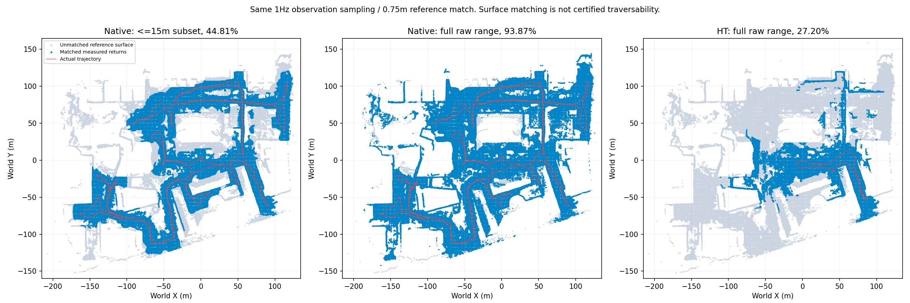
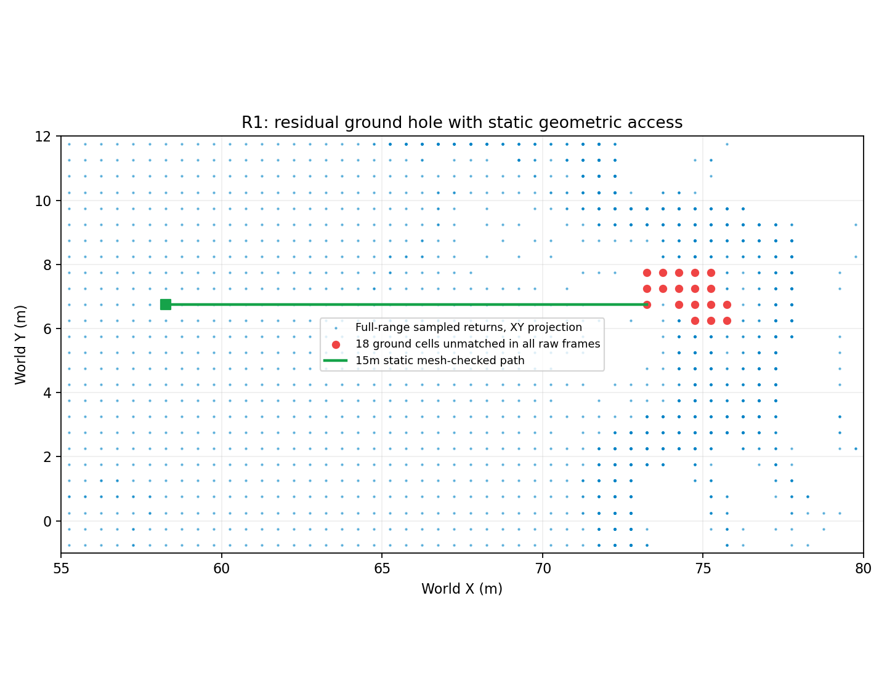

# TARE / HT 覆盖、遗漏区域与完成链核查（2026-11-18）

本轮只读分析既有录包、源码和碰撞网格，没有启动新的Gazebo探索，没有修改导航参数、HT门槛或原生任务策略。

结论：旧图的15米截断夸大了原生TARE的灰色“未探索”范围。保留同样1Hz抽样、取消距离截断后，原生第二轮参考表面匹配为93.867%，HT任务结束轮为27.196%。这仍是表面观测匹配，不是车辆可达地面真值覆盖率。另确认原生在(74,7)附近有一处小型地面残余，通往其中一个未匹配点的路径通过静态碰撞网格检查。HT结束条件和参数与原生相同；其结束时仍有2个EXPLORING单元，但全局可纳入任务数为0，局部收益队列为空，导致相同完成条件更早成立。

## 1. 修正旧图的含义

| 记录 / 观测口径 | 参考表面匹配 |
|---|---:|
| 原生第二轮：1Hz，≤15m（旧图） | 44.806% |
| 原生第二轮：1Hz，全部原始有效回波距离 | 93.867% |
| HT任务结束轮：1Hz，全部原始有效回波距离 | 27.196% |

所有比较使用同一377124个0.5m参考表面体素、0.75m匹配容差，扫描严格限定在正式采集区间。原生1145帧抽样，HT582帧。取消15m截断没有添加合成点、插值或先验，只恢复原始registered_scan中真实存在的远处回波；没有改变TARE内部kSensorRange=15m或运行轨迹。表面匹配既不要求车轮驶遍每个面，也不能证明所有未匹配面均可达。

原图把蓝色定义为15m内实测端点，但标题和后续解释把大片仅灰色区域当成实际未观测，表达不准确。历史44.806%仍保留其原口径，后续判断应使用本报告的分项结果。99.361%只描述原先3130.75m²的保守连通地形子集，不能概括整片campus。

## 2. 哪些区域仍有可达而未匹配的证据

### R1：东侧小型地面残余，有静态几何可达证据

全部6802帧原始registered_scan逐帧核对后，x=73.25–75.75、y=6.25–7.75m内仍有18个0.5m地面格未找到0.75m以内回波匹配，合计4.5m²。边界盒并不表示其中每格都缺测。另有一些分散小格尚未逐帧/逐路径验证，不能全部称已确认漏探索。

找到从实测轨迹附近(58.25,6.75,-0.5840)到未匹配点(73.25,6.75,-1.0210)的15m通路。直接解析原始campus.dae碰撞三角网格，沿途每0.1m检查地面支撑和0.15–1m高度障碍带：151个位置、每位置9个支撑点，0.6×0.6m原生车体包络无三角面碰撞；进一步用0.85×0.85m包络覆盖原生方形车体转向时的水平外接范围，仍无碰撞。地面与预览点云最大高差0.0748m，加大包络内最大支撑高差0.1439m。

这证明所检路径在静态几何条件下有通路；没有做新的实际驾驶或接触动力学实验，不能称实车可达验收，也没有证明整片18格每一格都已可驾驶到达。核验详情R1_MESH_PATH_VERIFICATION.json、R1_TURN_ENVELOPE_VERIFICATION.json及路径数组。

碰撞网格坐标采用与录包相符的Z对齐：SDF同时含名义model姿态Z=1和保存state的map姿态Z=0；原始扫描更匹配Z=0网格。网格顶点最近邻中位误差从名义Z=1的0.841m降至Z=0的0.312m，起点地面也与Z=0一致。保留两种姿态及MESH_ALIGNMENT_CHECK.json，不把名义model姿态直接当已验证运行姿态。

### R2：北侧候选区，经核对撤回“遗漏”判断

原15m截断统计中，(116,118)附近30格未匹配；全部原始回波核对后30格均有匹配。东侧R1原79格候选也有61格已被远处回波观测。这两项不能继续按原图数量算作真实遗漏。

### 大片灰色参考表面：有屋顶，也有绘图截断

例如x=-8.75–24.75、y=-34.75–-17.75m的一块平面，参考高程9.39–12.30m，相邻道路高约0m；另一块x=-29.75–-16.25、y=-99.75–-64.25m平面高13.54–15.51m，与附近道路相差约11.6m。它们不能因俯视图像像“平地”就判为漏走道路；这里也没有证明每块高平面都无任何通路。UNSEEDED_COMPONENTS.json保留分块几何证据，其unobserved_cells仍沿用旧15m口径，本文只引用几何高差，不用该字段统计全距离遗漏；不将不连通的保守点云图等同物理不可达。

### HT遗漏的大范围道路有原生实际驶过的直接证据

原生第二轮在西南(-135.55,-62.53)、南部(-67.66,-101.71)、北部(18.09,99.08)附近均实际行驶，沿这些轨迹的地面有原生回波匹配、HT全距离抽样回波无匹配。这证明这些轨迹对原生0.6m车体在本仿真中可达，不能把HT未进入的范围统一解释成场景不可达；也不能直接替代更大Scout车体的可达性验收。完整分区及实测轨迹长度见HT_OMITTED_NATIVE_DRIVEN_REGIONS.json。

## 3. 前沿与全局单元为什么没继续成为任务

代码核对结果如下（本轮未改这些规则）：

1. 全局TSP仅从EXPLORING单元挑选符合局部/全局分工、关键帧图连接条件的单元；不会把整张世界中所有UNSEEN单元主动加入任务。没有进入可用集合就设置return_home。
2. 局部收益只统计**未访问候选视点可见**的未覆盖点/前沿点；过滤后前沿云有点，不等于有可执行前沿任务。可见性还经过视场、15m范围和遮挡检查。
3. 局部收益门槛参数为40个表面点、20个前沿点，部分分支使用严格大于。没有选出局部收益视点，就可以local_complete=true，即使未覆盖点仍不为0。
4. 全局单元在缺少有收益视点、缺候选或almost-covered离开邻域等条件下可记COVERED；再次激活COVERED单元要求达到至少10个高收益或前沿收益视点。它是依赖当前候选模型的状态机，不是独立世界真值检查。
5. 最终完成条件为IsReturningHome && IsLocalCoverageComplete && 启动超过5秒；不包含全场景未知区域清空或独立覆盖率条件。

HT在约633.805秒触发完成的**同一轮原始日志**：

| 状态 | 值 |
|---|---:|
| EXPLORING全局单元 | 2 |
| 过滤后纳入全局TSP的单元（日志名routable） | 0 |
| 几何候选视点 | 342 |
| 候选视点可见的未覆盖表面点 | 84 |
| 候选视点可见的未覆盖前沿点 | 0 |
| 表面收益队列 / 前沿收益队列 / 复用收益视点 | 0 / 0 / 0 |
| global_return / local_complete | 1 / 1 |

这里routable=0**不等于证明2个单元物理不可达**：候选集合先排除交给局部规划的单元，随后才进行关键帧图过滤。已有日志没有逐单元排除原因，不能断言这2个一定是图不连通。

完成前最后一份HT过滤前沿云其实还有173点；经未访问候选视点可见性筛选后，真正进入收益计算的frontier为0。原生第二轮完成前过滤前沿云也还有137点、未覆盖云10点。这证实finish不是“原始前沿点全清零”。

**R1对应的原始全局cell具体为何退出任务，现有录包不能精确还原。** 原生包没有录到逐cell状态、候选视点及其分数/访问标记/拒绝原因，虽然订阅了exploring_cell_vis_cloud但该话题没有消息，实际单元可视化是另一个marker话题。不能用源码中的某个COVERED分支冒充原始现场事实。已能确认R1周围历史上产生过过滤前沿和未覆盖点，之后没有引导车靠近补齐；小残余/视点收益门槛/单元关闭规则与此兼容，但精确是哪一分支尚未证实。9.6m空间分桶历史不是原始cell ID，已在数据中标明。

源码入口见上一原生实验目录reproduce/native_source：sensor_coverage_planner_ground.cpp完成判断约1535行；grid_world.cpp单元更新约624–684行、全局挑选约741–804行；local_coverage_planner.cpp约693–697行；planning_env.cpp的GetUncoveredArea约354行。

## 4. 判断逻辑相同，为什么HT范围仍小

两轮实际tare_planner_node.yaml参数语义完全相同；原生与历史TARE源码差异为诊断日志和同一ROS2参数声明绑定，不是另一套完成公式。但其输入和执行条件不同：

| 项目 | HT任务结束轮 | 原生成功轮 |
|---|---:|---:|
| 车辆 | Scout，约0.93×0.70m | 原生0.6×0.6m |
| 速度上限 | 0.5m/s | 2.0m/s |
| 雷达 | Helios32，1800水平样本 | VLP16，350水平样本 |
| 标称每帧射线采样量 | 57600 | 5600 |
| 标称雷达频率 | 10Hz | 6.3Hz |
| 实测扫描接收 | 3.434Hz | 5.281Hz |
| 仿真实时率 | 0.349 | 0.840 |
| finish墙钟 | 633.805s | 1202.47s |
| 总行程 | 320.721m | 2460.020m |
| 局部通行/控制 | HT窗口、占用、未知、方向、TTL及车体支撑 | 原生几何localPlanner/pathFollower |

速度相差4倍，运行至finish的时长也不同，行程最终相差约7.67倍。Helios每帧标称采样量约10.29倍；标称射线采样预算每秒约16.33倍，这不是实测耗时倍数。加上HT建图/推理、车体和执行限制，整体负载及状态推进均不同，现有实验不能分别量化这些因素的因果贡献。

更直接的HT证据：finish之前2227份局部选择诊断均path_found=true；实际命令门禁抽样31630次HT_ALLOWED、202次方向低分、29次占用拒绝，恢复发生在早期且不是末段持续停车。候选路径层仍报告2303次上下文无效、1223次占用和1070次方向拒绝（重复检查计数，不是独立地图格）。**这轮HT更早结束不是持续找不到局部路径造成的卡死；直接触发链是全局可用任务0 + 局部收益任务0。** 备选路径被HT筛除会改变走法，但没有共同条件消融，不能把全部范围差距归因于这些拒绝。

TARE仍用原生地形/视点模型生成和结束任务，HT在后端用另一套通行模型执行，尚没有“HT暂不能执行”对应的全局延期任务状态。该接口差异值得查，但目前没有逐cell轨迹证明它解释了全部遗漏。TARE内部的视点模型还保留约±12°的竖直可见性模型；换成-55°至+15°的Helios不会自动得到相同可见性和前沿收益。是否需要适配应通过同条件记录验证，不能由此直接断言其为唯一根因。

“稳定更多”也没有被现有样本证明：原生2轮中首轮阻塞失败，第二轮返航；对比的最新HT轮也成功返航且finish前无持续无路。可以说原生第二轮走得更广、整套系统运行更轻，不能声称已统计验证原生稳定性更好。

## 5. 后续定位应保留的内容

下次有边界的同条件测试应固定Scout/Helios、速度、起点、场景及随机源，记录每个cell的状态迁移/原因、候选数量/收益/访问、局部与全局分工、关键帧图排除、前沿各级过滤数量，以及HT执行失败的任务反馈。这样才能区分前沿未生成、已有前沿无候选、低收益关闭、任务图过滤和执行器拒绝。当前不调整未知/占用/时效门槛，也没有新开第三轮或假称已经修复。

原始数据只读保留，全部新分析在/home/lzz/ht_tare_coverage_diagnosis_20261118；Windows副本D:/HT-TARE-Coverage-Diagnosis-20261118/results。只推送精简证据与复现脚本，不上传原始MCAP/大网格，不新建Release。
