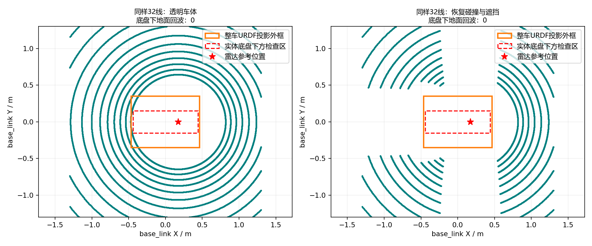

# Helios32 与车体遮挡修正

已把新仿真的假想 64 线雷达换成标称 Helios32，并补齐底盘、轮子、支架和传感器的遮挡。没有改 TARE 探索策略、HT 阈值或实车标定。

用户不知道雷达具体后缀，允许近似。本机已检查的历史导出只有配置和驱动文档，尚未恢复可确认型号、转速及逐线标定的 DIFOP/PCAP。因此这里采用 RS-Helios-5515 标称参数，不能称为该台实车雷达的完整复刻。

## 改动

- 32 条非均匀垂直线束，−55°～+15°；600rpm / 仿真时间 10Hz；水平 0.2°，每帧 57,600 条射线（含无回波）。逐线角度和量程见 `tools/helios32_sim/helios_5515.json`。
- 使用固定的 Scout URDF 及网格，保留原 collision，并让所有 visual 网格参与射线碰撞，共 18 项。车体仍由原 CMU 运动学更新位置，不是轮胎接触动力学仿真。
- 射线先求最近遮挡，再做 0.2m 盲区裁剪。自车回波被过滤后保留阴影，不重新射穿车体去找地面。
- 雷达随车转动，点云配准同步使用车体朝向。HT 的 URDF 外接框门禁沿用上一版。

参数来源：[厂家 RS-Helios-5515 手册](https://cdn.robosense.cn/20220923164517_61201.pdf)，表 5、规格页及坐标原点说明。

## 安装原点修正

第一版把源 URDF 的 `rslidar` 别名直接当作光学原点。该点恰好落在支架顶面，离线网格求交确认：部分向下光束约在 0 距离撞上支架。这会制造过大的近地盲区。

最终仿真把该源别名解释为安装基准，再按手册增加 63.5mm 光学高度：base_link→光学原点为 `(0.1725, 0, 0.6137)m`，离地 `0.84849m`。车体网格的世界位置不变。这是明确的标称安装近似，没有修改实车 TF。光窗起射半径约 51mm，也是模型近似，不代表实测光学标定。

## 最终模型检查

同一地面和墙面、同一 32 线扫描，分别开关车体遮挡：

| 检查 | 结果 |
|---|---|
| 逐线角度 | 32 线均出现，最大误差约 0.000008° |
| 透明车体有效点 | 46,770 |
| 遮挡后送入建图的有效点 | 39,443 |
| 自车遮挡回波 | 7,327 条被过滤，未重投射 |
| 实体底盘正下方地面点 | 透明和遮挡模型均为 0 |
| 15cm 近障碍挡住远墙 | 通过；不能因盲区裁剪而看穿 |
| 车转约 90° 后固定墙面配准 | 通过；墙面 X 的 95% 误差小于 0.000001m |

在正确光学高度下，最陡 −55° 光束本身就不落进所检查的实体底盘范围。开发模型曾有“145→0”的结果，**不能当作最终模型的对照指标**。原静态脚本要求透明模型必须看到车底，修正高度后这个断言不成立；保留失败日志，改为检查实际自车阴影和原点云，数据没有改写。最终检查见 `static_optical/PASSED.json`、`rotation_optical/RESULT.json`。

检查中还修正了 visual/collision 重名造成的 SDF 格式报错，三份最终模型通过 Gazebo 自带 `gz sdf -k` 校验；保留修正前日志。载体节点增加了退出时 ROS 上下文失效的处理，运行中的 ROS 错误仍抛出；运动积分和控制规律没有改变。最终转向探针运行阶段通过，但 SIGINT 之后仍有 FastDDS publisher 销毁错误及载体段错误，见 `rotation_optical/carrier.log`。因此不能宣称进程清理已修好；扫描/配准检查通过不包含干净退出。

## 完整链路试跑及限制

保留两次 campus 开发试跑：首次因缺少 CMU 仍在更新的 camera 位姿实体中止，补回空位姿锚点后第二次运行 600.003 秒。第二次车辆位移 0，finish=false；记录中有 21,199 次地图过期拒绝和 9,573 次缺测支撑拒绝，没有非零速度输出。

**这两次均发生在光学原点修正之前，不能用于验收最终代码的探索、起步或恢复效果。** 最终修正只完成了上面的静态遮挡和真实载体转向配准检查，没有追加 600 秒导航验收，也没有证明实车近地缺测问题已经解决。

CPU 射线计算较慢：最终静态遮挡场景实际约 3.34Hz（墙钟）；较早完整链路约 0.40Hz。配置中的 10Hz 是仿真时间频率，不能冒称本机达到实时。现有 CMU 配准桥使用主机时间重打时间戳，也不能把其图龄当作真实传感器延迟。没有模拟逐点发射时序、运动畸变、标定强度/噪声或双回波。

两个开发录包均完成独立 MCAP 读取、可用 CRC 检查及 metadata 数量核对；原始冻结归档逐文件 SHA256 与运行时清单一致。它们与最终安装原点存在已说明的差异。原始包、失败日志和网格保留在 `/home/lzz/ht_helios_collision_20261115`；仓库只存精简证据，不上传新视频或 MCAP。

## 使用入口

新实验用 `tools/helios32_sim/prepare_assets.py` 生成 `common_sensor_optical`，用同目录 `simulation.launch.py`；旧透明 profile 只作历史对照。编译 `src/helios32_sim`，同时将 `cupy_to_ht` 的 `surface_sensor_ground_offset_m` 设为生成清单里的雷达离地高度。操作说明见 `tools/helios32_sim/README.md`。

本批正式启动账本已关闭。未部署实车，未修改 real 分支，未新增 Release，未删除历史数据。
