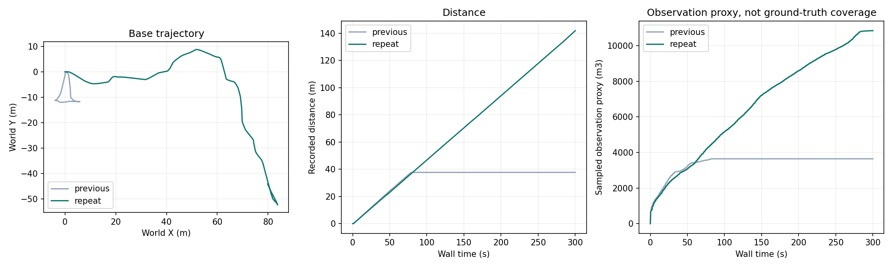

# campus 同配置300秒复跑（2026-11-17）

用户要求“你再探索一次试试”。本轮不修改导航，沿用实际测试代码11dd46d5561a0b426ebc800e192d9f42d0d8b00d、Helios32标称32×1800/仿真10Hz、车体crop_box、固定0.65m起点先验和explicit_labels_v1。运行前上次305个冻结文件逐一SHA相同；本轮仅隔离输出、ROS域223、Gazebo11539及Xvfb:103。未建立可重复的同一显式随机种子，不能把路线差异归因于代码改善。

## 结果

| 指标 | 上次 | 本轮 |
|---|---:|---:|
| 就绪后采集墙钟秒 | 300.002104 | 300.000120 |
| 累计里程m | 37.686604 | 141.878011 |
| 末30秒里程m | 0 | 14.535994 |
| 采样观测体积代理m³ | 3645.625 | 10846.375 |
| 完成信号 | 52.101秒 | 未发出 |
| finish最终值 | true | false |

- 扫描/HT接收频率：3.5667/3.5500Hz墙钟，按观察器结束累计计数减就绪起始计数计算。
- 抽样HT年龄P95：0.582078秒，>1秒比例0.1675%。桥使用主机重打戳，不能称物理端到端测量延迟。
- 独立原图命令审计passed=True，计数{"maps": 1074, "command_audits": 15016, "rejected_HT_MAP_STALE": 12, "allowed": 14984, "allowed_moving": 14957, "direction_rejection_examples": 40, "direction_distinct_rejections": 40, "direction_examples_map_matched": 40, "rejected_HT_DIRECTION_LOW": 20, "unresolved_commands": 0}。缺图不以邻帧替代。
- 五节点参数语义比较：{"tare_planner_node.yaml": {"semantic_equal": true, "byte_equal": true}, "localPlanner.yaml": {"semantic_equal": true, "byte_equal": true}, "pathFollower.yaml": {"semantic_equal": true, "byte_equal": true}, "cupy_to_ht_bridge.yaml": {"semantic_equal": true, "byte_equal": true}, "vehicleSimulator.yaml": {"semantic_equal": true, "byte_equal": true}}。
- 完整采集=True；前后冻结一致=True；完整归档逐条冻结检查=True（305个文件）；MCAP可用CRC/metadata计数核对通过，共136516消息。
- SIGINT子进程干净退出=False，相关残留=0，错误原文见CLEANUP.json。

末段规划诊断：

```text
[tare_planner_node-10] [INFO] [1794847970.641243945] [tare_planner_node]: EXPLORATION_DIAG candidates=282 uncovered=109 frontier=0 global_return=0 local_complete=1 global_nodes=144 local_nodes=31 x=79.473 y=-43.387
```

## 解释与限制

本轮是否再次提前完成，以完成信号、末30秒运动和完整轨迹共同判断。未修改任务生成、完成条件、HT门限或起点标签语义；单次同配置复跑不同路线不能证明前次缺陷已修复。全campus真值覆盖率没有核验；观测体积是采样射线代理，不能当可通过地面面积或完整覆盖率。上次完成后零计数含停止更新造成的零初始化，不是全图实测覆盖完成证据。

本次提前完成未复现。末段local_complete=1时global_return仍为0，车辆沿全局路径继续行驶；全局任务接续与上次不同。现有汇总日志不足以把两次路线分叉归因到某一个视点筛选原因。



## 保存和预算

完整录包/冻结：`/home/lzz/ht_labels_repeat_20261117/runs/explicit_labels_campus_repeat_01`。Windows精简结果：`D:/HT-Labels-Repeat-20261117/results`。本轮没有新RViz视频，也不上传视频/原始MCAP。新账本已关闭，最多2次仅基础设施失败重试，实际使用1次，不自动追加探索。旧数据不覆盖、不清理。

`data/ht_map_first.npz`与`ht_map_last.npz`从本次原始MCAP离线提取，保留原始HT层，未合成执行先验；坐标、层名和SHA见`data/MAP_SNAPSHOTS.json`。图像已检查可读。后处理脚本和实际启动脚本存于source目录；没有为后处理错误重启探索实验。
