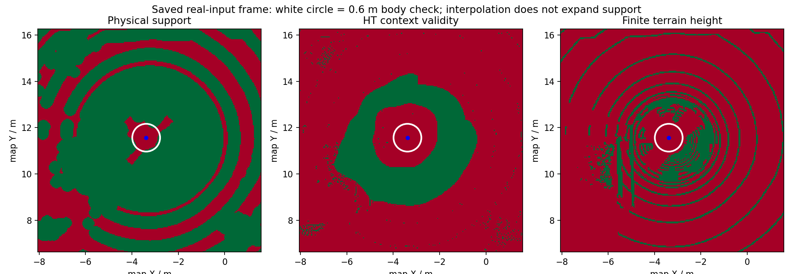

# 实车代码审查与修正（2026-10-28）

结论：已修复三项可复现的软件问题；保存的实车静态输入仍有明显车旁缺测，不能据此宣称实车探索闭环已经修好。本轮仅做独立构建、离线数据重放和隔离ROS组件检查，没有启动设备、仿真、实车域或车辆运动。

## 来源与版本

- 原目录：`/media/lzz/My Passport/HT_Explo_full_code_and_experiments_2026-10-27/HT_Explo`，作为只读来源。
- 该目录没有`.git`；原报告注明基线`62eaa06`，并包含10月24/27日未提交修改，因此不能把整份代码称为干净的62eaa06提交。
- 修改副本：`/home/lzz/my test/HT_Explo-real-review-20261028`，本地分支`real/scout-review-20261028`。源码导入提交`407e799`，补齐原目录回归样本后的修复基线`b65f88c44b6f5e444fd16a3f0ae431ab32b6bae3`。没有与仿真分支混用。
- 原始源码哈希见[source_snapshot.json](source_snapshot.json)。本轮没有核对或更新GitHub远端。

10月27日版本已统一开始话题、共享起点先验并增加inspect/preview/drive模式；这些已有改动得到保留，没有重复套用10月23日的旧诊断。

## 已确认并修复

| 问题 | 复现证据 | 修改及结果 |
|---|---|---|
| 导出副本安装失败 | x86和ARM依赖目录均保留完整版本库，但缺`libortools.so.9`别名；CMake安装时报文件不存在 | 从实际导入库生成工作区私有运行副本，构建RPATH及安装使用该副本；不修改第三方源目录。两包最终构建/安装通过，安装后ldd无缺库 |
| 标准传感器QoS不能接入 | BEST_EFFORT点云发布者与RELIABLE订阅者不匹配；真实DDS探针收到0帧，并记录RELIABILITY冲突 | 点云订阅请求改为BEST_EFFORT、深度仍为2；BEST_EFFORT和RELIABLE发布者均能进入输入队列 |
| 暂停ROS时钟后看门狗停摆 | 先实际转发0.2m/s测试指令，再停止输入和ROS时钟；0.8秒后没有新输出，最后输出仍为0.2 | 看门狗改为STEADY_TIME定时器，继续按单调时间检查接收超时；相同探针在0.8秒内继续输出16次，最终为零速 |

QoS是兼容性缺陷，本次静态文件没有保存当时雷达发布者的实际QoS，不能据此断言它就是现场缺测的原因。随仓库提供的SDK默认发布RELIABLE，本次修改也保留对该发布者的兼容。

看门狗复现条件使用`use_sim_time=true`并暂停`/clock`，不能把它冒充默认实车时钟下已观察到的故障。测试输出仅在隔离域的`/offline_review/...`话题出现，不是底盘运动证据。

生产修改在`src/tare_planner/CMakeLists.txt`、`src/ht_scout_bridge/ht_scout_bridge/node.py`及`command_bridge.py`。新增4项DDS回归，包含暂停时钟、话题重映射不回退，以及两种雷达可靠性。`package.xml`补充了测试使用的rosgraph_msgs依赖。话题重映射在修正测试夹具后，修改前后均能正常工作，不列作生产缺陷。

## 数据揭示的剩余问题

数据来自10月23日`quality_optimization/live_input.pkl`：55帧高程、61条定位；本轮重放与原报告相同的8帧。原时间戳保留，使用对应的受控离线时钟和匹配定位。CPU/NumPy用于本机重放，不能用于声称Jetson/CUDA的实时速度。

末帧、以记录中的base_link位置为圆心、0.6m半径：

| 条件 | 关闭既有小孔插补 | 开启既有小孔插补 |
|---|---:|---:|
| 车旁栅格数 | 709 | 709 |
| 缺物理支撑 | 606 | 606 |
| HT上下文无效 | 709 | 709 |
| 车旁已标记障碍 | 0 | 0 |
| 全图有限高程格 | 7373 | 8362 |
| 全图满足有限高程、物理支撑及HT上下文条件的格子 | 3283 | 4202 |

**插补改善了部分高程输入，却没有解决这组数据的车旁盲区。**606格缺支撑不等于606格是真实障碍；709格上下文无效意味着普通HT预测支撑条件不满足，不能直接理解成模型认为地面不可通行。固定起点30秒先验属于另一个有限许可机制，不会把未知测量改成有效HT图；这组重放没有验证车辆能否依靠它驶出盲区。



本图红色是该二值条件不满足，绿色是满足，白圈为车旁检查范围，并非红绿通行概率图。详细逐帧数据、输入SHA256及派生快照见[重放结果](recorded_replay/audit.json)和[last_snapshot.npz](recorded_replay/last_snapshot.npz)。

八帧中既有插补开关前后的物理支撑、HT上下文及障碍掩码逐格相等，原有限高程不变。这是对10月27日既有功能的诊断，不是本轮看门狗/QoS修改带来的地图收益。

不能由当前文件唯一确定盲区由自过滤、遮挡、扫描几何、姿态误差或其他上游因素产生；需要同时间的过滤前点云和实际TF链作对照。当前方向文件也仍区分代码映射核对与实车非对称地形响应验证，后者为false，不能把默认mapping策略写成已完成物理验收。

## 验证与失败记录

- 独立real构建/安装：2包通过；源码与安装的两个Python节点哈希一致，安装规划器ldd无缺失库。
- Python：191通过、15跳过。跳过为本机不可用的CUDA/Numba相关检查；外部建图工作区专用`test_cupy_tf_worker_ros.py`未收集，不能计入通过。
- C++：7个CTest目标最终通过；GTest为88通过、4跳过，另有独立`ht_core_test`通过。4个跳过项缺少对应历史场景环境变量/输入，不沿用原报告“92全部通过”的说法。
- C++初次几何回归因审查副本未复制原目录的collision_points.csv失败；补齐同一原始文件后仅重跑该目标，23项均通过。其余已通过目标没有无故重复运行。
- 原TARE六个关键决策函数体合同检查通过；本轮未改TSP、XYθ搜索、跟踪算法、模型权重或HT阈值。实际源文件一致性见[installed_source_checks.json](installed_source_checks.json)。
- 初次Python收集缺少尚未生成的StartupPrior类型；初次核心回归另缺两个未复制的历史样本。这些环境准备失败已保留，没有修改断言规避。
- 初版时钟探针未正确到达转发状态；后续夹具曾共享Header并将指令frame改成map。修正夹具后才确认暂停时钟缺陷。旧日志保留；有效修改前证据为`command_wire_before.json`和`reproduced_defects_before_v2.log`。

本机为x86_64、ROS Jazzy、PyTorch CPU；不是Jetson ARM64/Humble的复测，未做600秒仿真或实车运动验收。现有初始先验、默认inspect、手动开始、时效与未知策略仍保留。本候选需先在目标Jetson重建，再进行无底盘输出的真实数据检查；实车运动需要单独验收。

## 复现

在本工作副本运行；测试域与外部设备域隔离：

```bash
cd '/home/lzz/my test/HT_Explo-real-review-20261028'
BUILD_JOBS=2 bash scripts/build_real_scout.sh
source scripts/source_real_scout.sh
unset CYCLONEDDS_URI
export ROS_LOCALHOST_ONLY=1 RMW_IMPLEMENTATION=rmw_fastrtps_cpp
export ROS_DOMAIN_ID=224 OPENBLAS_NUM_THREADS=1 OMP_NUM_THREADS=4
export PYTHONPATH="$PWD/src/ht_scout_bridge:$PWD/tools/ht_cupy_bridge:$PYTHONPATH"
python3 -m pytest -q src/ht_scout_bridge/test tools/ht_cupy_bridge \
  --ignore=tools/ht_cupy_bridge/test_cupy_tf_worker_ros.py
export ROS_DOMAIN_ID=223
export HT_CONFIGURATION_FIXTURE="$PWD/docs/fixes/fixtures/mixed_turn_stop.txt"
ctest --test-dir build_real/tare_planner --output-on-failure
python3 scripts/check_tare_waypoint_contract.py
```

重放脚本为[audit_recorded.py](audit_recorded.py)，要求可信本地pickle路径与一个不存在的新输出目录。原始输入不复制进补丁；源路径与哈希保存在重放JSON中。全部测试日志及跳过情况保留于本目录。
