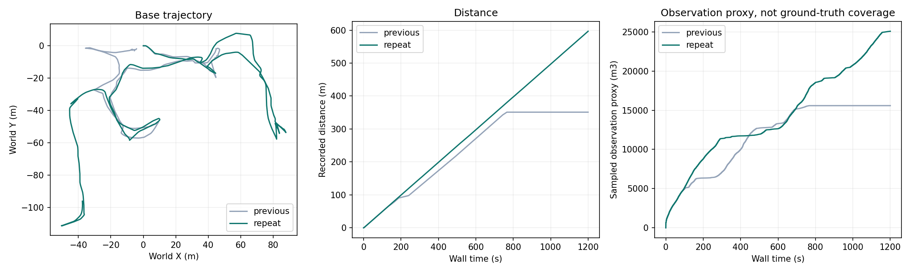
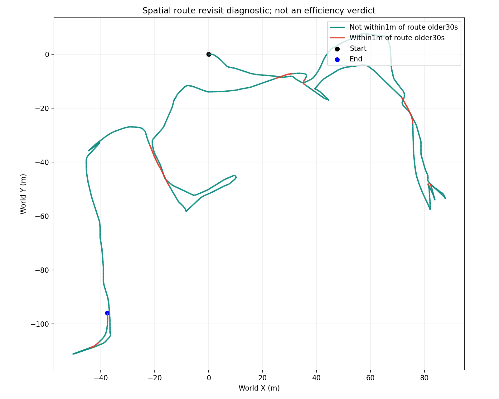
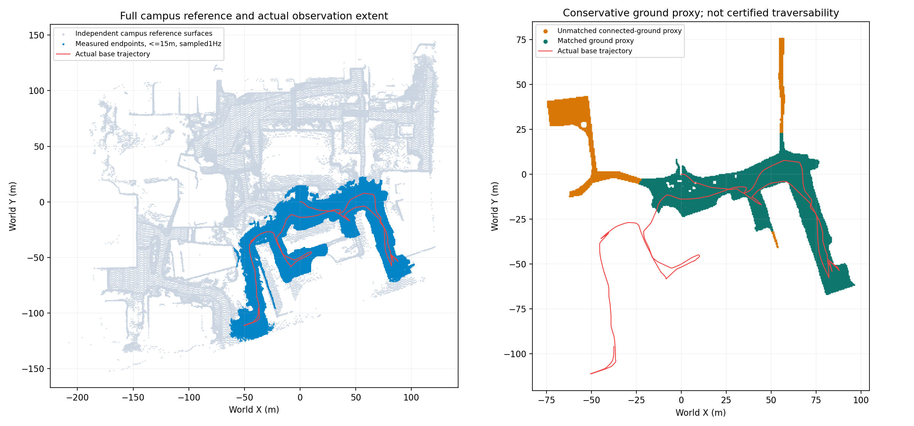

# 修复版campus 20分钟闭环（2026-11-18）

**完整采集1200.001秒墙钟，行驶596.607米，末30秒仍行驶14.920米，未复现长时间卡住。结束时finish=false、任务仍在探索，没有完成全campus或返航。** 本轮没有进入探索完成后的返航阶段，也没有触发恢复执行，不能用本轮持续运动替代对“完成后恢复”的在线验收。

## 本轮结果与旧20分钟记录

| 项目 | 最早20分钟 | 修复前复跑 | 本轮修复版 |
|---|---:|---:|---:|
| 累计里程m | 508.505 | 351.039 | 596.607 |
| 末30秒里程m | 0 | 0 | 14.920 |
| finish | true | true | false |
| 停车至结束 | 168.905秒 | 433.972秒 | 无≥10秒低平移区间 |
| 最终base距初始位置m | 40.458 | 4.624 | 103.082 |
| 采样HT图龄P95秒 | 0.660 | 0.596 | 0.571 |

最终base XY=(-37.551096,-95.999302)，最后采样指令线速度-0.5m/s、角速度约-0.000049rad/s，局部路径仍有效；采集预算到期后结束整套仿真。最终距起点103.082m是尚在探索的位置，不能称为“返航卡在103m”。低平移区间按实际base XY速度<0.02m/s且连续≥10秒统计，本轮为空；短暂拒绝/转向仍按原数据保留。

采集边界内最后全局诊断：`candidates=96 uncovered=15 frontier=132 global_return=0 local_complete=0 global_nodes=111 local_nodes=41 x=-37.512 y=-96.895`。软件仍有未完成任务。已剔除采集结束后清理阶段的日志，避免把后续几秒状态当成最后录包帧。

20分钟为墙钟；/clock实际推进446.400秒（约7分26秒），RTF=0.372032，不能称为20分钟仿真时间。无共同显式随机种子，路线从早期即不同；本轮未触发恢复行为，因此更多里程/观测不构成修复使探索效率提升的因果证据。

## 实际加载的修复版

导航代码5ba8bb5，启动资料基线6ea8d76f66f299f1c06dbf84c5330a4ebb837352。先核对旧305个冻结文件、候选源码/二进制SHA，最后source候选安装。输入就绪后读取本域两个进程/proc/exe，记录localPlanner和pathFollower实际路径及SHA，均为/home/lzz/ht_window_recovery_20261118/candidate/install中的修复版，详见ACTUAL_NAVIGATION.json/NAVIGATION_RUNTIME.json。运行前后317个冻结文件一致，归档逐条SHA核对通过。

域209、Gazebo11569、Xvfb:107；同campus、起点、Helios32标称配置、crop_box、URDF包络和0.65m explicit_labels_v1先验。五节点实际参数与修复前复跑逐字节相同；未改HT阈值、未知/障碍/TTL、历史600秒期限或TARE目标顺序。新增每60秒一次原始推理输入诊断，warmup=0，共21份，额外序列化I/O如实记录，不把它当成新观测。

本轮恢复正式采集窗口内只有4条启动IDLE诊断，计划0、完成0、部分前缀0；无finish_transition。RECOVERY_ANALYSIS.json的last_recovery是启动时旧诊断，不能解释为终点仍以启动目标运行。修复阶段原始终点冻结图的0.264m恢复证据仍见上一报告；本次没有遇到对应的在线触发条件，完整返航恢复仍待闭环验证。

## 回头路和观测收益

同一口径：base XY轨迹段中点距至少30秒以前轨迹采样点不超过指定半径，按距离加权。包括必要转场/返航/旧位置的新观察，不全等于无效绕行。

| 重复半径 | 修复前复跑 | 本轮 |
|---|---:|---:|
| 1m | 5.15% | 8.53% |
| 3m | 19.20% | 22.69% |
| 5m | 30.19% | 33.65% |

本轮base XY里程595.092m，3m口径重复135.045m（22.693%）；负线速度期间的base行程279.389m，不等于279m原路折返。表头累计里程596.607m沿用雷达采样轨迹口径，与base里程因雷达偏移和转向略有不同。

| 时段 | 雷达轨迹里程增量m | 采样观测体积代理增量m³ |
|---|---:|---:|
| 0—5分钟 | 148.967 | 11393.625 |
| 5—10分钟 | 148.663 | 1255.750 |
| 10—15分钟 | 149.314 | 6498.625 |
| 15—20分钟 | 149.663 | 5929.250 |

5—10分钟走了148.663m，代理观测量仅增加1255.75m³，存在低观测收益的旧区域回移，未隐藏为持续新增探索。该代理由每秒抽样射线并集估计，不是可通行地面或真实体积覆盖率。

## 整个campus对照

独立官方点云参考，0.5m体素、0.75m匹配容差；每秒至多一帧原始注册扫描、仅取距精确配对雷达位置≤15m的真实端点。完整参考表面匹配14.960%；保守连通地形估计匹配78.480%，2594个未匹配估计格距记录轨迹超过20m，仍有明显未观测区域。

完整模型包含屋顶/立面，地形估计也可能漏窄道或误判障碍。本轮轨迹还到达该连通估计边界之外，进一步说明代理不等于全部可达范围。不得把78.480%当作真实可达地面覆盖率，也不能把所有未匹配格都视为实际可达任务。全campus完整探索仍未验收。

## 审计与保存

- 655516条消息、33段MCAP的可用CRC和metadata计数核对通过；317条冻结归档SHA一致。
- 59955条非零放行命令独立原图审计：0越限、0未匹配；方向拒绝示例188条中187条匹配，1条未匹配，保留此限制。审计通过不证明模型地形真值正确。
- 扫描/HT观察频率约3.688/3.646Hz；采样HT图龄P95=0.571s，最大0.716s，无>1秒样本。正式窗口命令审计原因HT_ALLOWED=60000、HT_DIRECTION_LOW=27，与审计工具边界/总消息口径分开保留。
- 本轮未记录非法JSON或非有限航点，但未修复其上游源，不能据一次未出现宣称缺陷消失。SIGINT清理阶段子节点错误仍有，clean_child_exit=false；最终本轮相关进程无残留，详见原始日志/CLEANUP.json。

首末原始HT图、首末原始推理输入、实际参数、命令/恢复诊断和复现脚本已保存。完整录包/21份输入/冻结归档保留于`/home/lzz/ht_recovery_campus_1200s_20261118/runs/recovery_campus_1200s_01`，Windows精简D:/HT-Recovery-Campus-1200s-20261118/results。本轮一次启动成功，独立账本1/2后关闭；旧账本未重置，不自动再试第二轮。仅推送精简记录到fix/ht-execution-20261113，无新Release、原始MCAP/视频上传或实车部署。本轮没有制作新视频。
