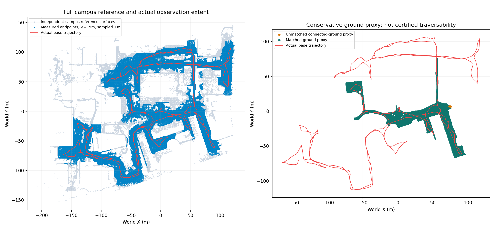
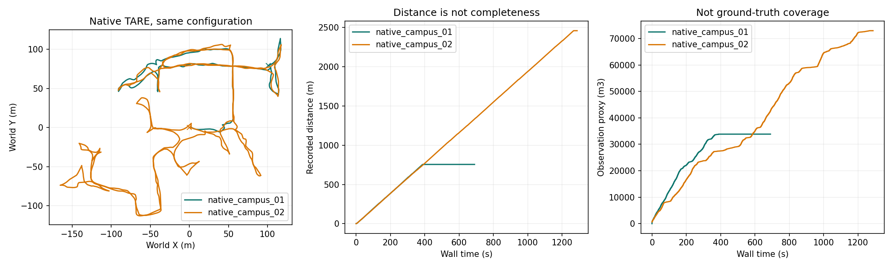

# 原生 TARE campus 任务实验（2026-11-18）

结论：原生 TARE 第二轮完成探索任务并成功返航，覆盖范围明显大于此前 HT 任务结束实验；同配置首轮却持续阻塞。因此支持保留原生方案作为基准，尚不能声称已经稳定完成整个 campus。

| 指标 | native_campus_01 | native_campus_02 |
|---|---:|---:|
| 终止结果 | PERSISTENT_BLOCKED，失败 | RETURNED_AND_STOPPED |
| 正式采集墙钟 | 690.294 s | 1287.970 s（21分28秒） |
| 实际累计里程 | 755.062 m | 2460.020 m |
| TARE finish | false | true，约1202.47 s（单调时钟采样） |
| 距起点 | 128.244 m | 0.04075 m |
| 末段稳定零命令停车 | 阻塞300秒 | 起点停车20.104秒，独立核验通过 |
| 地形连通代理观测匹配 | 4946/12523，39.495% | 12443/12523，99.361% |
| 代理中未匹配且距轨迹>20m的格子 | 4737 | 0 |
| 整体参考表面匹配 | 20.909% | 44.806% |
| 扫描墙钟接收频率 | 5.418 Hz | 5.281 Hz |
| 扫描龄P95 / 最大 | 0.180 / 0.210 s | 0.185 / 0.331 s |
| 仿真时间推进 / RTF | 594.7 s / 0.862 | 1081.5 s / 0.840 |

## 实际使用的系统

WSL Ubuntu-22.04 / ROS2 Humble / Gazebo headless，同一官方 campus 世界几何、同一起点。使用原生 TARE、CMU terrainAnalysis/terrainAnalysisExt、localPlanner、pathFollower、vehicleSimulator 和传感器扫描链。没有启动 CuPy 高程图、HT 推理、HT 门禁或 HT 恢复适配器。

TARE 源码固定 [b6760adb](https://github.com/caochao39/tare_planner/tree/b6760adb4280b379567c76f4e684ce628e28ef71)，CMU AEDE 固定 [158e67b](https://github.com/caochao39/autonomous_exploration_development_environment/tree/158e67b31b644ed1e8b06eb1d7f70e183cc62591)。通过 GitHub 固定树 blob SHA 核对：独立副本2401个 TARE 包文件还原为上游，66个 CMU 文件一致；随后仅补一行 ROS2 `kUseFrontier` 参数声明，使原有 campus YAML 的参数可绑定。补丁见 `setup/frontier_ros2_parameter.patch`。独立 Release 重编译6个包，共用源码/旧HT安装未覆盖。

原生配置：VLP16，16线，仿真6.3 Hz，350水平采样；车体0.6×0.6m，传感高度0.75m，XY传感器偏移0，maxSpeed/autonomySpeed为2.0m/s。官方 campus.yaml 除输入就绪前关闭自动开始外保留；观察器在扫描就绪后只发一次开始信号。必要基础设施变化为 headless、实体启动延迟、移除不可用的旧 Gazebo 接口插件，世界几何变换保持(0,0,1,0,0,0)。

两轮分别隔离 ROS域205/203、Gazebo端口11589/11599、显示109/110；复跑共用同一个已编译安装。四个实际 `/proc/exe` 及 SHA 均独立核对相同，详见各轮 ACTUAL_NAVIGATION.json。首轮后处理完成后才启动第二轮，避免重I/O与正式实验重叠。

## 完成与阻塞的证据

第二轮在约1202.47秒观察到finish，1267.36秒最后一个非零命令采样，1267.866秒起停车。终点base(-0.016697,0.037167)，距起点4.075厘米。最后20.104秒位移0、命令0、finish=true、输入新鲜；RETURN_VERIFICATION.json 独立从CSV核验通过。全程唯一≥10秒低平移区间就是最终停车，无其他持续停车。finish事件的ROS接收时间相对START.clock为1202.052秒，和单调时钟采样有约0.42秒窗口差，未混作两次完成。

第一轮390.713秒最后非零命令，之后同一区域无位移、无新增观测，扫描和里程计仍新鲜；保持300秒后按既定规则记阻塞失败。终点base(100.857704,79.210541)，仍有有限目标(108.100827,82.607183,-18.684202)，原生局部路径只包含原点，输出零命令，finish=false。可以确定停车链路是原生局部规划没有可执行路径，不能归因于HT，也尚未重建到具体哪项地形/碰撞候选导致拒绝。terminal_inputs保留末帧地形图、扫描、位姿、航点和路径原始CDR/NPZ，供下一步离线重建。两轮记录的航点均未检出非有限数。

不设20分钟强制截断。成功要求finish+距起点≤0.5m+零命令/位移≤0.05m/新鲜输入持续20秒；同阶段、同0.15m区域300秒且观测代理增量≤50m³则阻塞失败。正常采集结束不等于任务成功。原定第二启动名额曾仅供基础设施重试，首轮失败后在总上限仍为2的情况下明确改为同配置重复验证；未调导航参数，失败未删除。预算2/2已关闭，不自动第三轮。

## 覆盖与回头路

按同一独立官方campus预览点云、0.5m格、0.75m最近观测容差，对扫描与精确配对传感器位姿核验。最多每秒抽一帧、使用15m内实测端点。第二轮地形连通代理仅余80格未匹配，且全部距轨迹≤20m；此前HT任务结束实验为78.639%、2572个未匹配格距轨迹>20m。第二轮确实覆盖了更广的道路范围。

**99.361%是起点连通地形代理子集的观测匹配率，不是整个campus可达地面真值覆盖率。** 该代理仅12523格，图中许多实际走过区域也不在代理里；不能据此宣称全campus100%完成。整体表面44.806%的分母包含建筑、远处表面等，不代表余下55.194%均为应探索且可达的地面。本轮通过软件任务/返航验收，严格的全场景可达区域覆盖验收仍缺真值。

第二轮距至少30秒前轨迹1/3/5m内的距离加权重复比例分别16.893%/30.334%/36.782%。包含必要转场、从旧位置观察新区域和返航，不能全部判无效。负速度表示原生双向行驶，也不等于回头路。BACKTRACKING.json和分段CSV保留口径及明细。

## 比较边界与采集缺陷

此前HT版本使用Scout/Helios、约0.93×0.70m车体与0.5m/s上限，本轮原生方案同时改变车辆、雷达、速度、地形与执行链；**不是只关闭HT的单变量消融**。不能把全部改善归因于移除HT，也不能把首轮失败推广为TARE普遍失败。没有建立共同显式随机种子，两轮路线从起步就不同；一次成功、一次失败不足以证明稳定性。

四份实际二进制相同；6个成功导出的实际参数文件在归一化隔离路径后相同。但第二轮vehicleSimulator参数服务查询返回`Node not found`，其原始失败文件保留，不能声称7个节点实际参数全部核验通过。启动NODES快照也漏列TARE/vehicleSimulator；独立/proc执行路径验证确认两者实际运行，冻结启动脚本/源码/URDF和二进制证明配置来源，没有用事后重启伪造参数导出。CONFIGURATION_VERIFICATION.json列出逐项结果。

首轮原生离散速度积分出现最大采样2.025m/s，配置上限2.0m/s；次轮最大2.000m/s，未做HT门禁审计（本轮无HT图/门禁）。终止SIGINT后仍有ROS子节点RCLError等退出错误：首轮9条、次轮8条，原日志保留；正式运行期间无进程提前死亡，最终相关进程无残留。

## 数据与复现

首轮14段MCAP/351134消息/6,805,088,146字节；第二轮35段/650627消息/17,062,432,280字节。全部可用CRC、metadata消息数及原始SHA核对通过；两轮各128个冻结文件及归档核对通过。RECORDING_VALIDATION.json列出每段大小/SHA，CLEANUP.json保留退出缺陷，PHASES.json按300秒列出里程/观测增量。

本目录上传源码子集、固定上游树/校验、兼容补丁、实际参数、CSV、日志、终点原始输入、图表、清单和复现脚本。`reproduce/native_source`不含巨型mesh、路径表、OR-Tools库，不能单靠本精简目录立即启动；完整构建与冻结在WSL保留。源码/启动/采集脚本都没有修改现有HT生产代码。

完整原始数据仍在：

- `/home/lzz/tare_native_campus_20261118/runs/native_campus_01`
- `/home/lzz/tare_native_campus_repeat_20261118/runs/native_campus_02`
- Windows精简副本：`D:/TARE-Native-Campus-20261118/results`

沿用fix/ht-execution-20261113分支推送精简资料；不新建Release、不上传原始MCAP/视频、不清理历史数据。原始录包尚非完整远端备份。

下一步应先离线重建首轮末帧的原生局部规划拒绝条件，解释为何同一配置仍会卡住；若要把TARE接回当前Scout/Helios系统作公平对照，再保持车辆/传感器/速度一致另做有边界的实验。本批未修改这些算法，也未启动第三轮。
