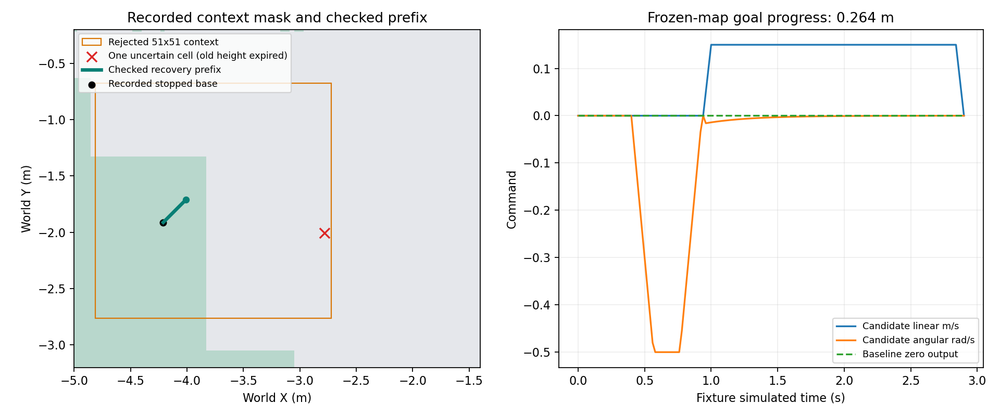

# HT窗口边界与返航恢复修复（2026-11-18）

已修复两个执行层问题：探索完成信号禁用了未完成的返航恢复；旧恢复搜索坚持至少0.75m目标进展，丢弃了较短但能够安全执行的前缀。原始20分钟终点地图上的冻结对照，旧版保持零输出，新版完成一个恢复前缀，净目标进展0.264029m、净位移0.285000m；所有非零命令通过原门禁。**这是停车现场的离线执行验证，不是新的20分钟探索、完整返航或实车验收。**

## 原图窗口和历史格证据

重建原记录ht_map_last.npz的4个内侧51×51窗口，全部与记录的ht_valid一致。起始base格上下文有效；朝目标0.5/0.75/1m的查询窗口近已知支撑比例均为100%，但含同一个不确定格[88,126]，世界位置(-2.783626,-2.005848)，触发uncertain窗口否决。它不是“整个窗口90%支撑不足”。

结束时历史归档保留该格高程-0.250265m，最后接受时间1794988005.662311；相对最后记录图已老化1194.568995秒，超过历史600秒期限，无更新的接受模式或拒绝高度。源码将已过期的留存高度视为未知，不能由附近的近邻填充重新变成真实可通过地面。该格的未知状态又否决了周围约2.09m的神经窗口。已确认本次终点这个格的过期证据，未重建每一帧原始源图和方差；不能将它套到所有历史停车事件。

tools/cmu_minimal/analyze_context_window.py从已记录的measured/physical/obstacle掩码重建该判据，只适用于ht_qualify_evidence=false的完整内侧窗口。靠近边缘、缺少原输入外25格时会报错，不猜测外部数据。JSON及原始图索引见CONTEXT_WINDOWS.json、上一轮data/MAP_SNAPSHOTS.json。

## 修改行为

- ht_recovery.hpp不再把exploration_finish当作禁用条件。只要仍有未到达的有效目标，原生输出持续零/拒绝0.4秒，恢复就能尝试；暂停、零速度上限、里程计时效及HT门禁继续检查。到达保留目标后报告RETURN_GOAL_REACHED，不重新启动恢复；未修改TARE目标和完成消息。
- 搜索优先原进展目标。受窗口边界/计算预算限制而无法找到原前缀时，允许已有搜索树中至少0.25m净目标进展的前缀；近目标时不低于原请求进展。先试最佳进展节点，若其轨迹或控制器仿真不通过，再试第一个合格前缀。纯转向、退离目标、任意微小进展不能以此接管。每个结果仍完整检查路径、车体扫掠、HT分数/上下文/未知/障碍、制动包络和控制器仿真，在线每条输出再检查。不是把坏HT格改成好格。
- 诊断新增探索阶段、目标距离、完整/部分进展、搜索节点数/退出原因、各拒绝原因的首个失败位置及计数。Gate只增加最后查询位置记录，判定逻辑不变；HT桥、阈值、600秒历史期限、起点标签策略和全局TARE未改。

## 验证与构建

Humble独立Release构建成功，4组CTest全部通过（ht_gate/ht_execution/ht_urdf_box/ht_recovery_return）。新增回归用真实ROS /exploration_finish订阅触发phase标志，检查允许零命令时仍能恢复、目标到达不重启、短窗口前缀、微小进展拒绝、上下文/缺测/障碍/低分/地图过期/里程计过期拒绝、暂停及零速度上限。已有执行/URDF包络回归继续通过。

| 冻结终点图对照 | 旧版 | 修复版 |
|---|---:|---:|
| exploration_finish | true | true |
| 接管并完成一个恢复前缀 | 否 | 是 |
| 非零控制tick数 | 0 | 123 |
| 净目标进展m | 0 | 0.264029 |
| 净位移m | 0 | 0.285000 |
| 恢复执行失效次数 | 0 | 0 |

两组原始CDR输入完全相同（fixture/FIXTURE摘要见FIXTURE.json）；URDF约0.930×0.700m、支撑半径0.581822302m、分数门限0.5、图龄期限1秒、0.1秒反应和原制动加速度一致。固定查询图龄0.4秒用于隔离静态地图执行，200Hz车体积分；**没有把这个冻结时钟用到真实导航，也没有续写旧图时间戳。** 新版在冻结时钟内约2.900秒完成这个前缀。搜索扩展预算仍20ms，记录约21ms包含额外路径和控制器校验，不是整个回调严格20ms保证。

旧版另做过诊断：临时将搜索上限放宽至2000ms仍无原0.75m结果；临时改进展目标为0.25m且关闭完成禁用则能执行约0.264m。它们仅用于区分失效链，不是保留配置。修复版保持20ms、原0.75m优先目标及finish=true；以受检短前缀解决两条件共同造成的零输出。日志原样保留，VALIDATION.json列明口径。

独立源码、两个导航可执行文件的SHA及下一轮环境顺序见RUNTIME.json。源码保留实际编译字节哈希，并另列Git规范化CRLF→LF后的哈希，区分换行转换与代码变化。已编译安装在/home/lzz/ht_window_recovery_20261118/candidate/install；原实验安装和旧录包没有被覆盖。下一次使用时必须最后source该候选安装，不能继续误用ht_initial_labels_20261116的旧二进制。精简证据Windows副本D:/HT-Window-Recovery-20261118/results。

## 尚未验收的部分

前缀完成不等于整条返航完成。冻结地图不会产生新观测；前缀后的扫描能否补齐过期格、能否持续绕过所有HT缺口，需要新的闭环测试。没有以局部恢复成功宣称全campus覆盖通过，也没有修改全局完成判据。旧实验的非有限航点、非法JSON源以及SIGINT子进程退出问题仍未在本次修复范围内解决。

原始数据和所有旧账本继续保留。本轮没有新正式Gazebo仿真、没有重置旧20分钟账本、没有Release或实车部署。源码及精简报告推送原fix/ht-execution-20261113分支。
